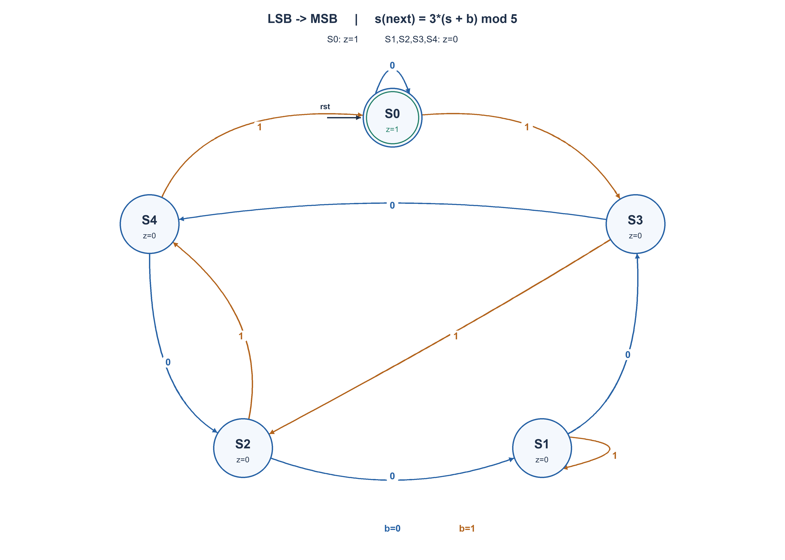

# PREP-050 — מכונת מצבים לבדיקת חלוקה ב־5 — ביטים מהפחות משמעותי תחילה

## מקור ומצב ביקורת

[צילום המקור](../sources/prep-050.png)

נוסח המקור נשמר בנפרד מהעריכה. פתרון מוצע בסיוע AI; אישור מקצועי, בדיקת שקילות שפות ובדיקת זכויות שימוש ממתינים. אין אישור הערכה ואין נתוני למידה אישיים.

```text
ממש מכונת מצבים שמחזירה 1 במידה והמספר מתחלק ב5 ללא שארית. ספרות מגיעות מהLSB
```

חברות מדווחות במקור: NVIDIA, Apple. השיוך אינו אימות עצמאי.

תגיות המקור: hardware, nvidia, apple.

## נוסח עברי

תכננו מכונת מצבים סינכרונית המקבלת מספר בינארי ללא סימן, ביט אחר ביט, החל מהביט הפחות משמעותי. המוצא יהיה 1 אם ורק אם ערך המספר שהתקבל עד כה מתחלק ב־5 ללא שארית. הציגו מצבים, טבלת מעברים, תרשים והסבר נכונות.

הבהרות שנוספו למקור: כל חזית עולה עם bit_valid=1 מקבלת ביט אחד. bit_valid=0 שומר את המצב. איפוס סינכרוני פעיל בגבוה מתחיל מילה חדשה וגובר על קליטת ביט; הוא אינו ביט נתונים. כל מילה מתחילה לאחר איפוס, ואות חיצוני מציין מתי הסתיימה. לאחר חזית שקלטה את הביט האחרון קוראים את המוצא המעודכן. אפסים מותרים בכל מקום; 0 מתחלק ב־5. לפני קליטת ביט נגדיר את הערך המתמטי כאפס, ולכן המוצא לאחר איפוס הוא 1; אם ממשק דורש מילה לא ריקה, עליו לסמן תקפות בנפרד. אין אורך מספר מרבי ואין צורך לשמור את המספר כולו.

### שלושה רמזים

1. כאן הביט החדש מקבל משקל גדול יותר מהקודמים. האם הנוסחה הרגילה להכנסת ביט מימין עדיין מתאימה?
2. פתרון ישיר שומר שארית וגם את המשקל הבא מודולו 5. המשקל עובר במחזור 1,2,4,3. האם אפשר לנרמל את השארית כדי להסיר את מונה המיקום?
3. המספר 3 הוא ההופכי של 2 מודולו 5. נסו להגדיר מצב ששווה לערך שנקלט כפול ההופכי של משקל הביט הבא. לאחר הוספת הביט החדש מחלקים את המצב המנורמל ב־2 מודולו 5.

## הצעה לפתרון

### מתחילים מפתרון ישיר שקל להבין

הביט הראשון שווה 1 אם הוא דלוק, הבא שווה 2, אחריו 4 וכן הלאה. לכן הפתרון הרגיל של הכפלת השארית ב־2 והוספת הביט מתאים לסדר ההפוך, ולא ניתן להשתמש בו כאן בלי שינוי.

אפשר לשמור שני דברים: שארית המספר r, ומשקל הביט הבא w, שניהם מודולו 5:

```text
r_next = (r + b*w) mod 5
w_next = 2*w mod 5
reset: r=0, w=1
z = (r == 0)
```

המשקל עובר 1,2,4,3 וחוזר ל־1. זה פתרון תקף של עד 20 צמדי מצבים, והוא מתקבל גם אם מעדיפים אינטואיציה על צמצום. אין לשמור רק r ולהתעלם מ־w.

### מצמצמים לחמישה מצבים

במקום לשמור את השארית והמשקל בנפרד, נמדוד את השארית ביחידות של המשקל הבא. אחרי k ביטים התקבל המספר N_k. נגדיר:

```text
s_k = N_k * inverse(2^k) mod 5
```

ההופכי קיים, משום ש־2 ו־5 זרים. בפרט, 2*3 שווה 1 מודולו 5, ולכן חלוקה ב־2 במודל הזה היא הכפלה ב־3. חשוב: שמות המצבים S0 עד S4 מציינים שארית מנורמלת, ולא את השארית הרגילה של המספר.

הביט החדש b מוסיף b*2^k למספר. לאחר קליטתו יש לחלק ביחידות של 2^(k+1), ולכן:

```text
s_next = 3*(s + b) mod 5
z = (s == 0)
```

כפל במספר הפיך אינו משנה אם השארית היא אפס, ולכן z בודק בדיוק חלוקה ב־5. לא צריך מונה מיקום!

### טבלת המעברים והפלט

| מצב נוכחי | ביט 0 | ביט 1 | מוצא z |
| --- | --- | --- | --- |
| S0 | S0 | S3 | 1 |
| S1 | S3 | S1 | 0 |
| S2 | S1 | S4 | 0 |
| S3 | S4 | S2 | 0 |
| S4 | S2 | S0 | 0 |

בתרשים כל חץ מסומן בביט הנכנס; המעברים מתבצעים רק כשאות התקפות פעיל. העיגול הכפול S0 הוא המצב היחיד שבו הפלט 1. איפוס מכל מצב חוזר ל־S0; מחזור ללא ביט תקף נשאר באותו מצב, גם אם החצים האלה לא צוירו בכל עיגול. נדרשים שלושה דלגלגים בקידוד בינארי לחמשת המצבים.

### דוגמה: המספר 25

```text
bit order:    1, 0, 0, 1, 1
value:        1, 1, 1, 9, 25
state:       S3,S4,S2,S4,S0
z:            0, 0, 0, 0, 1
```

אותה רשימת ביטים אם קוראים אותה בטעות מהמשמעותי תחילה מייצגת 19, שאינו מתחלק ב־5. זו דוגמה שמבחינה בין כיווני הקליטה.

### נכונות ומספר מצבים

באיפוס N=0 וגם s=0. אם האינווריאנט של השארית המנורמלת נכון לפני חזית, הנוסחה לעיל משמרת אותו אחרי הוספת הביט; לכן הוא נכון באינדוקציה לכל אורך מילה. z=1 בדיוק כאשר N מתחלק ב־5.

חמישה מצבים הם גם מינימום במודל שמקבל מילים סופיות בכל אורך וצריך להבחין בחלוקה ב־5: כל חמשת המצבים נגישים. לכל שני מצבים שונים s,t, נבחר המשך של שלושה ביטים המייצג v=(-s) mod 5. הערך v הוא בין 0 ל־4 ולכן נכנס בשלושה ביטים. אחרי המשך זה המצב הראשון מתאפס והשני לא, ולכן שני המצבים מובחנים ואסור לאחדם. זה מינימום מצבים לוגיים, לא מינימום שערים, שטח או השהיה.

הקוד מממש את הטבלה במפורש ללא צורך במחלק חומרתי. בדיקות פייתון כיסו כל 131,071 המילים באורכים 0–16, עם 1,966,082 בדיקות קידומת, וכל 16,384 עקבות בקרה באורך 7. צורף קוד חומרה אך הוא לא קומפל או הורץ בסימולטור HDL. פתרון מוצע בסיוע AI; סקירה מקצועית עצמאית ממתינה.



## English question

Design a synchronous FSM receiving an unsigned binary number serially, least-significant bit first. Its output must be 1 exactly when the value received so far is divisible by five. Give states, a transition table, a diagram and a correctness argument.

Clarifications added to the terse source: each rising edge with bit_valid=1 accepts one bit; bit_valid=0 holds state. A synchronous active-high reset begins a new word and overrides bit acceptance; reset is not data. Reset separates words, and an external signal identifies word completion. Read the updated output after the edge accepting the final bit. Zeros are allowed anywhere; zero is divisible by five. Before any bit, the mathematical empty value is defined as zero, so the reset output is 1. An interface requiring a nonempty word must qualify validity separately. Word length is unbounded; do not store the entire number.

### Three hints

1. The new bit has a higher weight than earlier bits. Does the ordinary append-on-the-right recurrence apply?
2. A direct design tracks both the residue and next positional weight modulo five. Weights cycle 1,2,4,3. Could normalizing the residue remove the position counter?
3. Three is the inverse of two modulo five. Define state as the received value times the inverse of the next bit weight. After adding a bit, divide that normalized value by two modulo five.

## Proposed solution

### Start with an intuitive direct solution

The first bit has weight one, then two, four, and so on. The usual double-the-remainder-and-add-the-bit recurrence assumes the opposite bit order and cannot be reused unchanged.

A valid direct design tracks numeric residue r and next positional weight w, both modulo five:

```text
r_next = (r + b*w) mod 5
w_next = 2*w mod 5
reset: r=0, w=1
z = (r == 0)
```

Weights cycle 1,2,4,3. This yields up to twenty residue/weight pairs and is a valid alternative when clarity is preferred over state reduction. Retaining r while dropping w is incorrect.

### Reduce to five states

Instead of tracking residue and weight separately, measure the residue in units of the next bit weight. After k bits, let N_k be the received integer and define:

```text
s_k = N_k * inverse(2^k) mod 5
```

The inverse exists because two and five are coprime. In particular, 2*3 is one modulo five, so division by two means multiplication by three. State labels S0 through S4 denote normalized residues, NOT the ordinary numeric remainder.

A new bit b adds b*2^k to the value. The new normalization divides by 2^(k+1), giving:

```text
s_next = 3*(s + b) mod 5
z = (s == 0)
```

Multiplication by an invertible residue preserves whether the result is zero. Thus z detects divisibility by five without any position counter.

### Transitions and output

| Current state | Input 0 | Input 1 | Output z |
| --- | --- | --- | --- |
| S0 | S0 | S3 | 1 |
| S1 | S3 | S1 | 0 |
| S2 | S1 | S4 | 0 |
| S3 | S4 | S2 | 0 |
| S4 | S2 | S0 | 0 |

Each diagram edge is labelled with the incoming bit; edges are taken only when bit_valid is asserted. Double-circle S0 is the sole output-one state. Reset from any state returns to S0; invalid cycles self-loop even though those control edges are not repeated on every circle. Binary encoding needs three flip-flops for the five states.

### Example: twenty-five

```text
bit order:    1, 0, 0, 1, 1
value:        1, 1, 1, 9, 25
state:       S3,S4,S2,S4,S0
z:            0, 0, 0, 0, 1
```

Reading that sequence in the wrong, MSB-first direction instead gives nineteen, which is not divisible by five. This distinguishes the two serial conventions.

### Correctness and state count

Reset establishes N=0 and s=0. Substituting N_next=N+b*2^k into the normalized-state definition gives the transition equation, preserving the invariant by induction. Its zero condition is exactly numeric divisibility.

Five states are also necessary for arbitrary-length finite words under this model. All five are reachable. For distinct normalized states s,t, append three LSB-first bits representing v=(-s) mod 5. This value lies between zero and four and fits in three bits. The first resulting state is zero and the second is not, so every pair is distinguishable and cannot be merged. This is a logical-state lower bound, not a physical gate, area or delay minimum.

The supplied hardware code explicitly implements the transition table, requiring no hardware divider. Python checks cover all 131,071 words of lengths zero through sixteen, with 1,966,082 prefix checks, plus all 16,384 length-seven control traces. The SystemVerilog is supplied but not compiled or HDL-simulated. AI-assisted proposed solution; independent expert review pending.


## חומר משלים בשתי השפות / Bilingual technical material

### assumptions

```json
{
  "he": [
    "הקלט הוא מספר בינארי ללא סימן, מהביט הפחות משמעותי תחילה, באורך לא מוגבל.",
    "כל חזית עולה עם bit_valid=1 מקבלת ביט אחד; מחזור לא תקף שומר מצב. איפוס סינכרוני פעיל בגבוה גובר על תקפות ומפריד בין מילים.",
    "אפס מתחלק ב־5. המילה הריקה מוגדרת מתמטית כאפס ולכן הפלט לאחר איפוס הוא 1; תקפות של מילה לא ריקה היא אות ממשק נפרד.",
    "קוראים את הפלט המעודכן אחרי חזית הביט האחרון. אות סוף מילה מגיע מבחוץ ואינו משנה את חישוב השארית."
  ],
  "en": [
    "Unsigned binary input, least-significant bit first, without a fixed maximum word length.",
    "A rising edge with bit_valid accepts one bit; invalid cycles hold. Synchronous active-high reset overrides validity and separates words.",
    "Zero is divisible by five. Empty input mathematically denotes zero, so reset output is one; nonempty-word validity is a separate interface signal.",
    "Read the updated output after the last accepted edge. An external end-of-word indication does not alter the residue computation."
  ]
}
```

### optimality

```json
{
  "he": {
    "criterion": "מספר מצבים לוגיים לזיהוי חלוקה ב־5 בכל אורך מילה בסדר קליטה זה.",
    "result": "חמישה מצבים מספיקים ונחוצים; שלושה דלגלגים בקידוד בינארי. פתרון ישיר של שארית ומשקל עם עד 20 מצבים תקף גם הוא.",
    "proof": "השארית המנורמלת מתעדכנת לפי s_next=3(s+b) mod5. כל המצבים נגישים וכל זוג מובחן בעזרת המשך בן שלושה ביטים שערכו (-s) mod5.",
    "scope": "אין טענה למינימום שערים, שטח, השהיה או מספר מצבים כשמוסיפים למפרט דגל פנימי של מילה לא ריקה."
  },
  "en": {
    "criterion": "Logical state count for arbitrary-length divisibility-by-five recognition in this bit order.",
    "result": "Five states are necessary and sufficient; three binary-encoded flip-flops. A direct residue/weight design with up to twenty states is also valid.",
    "proof": "Normalized residue updates as s_next=3(s+b) mod5. All states are reachable and each pair is distinguished by a three-bit suffix valued (-s) mod5.",
    "scope": "No minimum physical gates, area or delay claim, nor a state-count claim for a different specification requiring an internal nonempty-word flag."
  }
}
```

### verification

```json
{
  "he": "עברו כל 131,071 המילים באורכים 0–16, עם 1,966,082 בדיקות קידומת מול סכום מספרי מדויק והאינווריאנט המנורמל. עברו כל 16,384 עקבות הבקרה באורך 7, עם 114,688 חזיתות, עשרת מעברי מצב/ביט, נגישות חמשת המצבים והבחנה בכל עשרת זוגות המצבים. אלו בדיקות מודל פייתון; קוד HDL לא קומפל או הורץ, ולא בוצעו סינתזה או מדידות חומרה.",
  "en": "All 131,071 words of lengths zero through sixteen passed, with 1,966,082 prefix checks against exact integer accumulation and the normalized invariant. All 16,384 length-seven control traces passed across 114,688 edges, plus all ten state/input transitions, five-state reachability and all ten state-pair distinctions. Python models only; HDL not compiled or simulated, no synthesis or physical measurements."
}
```

### edge_cases

```json
{
  "he": [
    "המילה הריקה, ביט אפס יחיד וכל רצף אפסים מפיקים 1 לפי ההגדרה המתמטית.",
    "הוספת אפסים בקצה המשמעותי אחרי קליטת המספר אינה משנה את הערך; מצב מנורמל לא אפס עשוי בכל זאת להשתנות.",
    "איפוס ותקפות יחד מאפסים ואינם קולטים ביט באותה חזית.",
    "אין לקשר מילים עצמאיות בלי לאפס ביניהן; 25 בסדר 1,0,0,1,1 מבדיל מסדר MSB.",
    "קודי מצב בינאריים 5–7 אינם מצבי המכונה; ענף ברירת המחדל בקוד הוא התאוששות הגנתית, לא מודל לתקלת חומרה."
  ],
  "en": [
    "Empty input, a single zero and all-zero streams output one under the mathematical convention.",
    "Appending high-order zeros preserves the integer, although a nonzero normalized state can still change.",
    "Reset and validity together reset without accepting a bit at that edge.",
    "Independent words require reset between them; twenty-five in order 1,0,0,1,1 distinguishes MSB from LSB reception.",
    "Binary codes five through seven are outside the FSM; default recovery is defensive code, not a hardware fault model."
  ]
}
```

### common_mistakes

```json
{
  "he": [
    "להשתמש בעדכון 2*r+b של קליטה מהביט המשמעותי תחילה.",
    "לכנות את s השארית הרגילה; למשל אחרי ביט 1 ראשון המצב S3, אבל השארית המספרית היא 1.",
    "לשמור שארית בלבד בעדכון r+b בלי משקל מיקום.",
    "לאפס את המכונה בכל ביט או לקרוא פלט לפני חזית הקליטה האחרונה.",
    "להכריז שאפס אינו מתחלק ב־5 או שמוצא החלוקה לבדו מציין מילה תקפה ולא ריקה."
  ],
  "en": [
    "Using the MSB-first update 2*r+b unchanged.",
    "Calling s the ordinary remainder: after first bit one, state is S3 while the numeric remainder is one.",
    "Updating r+b without retaining the positional weight or normalizing.",
    "Resetting before every bit or sampling output before the last acceptance edge.",
    "Treating zero as nondivisible or interpreting divisibility alone as nonempty-word validity."
  ]
}
```

### interview_answer

```json
{
  "he": "אשמור מצב מנורמל: אחרי k ביטים s=N*2^(-k) מודולו 5. כיוון שההופכי של 2 הוא 3, כל ביט b מעדכן s ל־3(s+b) מודולו 5. הפלט 1 רק במצב אפס. כך מספיקים חמישה מצבים בלי מונה מיקום, עם איפוס בין מילים וקליטה מהביט הפחות משמעותי.",
  "en": "Store normalized state s=N*2^(-k) modulo five after k bits. Since the inverse of two is three, input b updates s to 3(s+b) modulo five. Output one only in state zero. This needs five states and no position counter, with reset between LSB-first words."
}
```

### solution_extensions

```json
{
  "he": {
    "question": "איך תתכננו פתרון ישיר ללא שימוש בהופכי מודולרי, ומה משתנה במחלק זוגי כמו 6?",
    "direction": "שומרים שארית r ואת משקל הביט הבא w, ומעדכנים r+b*w ו־2*w מודולו המחלק. זה תקף גם ל־6, אך 2 אינו הפיך מודולו 6 ולכן אסור להעתיק את נוסחת הנרמול. נתחו נגישות וצמצום מחדש.",
    "status": "שאלת המשך מוכנה בתוכן; אינה מחוברת לתור ההמשך החי."
  },
  "en": {
    "question": "How can you solve this without modular inverses, and what changes for an even divisor such as six?",
    "direction": "Track residue r and next weight w, updating r+b*w and 2*w modulo the divisor. This works for six too, but two is not invertible modulo six, so the normalized recurrence cannot be copied. Reanalyse reachable states and minimization.",
    "status": "Follow-up prepared in content; not connected to the live follow-up queue."
  }
}
```

## קוד ובדיקות / Code and verification

- [solutions/prep_050_lsb_divisible_by_five.py](../solutions/prep_050_lsb_divisible_by_five.py)
- [solutions/prep_050_lsb_divisible_by_five.sv](../solutions/prep_050_lsb_divisible_by_five.sv)
- [בדיקת מודל / Python-model check](../checks/check_prep_050.py)
- [תוצאות / Evidence](../checks/prep-050-verification.json)

Python-model verification is separate from HDL compilation/simulation, synthesis, physical hardware, professional review and live-site clicking. Follow-up content is prepared but not connected to the interactive queue.
