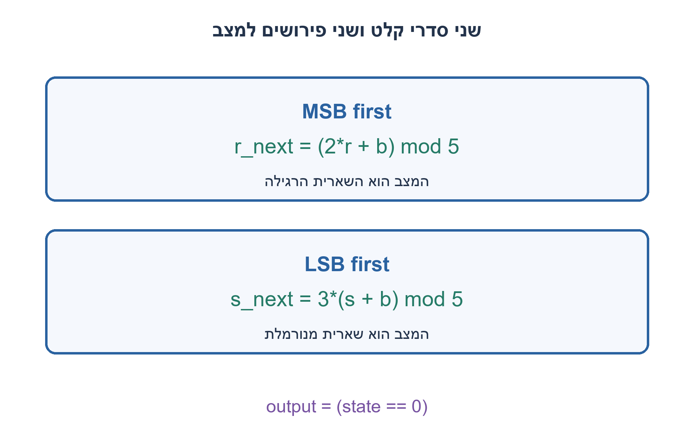
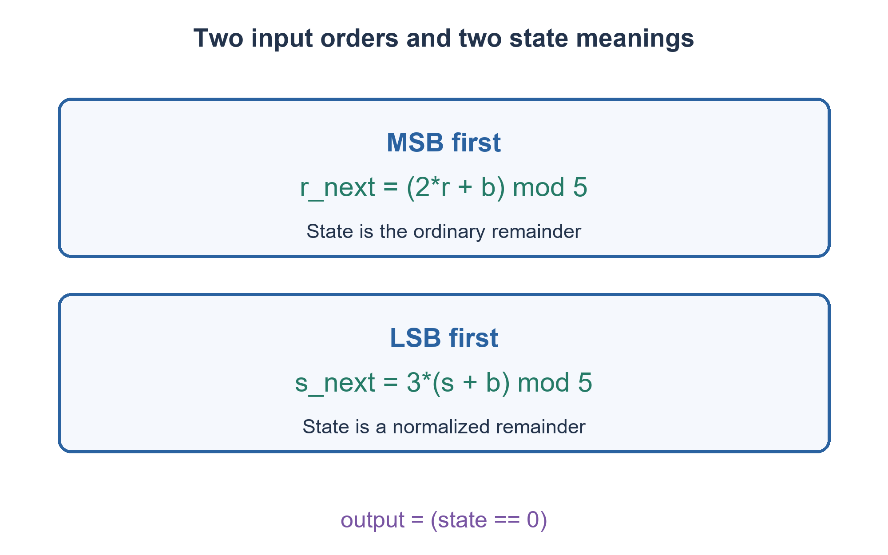

# PREP-050 — מכונת מצבים לבדיקת חלוקה ב־5 — ביטים מהפחות משמעותי תחילה

פתרון מוצע בסיוע AI; ביקורת מקצועית אנושית ממתינה. הקושי אינו מכויל.

[צילום מקור פרטי](../sources/2026-11-07-batch10-07.png)

ממש מכונת מצבים שמוציאה 1 כל פעם שהמספר מתחלק ב-5, פעם כאשר נכנס ביט מה-LSB ואחרת מה-MSB.

חברות לפי הדיווח בצילום בלבד: NVIDIA.

## עברית

### הרחבה: חלוקה בחמש בשני סדרי הגעה
הציגו גם מכונת מצבים כאשר הסיביות מגיעות מן ה־MSB, והשוו למכונת ה־LSB שלעיל. בכל ביט תקף יש לקבוע אם הקידומת שהתקבלה מתחלקת בחמש.

השלמות נשמרות: שעון יחיד, איפוס סינכרוני בתחילת מילה ו־bit_valid להשהיות. בהתאם לחוזה המקורי של השאלה, המילה הריקה מייצגת אפס ולכן אחרי איפוס היציאה 1. אם מעוניינים לפסול ריקות מוסיפים דגל seen בנפרד. אין להחליף בין ״סיבית נכנסת למקום ה־LSB״ לבין ״הסיבית הפחות משמעותית מגיעה ראשונה״.

1. בסדר MSB-first, הוספת ביט מימין מכפילה את המספר הישן בשתיים ואז מוסיפה את הביט.
2. האם שארית מודולו5 מספיקה כדי לעדכן את עצמה, בלי לזכור את כל המספר?
3. ל־MSB שמרו r ועדכנו (2r+b)%5. ל־LSB ניתן לשמור שארית מנורמלת s ולעדכן 3(s+b)%5, כי3 הוא ההופכי של2 מודולו5.

### אותה בדיקת אפס, משמעות מצב שונה
ב־MSB-first נסמן ב־N את הקידומת שכבר נקראה. הוספת b נותנת `Nnext=2N+b`, ולכן מספיק לשמור `r=N mod5`. המעבר הוא `rnext=(2r+b)%5`. יש חמישה מצבים r0..r4, אתחול r0, והיציאה1 רק ב־r0.

|מצב r|ביט0|ביט1|
|---|---|---|
|0|0|1|
|1|2|3|
|2|4|0|
|3|1|2|
|4|3|4|

ב־LSB-first הביט החדש מוסיף `b·2^k` לערך הקיים. אפשר לשמור גם שלב משקל, אבל הפתרון המקורי מצמצם לחמישה מצבים מנורמלים: `s=N·(2^k)^(-1) mod5`. מאחר שההופכי של2 הוא3, אחרי הוספת הביט והתקדמות k נקבל `snext=3(s+b)%5`. כפל בהופכי אינו משנה אם הערך אפס, ולכן s=0 שקול לחלוקה בחמש. r ו־s אינם בדרך כלל אותה שארית; אין להעביר טבלת מעברים ביניהם.

לדוגמה, הסדרה הנכנסת1,0,0,1,1 מייצגת ב־MSB-first את19, וב־LSB-first את25. רק הסדר השני מתחלק בחמש. ההשוואה נעשית אחרי כל עליית שעון תקפה, לא רק בסוף מילה. bit_valid=0 שומר מצב ויציאה; איפוס מחזיר0 ומוציא1.

כל מכונה משתמשת בשלושה FF לקידוד חמישה מצבים ובטבלה קבועה; אין צורך במחלק חומרה כללי. המשוואות modulo מגדירות את הפונקציה; הקוד המצורף מממש אותן ב־case. הבדיקה העצמאית בונה מספרים שלמים בשני סדרי הסיביות ומשווה אחרי כל קידומת.

### קוד SystemVerilog; תוצאות סימולציה בדוח נפרד

```systemverilog
`timescale 1ns/1ps
module prep050_mod5_orders_batch1107b10(
 input logic clk,rst,bit_valid,bit_in,
 output wire msb_divisible,lsb_divisible);
 logic [2:0] msb_state,lsb_state;
 // Constant finite tables: no general-purpose hardware division.
 function automatic [2:0] msb_next(input [2:0] s,input b);
   case(s)
     0:msb_next=b?1:0; 1:msb_next=b?3:2;
     2:msb_next=b?0:4; 3:msb_next=b?2:1;
     4:msb_next=b?4:3; default:msb_next=0;
   endcase
 endfunction
 function automatic [2:0] lsb_next(input [2:0] s,input b);
   case(s)
     0:lsb_next=b?3:0; 1:lsb_next=b?1:3;
     2:lsb_next=b?4:1; 3:lsb_next=b?2:4;
     4:lsb_next=b?0:2; default:lsb_next=0;
   endcase
 endfunction
 always @(posedge clk) begin
   if(rst) begin msb_state<=0; lsb_state<=0; end
   else if(bit_valid) begin
     msb_state<=msb_next(msb_state,bit_in);
     lsb_state<=lsb_next(lsb_state,bit_in);
   end
 end
 assign msb_divisible=(msb_state==0);
 assign lsb_divisible=(lsb_state==0);
endmodule
```




### assumptions

שני סדרי קלט נפרדים; מילה ריקה כאפס לפי החוזה הקודם; איפוס ותקפות משותפים.

### optimality

חמישה מצבים לכל סדר, שלושה FF במימוש בינארי; עדכון קבוע לכל סיבית.

### verification

אימות RTL אמיתי: Icarus Verilog 12 קימפל את חמש הווריאציות והרתמה עברה 138,967 בדיקות בסביבה מבודדת ללא רשת: 2,046 מילים טוריות, 5,000 מחזורי FIFO, 1,300 מחזורי חלון וכל 16 זוגות המקסימום. בדיקת Python עצמאית מרחיבה את הכיסוי ל־4,094 מילים ו־10,000 מחזורי FIFO. ראיות: checks/batch1107b10-native-verification.json ו־checks/batch1107b10-hardware-model-verification.json. זו סימולציה דיגיטלית מוגבלת; לא בוצעו סינתזה או ניתוח תזמון.

### edge_cases

```json
[
  "קידומת0, המילה10011, אפסים מובילים והשהיות.",
  "אותה סדרת ביטים בשני הסדרים; איפוס חוזר."
]
```

### common_mistakes

שימוש בטבלת MSB עבור LSB; הצגת s כאילו תמיד שארית N; שינוי פתאומי של חוזה הריקות.

### interview_answer

ב־MSB השארית מתעדכנת בכפל בשתיים וחיבור הביט. ב־LSB אשתמש בנרמול לפי המשקל, ולכן שני הסדרים דורשים טבלאות שונות אף שבשניהם בודקים מצב אפס.

### source_ambiguities

הצילום מבקש שני סדרי הגעה. הסבר ההבחנה בין הוספה ל־LSB להגעת LSB ראשון נוסף כדי למנוע פירוש שגוי.

### solution_extensions

```json
{
  "question": "האם נרמול זה יעבוד מודולו4?",
  "direction": "לא;2 אינו הפיך מודולו4. הגעת LSB-first נעזרת בשתי הסיביות הראשונות.",
  "tests": [
    "הוכחת היעדר הופכי",
    "השוואת00 ו־01 בסדר LSB"
  ]
}
```

## English

### Extension: divisibility by five in both arrival orders
Also give an FSM for MSB-first arrival and compare it with the preceding LSB-first machine. At each accepted bit determine whether the received prefix is divisible by five.

Retain the original contract: one clock, synchronous reset between words and bit_valid pauses. As in the existing exercise, the empty word represents zero, so reset output is one. Add a separate seen flag if an application rejects empty words. Inserting a new bit at the LSB is different from receiving the least-significant bit first.

1. MSB-first append doubles the old value and adds the bit.
2. Does the remainder modulo five determine its own update?
3. For MSB first update r=(2r+b)%5. For LSB first a normalized remainder updates s=3(s+b)%5 because3 is the inverse of2 modulo5.

### Same zero test, different state meanings
For MSB-first arrival let N be the processed prefix. Appending b gives `Nnext=2N+b`, so retaining `r=N mod5` is sufficient: `rnext=(2r+b)%5`. There are five states r0..r4, initially r0, with output one only in r0.

|State r|Bit0|Bit1|
|---|---|---|
|0|0|1|
|1|2|3|
|2|4|0|
|3|1|2|
|4|3|4|

For LSB-first arrival the new bit adds `b·2^k`. A weight-phase register works, but the original solution reduces this to five normalized states: `s=N·(2^k)^(-1) mod5`. Since the inverse of2 is3, adding the bit and advancing k yields `snext=3(s+b)%5`. Multiplication by an invertible factor preserves zero, so s0 exactly detects divisibility. In general r and s are different remainders; their transition tables cannot be interchanged.

For example, incoming bits1,0,0,1,1 mean19 MSB first but25 LSB first. Only the latter is divisible by five. Evaluate after every accepted prefix, not just at word completion. bit_valid0 holds state and output; reset returns state0 and output1.

Each machine needs three flip-flops to encode five states and a constant table, without a general hardware divider. Modulo equations specify behavior; the supplied RTL implements them by case tables. An independent checker constructs integers in both orders and compares every prefix.

### SystemVerilog; simulation results are in a separate report

```systemverilog
`timescale 1ns/1ps
module prep050_mod5_orders_batch1107b10(
 input logic clk,rst,bit_valid,bit_in,
 output wire msb_divisible,lsb_divisible);
 logic [2:0] msb_state,lsb_state;
 // Constant finite tables: no general-purpose hardware division.
 function automatic [2:0] msb_next(input [2:0] s,input b);
   case(s)
     0:msb_next=b?1:0; 1:msb_next=b?3:2;
     2:msb_next=b?0:4; 3:msb_next=b?2:1;
     4:msb_next=b?4:3; default:msb_next=0;
   endcase
 endfunction
 function automatic [2:0] lsb_next(input [2:0] s,input b);
   case(s)
     0:lsb_next=b?3:0; 1:lsb_next=b?1:3;
     2:lsb_next=b?4:1; 3:lsb_next=b?2:4;
     4:lsb_next=b?0:2; default:lsb_next=0;
   endcase
 endfunction
 always @(posedge clk) begin
   if(rst) begin msb_state<=0; lsb_state<=0; end
   else if(bit_valid) begin
     msb_state<=msb_next(msb_state,bit_in);
     lsb_state<=lsb_next(lsb_state,bit_in);
   end
 end
 assign msb_divisible=(msb_state==0);
 assign lsb_divisible=(lsb_state==0);
endmodule
```




### assumptions

Two separate input orders; empty-as-zero follows the prior contract; shared reset and validity.

### optimality

Five states per order, three flip-flops per binary encoding and fixed work per bit.

### verification

Executed RTL verification: Icarus Verilog 12 compiled the five variants and the harness passed 138,967 checks in an isolated network-denied environment: 2,046 serial words, 5,000 FIFO cycles, 1,300 window cycles and all 16 maximum-input pairs. Independent Python checks extend coverage to 4,094 words and 10,000 FIFO cycles. Evidence: checks/batch1107b10-native-verification.json and checks/batch1107b10-hardware-model-verification.json. This is bounded digital simulation, not synthesis or timing analysis.

### edge_cases

```json
[
  "Zero prefix,10011, leading zeros and pauses.",
  "The same incoming bits under both interpretations; repeated reset."
]
```

### common_mistakes

Using the MSB table for LSB; claiming s always equals N modulo5; silently changing the empty-word convention.

### interview_answer

MSB remainder doubles and adds the bit; LSB uses weight normalization, so the transition tables differ although both test state zero.

### source_ambiguities

The screenshot requests both arrival orders. The insertion-versus-arrival distinction is added to prevent misinterpretation.

### solution_extensions

```json
{
  "question": "Does this normalization work modulo four?",
  "direction": "No:2 is not invertible modulo4. LSB-first divisibility depends on the first two bits.",
  "tests": [
    "Show no inverse exists",
    "Compare00 and01 under LSB-first arrival"
  ]
}
```
