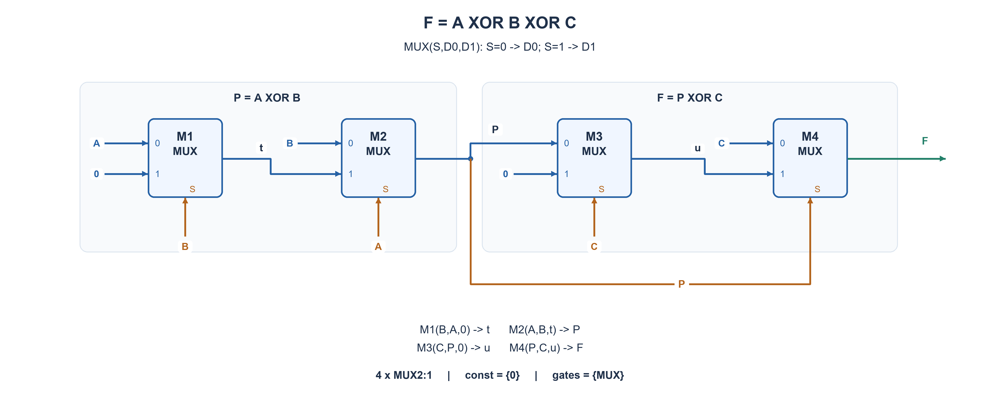

# PREP-051 — שלוש כניסות XOR — מרבבים וקבוע אפס בלבד

## מקור ומצב ביקורת

[צילום המקור](../sources/prep-051.png)

נוסח המקור נשמר בנפרד מהעריכה. פתרון מוצע בסיוע AI; אישור מקצועי, בדיקת שקילות שפות ובדיקת זכויות שימוש ממתינים. אין אישור הערכה ואין נתוני למידה אישיים.

```text
יש לממש A xor B xor C בעזרת מוקסים ומתח '0' לוגי בלבד
```

חברות מדווחות במקור: לא דווחו חברות בצילום הזה. השיוך אינו אימות עצמאי.

תגיות המקור: לא נראות תגיות בצילום.

## נוסח עברי

ממשו את הפונקציה A XOR B XOR C, כאשר כל כניסה היא ביט אחד, באמצעות מרבבי 2:1 רגילים וקבוע לוגי 0 בלבד. אין קבוע 1, כניסות משלימות מוכנות, שערי NOT או שערים נוספים. מותר לחבר אות קלט או מוצא מרבב קודם לכל כניסת נתונים או בחירה, ולפצל חוטים. הרשת צירופית וללא משוב. ציינו כל חיבור ובדקו את כל שמונה צירופי הקלט. גודל המרבב והאפשרות להשתמש באות ביניים כבחירה הם הבהרות למקור; אין דרישת מינימום מפורשת.

### שלושה רמזים

1. אפשר לבנות תחילה XOR של שני ביטים, ואז לשלב את התוצאה עם הביט השלישי. היזהרו לא להוסיף קבוע 1.
2. אות ביניים לא חייב להיות שלילה נכונה בכל מצבי הקלט, אלא רק כאשר המרבב הבא באמת בוחר בו.
3. לזוג X,Y נסו t=MUX(Y,X,0), ואז תנו ל־X לבחור בין Y לבין t. כש־X=1, מה הערך שהמרבב הראשון מעביר כאשר Y=0?

## הצעה לפתרון

### מה חייבים לממש?

המוצא הוא 1 כאשר מספר האחדים בקלט אי־זוגי: אחד או שלושה. נחשב תחילה P=A XOR B, ואחר כך F=P XOR C. חשוב שהמילים XOR בהסבר מתארות פונקציה, ולא שערי XOR שהוספנו למעגל. כל המימוש בפועל הוא מרבבים בלבד.

נסמן מרבב כך:

```text
MUX(S,D0,D1) = D0 if S=0, otherwise D1
```

### הטריק: היפוך רק בענף שבו הוא נחוץ

עבור שני ביטים X,Y נשתמש בשני מרבבים:

```text
t = MUX(Y, X, 0)
Z = MUX(X, Y, t)
```

אם X=0, המרבב האחרון בוחר את Y, בדיוק כנדרש. אם X=1, המרבב הראשון בוחר בין הערך 1 של X לבין אפס לפי Y: כאשר Y=0 הוא מוציא 1, וכאשר Y=1 הוא מוציא 0. לכן בענף שבו צריך אותו הוא מתפקד כמו NOT Y, והמרבב האחרון בוחר בו.

לא הוספנו מקור מתח של 1: השתמשנו בערך של קלט שידוע שהוא 1 באותו מקרה. גלובלית t אינו NOT Y; הוא X AND NOT Y. כאשר X=0 הוא אפס, אבל אז המרבב האחרון בכלל לא בוחר בו.

### ארבעת המרבבים והחיבורים המדויקים

```text
M1: S=B, D0=A, D1=0 -> t
M2: S=A, D0=B, D1=t -> P
M3: S=C, D0=P, D1=0 -> u
M4: S=P, D0=C, D1=u -> F
```

שני הראשונים מחשבים XOR של A,B. שני האחרונים חוזרים על אותה בנייה עבור P,C. מותר ש־P יהיה גם נתון וגם אות בחירה; הוא אות ביניים של מרבב קודם, ללא משוב. בשרטוט קווים כחולים מוליכים נתונים וקווים כתומים מוליכים בחירה; נקודה על הקו מסמנת פיצול מחובר. אות חוזר בעל אותו שם הוא אותו חוט קלט. הספרות 0,1 בתוך קופסת מרבב הן שמות הפינים, לא שני מקורות קבועים: רק פינים שאליהם מצויר חוט עם 0 מחוברים לאפס.

### טבלת אמת מלאה

| A | B | C | P | F |
| --- | --- | --- | --- | --- |
| 0 | 0 | 0 | 0 | 0 |
| 0 | 0 | 1 | 0 | 1 |
| 0 | 1 | 0 | 1 | 1 |
| 0 | 1 | 1 | 1 | 0 |
| 1 | 0 | 0 | 1 | 1 |
| 1 | 0 | 1 | 1 | 0 |
| 1 | 1 | 0 | 0 | 0 |
| 1 | 1 | 1 | 0 | 1 |

### נכונות ועלות

הניתוח לפי X מוכיח שבלוק שני המרבבים הוא XOR לכל ארבעת זוגות הקלט. שילוב שני בלוקים נותן את הפונקציה המבוקשת לכל שמונת המצבים. העלות היא ארבעה מרבבי 2:1 וקבוע אפס בלבד; לא נטען שזה המינימום לכל רשת מותרת. אין שעון או איפוס, כי זה מעגל צירופי. זמן התייצבות ופולסים חולפים בזמן שינוי קלט אינם נבדקים בטבלת אמת.

מודל הפייתון מריץ את רשימת ארבעת המרבבים בפועל, ולא מחשב את התשובה באמצעות אופרטור XOR. כל שמונה התוצאות הושוו לזוגיות סכום הקלטים, ונבדק מבנה החיבורים כדי למנוע קבוע 1, שער חיצוני או שימוש באות לפני יצירתו. קוד SystemVerilog מצורף אך לא קומפל או הורץ. השאלה היא וריאציה בת שלוש כניסות של PREP-031, שנותרת עם שתי כניסות וללא שינוי מזהה או היסטוריה.



## English question

Implement A XOR B XOR C for three one-bit inputs using ordinary noninverting 2:1 MUXes and only logic constant zero. Constant one, precomputed complements, NOT gates and other gates are unavailable. Raw inputs and earlier MUX outputs may drive either data or select pins; fanout is allowed. The network is combinational and acyclic. Specify every connection and check all eight inputs. MUX size and intermediate-signal selection are clarifications of the terse source; no explicit minimum is required.

### Three hints

1. First implement XOR of two bits, then combine it with the third. Do not introduce a hidden constant one.
2. An intermediate signal need not be a correct complement in every case, only when the following MUX selects it.
3. For X,Y try t=MUX(Y,X,0), then let X select between Y and t. When X=1, what does the first MUX pass at Y=0?

## Proposed solution

### What is required?

The output is one for an odd input population: one or three set bits. First compute P=A XOR B, then F=P XOR C. XOR labels describe functions; they do not introduce physical XOR gates. The actual network contains MUX cells only.

Use this pin convention:

```text
MUX(S,D0,D1) = D0 if S=0, otherwise D1
```

### Conditional inversion without constant one

For two bits X,Y use:

```text
t = MUX(Y, X, 0)
Z = MUX(X, Y, t)
```

At X=0 the last MUX selects Y, as required. At X=1 the first MUX selects between X, which is now one, and zero according to Y. It outputs one at Y=0 and zero at Y=1. Thus it behaves as NOT Y precisely in the branch where the last MUX selects it.

No constant-one source was added. A raw input supplies its actual value only in the relevant case. Globally t is X AND NOT Y, not a standalone NOT Y. At X=0 it is zero, but the final MUX does not select it.

### Four cells, exact pin connections

```text
M1: S=B, D0=A, D1=0 -> t
M2: S=A, D0=B, D1=t -> P
M3: S=C, D0=P, D1=0 -> u
M4: S=P, D0=C, D1=u -> F
```

The first pair computes A XOR B; the second repeats the construction for P,C. P may drive both a data pin and a select pin because it is an earlier MUX output, with no feedback. Blue diagram wires carry data and orange wires select; a dot denotes a connected branch. Repeated external signal names denote the same raw input. Digits zero and one INSIDE a MUX box label data pins, not constant sources; only incoming wires explicitly labelled zero are tied to zero.

### Complete truth table

| A | B | C | P | F |
| --- | --- | --- | --- | --- |
| 0 | 0 | 0 | 0 | 0 |
| 0 | 0 | 1 | 0 | 1 |
| 0 | 1 | 0 | 1 | 1 |
| 0 | 1 | 1 | 1 | 0 |
| 1 | 0 | 0 | 1 | 1 |
| 1 | 0 | 1 | 1 | 0 |
| 1 | 1 | 0 | 0 | 0 |
| 1 | 1 | 1 | 0 | 1 |

### Correctness and cost

The case split on X proves each two-MUX block is XOR for all four inputs. Cascading two blocks proves the requested function for all eight triples. Cost is four 2:1 MUX cells and only constant zero; no global minimum claim is made. There is no clock or reset because the circuit is combinational. Truth tables do not establish settling time or absence of transient glitches.

The Python model evaluates the actual four-cell netlist rather than returning a Python XOR expression. All eight outputs were checked against input-sum parity; structural validation excludes constant one, external gates and forward references. SystemVerilog is supplied but not compiled or simulated. This is a three-input variation of PREP-031, whose two-input content, identifier and history remain unchanged.


## חומר משלים בשתי השפות / Bilingual technical material

### assumptions

```json
{
  "he": [
    "שלוש כניסות עצמאיות בנות ביט אחד; הפלט הוא הזוגיות האי־זוגית שלהן.",
    "רק מרבבי 2:1 לא מהופכים וקבוע 0. אין קבוע 1, שערים נוספים או אותות משלימים מוכנים.",
    "אות קלט או מוצא מרבב קודם רשאי להניע גם פין נתונים וגם פין בחירה. מותר פיצול חוטים; אין משוב.",
    "סימן MUX(S,D0,D1) בוחר D0 ב־S=0 ו־D1 ב־S=1. גודל המרבב הובהר בעריכה."
  ],
  "en": [
    "Three independent one-bit inputs; output is their odd parity.",
    "Only ordinary noninverting 2:1 MUXes and constant zero, with no constant one, extra gates or precomputed complements.",
    "Raw inputs and previous MUX outputs may drive both data and select pins. Fanout is allowed, feedback is not.",
    "MUX(S,D0,D1) selects D0 at S=0 and D1 at S=1. The source did not specify MUX size; the edited model does."
  ]
}
```

### optimality

```json
{
  "he": {
    "criterion": "בניית רשת צירופית תקפה תחת מגבלת מרבבים ואפס בלבד.",
    "result": "ארבעה מרבבי 2:1, בשני בלוקים של שני מרבבים.",
    "proof": "כל בלוק מממש XOR לפי פיצול למקרים X=0 ו־X=1; הרכבה נותנת XOR של שלוש כניסות.",
    "scope": "זהו חסם עליון ומימוש מפורש; לא הוכח מינימום מספר מרבבים או שטח, עומק והשהיה."
  },
  "en": {
    "criterion": "A valid combinational construction under the MUX-and-zero-only constraint.",
    "result": "Four 2:1 MUX cells, arranged as two two-cell XOR blocks.",
    "proof": "A case split on X proves each block is two-input XOR; composition gives three-input XOR.",
    "scope": "This is constructive sufficiency and an upper bound; no global minimum MUX count, area, depth or delay is proved."
  }
}
```

### verification

```json
{
  "he": "עברו כל שמונה שורות האמת מול זוגיות סכום שלם. נבדקה רשימת חיבורים טופולוגית בת ארבעה מרבבים, בלי קבוע 1, שער חיצוני או אות שטרם נוצר. נבדק גם בלוק שני מרבבים בנפרד. בדיקת מודל פייתון בלבד; ללא קומפילציית HDL, סימולציית חומרה או תזמון.",
  "en": "All eight truth rows passed against integer-sum parity. Topological validation checks four MUX instances with no constant one, external gate or unavailable wire; the two-cell block is also checked independently. Python functional model only; no HDL compilation, hardware simulation or timing."
}
```

### edge_cases

```json
{
  "he": [
    "000 חייב להוציא 0, ו־111 חייב להוציא 1.",
    "בדיוק שני אחדים נותנים 0; זה אינו שער OR או הצבעת רוב.",
    "אות הביניים t אינו השלילה של B בכל מצב; הוא משמש רק בענף שבו A=1.",
    "המספר 1 המופיע ליד פין D1 הוא שם הפין, לא מקור קבוע נוסף."
  ],
  "en": [
    "000 must output zero and 111 must output one.",
    "Exactly two ones give zero; this is neither OR nor majority.",
    "Intermediate t is not globally NOT B; it is used only in the branch A=1.",
    "A one next to pin D1 is a pin label, not an added constant-one source."
  ]
}
```

### common_mistakes

```json
{
  "he": [
    "לבנות היפוך רגיל על ידי חיבור 1 שאינו מותר.",
    "להשתמש בשערי XOR/OR/NOT בתור רכיבי מימוש במקום רק לתאר פונקציות.",
    "להניח שהמשימה בלתי אפשרית כי אי אפשר לייצר NOT כללי עם אפס בלבד.",
    "למזג את השאלה עם PREP-031 תוך מחיקת השוני בין שתי כניסות לשלוש.",
    "להחליף את סדר פיני D0,D1 בלי לעדכן את הסלקטור."
  ],
  "en": [
    "Adding an unavailable constant one to build an ordinary inverter.",
    "Using XOR/OR/NOT gates as physical components rather than explanatory function names.",
    "Calling the task impossible because a standalone NOT cannot be built with only zero.",
    "Merging with PREP-031 while erasing its two-input versus three-input difference.",
    "Swapping D0/D1 without adjusting select interpretation."
  ]
}
```

### interview_answer

```json
{
  "he": "אבנה XOR של שני ביטים בשני מרבבים: t=MUX(Y,X,0), ואחריו Z=MUX(X,Y,t). אם X=0 מעבירים Y; אם X=1, האות t מתפקד כשלילת Y בלי מקור 1 נוסף. אשתמש בבלוק פעם ל־A,B ופעם לתוצאה ול־C. סך הכול ארבעה מרבבים וקבוע אפס בלבד.",
  "en": "Use a two-MUX XOR block: t=MUX(Y,X,0), then Z=MUX(X,Y,t). At X=0 pass Y; at X=1, t behaves as NOT Y without an extra one source. Apply it first to A,B and then to that result and C: four MUXes with only constant zero."
}
```

### solution_extensions

```json
{
  "he": {
    "question": "למה אפשר לממש XOR, אבל אי אפשר לממש NOT של כניסה אחת באמצעות מרבבים וקבוע 0 בלבד?",
    "direction": "כל רשת מותרת שומרת אפס: אם כל הקלטים אפס, כל מרבב בוחר אפס. NOT דורש פלט 1 במצב זה ולכן בלתי אפשרי. XOR שומר אפס; ההיפוך שבפתרון הוא מותנה בענף שבו קלט אחר כבר שווה 1.",
    "status": "שאלת המשך מוכנה בתוכן; אינה מחוברת לתור ההמשך החי."
  },
  "en": {
    "question": "Why is XOR possible while a standalone NOT is impossible with MUXes and only constant zero?",
    "direction": "Every permitted network preserves all-zero input: every cell selects zero. NOT would have to output one there and is impossible. XOR preserves zero; the construction only inverts conditionally when another input is already one.",
    "status": "Follow-up prepared in content; not connected to the live follow-up queue."
  }
}
```

## קוד ובדיקות / Code and verification

- [solutions/prep_051_xor_three_mux_zero.py](../solutions/prep_051_xor_three_mux_zero.py)
- [solutions/prep_051_xor_three_mux_zero.sv](../solutions/prep_051_xor_three_mux_zero.sv)
- [בדיקת מודל / Python-model check](../checks/check_prep_051.py)
- [תוצאות / Evidence](../checks/prep-051-verification.json)

Python-model verification is separate from HDL compilation/simulation, synthesis, physical hardware, professional review and live-site clicking. Follow-up content is prepared but not connected to the interactive queue.
