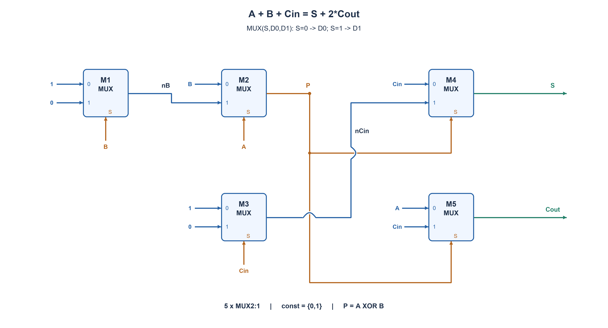

# PREP-052 — מחבר מלא באמצעות מרבבי 2:1

## מקור ומצב ביקורת

[צילום המקור](../sources/prep-052.png)

נוסח המקור נשמר בנפרד מהעריכה. פתרון מוצע בסיוע AI; אישור מקצועי, בדיקת שקילות שפות ובדיקת זכויות שימוש ממתינים. אין אישור הערכה ואין נתוני למידה אישיים.

```text
ממש FA ע"י mux 2:1
```

חברות מדווחות במקור: Intel. השיוך אינו אימות עצמאי.

תגיות המקור: hardware, intel, software, 2312313.

## נוסח עברי

ממשו מחבר מלא של ביט אחד באמצעות מרבבי 2:1 בלבד. הכניסות הן A,B,Cin והפלטים הם ביט הסכום S וביט הנשא Cout, כך ש־A+B+Cin=S+2*Cout. ציינו חיבורים ובדקו את כל שמונה צירופי הקלט.

המקור אינו מפרט אילו קבועים מותרים. בגרסה הראשית נאפשר קבועים לוגיים 0 ו־1 וחוטים מפוצלים. לא נניח כניסות משלימות מוכנות, שערי NOT חיצוניים או שערים נוספים: כל היפוך נדרש ימומש באמצעות מרבב שגם נספר. הרשת צירופית וללא משוב. אין דרישה להוכיח מינימום רכיבים; תארו גם איך משתנה התכנון אם רק קבוע 0 זמין.

### שלושה רמזים

1. חשבו תחילה מה קורה לנשא כש־A ו־B שווים, ומה קורה כשהם שונים.
2. אם P=A XOR B, הנשא הוא A כש־P=0, ו־Cin כש־P=1. לכן P יכול לשמש סלקטור של מרבב הנשא.
3. מרבב עם נתונים 1 ואז 0 הופך את הסלקטור. בעזרת שני היפוכים כאלה אפשר לבנות P וגם S באמצעות בחירה בין אות לבין שלילתו.

## הצעה לפתרון

### מפרידים בין סכום לנשא

מחבר מלא מחבר שלושה ביטים. ביט הסכום הוא הזוגיות של מספר האחדים; הנשא אומר שיש לפחות שני אחדים. נחשב תחילה האם A ו־B שונים:

```text
P = A XOR B
S = P XOR Cin
```

אם P=0, שתי הכניסות A,B שוות: 00 אינו יוצר נשא גם כש־Cin=1, ו־11 תמיד יוצר נשא. לכן במקרה הזה Cout=A. אם P=1, בדיוק אחת מהן היא 1, ולכן Cin קובע אם הסכום 1 או 2; אז Cout=Cin.

```text
Cout = MUX(P, A, Cin)
```

### כל ההיפוכים הם מרבבים שנספרים

נשתמש בהגדרה MUX(S,D0,D1): בוחרים D0 כשהסלקטור אפס, ו־D1 כשהוא אחד. מרבב עם נתונים 1,0 מחזיר את שלילת הסלקטור. כך כל החיבורים הם:

```text
M1: S=B,   D0=1,   D1=0    -> nB
M2: S=A,   D0=B,   D1=nB   -> P
M3: S=Cin, D0=1,   D1=0    -> nCin
M4: S=P,   D0=Cin, D1=nCin -> S
M5: S=P,   D0=A,   D1=Cin  -> Cout
```

M1 ו־M3 מייצרים את השלילות בעזרת מרבבים, לא שערי NOT שהוברחו מבחוץ. M2 מעביר B כש־A=0 ואת שלילתו כש־A=1, ולכן מחשב XOR. M4 עושה אותו דבר עבור P,Cin. M5 מחשב את הנשא לפי שני המקרים לעיל. סך הכול חמישה מרבבים, עם פיצול P לשני סלקטורים.

בשרטוט, הספרות בתוך המרבב מסמנות פיני נתונים. חוט שמסומן 1 מחובר לקבוע 1 שמותר בגרסה הזאת; חוט מסומן 0 מחובר לאפס. נקודה מציינת פיצול מחובר, וגשר קטן מעל חוט אחר מציין חצייה ללא חיבור. השמות החוזרים A,B,Cin מתייחסים לאותן כניסות חיצוניות.

### טבלת אמת

| A | B | Cin | S | Cout |
| --- | --- | --- | --- | --- |
| 0 | 0 | 0 | 0 | 0 |
| 0 | 0 | 1 | 1 | 0 |
| 0 | 1 | 0 | 1 | 0 |
| 0 | 1 | 1 | 0 | 1 |
| 1 | 0 | 0 | 1 | 0 |
| 1 | 0 | 1 | 0 | 1 |
| 1 | 1 | 0 | 0 | 1 |
| 1 | 1 | 1 | 1 | 1 |

לדוגמה, בקלט 1,1,1 מקבלים P=0. לכן M4 מעביר Cin=1 ו־M5 מעביר A=1. הפלט הוא Cout,S=11, כלומר 3 בבינארי. בקלט 0,1,1 מקבלים P=1 ולכן S=0 ו־Cout=1, כלומר 2. הנשא הוא הביט המשמעותי, לא הסכום.

### אם רק קבוע 0 מותר

אסור להשתמש ב־M1 וב־M3 של המימוש הראשי, כי הם מחוברים ל־1. חלופה תקפה היא שני בלוקי XOR של שני מרבבים כל אחד, לפי הבנייה המותנית שב־PREP-031 ו־PREP-051, ועוד מרבב נשא אחד:

```text
t = MUX(B, A, 0)
P = MUX(A, B, t)
u = MUX(Cin, P, 0)
S = MUX(P, Cin, u)
Cout = MUX(P, A, Cin)
```

גם החלופה הזאת משתמשת בחמישה מרבבים, אך ללא 1 קבוע וללא היפוכים חיצוניים. אין מכאן הוכחה שזה המספר המינימלי בכל מודל.

פיצול למקרים P=0 ו־P=1 מוכיח את משוואת הנשא; שני שלבי XOR מוכיחים את ביט הסכום. כל שמונת הקלטים נבדקו מול חיבור מספרים שלמים, לרבות הזהות A+B+Cin=S+2*Cout. הקוד הראשי הוא רשימת מרבבים מפורשת. בדיקות אלו הן מודל פייתון ולא קומפילציה, סימולציית HDL, סינתזה או מדידת תזמון.



## English question

Implement a one-bit full adder using only 2:1 MUXes. Inputs are A,B,Cin; outputs are sum S and carry Cout, satisfying A+B+Cin=S+2*Cout. Specify pin connections and check all eight inputs.

The source does not state which constants are available. The main edited model permits logic zero, logic one and wire fanout. Do not assume free complemented inputs, external NOT gates or other gates: any required inversion must be built using a counted MUX. The network is combinational and acyclic. No minimum component proof is required. Also explain how the design changes if only constant zero is available.

### Three hints

1. Consider the carry when A and B are equal and when they differ.
2. With P=A XOR B, carry is A when P=0 and Cin when P=1. P can therefore select a carry MUX.
3. A MUX with data one then zero inverts its selector. Two counted inversions let you form P and S by selecting between a bit and its complement.

## Proposed solution

### Separate sum from carry

A full adder sums three bits. Sum is the parity of the number of ones; carry indicates at least two ones. First determine whether A and B differ:

```text
P = A XOR B
S = P XOR Cin
```

If P=0, A and B are equal: 00 never creates carry even at Cin=1, while 11 always creates carry. Thus Cout=A. If P=1, exactly one of A,B is one, and Cin determines whether the total is one or two; hence Cout=Cin.

```text
Cout = MUX(P, A, Cin)
```

### Count every inversion as a MUX

MUX(S,D0,D1) selects D0 at select zero and D1 at select one. Data one,zero therefore inverts the select. The exact five-cell netlist is:

```text
M1: S=B,   D0=1,   D1=0    -> nB
M2: S=A,   D0=B,   D1=nB   -> P
M3: S=Cin, D0=1,   D1=0    -> nCin
M4: S=P,   D0=Cin, D1=nCin -> S
M5: S=P,   D0=A,   D1=Cin  -> Cout
```

M1 and M3 generate complements using counted MUXes, not hidden external NOT gates. M2 passes B at A=0 and its complement at A=1, hence XOR. M4 does the same for P,Cin. M5 implements the carry case split. Five MUXes total, with P fanned out to two selectors.

In the diagram, digits inside cells label data pins. An incoming wire labelled one is tied to permitted logic one; a wire labelled zero is tied to zero. Dots denote connected branches, while small wire bridges denote crossings without connection. Repeated A,B,Cin labels refer to the same external signals.

### Truth table

| A | B | Cin | S | Cout |
| --- | --- | --- | --- | --- |
| 0 | 0 | 0 | 0 | 0 |
| 0 | 0 | 1 | 1 | 0 |
| 0 | 1 | 0 | 1 | 0 |
| 0 | 1 | 1 | 0 | 1 |
| 1 | 0 | 0 | 1 | 0 |
| 1 | 0 | 1 | 0 | 1 |
| 1 | 1 | 0 | 0 | 1 |
| 1 | 1 | 1 | 1 | 1 |

For 1,1,1, P=0. M4 passes Cin=1 and M5 passes A=1, giving Cout,S=11, binary three. For 0,1,1, P=1 gives S=0,Cout=1, binary two. Carry is the more-significant output bit.

### If only constant zero is available

Do not reuse main cells M1 and M3 because they require constant one. A valid alternative uses two conditional two-MUX XOR blocks from PREP-031/PREP-051, followed by the same carry MUX:

```text
t = MUX(B, A, 0)
P = MUX(A, B, t)
u = MUX(Cin, P, 0)
S = MUX(P, Cin, u)
Cout = MUX(P, A, Cin)
```

This also uses five MUXes, without constant one or external complements. Neither construction alone proves a global minimum count.

Splitting on P proves carry; the two XOR stages prove sum. All eight inputs were checked against integer addition, including A+B+Cin=S+2*Cout. The primary code evaluates an explicit MUX netlist. These are Python functional checks, not HDL compilation/simulation, synthesis or physical timing.


## חומר משלים בשתי השפות / Bilingual technical material

### assumptions

```json
{
  "he": [
    "מחבר מלא של ביט אחד: A+B+Cin=S+2*Cout, כאשר Cout הוא הביט המשמעותי.",
    "המקור אינו מפרט קבועים. בגרסה הראשית מותרים 0 ו־1; חלופה של חמישה מרבבים עם אפס בלבד מפורטת בנפרד.",
    "רק מרבבי 2:1 רגילים, חוטים ופיצול; אין היפוכים מוכנים או שערי NOT חיצוניים. כל מרבב היפוך נספר.",
    "אין שעון או זיכרון. סדר הפינים הוא MUX(S,D0,D1)."
  ],
  "en": [
    "One-bit full adder: A+B+Cin=S+2*Cout, with Cout the more-significant output.",
    "Constants are unspecified in the source. Main construction permits zero and one; a separate five-MUX zero-only alternative is explained.",
    "Only ordinary 2:1 MUXes, wires and fanout. No free complements or external NOT gates; every inverter MUX is counted.",
    "No clock or state; pin order is MUX(S,D0,D1)."
  ]
}
```

### optimality

```json
{
  "he": {
    "criterion": "מימוש שני פלטי מחבר מלא באמצעות מרבבי 2:1.",
    "result": "חמישה מרבבים עם 0 ו־1, כולל שני מרבבי היפוך. קיימת גם חלופה בת חמישה מרבבים עם 0 בלבד.",
    "proof": "P=A XOR B קובע את הנשא: ב־P=0 בוחרים A, וב־P=1 בוחרים Cin; הסכום הוא P XOR Cin.",
    "scope": "חסם עליון קונסטרוקטיבי, לא הוכחת מינימום שערים, רכיבים, שטח או השהיה. התגית 2312313 נשמרה מהמקור ללא פרשנות."
  },
  "en": {
    "criterion": "Implement both full-adder outputs using 2:1 MUX cells.",
    "result": "Five MUXes with constants zero/one, including two inverter MUXes; a five-MUX zero-only alternative also exists.",
    "proof": "P=A XOR B selects carry: A at P=0, Cin at P=1; sum is P XOR Cin.",
    "scope": "Constructive upper bound, not a global minimum gate, cell, area or delay proof. The odd source tag 2312313 is preserved without interpretation."
  }
}
```

### verification

```json
{
  "he": "עברו כל שמונה שורות האמת ברשימת חיבורים של חמישה מרבבים מול חיבור שלם, כולל זהות שימור הסכום. נבדק שאין חיבור קדימה, וששתי השלילות מיוצרות במרבבים נספרים. חלופת אפס בלבד נבדקה גם היא לכל שמונת הקלטים. זו בדיקת מודל פייתון; קוד SystemVerilog לא קומפל או הורץ ולא בוצעה סינתזה.",
  "en": "All eight truth rows of the five-MUX netlist passed against integer addition, including value conservation. Structural checks reject forward references and ensure both complements come from counted MUXes. The zero-only alternative also passed all eight inputs. Python models only; SystemVerilog not compiled/simulated or synthesized."
}
```

### edge_cases

```json
{
  "he": [
    "000 מפיק S=0,Cout=0; 111 מפיק S=1,Cout=1.",
    "כש־A=B=0 הנשא תמיד 0; כש־A=B=1 הנשא תמיד 1, בלי תלות ב־Cin.",
    "כש־A ו־B שונים, הנשא שווה ל־Cin.",
    "הסכום הבינארי המלא נקרא Cout ואז S.",
    "אם אוסרים קבוע 1 יש להשתמש בחלופה, לא לטעון שהמימוש הראשי עומד באיסור."
  ],
  "en": [
    "000 gives S=0,Cout=0; 111 gives S=1,Cout=1.",
    "At A=B=0 carry is always zero; at A=B=1 it is always one, independent of Cin.",
    "When A and B differ, carry equals Cin.",
    "Read the full binary total as Cout followed by S.",
    "If constant one is forbidden, use the alternative rather than claiming the main netlist satisfies that restriction."
  ]
}
```

### common_mistakes

```json
{
  "he": [
    "להציג רק S בלי Cout ולהכריז שמומש מחבר מלא.",
    "לא לספור את המרבבים שמייצרים nB ו־nCin.",
    "להחליף את A ואת Cin בפיני הנתונים של מרבב הנשא בלי להחליף את הבחירה.",
    "לחבר P כנתון במקום לסלקטור של מרבב הנשא.",
    "לפרש את התגית 2312313 כחברה או להוסיף חברות שלא נראות במקור."
  ],
  "en": [
    "Providing only S while omitting Cout.",
    "Not counting the MUXes that generate nB and nCin.",
    "Swapping A and Cin on carry data pins without changing select interpretation.",
    "Driving carry data rather than its select with P.",
    "Interpreting 2312313 as a company or importing companies absent from the screenshot."
  ]
}
```

### interview_answer

```json
{
  "he": "אחשב P=A XOR B בעזרת מרבב היפוך ל־B ומרבב שבוחר B או שלילתו לפי A. בדומה אחשב S=P XOR Cin בעזרת שני מרבבים. לנשא אשתמש במרבב שבוחר A אם P=0 ו־Cin אם P=1. סך הכול חמישה מרבבים, כולל ההיפוכים, ובלי שערים חיצוניים.",
  "en": "Compute P=A XOR B with a counted B-inverting MUX and a MUX selecting B or its complement by A. Repeat for S=P XOR Cin using two cells. Carry uses one MUX selecting A at P=0 and Cin at P=1: five MUXes including the inversions, no external gates."
}
```

### solution_extensions

```json
{
  "he": {
    "question": "כיצד תממשו את אותו מחבר אם מותר רק קבוע אפס, והאם מספר המרבבים חייב לגדול?",
    "direction": "לא חייב לגדול: שני בלוקי XOR של שני מרבבים כל אחד במימוש המותנה עם אפס בלבד, ואחריהם מרבב הנשא, נותנים שוב חמישה. הציגו את כל הפינים; אין צורך לייצר שלילה גלובלית.",
    "status": "שאלת המשך מוכנה בתוכן; אינה מחוברת לתור ההמשך החי."
  },
  "en": {
    "question": "How would you implement the adder with only constant zero, and must the MUX count increase?",
    "direction": "It need not increase: use two conditional zero-only two-MUX XOR blocks plus the carry MUX, again five cells. Specify every pin; no standalone complement is required.",
    "status": "Follow-up prepared in content; not connected to the live follow-up queue."
  }
}
```

## קוד ובדיקות / Code and verification

- [solutions/prep_052_full_adder_mux.py](../solutions/prep_052_full_adder_mux.py)
- [solutions/prep_052_full_adder_mux.sv](../solutions/prep_052_full_adder_mux.sv)
- [בדיקת מודל / Python-model check](../checks/check_prep_052.py)
- [תוצאות / Evidence](../checks/prep-052-verification.json)

Python-model verification is separate from HDL compilation/simulation, synthesis, physical hardware, professional review and live-site clicking. Follow-up content is prepared but not connected to the interactive queue.
