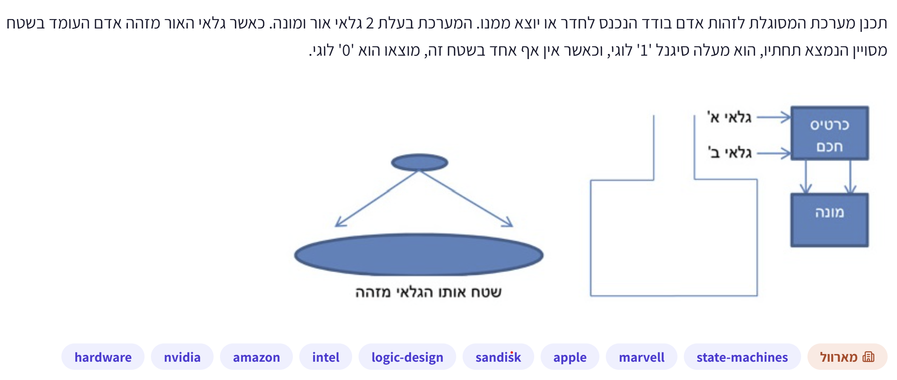
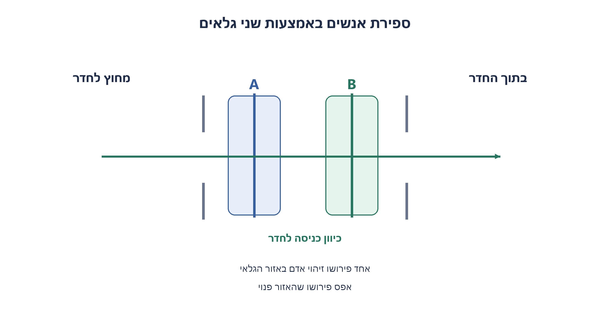
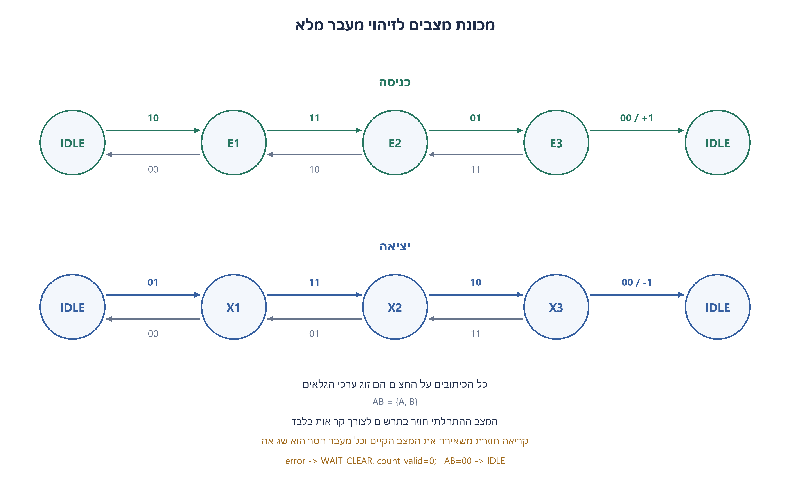
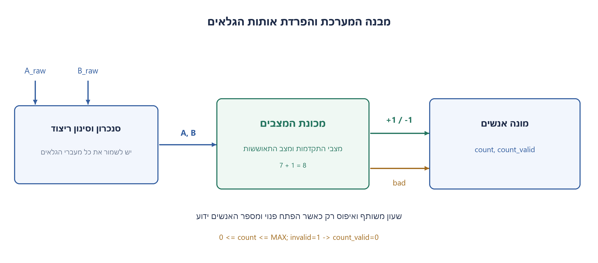
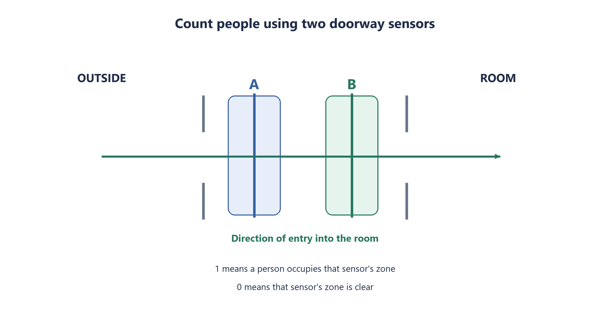
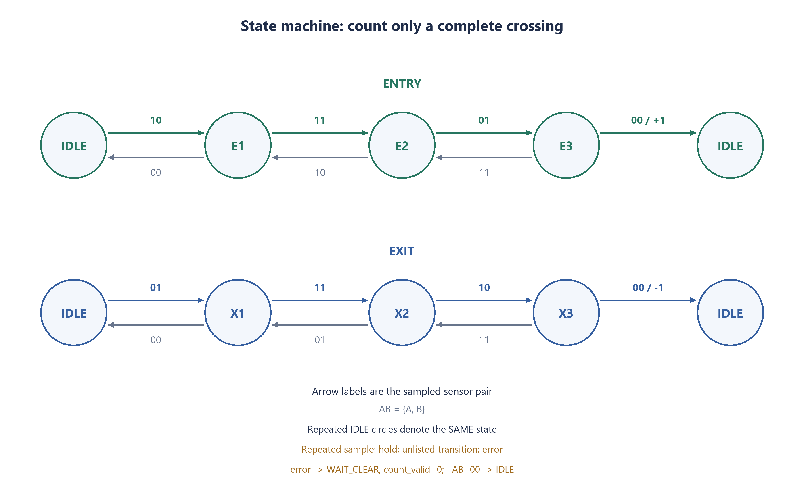
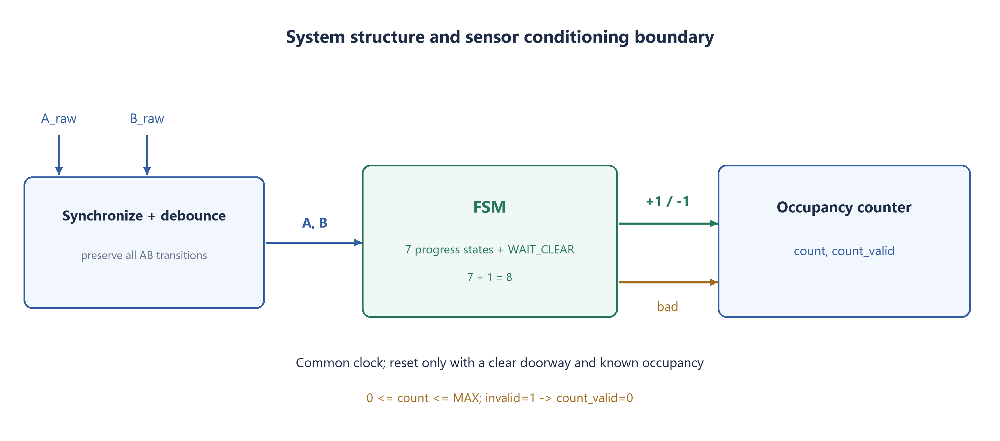

# PREP-053 — ספירת כניסות ויציאות באמצעות שני גלאים

נקלטה ב־20 באוקטובר 2026. פתרון מוצע בסיוע AI. ביקורת מקצועית, בדיקת תרגום אנושית ובדיקת זכויות שימוש ממתינות. קושי אינו מכויל. שיוכי החברות הם דיווחי צילום המקור בלבד, ללא אימות עצמאי.

## מקור ללא שינוי



תכנן מערכת המסוגלת לזהות אדם בודד הנכנס לחדר או יוצא ממנו. המערכת בעלת 2 גלאי אור ומונה. כאשר גלאי האור מזהה אדם העומד בשטח מסויים הנמצא תחתיו, הוא מעלה סיגנל '1' לוגי, וכאשר אין אף אחד בשטח זה, מוצאו הוא '0' לוגי.

## נוסח השאלה לאתר

תכננו מערכת לספירת האנשים בחדר באמצעות שני גלאים בינריים בפתח ומונה. גלאי A נמצא בצד החיצוני וגלאי B בצד הפנימי. גלאי מחזיר 1 כאשר אדם נמצא באזור הזיהוי שלו, ו־0 אחרת. התרשים המצורף מגדיר את סדר הגלאים; צילום המקור נשמר בארכיון.

בכל רגע עובר בפתח לכל היותר אדם אחד. הגלאים קרובים מספיק כך שבמהלך מעבר מלא האדם מזוהה גם בשניהם בו־זמנית. כניסה מלאה נותנת את רצף הקריאות הבא, כאשר A הוא הביט הראשון:

```text
ENTRY: 00 -> 10 -> 11 -> 01 -> 00
EXIT:  00 -> 01 -> 11 -> 10 -> 00
```

אפשר להיעצר או לחזור אחורה באמצע המעבר. הוסיפו 1 למונה רק לאחר כניסה מלאה, והפחיתו 1 רק לאחר יציאה מלאה. אל תספרו אדם שנכנס חלקית לפתח וחזר לאותו צד.

הציגו מכונת מצבים, טבלת מעברים ומבנה חומרה עם המונה. הגדירו מה עושים בקריאה ללא שינוי, בדילוג על מעבר, באיפוס, בהפחתה מאפס ובגלישה. הניחו שהכניסות כבר מסונכרנות לשעון ומסוננות מריצוד, ושאין החמצת מצבי הביניים. האיפוס מתבצע כשהפתח פנוי ומספר האנשים ההתחלתי ידוע. אלה הבהרות הנדסיות שנוספו למקור; ללא חפיפה או תחת החמצת מעברים אין הבטחה לזיהוי אמין בשני גלאים בלבד.

### שלושה רמזים

1. קריאה בודדת אינה מספרת מאיזה צד הגיע האדם. עקבו אחר סדר ההפעלה של שני הגלאים, וחישבו מתי באמת הושלם מעבר ולא רק התחיל.
2. שמרו גם מאיזה צד התחיל הניסיון וגם עד לאיזה שלב הגיע. אותה קריאה של שני גלאים פעילים יכולה להופיע בכניסה או ביציאה, ולכן אינה מצב מספיק בפני עצמה.
3. בנו מסלול כניסה ומסלול יציאה, אפשרו חזרה לשלב הקודם כשאדם נסוג, ושנו את המונה רק בחזרה ל־00 מהשלב האחרון במסלול. קלט זהה משאיר מצב; דילוג חשוד מבטל את אמינות הספירה.

## הצעה לפתרון

**פתרון מוצע — זוכרים כיוון והתקדמות, וסופרים רק כשמגיעים לצד השני.**

### למה שני ביטי הקלט אינם מספיקים?

כאשר שני הגלאים פעילים מתקבל 11 גם בכניסה וגם ביציאה. צריך לדעת מי הופעל קודם. כמו כן, אין לספור מיד בהפעלת הגלאי הראשון: אדם יכול להתחרט ולחזור החוצה. לכן נשמור מצב המתאר ניסיון מעבר שלם, ולא רק את הקריאה הנוכחית.

### מסלול כניסה ומסלול יציאה

המצב IDLE אומר שהפתח פנוי ואין מעבר חלקי. בכניסה שומרים שלושה מצבי התקדמות: E1 אחרי 10, E2 אחרי 11, ו־E3 אחרי 01. רק המעבר מ־E3 אל 00 מפיק אירוע כניסה ומוסיף 1. ביציאה משתמשים בשלושה מצבים מקבילים X1 אחרי 01, X2 אחרי 11, ו־X3 אחרי 10. רק חזרת X3 אל 00 מפיקה יציאה ומפחיתה 1.

```text
IDLE -> E1 -> E2 -> E3 -> IDLE   : completed entry +1
IDLE -> X1 -> X2 -> X3 -> IDLE   : completed exit  -1
```

אם הקריאה אינה משתנה נשארים במקום. אם אדם חוזר אחורה, חוזרים שלב במסלול במקום להתחיל ספירה חדשה. למשל, בכניסה E2 עם 10 חוזר אל E1; E3 עם 11 חוזר אל E2. חזרת E1 אל 00 היא ביטול ניסיון ללא ספירה. המסלול ההפוך פועל באותה צורה. אין לספור כל מעבר בין גלאים כאדם חדש.

### טבלת המעברים המלאה

בכל תא כתוב המצב הבא. סימון ‎+1 או ‎-1 הוא אירוע שינוי המונה באותה חזית, לפי המצב והקלט שלפני העדכון. שאר התאים אינם משנים את המונה. עמודת מצב מסמנת את המצב הקיים; AB הוא זוג הגלאים שנדגם.

| מצב | AB=00 | AB=01 | AB=10 | AB=11 |
| --- | --- | --- | --- | --- |
| IDLE | IDLE | X1 | E1 | WAIT_CLEAR |
| E1 | IDLE | WAIT_CLEAR | E1 | E2 |
| E2 | WAIT_CLEAR | E3 | E1 | E2 |
| E3 | IDLE / +1 | E3 | WAIT_CLEAR | E2 |
| X1 | IDLE | X1 | WAIT_CLEAR | X2 |
| X2 | WAIT_CLEAR | X1 | X3 | X2 |
| X3 | IDLE / -1 | WAIT_CLEAR | X3 | X2 |
| WAIT_CLEAR | IDLE | WAIT_CLEAR | WAIT_CLEAR | WAIT_CLEAR |

WAIT_CLEAR הוא מצב התאוששות. מעבר אליו עקב רצף לא חוקי קובע count_valid=0, ללא המצאת כניסה או יציאה. ממתינים עד ששני הגלאים פנויים ורק אז חוזרים ל־IDLE. הפתח שוב מסונכרן, אך הספירה אינה חוזרת להיות מהימנה מעצמה: ייתכן שאדם עבר בזמן שהמידע אבד. הדגל נשאר 0 עד איפוס מפוקח עם מספר אנשים ידוע. אירועים חוקיים מאוחרים עדיין יכולים לעדכן את המספר המוצג, אך אין להציגו כספירה מדויקת כאשר הדגל אינו תקף.

### דוגמאות חשובות

```text
00,10,11,01,00              -> +1
00,01,11,10,00              -> -1
00,10,11,10,00              ->  0  (retreat)
00,10,11,01,11,10,00        ->  0  (deep retreat)
00,10,10,11,11,01,01,00,00  -> +1  (pauses)
00,10,01,00                 ->  0, count_valid=0 (missed/invalid overlap)
```

### מבנה החומרה

שרשרת הכניסה הפיזית צריכה לסנכרן ולסנן את שני הגלאים בלי לאבד את סדר הקריאות. אחריה מכונת המצבים מפיקה בקשת הגדלה או הקטנה, ומונה סינכרוני משנה את מספר האנשים. כל האוגרים משתמשים באותו שעון; פולסי כניסה ויציאה הם פולסים של מחזור אחד. בקידוד הנתון יש שמונה מצבי בקרה, ולכן שלושה ביטי מצב, נוסף למונה ולדגלי התקפות והאירועים. זו בחירת מימוש, לא הוכחת מינימום שערים או דלגלגים.

מונה בן W ביטים מוגבל לטווח אפס עד שניים בחזקת W פחות אחד. בבקשת יציאה מאפס או כניסה בערך המרבי משאירים את הערך ומורידים את count_valid; אין לגלוש לעטיפה ואין לייצר מספר אנשים שלילי. בקוד החומרה האיפוס הסינכרוני מחזיר ל־IDLE, מאפס את המונה והאירועים ומחזיר תקפות, ולכן מותר לבצעו רק כאשר באמת ידוע שהחדר ריק והפתח פנוי. מודל הפייתון מאפשר גם ערך התחלתי ידוע אחר.

### למה זה נכון ומה ההגבלות?

כל מצב E או X מזהה מיקום לאורך ניסיון שהתחיל מצד מסוים. התקדמות מעבירה לשלב הבא; נסיגה מחזירה לקודם; חזרה לאותו גבול אינה משלימה מסלול. רק הגעה ל־00 מהשלב האחרון מוכיחה מעבר לצד השני במודל הנתון, ולכן מתקבל שינוי יחיד ולא ספירת ביניים. בדיקה גאומטרית עצמאית של תנועות קדימה, אחורה ועצירה מאמתת את ההתנהגות בלי להסתמך על אותה טבלת מעברים.

אם אדם יכול להיעלם בין הגלאים, אם שתי הקריאות אינן חופפות, אם שני אנשים עוברים יחד, או אם הדגימה מחמיצה מצבים, האינווריאנט עלול לא להתקיים. למשל 00,10,00 עשוי להיות נסיגה או קטע ממעבר באזור ללא חפיפה. יש לשנות את החיישנים או את המפרט, ולא להכריז שהמונה פותר מצב בלתי ניתן להבחנה. הוספת שני מסנכרנים רגילים אינה לבדה הוכחה לשימור סדר בין שני אותות.

מצורפים תרשים גאומטריה נקי, תרשים מצבים, מבנה מערכת, מודל פייתון וקוד חומרה. עברו 88,572 דגימות באורקל תנועה מוגבל לעומק 10, כל 32 צירופי מצב וקלט, ותרחישי שגיאה וגבולות. קוד החומרה לא קומפל או הודמה בסימולטור, ואין כאן בדיקת חיישנים פיזיים, תזמונים או ניתוח מעבר בין תחומי שעון.







### assumptions

[
  "גלאי A חיצוני וגלאי B פנימי; A הוא הביט הראשון בזוג.",
  "אדם יחיד עובר בכל פעם, כולל מצב חפיפה 11 בכל מעבר מלא; אפשר להיעצר ולחזור אחורה.",
  "כל שינוי ביניים נצפה לאחר סנכרון וסינון ריצוד; הוספת מסנכרנים לבדה אינה הוכחת שימור סדר.",
  "איפוס רק עם פתח פנוי וספירה ידועה. בחומרה המצורפת הספירה ההתחלתית אפס.",
  "מונה חסום ללא גלישה; שגיאה או חריגה מהגבול מורידות דגל תקפות עד איפוס מפוקח."
]

### optimality

{
  "criterion": "נכונות זיהוי מעבר מלא תחת הנחות הגאומטריה והדגימה.",
  "result": "שבעה מצבי התקדמות ומצב התאוששות, עם מונה ותקפות.",
  "proof": "מסלולי התקדמות ונסיגה שומרים את צד ההתחלה; רק חזרה ל־00 מהשלב האחרון משלימה מעבר.",
  "scope": "לא נטען למינימום מצבים, שערים, זמן השהיה או משאבי חומרה; נכונות במודל אינה הבטחת מוצר פיזי."
}

### verification

"עברו 88,572 דגימות באורקל תנועה גאומטרי עצמאי לעומק 10, כל 32 צירופי מצב וקלט ובדיקות נסיגה, השהיה, דילוג, התאוששות, תקפות דביקה, גלישה ותת־גלישה. זו בדיקת מודל פייתון; לא בוצעו קומפילציה או סימולציית חומרה, ניסוי בחיישנים או ניתוח תזמונים ומעבר תחומי שעון."

### edge_cases

[
  "השהיה חוזרת בכל שלב אינה יוצרת אנשים נוספים.",
  "נסיגה גם אחרי 11 או 01 מבטלת ניסיון אם חוזרים לצד המקורי.",
  "10 אל 01 הוא דילוג חשוד; אין להמציא ביניהם את 11.",
  "מעבר שגוי מוריד תקפות; חזרה לפתח פנוי אינה מתקנת את המספר שכבר אינו ידוע.",
  "יציאה מאפס וכניסה בערך המרבי אינן עוטפות את המונה.",
  "אדם נוסף בפתח או אזורי חישה ללא חפיפה נמצאים מחוץ להנחות."
]

### common_mistakes

[
  "לספור מיד בהפעלת הגלאי הראשון.",
  "לשמור רק את AB ולשכוח כיוון התקדמות.",
  "לספור אדם שסב לאחור כאילו השלים כניסה או יציאה.",
  "להניח ששני גלאים בכל מיקום מבטיחים כיוון, גם ללא חפיפה.",
  "להחזיר תקפות אוטומטית אחרי איבוד מידע.",
  "להציג מודל פייתון כאילו עבר סימולציית חומרה."
]

### interview_answer

"אציב את A בחוץ ו־B בפנים עם חפיפה. אשמור מסלול כניסה 00,10,11,01,00 ומסלול יציאה הפוך, ואאפשר נסיגה והשהיה. רק השלב האחרון שחוזר ל־00 יוצר שינוי יחיד במונה. דילוג מפנה להתאוששות ומוריד תקפות עד כיול מחדש; המונה לא גולש ולא יורד מתחת לאפס. הנחות אדם יחיד, דגימה מלאה וסנכרון הן חלק מהמפרט."

### source_ambiguities

{
  "sensor_order": "המקור אינו מגדיר סדר חד־משמעי; בעריכה A בחוץ ו־B בפנים.",
  "overlap": "נוספה חובת חפיפה. בלעדיה קריאות יכולות להיות בלתי ניתנות להבחנה.",
  "faults": "המקור אינו קובע טיפול בנסיגה, איפוס, דילוגים וגבולות; המדיניות כאן מפורשת ומוצעת."
}

### transition_tables

"עמודת מצב מציינת את המצב הקיים; AB הוא הקלט שנדגם. תא ללא אירוע משאיר מונה. כל מעבר חשוד מוריד תקפות.\n\n| מצב | AB=00 | AB=01 | AB=10 | AB=11 |\n| --- | --- | --- | --- | --- |\n| IDLE | IDLE | X1 | E1 | WAIT_CLEAR |\n| E1 | IDLE | WAIT_CLEAR | E1 | E2 |\n| E2 | WAIT_CLEAR | E3 | E1 | E2 |\n| E3 | IDLE / +1 | E3 | WAIT_CLEAR | E2 |\n| X1 | IDLE | X1 | WAIT_CLEAR | X2 |\n| X2 | WAIT_CLEAR | X1 | X3 | X2 |\n| X3 | IDLE / -1 | WAIT_CLEAR | X3 | X2 |\n| WAIT_CLEAR | IDLE | WAIT_CLEAR | WAIT_CLEAR | WAIT_CLEAR |"

### solution_extensions

{
  "question": "מה קורה אם הגלאים רחוקים ואין ביניהם חפיפה, או אם צריך לספור כמה אנשים במקביל?",
  "direction": "הציגו עקבות זהות שנובעות מתנועות שונות, והסבירו שלא ניתן להבטיח פתרון מאותו מידע בלבד. נדרשים חיישנים נוספים, שינוי גאומטריה, מעקב זהות או אילוץ תנועה מתאים. הגבלת זמן מעבר היא הנחה חדשה ואינה פותרת כל עצירה ונסיגה.",
  "status": "המשך מוכן בתוכן; אינו מחובר לתור ההמשך החי."
}

## English website wording

Design an occupancy counter using two binary doorway sensors and a counter. Sensor A is on the outside and sensor B on the inside. A sensor returns 1 while a person occupies its sensing region and 0 otherwise. The attached clean diagram defines their order; the source screenshot remains in the archive.

At most one person traverses the doorway at a time. The sensors are close enough that a full crossing includes an interval with both occupied. With A as the first bit, a complete passage produces:

```text
ENTRY: 00 -> 10 -> 11 -> 01 -> 00
EXIT:  00 -> 01 -> 11 -> 10 -> 00
```

A person may pause or reverse midway. Increment only on a completed entry and decrement only on a completed exit. Do not count a partial attempt that returns to its starting side.

Provide an FSM, transition table and counter hardware structure. Define unchanged readings, skipped transitions, reset, decrementing zero and overflow. Assume inputs are already synchronized and debounced, with no missed intermediate states. Reset occurs with a clear doorway and known initial occupancy. These are explicit engineering clarifications added to the source; without overlap or with missed transitions, two binary sensors alone cannot guarantee reliable direction detection.

### Three hints

1. One reading cannot reveal which side a person came from. Track the order in which the sensors activate and decide when a crossing is complete rather than merely started.
2. Remember both the attempted direction and progress. The same both-active reading occurs during entry and exit, so that reading alone is not enough state.
3. Build entry and exit paths, allow retracing when the person reverses, and change the count only when the final path state returns to 00. Repeated readings hold; a suspicious skipped transition invalidates confidence in the count.

## Proposed solution

**Proposed solution — remember direction and progress; count only a completed crossing.**

### Why the two current input bits are insufficient

Both sensors read 11 during both entry and exit, so remember which activated first. Counting the first activation is also wrong: a person can turn back. We therefore track a complete attempted crossing, not just the latest sensor pair.

### Entry and exit paths

IDLE means the doorway is clear with no partial traversal. Entry uses E1 after 10, E2 after 11 and E3 after 01. Only E3 returning to 00 generates an entry event and increments. Exit uses X1 after 01, X2 after 11 and X3 after 10. Only X3 returning to 00 generates an exit and decrements.

```text
IDLE -> E1 -> E2 -> E3 -> IDLE   : completed entry +1
IDLE -> X1 -> X2 -> X3 -> IDLE   : completed exit  -1
```

An unchanged reading holds the state. Reversal retraces the path rather than starting another count. During entry, E2 with 10 returns to E1; E3 with 11 returns to E2. E1 returning to 00 cancels the attempt without counting. Exit is symmetric. Do not treat every sensor edge as a new person.

### Complete transition table

Each cell gives the next state. A +1 or -1 suffix requests a counter update on that sampling edge using the old state and sampled inputs. All other cells leave the count unchanged. State is the current state; AB is the sampled pair.

| State | AB=00 | AB=01 | AB=10 | AB=11 |
| --- | --- | --- | --- | --- |
| IDLE | IDLE | X1 | E1 | WAIT_CLEAR |
| E1 | IDLE | WAIT_CLEAR | E1 | E2 |
| E2 | WAIT_CLEAR | E3 | E1 | E2 |
| E3 | IDLE / +1 | E3 | WAIT_CLEAR | E2 |
| X1 | IDLE | X1 | WAIT_CLEAR | X2 |
| X2 | WAIT_CLEAR | X1 | X3 | X2 |
| X3 | IDLE / -1 | WAIT_CLEAR | X3 | X2 |
| WAIT_CLEAR | IDLE | WAIT_CLEAR | WAIT_CLEAR | WAIT_CLEAR |

WAIT_CLEAR is a recovery state. Entering it after an illegal sequence sets count_valid=0 without inventing an entry or exit. Wait until both sensors are clear, then return to IDLE. This restores sensor alignment, not trust in occupancy: a person may have crossed while information was lost. Validity stays false until a supervised reset with a known count. Later valid events may still update the displayed number, but it must not be represented as exact while count_valid is false.

### Important traces

```text
00,10,11,01,00              -> +1
00,01,11,10,00              -> -1
00,10,11,10,00              ->  0  (retreat)
00,10,11,01,11,10,00        ->  0  (deep retreat)
00,10,10,11,11,01,01,00,00  -> +1  (pauses)
00,10,01,00                 ->  0, count_valid=0 (missed/invalid overlap)
```

### Hardware structure

A physical input front end must synchronize and debounce the sensors while preserving the observed sequence. The FSM then issues increment/decrement requests to a synchronous counter. All registers use the same clock; entry and exit events are one-cycle pulses. This implementation uses eight control states, hence three encoded state bits, plus occupancy and validity/event registers. This is a construction, not a minimum gate or flip-flop proof.

A W-bit counter ranges from zero through 2**W-1. An exit at zero or entry at the maximum holds the count and invalidates it; never wrap or create a negative occupancy. The synchronous HDL reset clears state, count and events and restores validity, so it is permitted only when the room is known empty and the doorway clear. The Python model also permits another known initial occupancy.

### Correctness and limitations

Every E/X state represents progress from a particular starting side. Advancing moves to the next stage; retreating moves back; returning to the starting boundary does not finish a crossing. Only reaching 00 from the final stage proves arrival on the opposite side under the stated geometry. Thus exactly one update is emitted, never an intermediate count. An independent geometric movement oracle checks forward/backward/stationary motion without relying on the FSM table itself.

If a person can disappear between sensors, their regions do not overlap, multiple people pass together, or sampling misses states, this invariant can fail. For example 00,10,00 may represent a retreat or a segment through a non-overlapping gap. Change the sensing arrangement or specification instead of claiming to distinguish identical observations. Adding two ordinary synchronizers alone does not prove relative event order is preserved.

Attached are clean geometry, FSM and system diagrams, a Python model and HDL. Checks passed for 88,572 independent physical-walk samples up to depth 10, all 32 state/input pairs, and fault/boundary scenarios. The HDL was not compiled or simulated; these checks are not physical sensor, timing or CDC verification.







### assumptions

[
  "A is outside and B inside; A is the first bit of the pair.",
  "One person at a time, with 11 overlap on every full crossing; pausing and reversal are allowed.",
  "Every intermediate transition is observed after synchronization and debounce; ordinary synchronizers alone are not an event-order proof.",
  "Reset only with a clear doorway and known occupancy; supplied HDL assumes initial zero.",
  "Bounded nonwrapping count; a sequence or bound fault invalidates it until supervised reset."
]

### optimality

{
  "criterion": "Correct recognition of complete crossings under the stated sensing model.",
  "result": "Seven progress states plus one recovery state, with occupancy and validity.",
  "proof": "Advance/retreat paths retain the starting side; only final-stage return to 00 completes a crossing.",
  "scope": "No claim of minimum states, gates, delay or physical resources; model correctness is not a physical product guarantee."
}

### verification

"Passed 88,572 samples in an independent geometric movement oracle to depth 10, all 32 state/input pairs, and retreat/pause/skip/recovery/sticky-validity/overflow/underflow tests. This verifies a Python model, not HDL compilation/simulation, sensors, timing or CDC."

### edge_cases

[
  "Repeated pauses at any stage do not count extra people.",
  "Retreat even after 11 or 01 cancels if the person returns to the starting side.",
  "10 to 01 is a suspicious skip; do not invent an observed 11.",
  "A sequence fault invalidates occupancy; a clear doorway does not repair an unknown count.",
  "Exit at zero and entry at maximum never wrap the counter.",
  "Multiple people or non-overlapping regions are outside the assumptions."
]

### common_mistakes

[
  "Counting as soon as the first sensor activates.",
  "Remembering only AB while losing direction/progress.",
  "Counting a turnaround as a completed entry or exit.",
  "Assuming any two sensor positions guarantee direction even without overlap.",
  "Automatically restoring validity after losing information.",
  "Presenting Python checks as HDL simulation."
]

### interview_answer

"Place A outside and B inside with overlap. Track entry 00,10,11,01,00 and reverse exit, allowing pauses and retracing. Only final-stage return to 00 updates occupancy once. A skipped transition enters recovery and invalidates the count until recalibration; never overflow or go below zero. One person, complete sampling and synchronization are explicit assumptions."

### source_ambiguities

{
  "sensor_order": "The source does not fix an unambiguous order; the edited model sets A outside and B inside.",
  "overlap": "Required overlap was added explicitly; without it observations can be ambiguous.",
  "faults": "Retreat/reset/skip/bounds behavior is unspecified in the source; this proposed policy is explicit."
}

### transition_tables

"State is current state; AB is sampled input. Cells without an event hold occupancy. Every suspicious transition invalidates the count.\n\n| State | AB=00 | AB=01 | AB=10 | AB=11 |\n| --- | --- | --- | --- | --- |\n| IDLE | IDLE | X1 | E1 | WAIT_CLEAR |\n| E1 | IDLE | WAIT_CLEAR | E1 | E2 |\n| E2 | WAIT_CLEAR | E3 | E1 | E2 |\n| E3 | IDLE / +1 | E3 | WAIT_CLEAR | E2 |\n| X1 | IDLE | X1 | WAIT_CLEAR | X2 |\n| X2 | WAIT_CLEAR | X1 | X3 | X2 |\n| X3 | IDLE / -1 | WAIT_CLEAR | X3 | X2 |\n| WAIT_CLEAR | IDLE | WAIT_CLEAR | WAIT_CLEAR | WAIT_CLEAR |"

### solution_extensions

{
  "question": "What if the sensor regions do not overlap or several people pass at once?",
  "direction": "Construct identical traces from different motions to show the information is insufficient. Add sensing, change geometry, track identities or impose a suitable movement constraint. A timeout is a new assumption and cannot resolve arbitrary pauses and reversals.",
  "status": "Follow-up prepared in content; not connected to the live follow-up queue."
}

## Files and verification

- [prep_053_doorway_counter.py](../solutions/prep_053_doorway_counter.py)
- [prep_053_doorway_counter.sv](../solutions/prep_053_doorway_counter.sv)

- [Verification script](../checks/check_prep_053.py)

- [Verification evidence](../checks/prep-053-verification.json)

No chat hint/solution request is recorded as learner activity. Publication is a pilot content action, not professional approval. The authored follow-up remains unconnected to the interactive queue.


## מקור נוסף — 30.10.2026, מקבץ70, צילום 9

[צילום מקור פרטי](../sources/2026-10-30-batch70-09.png)

נוספה הרחבה דו־לשונית ברשומה ובנספח נפרד; התוכן והרמזים הקודמים נשמרו.

החלטת קליטה: `existing_question_source_and_variant`.

תמלול המקור (נתוני מקור):

```text
נתון אולם. אנשים נכנסים אליו ויוצאים ממנו דרך שער המאפשר מעבר של בן אדם אחד בכל רגע. ברשותך גלאי שמזהה מעבר של בן אדם. תכנן מערכת שתדע כמה אנשים נמצאים בתוך האולם בכל רגע. מותר להשתמש בגלאי אחד או יותר. האם יכולה להיווצר בעיה במערכת שתיכננת?
```
