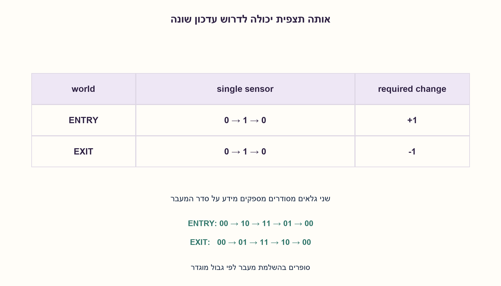
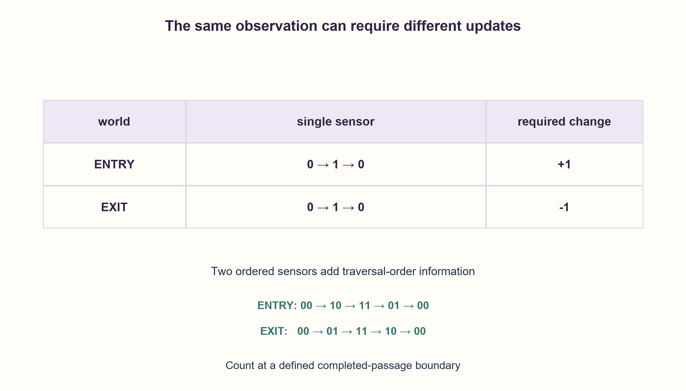

# PREP-053 — הרחבה מ־30.10.2026

הצעה בסיוע AI; ביקורת אנושית ממתינה.

[מקור פרטי](../sources/2026-10-30-batch70-09.png)

נתון אולם. אנשים נכנסים אליו ויוצאים ממנו דרך שער המאפשר מעבר של בן אדם אחד בכל רגע. ברשותך גלאי שמזהה מעבר של בן אדם. תכנן מערכת שתדע כמה אנשים נמצאים בתוך האולם בכל רגע. מותר להשתמש בגלאי אחד או יותר. האם יכולה להיווצר בעיה במערכת שתיכננת?

## עברית

### הרחבה: כמה גלאים צריך ומה פירוש ״בכל רגע״?
אולם מאפשר מעבר אדם אחד בכל פעם. מותר להשתמש בגלאי אחד או יותר שמזהים מעבר. תכננו ספירת אנשים ודונו בבעיות אפשריות. הבהרה: גלאי חד־כיווני אינו נתון; נניח שכל גלאי רגיל מודיע נוכחות באזורו ואינו מזהה כיוון בעצמו. הראו מדוע גלאי יחיד אינו מספיק להבחין בין כניסה ליציאה. השימוש בשני גלאים ממוקמים, חופפים ומדוגמים כפי שהוגדר בחלק המקורי הוא פתרון מוצע. הגדירו גבול ספירה: המספר משתנה רק בהשלמת מעבר מלא; אם צריך לדעת מיקום רציף של אדם שנמצא חלקית בפתח, יש לקבוע קו גבול ומשמעות נפרדת. אין להבטיח זאת מחיישני נוכחות בינאריים בלבד.

1. האם אדם שנכנס ואדם שיוצא יכולים להפעיל אותו גלאי יחיד באותו רצף 0,1,0?
2. שני גלאים מסודרים נותנים סדר הפעלה שונה לשני הכיוונים, אך אדם יכול לעצור או לחזור לאחור.
3. השתמשו ב־FSM המקורית שסופרת רק 00→10→11→01→00 או המסלול ההפוך. לא מספיק לספור כל קצה, והשאלה ״בכל רגע״ דורשת גבול ספירה מוגדר.

### גלאי אחד אינו נותן כיוון בחינם
נניח ספירה התחלתית ידועה. אדם שנכנס משמאל ואדם שיוצא מימין יכולים לתת לאותו גלאי את הרצף 0,1,0 ואף אותם זמנים. שתי ההיסטוריות הנצפות זהות, אבל העדכון הדרוש הוא+1 בעולם אחד ו־−1 בשני. שום אלגוריתם שקורא רק את הגלאי הזה אינו יכול להבטיח לבחור נכון בשניהם. ההנחה שאדם אחד עובר בכל רגע מונעת חפיפה בין אנשים, אך לא פותרת את חוסר הכיוון.

שני גלאים במקומות שונים מספקים מידע נוסף: כניסה מפעילה תחילה את החיצוני ויציאה את הפנימי. בחוזה המקורי שלהם יש חפיפה 11 והדגימה אינה מחמיצה שלבים. מכונת המצבים הקיימת מטפלת גם בעצירה ובחזרה, ומעדכנת רק כשהאדם הגיע לצד הנגדי והשער התפנה. אין לשנות את הטבלה או לספור כבר בגלאי הראשון; אדם יכול לסגת.

המספר נשמר בין אירועי השלמה. זהו מונה של מעברים שהושלמו תחת גבול שהוגדר, ולא מד רציף של איזה חלק מהגוף כבר בתוך האולם. לצורך משמעות אחרת של ״בכל רגע״ צריך להגדיר קו פיזי, מה נחשב אדם בפנים, דיוק וזמן תגובה. הסקת קואורדינטה רציפה משני ביטים אינה מובטחת.

קפיצות חיישן, אירוע שהוחמץ, אנשים צמודים, חוסר חפיפה, איפוס באמצע או גלישת מונה נשארים מגבלות אמיתיות. דגל count_valid של החלק המקורי אינו חוזר לאמת רק משום שהגלאים שוב פנויים. נבדקו שתי היסטוריות חד־גלאיות בלתי ניתנות להבחנה, שני מעברים מלאים מול המודל המקורי ונסיגה שאינה נספרת. בדיקות החומרה וה־CDC עדיין לא בוצעו.

```python
"""A nondirectional sensor can have identical observations for opposite traversals."""


def single_sensor_trace(direction):
    if direction not in ("entry", "exit"):
        raise ValueError("direction required")
    return (0, 1, 0)


def two_sensor_trace(direction):
    if direction not in ("entry", "exit"):
        raise ValueError("direction required")
    return (
        ((0, 0), (1, 0), (1, 1), (0, 1), (0, 0))
        if direction == "entry"
        else ((0, 0), (0, 1), (1, 1), (1, 0), (0, 0))
    )
```




## English

### Extension: how many sensors, and what does “at every instant” mean?
Only one person traverses a hall entrance at a time. One or more passage detectors may be used; design occupancy counting and discuss failures. Clarification:no directional detector is supplied. Model each ordinary detector as presence in a sensing region without direction. Show why one detector cannot distinguish entry from exit. The original two ordered, overlapping, sampled sensors are one proposed solution. Define a counting boundary: update only on a completed full passage. If continuous location of a partially crossing person is required, define a physical boundary and semantics separately; binary presence observations alone do not promise that.

1. Can one entry and one exit create the same0,1,0 trace at a single nondirectional detector?
2. Two ordered detectors reveal different activation order, but a person may pause or retreat.
3. Use the original full-passageFSM paths, not every edge. The phrase “at every instant” needs an explicit counting boundary.

### One sensor does not provide direction for free
Assume known starting occupancy. A person entering from one side and a person leaving from the other can produce the same0,1,0 trace at one detector, even with identical timing. Observations are identical but required updates are+1 and−1. No algorithm using only that observation can guarantee correctness in both worlds. One-at-a-time traversal prevents simultaneous people but does not supply direction.

Two ordered sensors add information: entry activates the outer one first, exit the inner one. The original contract includes11 overlap and no missed sampled stages. Its existingFSM handles pauses/retreats and updates only when the person reaches the opposite side and the doorway clears. Do not change that table or count on the first detector; the person may retreat.

The number holds between completion events. This is a completed-passage count under a defined boundary, not a continuous measurement of how much of a body is inside. Another meaning of “every instant” needs a physical boundary, inside/outside convention, accuracy and response latency. Two binary levels do not guarantee continuous position.

Bounce, missed samples, tailgating, nonoverlapping regions, midstream reset and count overflow remain genuine failure modes. The original stickycount_valid does not recover merely because sensors clear again. Checks covered two indistinguishable single-sensor worlds, two complete traversals against the unchanged canonical model and an uncounted retreat. No physical sensor orCDC validation is claimed.

```python
"""A nondirectional sensor can have identical observations for opposite traversals."""


def single_sensor_trace(direction):
    if direction not in ("entry", "exit"):
        raise ValueError("direction required")
    return (0, 1, 0)


def two_sensor_trace(direction):
    if direction not in ("entry", "exit"):
        raise ValueError("direction required")
    return (
        ((0, 0), (1, 0), (1, 1), (0, 1), (0, 0))
        if direction == "entry"
        else ((0, 0), (0, 1), (1, 1), (1, 0), (0, 0))
    )
```




```json
{
  "assumptions": {
    "he": [
      "גלאי נוכחות רגיל אינו מחזיר כיוון; ספירה התחלתית ידועה.",
      "פתרון שני הגלאים ממשיך את הנחות הגאומטריה והדגימה המקוריות.",
      "גבול העדכון הוא השלמת מעבר, לא מיקום רציף."
    ],
    "en": [
      "An ordinary presence detector does not report direction; initial count is known.",
      "Two-sensor construction retains original geometry/sampling assumptions.",
      "Update boundary is passage completion, not continuous position."
    ]
  },
  "optimality": {
    "he": "גלאי יחיד לא מספיק תחת מודל תצפיות זהות; שניים הם בנייה אפשרית תחת ההנחות, לא הוכחת מינימום לכל סוג חיישן חכם.",
    "en": "One sensor is insufficient in the stated observation model; two are a sufficient construction under its assumptions, not a minimum over all smart sensor technologies."
  },
  "verification": {
    "he": "שני עולמות זהים לגלאי יחיד, שני מעברים מלאים ונסיגה מול המודל הקיים.",
    "en": "Two indistinguishable one-sensor worlds, two full traversals and one retreat against the unchanged model."
  },
  "edge_cases": {
    "he": [
      "אדם יחיד נעצר או חוזר באמצע.",
      "אות גלאי יחיד זהה לשני כיוונים.",
      "אין משמעות ״מדויק בכל רגע״ ללא גבול מוגדר."
    ],
    "en": [
      "A single person pauses or retreats.",
      "Identical single-sensor observations for opposite directions.",
      "“Exact every instant” needs a defined boundary."
    ]
  },
  "common_mistakes": {
    "he": [
      "הנחה שהגלאי יודע כיוון בלי שנאמר כך.",
      "ספירה על הפעלה ראשונה גם כשיש נסיגה.",
      "הצגת count_valid שגוי כמספר מדויק."
    ],
    "en": [
      "Assuming a detector secretly reports direction.",
      "Counting first activation despite possible retreat.",
      "Presenting invalidcount_valid output as exact."
    ]
  },
  "interview_answer": {
    "he": "גלאי יחיד יכול לראות אותו רצף בכניסה וביציאה. אוסיף גלאי מסודר שני ואעקוב אחרי מעבר מלא עם אפשרות נסיגה. אגדיר במפורש מתי האדם נחשב בפנים ואשמור תקפות ספירה.",
    "en": "One detector can see the same entry/exit trace. Add an ordered second sensor and track a full passage including retreat. Explicitly define when a person counts as inside and retain count validity."
  },
  "source_ambiguities": {
    "he": [
      "סוג הגלאי, גבול הספירה וזמן התגובה חסרים במקור החדש; הם לא יכולות סמויות של החומרה.",
      "Rafael מדווחת בצילום בלבד."
    ],
    "en": [
      "Detector type, counting boundary and response latency are unspecified, not hidden hardware capabilities.",
      "Rafael is source-reported only."
    ]
  },
  "solution_extensions": {
    "he": [
      {
        "question": "האם גלאי יחיד חכם שמחזיר כיוון משנה את התשובה?",
        "answer_direction": "כן: הוא מספק מידע שלא היה בתצפית הבינארית. צריך לבדוק את אמינות הכיוון והגדרת אירוע, ולא להסיק שהוכחת אי־האפשרות חלה על כל מכשיר בשם גלאי.",
        "principle": "יכולת חישה מגדירה את גבולות האלגוריתם."
      }
    ],
    "en": [
      {
        "question": "Does one smart directional sensor change the answer?",
        "answer_direction": "Yes, it exposes information absent from binary presence. Verify direction/event reliability rather than applying the impossibility result to every device called a sensor.",
        "principle": "Observations define algorithmic limits."
      }
    ]
  }
}
```
