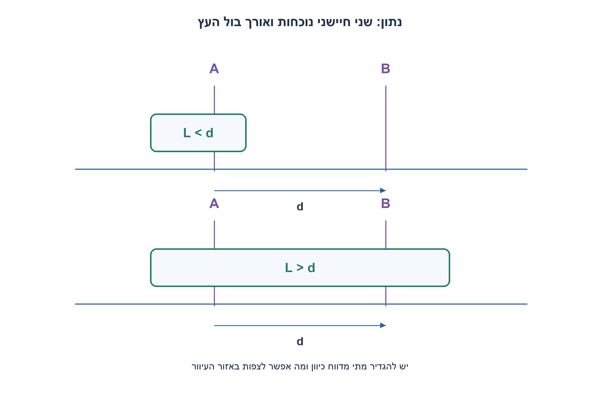
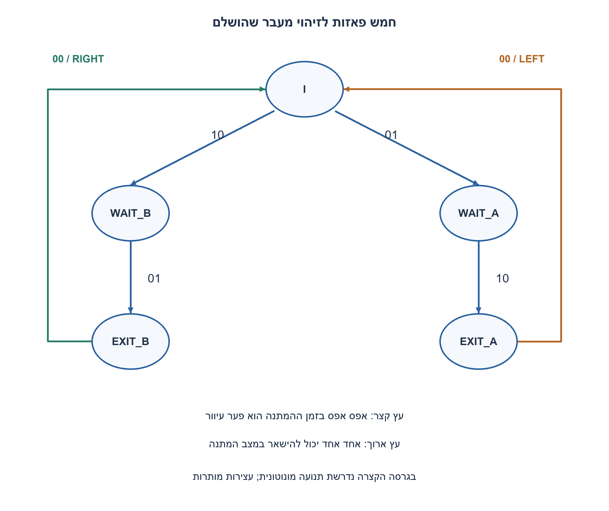
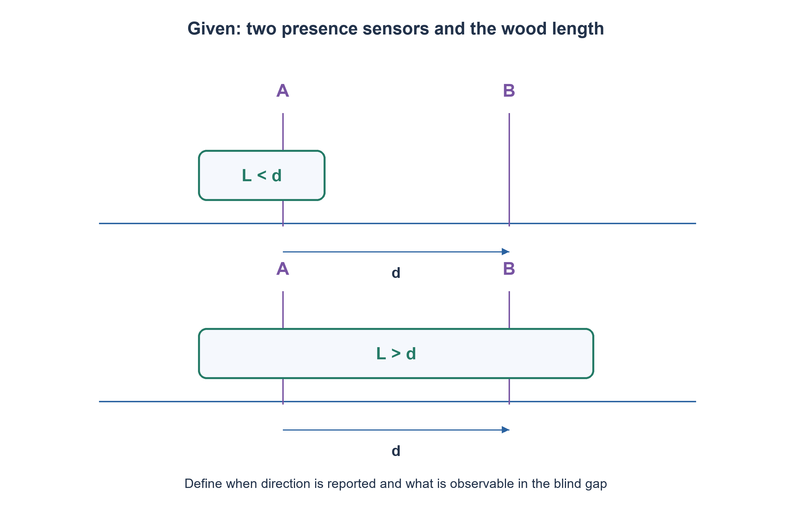
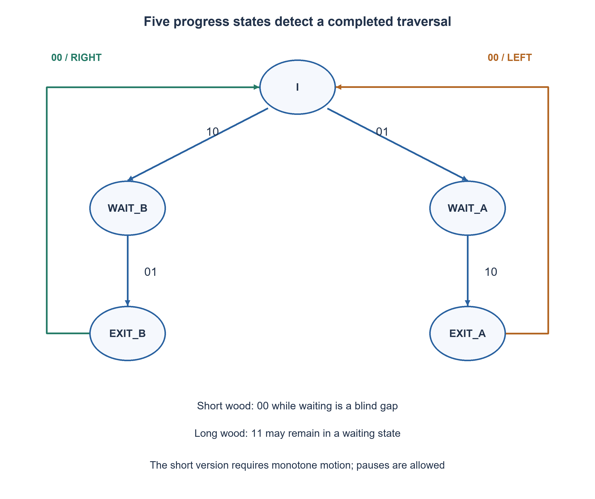

# PREP-053 — ספירת כניסות ויציאות באמצעות שני גלאים

פתרון מוצע בסיוע AI; ביקורת מקצועית אנושית ממתינה. דירוג הקושי פנימי ואינו מוצג ללומדים.

[צילום מקור פרטי](../sources/2026-11-08-batch20-14.png)

שני חיישנים A ו־B ובול עץ שנע שמאלה וימינה. יש לתת את כיוון התנועה עבור בול עץ קצר מהמרחק בין A ל־B ועבור בול עץ ארוך מהמרחק. האם ניתן לצמצם מצבים? בחלק השני לכתוב את אותה שאלה בפסאודו־קוד.

חברות לפי הדיווח בצילום בלבד: Elbit.

## עברית

### וריאציה: כיוון בול עץ קצר או ארוך ממרחק החיישנים
שני חיישני נוכחות A משמאל ו־B מימין נמצאים במרחק d. כל אחד מחזיר1 כשהעץ מכסה אותו. בנו FSM ופסאודו־קוד המדווחים פולס ימינה או שמאלה לאחר מעבר שלם, עבור L<d ועבור L>d.

השלמה הכרחית: עץ יחיד, חיישנים נקודתיים, דגימה של כל שינוי ללא החמצות, התחלה ידועה כשהעץ כולו מחוץ לשני החיישנים ואיפוס לפני בדיקה. עצירות מותרות. בגרסה הקצרה נדרשת תנועה מונוטונית במהלך מעבר; שינוי כיוון או ביטול מחייבים איפוס חיצוני במצב התחלתי ידוע. בגרסה הארוכה אפשר לעקוב גם אחרי חזרה דרך אזור החפיפה. אין טענה לגילוי מהירות או כיוון מיידי כשהחיישנים אינם משתנים; L=d אינו בחוזה הראשי.

1. בעץ ארוך שתי הפעלות חופפות. בעץ קצר מופיע00 גם באמצע הדרך, ולכן הוא לא בהכרח מצב התחלה.
2. זכרו מי הופעל ראשון ומתי הופעל החיישן הנגדי. בדקו מה אפשר לדעת אם העץ הקצר מחליף כיוון בלי לשנות קריאה.
3. אפשר להשתמש בחמישה מצבי התקדמות: I,WAIT_B,EXIT_B,WAIT_A,EXIT_A. בעץ קצר00 בהמתנה נשמר; בעץ ארוך הוא ביטול חזרה.

### המידע שמפיקים החיישנים
בסדר הביטים AB, מעבר ימינה של עץ ארוך יוצר `00→10→11→01→00`, ומעבר שמאלה את הרצף ההפוך. עץ קצר יוצר `00→10→00→01→00` ימינה. ה־00 האמצעי בעץ קצר הוא אזור עיוור, לא הוכחה שהעץ עזב את המערכת. תחילה נגדיר פלט על מעבר שהושלם; זו אינה מדידת כיוון בזמן עצירה או בין אירועים.

### חמישה מצבי התקדמות
I הוא מצב ללא מעבר פעיל. ב־10 עוברים ל־WAIT_B וב־01 ל־WAIT_A. ב־WAIT_B ממתינים עד01 ואז עוברים ל־EXIT_B; כשהוא רואה00 מפיקים right_pulse וחוזרים ל־I. הכיוון השני סימטרי. קריאה שלא השתנתה מחזיקה את המצב; בכל שעון מאפסים את הפולסים לפני חישוב האירוע החדש.

ב־WAIT_B/WAIT_A, קריאת00 בעץ קצר מחזיקה זיכרון של החיישן הראשון. בעץ ארוך היא חזרה מחוץ לצד שממנו התחיל העץ ולכן מבטלת ללא פולס. קריאת11 בעץ ארוך יכולה להישאר במצב ההמתנה; אם חזרנו מ־EXIT_B ל־11 חוזרים ל־WAIT_B, ובכיוון השני באופן סימטרי. כך חזרה חלקית נצפית אינה נספרת כמעבר מלא.

```text
on each clock:
  right_pulse = left_pulse = 0
  if reset: state = I
  else:
    I:      10 -> WAIT_B; 01 -> WAIT_A
    WAIT_B: 01 -> EXIT_B; 00 -> (hold if short else I)
    EXIT_B: 00 -> I and right_pulse=1
    WAIT_A: 10 -> EXIT_A; 00 -> (hold if short else I)
    EXIT_A: 00 -> I and left_pulse=1
  long mode: 11 in EXIT_B -> WAIT_B; 11 in EXIT_A -> WAIT_A
```

פירוט כל הברירות, כולל קריאות מחוץ לחוזה, נמצא בקוד. אין הבטחת התאוששות מכל החמצת דגימה. בניגוד למימוש נאיבי המפריד מצב המתנה ומצב חפיפה עם אותה התנהגות עתידית בחוזה, אפשר לשתף מצב ולהסתפק בחמש פאזות, שלוש סיביות מצב ושני FF לפולסים הרשומים. אין כאן הוכחת מינימום לכל מפרט פלט או מודל תנועה.

### גבול נצפות בעץ קצר
אי אפשר להבטיח מעבר שלם כשמותר לשנות כיוון באופן שרירותי. לדוגמה d=4,L=2: המיקומים `−3,−2,−1,0,1,2,3,4,5` והמיקומים `−3,−2,−1,0,1,2,3,2,1` נותנים אותן קריאות `00,10,10,10,00,01,01,01,00`. הראשון עובר ימינה; השני חוזר לאזור העיוור. שום FSM שמקבל רק קריאות אלה אינו יכול להבדיל. לכן נדרשת ההנחה המונוטונית או מידע נוסף, ולא עוד מצבי זיכרון בלבד.

מודל גאומטרי בלתי תלוי בדק23,254 תצפיות, כולל עצירות וחזרות של עץ ארוך, ובדק במפורש את הזוג הבלתי ניתן להבחנה. RTL נבדק בנפרד מול דגימות מיקום פיזי. זיהוי כיוון של כל קצה סמוך עם ארבע פאזות הוא חוזה פלט אחר; הוא אינו הופך תנועה קצרה נסתרת לנצפית.

### מודל Python שנבדק

```python
"""Five-state direction-on-completion model under explicit observability limits."""
IDLE,WAIT_B,EXIT_B,WAIT_A,EXIT_A=range(5)


def step(state, ab, short_mode):
    if state not in range(5) or ab not in range(4):
        raise ValueError('state0..4 and sensor mask0..3 required')
    right=left=False
    if state==IDLE:
        state={2:WAIT_B,1:WAIT_A}.get(ab,IDLE)
    elif state==WAIT_B:
        if ab==1:
            state=EXIT_B
        elif (ab==0 and not short_mode) or(ab==3 and short_mode):
            state=IDLE
    elif state==EXIT_B:
        if ab==0:
            state=IDLE;right=True
        elif ab==3:
            state=IDLE if short_mode else WAIT_B
        elif ab==2:
            state=IDLE
    elif state==WAIT_A:
        if ab==2:
            state=EXIT_A
        elif(ab==0 and not short_mode)or(ab==3 and short_mode):
            state=IDLE
    elif state==EXIT_A:
        if ab==0:
            state=IDLE;left=True
        elif ab==3:
            state=IDLE if short_mode else WAIT_A
        elif ab==1:
            state=IDLE
    return state,right,left


def sensors(position,length_,distance=4):
    return (2*int(position<=0<=position+length_)
            +int(position<=distance<=position+length_))
```


### קוד SystemVerilog; תוצאות סימולציה בדוח נפרד

```systemverilog
// A is the left sensor (ab[1]); B is the right sensor (ab[0]).
// Short objects: isolated monotone traversals, pauses allowed. Reversal/abort
// requires an external reset at a known boundary. See observability discussion.
// Long objects: complete traversals and observable partial reversals supported.
module prep053_wood_direction #(parameter SHORT_MODE=0)(
  input wire clk,rst,input wire [1:0] ab,
  output reg right_pulse,left_pulse);
  localparam IDLE=0, WAIT_B=1, EXIT_B=2, WAIT_A=3, EXIT_A=4;
  reg [2:0] state,next_state;
  reg go_right,go_left;
  always @* begin
    next_state=state;go_right=0;go_left=0;
    case(state)
      IDLE: case(ab)
        2'b10:next_state=WAIT_B;
        2'b01:next_state=WAIT_A;
        default:next_state=IDLE;
      endcase
      WAIT_B: case(ab)
        2'b01:next_state=EXIT_B;
        2'b00:if(!SHORT_MODE)next_state=IDLE;
        2'b11:if(SHORT_MODE)next_state=IDLE;
        default:next_state=WAIT_B;
      endcase
      EXIT_B: case(ab)
        2'b00:begin next_state=IDLE;go_right=1;end
        2'b11:next_state=SHORT_MODE ? IDLE : WAIT_B;
        2'b10:next_state=IDLE; // Out-of-contract skipped/invalid observation.
        default:next_state=EXIT_B;
      endcase
      WAIT_A: case(ab)
        2'b10:next_state=EXIT_A;
        2'b00:if(!SHORT_MODE)next_state=IDLE;
        2'b11:if(SHORT_MODE)next_state=IDLE;
        default:next_state=WAIT_A;
      endcase
      EXIT_A: case(ab)
        2'b00:begin next_state=IDLE;go_left=1;end
        2'b11:next_state=SHORT_MODE ? IDLE : WAIT_A;
        2'b01:next_state=IDLE;
        default:next_state=EXIT_A;
      endcase
      default:next_state=IDLE;
    endcase
  end
  always @(posedge clk)begin
    if(rst)begin state<=IDLE;right_pulse<=0;left_pulse<=0;end
    else begin state<=next_state;right_pulse<=go_right;left_pulse<=go_left;end
  end
endmodule
```






### assumptions

A משמאל, B מימין; עץ יחיד, אין החמצת קצוות. קצר: מעבר מונוטוני; ארוך: חזרות נצפות מותרות.

### optimality

חמש פאזות, שלושה FF למצב ושניים לפולסים. אין טענת מינימום גלובלית.

### verification

בדיקות מודלים עצמאיות עברו: 81 חישובי פינות תזמון מול זמני הגעה מוחלטים, 27 דוגמאות RC בסף יחיד ו־27 בקבל מצומד לאדמה, 100 חלונות ADC ו־32 דוגמאות aliasing, ‏23,254 תצפיות גאומטריות בחיישני עץ, זוג מסלולים המדגים חוסר נצפות בעץ קצר, 32 פאזות סינוס וכל 65,536 זוגות min/max. ראיה: checks/batch1108b20-hardware-model-verification.json. בדיקות Python וחישוב מספרי אינן SPICE, נתוני תהליך, STA או מדידת ADC. קוד SystemVerilog נבדק בנפרד, ותנאי הסביבה והיקף ההרצה מתועדים בדוח native של האצווה. סימולציית Icarus 12.0 עברה 66,134 השוואות: 65,536 זוגות min/max, ‏404 דגימות חיישני עץ ו־194 צעדי סינוס. הבתים של הקוד אומתו מול SHA-256, וההרצה החוזרת בוצעה ללא גישת רשת. ראיה: checks/batch1108b20-native-verification.json. זהו כיסוי סופי מוגבל לחוזים המתוארים, ולא הוכחת חומרה פיזית.

### edge_cases

```json
[
  "00 באמצע מעבר קצר.",
  "11 במעבר ארוך.",
  "עצירות אינן אירועים חדשים.",
  "התחלה כשהעץ מכסה חיישן אינה בחוזה."
]
```

### common_mistakes

```json
[
  "איפוס זיכרון בכל00.",
  "הבטחת כיוון מיידי גם כשהקריאות קבועות.",
  "הוספת מצבים כדי לפתור מידע שאינו נצפה."
]
```

### interview_answer

זוכר מי הופעל ראשון וממתין להשלמה. בעץ קצר הפער העיוור דורש זיכרון והנחת מעבר מונוטוני; בעץ ארוך משתמש בחפיפה.

### source_ambiguities

הוגדר פלט של מעבר שלם ולא מהירות רגעית. במקור אין מגבלת חזרה; חוסר הנצפות וההנחה שנוספה מוסברים בגלוי.

### solution_extensions

```json
[
  {
    "question": "איזה מידע נוסף יאפשר לטפל בחזרה קצרה?",
    "direction": "חיישן נוסף או מדידת מיקום/כיוון בתוך הפער, תחת מודל גאומטרי ודגימה מוגדר.",
    "tests": "שני המסלולים בעלי הקריאות הזהות צריכים לקבל מידע שונה."
  }
]
```

## English

### Variant: direction of wood shorter or longer than sensor spacing
Presence sensors A on the left and B on the right are separated by d; each is1 while covered. Give an FSM and pseudocode that pulse right or left after a complete traversal for L<d and L>d.

Necessary completion: one object, point sensors, every transition sampled without loss, known initial position fully outside both sensors and reset before testing. Pauses are allowed. The short version requires monotone motion during a traversal; reversal/abort requires external reset at a known initial boundary. The long version can also track returns through the overlap region. There is no claim of instantaneous velocity/direction when observations do not change; L=d is outside the primary contract.

1. Long wood creates overlap; short wood produces00 between sensors, so00 is not automatically idle.
2. Remember which sensor activated first and whether the opposite sensor has been reached. Consider an unseen short-object reversal.
3. Use five progress states I,WAIT_B,EXIT_B,WAIT_A,EXIT_A. Short-mode00 holds a waiting state; long-mode00 there aborts the attempt.

### What the sensors reveal
With bits ordered AB, rightward long wood gives `00→10→11→01→00`; leftward motion reverses it. Short wood gives `00→10→00→01→00` rightward. The middle00 is a blind gap, not proof that the object has left the system. Define output on completed traversal; this is not instantaneous direction measurement during pauses or between events.

### Five progress states
I has no active traversal. Observation10 enters WAIT_B, and01 enters WAIT_A. WAIT_B waits for01, entering EXIT_B; EXIT_B emits right_pulse on00 and returns to I. Leftward operation is symmetric. Unchanged readings hold progress, and pulses are cleared before calculating each new clock event.

In a waiting state, short-mode00 preserves the first-sensor memory. In long mode it means a return outside the starting side and aborts without a pulse. Long-mode11 may remain in the waiting state. Returning from EXIT_B to11 returns to WAIT_B, symmetrically for EXIT_A. Observable partial retreats are therefore not counted as completed crossings.

```text
on each clock:
  right_pulse = left_pulse = 0
  if reset: state = I
  else:
    I:      10 -> WAIT_B; 01 -> WAIT_A
    WAIT_B: 01 -> EXIT_B; 00 -> (hold if short else I)
    EXIT_B: 00 -> I and right_pulse=1
    WAIT_A: 10 -> EXIT_A; 00 -> (hold if short else I)
    EXIT_A: 00 -> I and left_pulse=1
  long mode: 11 in EXIT_B -> WAIT_B; 11 in EXIT_A -> WAIT_A
```

The code specifies all branches, including out-of-contract readings; arbitrary missed-sample recovery is not guaranteed. Waiting and overlap stages with the same future behavior under this contract can share state rather than being split naively. Five progress states use three state bits plus two registered pulse bits. This is not a global minimality proof across all output and motion contracts.

### Short-object observability limit
Arbitrary reversals prevent guaranteed completion detection. For d=4,L=2, left-edge positions `−3,−2,−1,0,1,2,3,4,5` and `−3,−2,−1,0,1,2,3,2,1` give the same observations `00,10,10,10,00,01,01,01,00`. One crosses right; the other returns to the blind gap. No FSM seeing only those readings can distinguish them. Monotone motion or additional information is required; extra states alone cannot solve the ambiguity.

An independent geometric model checked23,254 observations including pauses and long-object retreats, plus the indistinguishable trajectory pair. RTL is separately checked against physical-position-generated samples. A four-phase design reporting each adjacent observed edge is another output contract, not a way to observe hidden short-object motion.

### Verified Python teaching model

```python
"""Five-state direction-on-completion model under explicit observability limits."""
IDLE,WAIT_B,EXIT_B,WAIT_A,EXIT_A=range(5)


def step(state, ab, short_mode):
    if state not in range(5) or ab not in range(4):
        raise ValueError('state0..4 and sensor mask0..3 required')
    right=left=False
    if state==IDLE:
        state={2:WAIT_B,1:WAIT_A}.get(ab,IDLE)
    elif state==WAIT_B:
        if ab==1:
            state=EXIT_B
        elif (ab==0 and not short_mode) or(ab==3 and short_mode):
            state=IDLE
    elif state==EXIT_B:
        if ab==0:
            state=IDLE;right=True
        elif ab==3:
            state=IDLE if short_mode else WAIT_B
        elif ab==2:
            state=IDLE
    elif state==WAIT_A:
        if ab==2:
            state=EXIT_A
        elif(ab==0 and not short_mode)or(ab==3 and short_mode):
            state=IDLE
    elif state==EXIT_A:
        if ab==0:
            state=IDLE;left=True
        elif ab==3:
            state=IDLE if short_mode else WAIT_A
        elif ab==1:
            state=IDLE
    return state,right,left


def sensors(position,length_,distance=4):
    return (2*int(position<=0<=position+length_)
            +int(position<=distance<=position+length_))
```


### SystemVerilog; simulation results are in a separate report

```systemverilog
// A is the left sensor (ab[1]); B is the right sensor (ab[0]).
// Short objects: isolated monotone traversals, pauses allowed. Reversal/abort
// requires an external reset at a known boundary. See observability discussion.
// Long objects: complete traversals and observable partial reversals supported.
module prep053_wood_direction #(parameter SHORT_MODE=0)(
  input wire clk,rst,input wire [1:0] ab,
  output reg right_pulse,left_pulse);
  localparam IDLE=0, WAIT_B=1, EXIT_B=2, WAIT_A=3, EXIT_A=4;
  reg [2:0] state,next_state;
  reg go_right,go_left;
  always @* begin
    next_state=state;go_right=0;go_left=0;
    case(state)
      IDLE: case(ab)
        2'b10:next_state=WAIT_B;
        2'b01:next_state=WAIT_A;
        default:next_state=IDLE;
      endcase
      WAIT_B: case(ab)
        2'b01:next_state=EXIT_B;
        2'b00:if(!SHORT_MODE)next_state=IDLE;
        2'b11:if(SHORT_MODE)next_state=IDLE;
        default:next_state=WAIT_B;
      endcase
      EXIT_B: case(ab)
        2'b00:begin next_state=IDLE;go_right=1;end
        2'b11:next_state=SHORT_MODE ? IDLE : WAIT_B;
        2'b10:next_state=IDLE; // Out-of-contract skipped/invalid observation.
        default:next_state=EXIT_B;
      endcase
      WAIT_A: case(ab)
        2'b10:next_state=EXIT_A;
        2'b00:if(!SHORT_MODE)next_state=IDLE;
        2'b11:if(SHORT_MODE)next_state=IDLE;
        default:next_state=WAIT_A;
      endcase
      EXIT_A: case(ab)
        2'b00:begin next_state=IDLE;go_left=1;end
        2'b11:next_state=SHORT_MODE ? IDLE : WAIT_A;
        2'b01:next_state=IDLE;
        default:next_state=EXIT_A;
      endcase
      default:next_state=IDLE;
    endcase
  end
  always @(posedge clk)begin
    if(rst)begin state<=IDLE;right_pulse<=0;left_pulse<=0;end
    else begin state<=next_state;right_pulse<=go_right;left_pulse<=go_left;end
  end
endmodule
```






### assumptions

A left, B right; one object and no missed edges. Short passages are monotone; observable long-object retreats are allowed.

### optimality

Five progress states, three state FFs and two pulse FFs; no global minimum claim.

### verification

Independent models passed:81 corner budgets compared with absolute arrival times,27 single-threshold RC and27 ground-coupling cases,100 ADC slots and32 alias examples,23,254 geometric wood observations, one indistinguishable short-wood trajectory pair,32 sine phases and all65,536 min/max pairs. Evidence: checks/batch1108b20-hardware-model-verification.json. Python/numerical checks are not SPICE, process characterization, STA or physical ADC measurements. SystemVerilog is verified separately; execution conditions and coverage are recorded in the batch native report. Icarus12.0 simulation passed66,134 comparisons:65,536 min/max pairs,404 wood-sensor samples and194 sine steps. Source bytes were checked against SHA-256, and the confirmation run had network access denied. Evidence: checks/batch1108b20-native-verification.json. This is finite coverage of the stated contracts, not physical hardware signoff.

### edge_cases

```json
[
  "00 in a short traversal.",
  "11 in a long traversal.",
  "Pauses are not new events.",
  "Starting on a covered sensor is outside the contract."
]
```

### common_mistakes

```json
[
  "Resetting memory on every00.",
  "Promising instantaneous direction with unchanged observations.",
  "Adding states to recover unobservable information."
]
```

### interview_answer

Remember the first sensor and await completion; short gaps need memory and a monotone-motion assumption, while long wood provides overlap.

### source_ambiguities

Output means completed traversal, not instantaneous velocity. The source omits reversal restrictions; the observability limit and added assumption are explicit.

### solution_extensions

```json
[
  {
    "question": "What extra information could resolve a short-object reversal?",
    "direction": "Add sensing or position/direction information within the gap under a defined geometry/sampling model.",
    "tests": "The indistinguishable trajectories must produce different additional information."
  }
]
```

