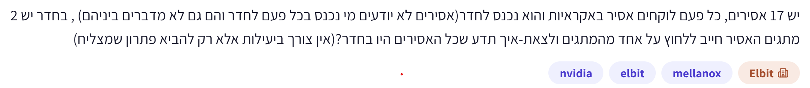
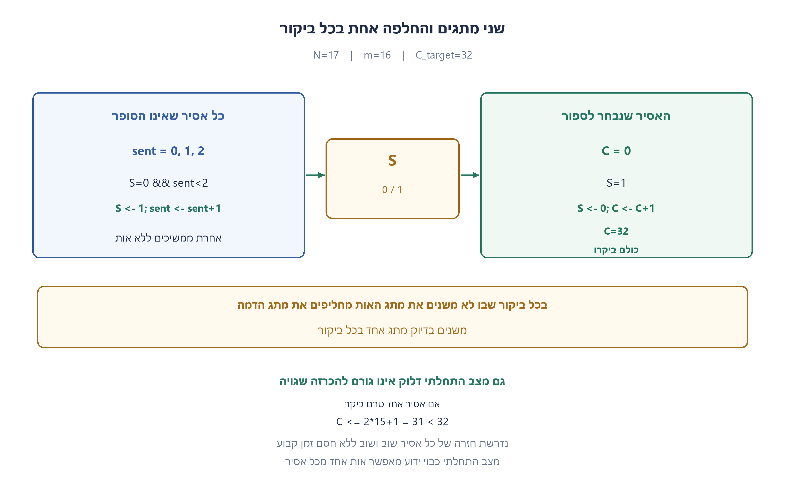
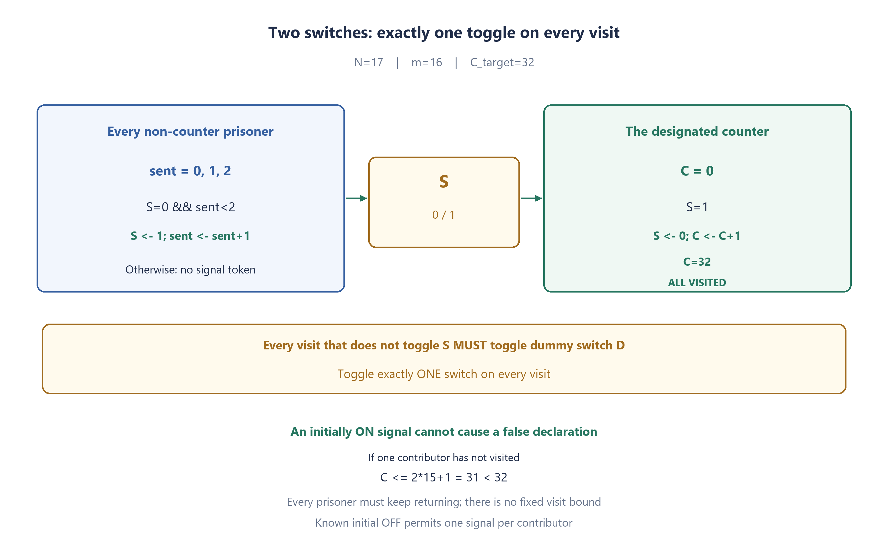
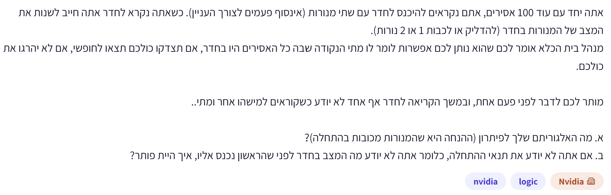
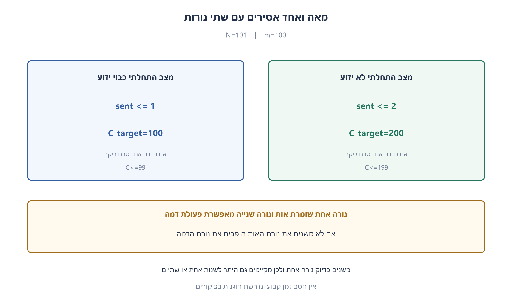
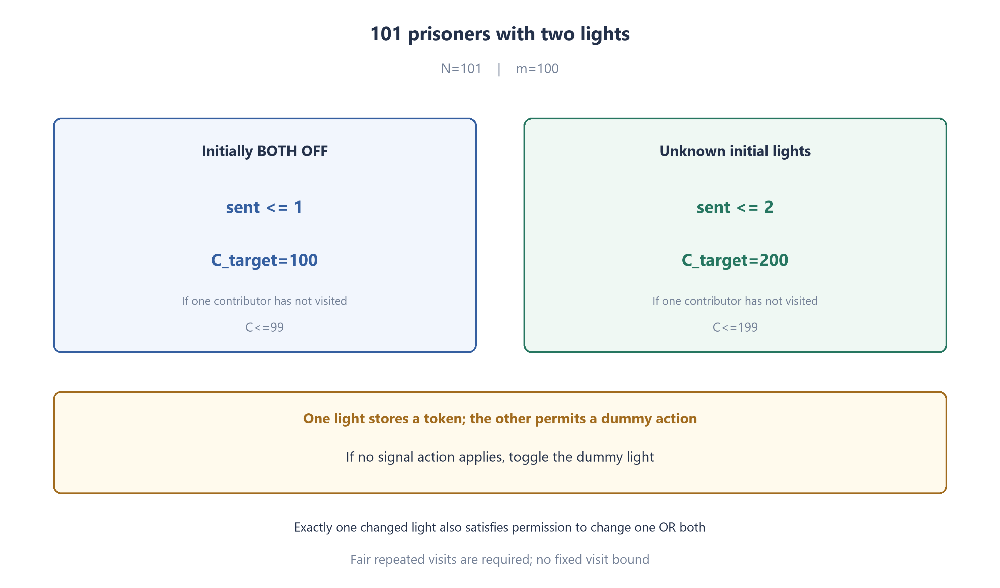

# PREP-054 — 17 אסירים — שני מתגים וחובת החלפה בכל ביקור

נקלטה ב־20 באוקטובר 2026. פתרון מוצע בסיוע AI. ביקורת מקצועית, בדיקת תרגום אנושית ובדיקת זכויות שימוש ממתינות. קושי אינו מכויל. שיוכי החברות הם דיווחי צילום המקור בלבד, ללא אימות עצמאי.

## מקור ללא שינוי



יש 17 אסירים, כל פעם לוקחים אסיר באקראיות והוא נכנס לחדר (אסירים לא יודעים מי נכנס בכל פעם לחדר והם גם לא מדברים ביניהם), בחדר יש 2 מתגים. האסיר חייב ללחוץ על אחד מהמתגים ולצאת — איך נדע שכל האסירים היו בחדר? (אין צורך ביעילות אלא רק להביא פתרון שמצליח)

## נוסח השאלה לאתר

יש 17 אסירים מבודדים. בכל ביקור נכנס אסיר אחד בלבד לחדר המשותף ויוצא ממנו לפני הבא אחריו. מותר לאסירים להסכים מראש על תוכנית ולמנות בעלי תפקידים, אך אחרי תחילת התהליך אין ביניהם תקשורת מלבד מצב המתגים. כל אסיר זוכר את פעולותיו שלו; אין לספור זמן, לשמוע אחרים או להשאיר סימנים נוספים.

בחדר שני מתגים דו־מצביים שניתן לראות את מצבם. בכל ביקור חובה להפוך בדיוק מתג אחד: מכבוי לדלוק או להפך. אסור להשאיר את שניהם ללא שינוי ואסור להפוך את שניהם באותו ביקור. מצבם ההתחלתי של שני המתגים אינו ידוע.

הבחירה אקראית והוגנת: כל אסיר נבחר שוב ושוב כמעט בוודאות, למשל בחירה עצמאית ואחידה בכל ביקור. תכננו תוכנית שבה אסיר יוכל בשלב מסוים להכריז בוודאות שכל 17 האסירים כבר היו בחדר לפחות פעם אחת. הסבירו מדוע אין הכרזה מוקדמת שגויה ומדוע התהליך יסתיים תחת הנחת ההוגנות. אין דרישה למספר ביקורים מינימלי או לחסם זמן קבוע.

הבהרות: האפשרות להסכמה מוקדמת, הזיכרון המקומי, מצב התחלתי לא ידוע והנחת ההוגנות נאמרים במפורש בעריכה משום שהמקור אינו מפרט את כולם. הסבירו גם כיצד התוכנית מתקצרת אם ידוע מראש שמתג האות כבוי.

### שלושה רמזים

1. אין צורך שכל אסיר ידע מי כבר ביקר. אפשר למנות אסיר אחד שיאסוף סימנים מהאחרים, ולתת לכל אסיר מספר מוגבל של סימנים.
2. מתג האות יכול לייצג סימן אחד שממתין לאיסוף. רק הסופר יכבה אותו, והאחרים ידליקו רק כשהוא כבוי. חישבו איך מצב התחלתי דלוק יכול להיראות כמו סימן שלא נשלח.
3. אפשרו לכל אחד מ־16 האסירים האחרים לשלוח לכל היותר שני סימנים. כמה סימנים לכל היותר יוכל הסופר לאסוף אם אחד מהם עוד לא ביקר, כולל סימן התחלתי שגוי? השתמשו במתג השני לפעולת חובה שאינה נוגעת למתג האות.

## הצעה לפתרון

**פתרון מוצע — מתג אחד מעביר הודעות, והמתג השני מאפשר לא לפגוע בהן.**

נמנה אסיר אחד לסופר ואת 16 האחרים למדווחים. הסופר אוסף הודעות, לא סופר ביקורים: גם אם אותו אסיר נכנס שוב ושוב, יש לו מכסה מוגבלת של הודעות. נתחיל במקרה הפשוט שבו מתג הספירה מתחיל כבוי, ואז נתאים את הכללים למצב ההתחלתי הלא ידוע שבשאלה.

### שני מתגים, שני תפקידים

- **מתג א׳ — מתג הספירה (S):** למעלה פירושו שיש הודעה שממתינה לסופר; למטה פירושו שאפשר להשאיר הודעה חדשה. רק מדווחים מעלים אותו, ורק הסופר מוריד אותו.
- **מתג ב׳ — מתג הסרק (D):** בכל ביקור שבו לא משנים את מתג א׳, הופכים את מתג ב׳ במקום. לא מפיקים ממנו מידע, ומצבו ההתחלתי אינו משנה.

כך תמיד הופכים בדיוק מתג אחד. מתג הסרק מאפשר לקיים את חובת הפעולה בלי למחוק הודעה שעוד לא נאספה.

### מתחילים בפשטות: מתג א׳ מתחיל למטה, והדבר ידוע

זהו מקרה לימוד פשוט, לא הנחת הפתיחה של השאלה המקורית. מספיק לדעת שמתג א׳ כבוי; מתג ב׳ יכול להתחיל בכל מצב.

כל מדווח זוכר רק: **האם כבר שלחתי את ההודעה שלי?**

| מי נכנס? | מה הוא רואה או זוכר? | מה הוא עושה? |
| --- | --- | --- |
| מדווח | א׳ למטה, וטרם שלח הודעה | מעלה את א׳ וזוכר ששלח; לא ישלח שוב |
| מדווח | א׳ למעלה, או שכבר שלח | הופך רק את ב׳ |
| הסופר | א׳ למעלה | מוריד את א׳ ומוסיף 1 למונה שלו |
| הסופר | א׳ למטה | הופך רק את ב׳; המונה לא משתנה |

לדוגמה, דני נכנס ומעלה את א׳. יוסי נכנס אחריו: הוא רואה שיש הודעה ממתינה, ולכן הופך רק את ב׳ ועדיין לא מסמן לעצמו ששלח. כשהסופר מגיע, הוא מוריד את א׳ וסופר הודעה אחת. רק כעת אפשר להשאיר את ההודעה הבאה.

ההודעה אינה נמחקת כשהאחרים נכנסים, והסופר אינו יכול לספור אותה פעמיים: אחרי שאסף אותה, א׳ שוב למטה. גם דני אינו יכול לייצר הודעות נוספות, כי הוא זוכר שכבר שלח.

**כשהסופר מגיע ל־16, כל 16 המדווחים בוודאות ביקרו.** כל אחד יכול היה לתרום לכל היותר הודעה אחת, ולכן 16 ההודעות באו מ־16 אנשים שונים. הסופר עצמו נמצא בחדר, ולכן כל 17 האסירים ביקרו.

### חוזרים לשאלה: מה אם מתג א׳ התחיל למעלה?

הסופר עלול להיכנס, להוריד אותו ולספור הודעה שאיש לא שלח. כך הוא עלול להגיע ל־16 עם 15 הודעות אמיתיות בלבד, בזמן שאסיר אחד כלל לא ביקר. זו הסיבה שהשיטה הפשוטה אינה מספיקה למצב התחלתי לא ידוע.

המצב ההתחלתי יכול להוסיף **לכל היותר הודעה מדומה אחת**: הסופר מכבה אותה באיסוף הראשון; כל הדלקה מאוחרת יותר חייבת להגיע ממדווח.

### הפתרון למצב לא ידוע: מכסה של שתי הודעות וספירה עד 32

משנים רק שני דברים:

1. כל מדווח רשאי לשלוח **עד שתי הודעות בסך הכול**, בביקורים נפרדים. הוא זוכר אם שלח 0, 1 או 2. הוא מעלה את א׳ רק כשהוא למטה ונותרה לו מכסה; בכל מקרה אחר הופך רק את ב׳.
2. הסופר פועל כמקודם, אבל מכריז רק אחרי **32 איסופים**. כשהוא מוריד את א׳, הוא מוסיף 1; אם א׳ כבר למטה, הוא הופך רק את ב׳ בלי לספור.

| מצב הפתיחה של א׳ | מכסת הודעות לכל מדווח | מתי הסופר מכריז? |
| --- | --- | --- |
| ידוע שלמטה | עד הודעה אחת | אחרי 16 איסופים |
| לא ידוע — השאלה שלנו | עד שתי הודעות | אחרי 32 איסופים |

### למה 32 מוכיח שכולם ביקרו?

דמיינו שאסיר אחד עדיין לא נכנס אפילו פעם אחת. נשארים רק 15 מדווחים שיכולים לשלוח הודעות. כל אחד רשאי לשלוח עד שתיים:

```text
15 × 2 = 30 הודעות אמיתיות לכל היותר
30 + 1 = 31, גם עם ההודעה המדומה מההתחלה
```

**אם חסר אפילו מדווח אחד, אי אפשר להגיע ל־32.** לכן ספירה של 32 מוכיחה שכל 16 המדווחים ביקרו. גם הסופר ביקר, כי ההכרזה נעשית בזמן ביקורו.

אין צורך לדעת מי שלח כל הודעה. גם אין צורך שכולם ישלחו פעמיים לפני ההכרזה: אם הייתה הודעה מדומה בהתחלה, ייתכן שאחד המדווחים שלח רק פעם אחת. המטרה היא להוכיח שכולם **ביקרו**, לא שכולם מיצו את מכסתם.

### למה התהליך יסתיים?

הודעה שנשארת למעלה מחכה עד לביקור הבא של הסופר. כשא׳ למטה ועדיין לא הגענו ל־32, יש מדווח שנותרה לו מכסה; בביקור מתאים הוא יוכל לשלוח. כל שליחה או איסוף מקדמים את התהליך.

בהנחה שכל אסיר ממשיך להיבחר שוב ושוב, נגיע לסף. בבחירה עצמאית ואחידה זה קורה בהסתברות 1. אין מספר ביקורים קבוע שמבטיח סיום: ייתכנו ביקורים רבים שבהם רק הופכים את ב׳. אם אסיר מסוים לעולם אינו נבחר, התהליך עלול לא להסתיים, אבל לא תצא ממנו הכרזה שגויה.

### זיכרון ובדיקות

בגרסה הראשית כל מדווח זוכר 0, 1 או 2 שליחות, והסופר זוכר מונה עד 32. כל ביקור דורש עבודה קבועה; אין כאן טענה למינימום ביקורים או זמן המתנה. הקוד המצורף הוא מודל בדיקה: במציאות כל אסיר יודע רק את זיכרונו שלו ואת מצב המתגים, ולא קורא את המונים של האחרים. בדיקות המצבים מאמתות את כללי האיתות ואת בטיחות ההכרזה; הוכחת הסיום דורשת בנפרד את הנחת הביקורים ההוגנים.



### assumptions

[
  "17 אסירים, אחד בחדר בכל פעם, עם הסכמה מוקדמת וזיכרון אישי.",
  "מצב מתג האות אינו ידוע בהתחלה; נדרש להיות בטוחים גם אם הוא דלוק.",
  "בכל ביקור הופכים בדיוק מתג אחד; מתג דמה מאפשר לקיים זאת בלי לשבש אותות.",
  "רק המתגים משמשים לתקשורת לאחר הבידוד; אין תזמון, סימנים או שמיעת אחרים.",
  "סיום מותנה בביקורים חוזרים והוגנים של כל אסיר; בטיחות אינה תלויה בהוגנות.",
  "אין דרישה למינימום ביקורים ואין חסם זמן קבוע."
]

### optimality

{
  "criterion": "הכרזה בטוחה עם מצב התחלתי לא ידוע וסיום תחת הוגנות.",
  "result": "סופר אחד, 16 מדווחים עם עד שני אותות כל אחד, וסף 32.",
  "proof": "אם מדווח אחד לא ביקר ניתן לספור לכל היותר 31, כולל אות התחלתי שגוי. לכן 32 מבטיח שכולם ביקרו.",
  "scope": "זו הוכחת בטיחות של הבנייה; אין טענה למינימום ביקורים, תוחלת זמן, זיכרון או מספר שינויים. ללא הוגנות אין הבטחת סיום."
}

### verification

"חיפוש ממצה עם צמצום סימטריה בדק 2,436 מצבים נגישים ו־8,932 מעברים בכל מצבי ההתחלה המותרים. נבדקו שימור אסימונים, היעדר הכרזה כשמדווח טרם שלח, מכסת שתי שליחות ופעולה חוקית בכל ביקור. נוספו 400 ריצות אקראיות עם זיכרון אישי. זהו מודל פייתון; סימולציות סופיות אינן הוכחת סיום בכל סדר ואין ניסוי פיזי או אישור מומחה. הוכחת סיום משתמשת בנפרד בהנחת הוגנות."

### edge_cases

[
  "מתג אות דלוק בהתחלה מוסיף לכל היותר אות שגוי אחד; סף כפול מגן מפניו.",
  "ביקורים חוזרים של אותו מדווח אינם מאפשרים יותר משתי שליחות.",
  "סופר שמגיע שוב בלי הדלקה חדשה אינו סופר אותו אות פעמיים.",
  "מדווח שאינו יכול לשלוח אינו מכבה אות שממתין לסופר.",
  "בכל ביקור הופכים בדיוק מתג אחד; מתג דמה מאפשר לקיים זאת בלי לשבש אותות.",
  "סדר לא הוגן עשוי לא להסתיים אך אינו גורם להכרזה שגויה.",
  "ידיעה שכל האסירים רשאים לבקר אינה מוכיחה שאכן יבחרו את כולם."
]

### common_mistakes

[
  "להשתמש באות אחד מכל מדווח ובסף 16 כאשר המצב ההתחלתי לא ידוע.",
  "לספור ביקורים במקום הדלקות חדשות שנאספו.",
  "לאפשר למדווח לכבות מתג אות דלוק ולאבד דיווח של אחר.",
  "להתיר מספר לא מוגבל של אותות מכל מדווח.",
  "להבטיח סיום תוך מספר ביקורים קבוע או בלי הוגנות.",
  "לחשוב שהסופר צריך לדעת את זהות שולח האות.",
  "לשכוח להפוך מתג בביקור חסר תועלת, או להפוך את שני המתגים."
]

### interview_answer

"נמנה סופר. כל אחד מ־16 האחרים ידליק את מתג האות כשהוא כבוי, לכל היותר פעמיים. רק הסופר יכבה ויספור. בכל ביקור בלי שינוי אות הופכים את מתג הדמה כדי לשנות בדיוק מתג אחד. הסופר מכריז ב־32: אם אחד לא ביקר, יש לכל היותר 31 אותות כולל אות התחלתי שגוי. תחת הוגנות התהליך מסתיים; אין חסם זמן קבוע. אם מתחילים בכבוי ידוע, די באות אחד לכל מדווח ובסף 16."

### source_ambiguities

{
  "agreement": "אפשרות להסכמה מוקדמת וזיכרון אישי לא נאמרת במלואה במקור ונדרשת לפרוטוקול המוצע.",
  "initial_state": "המקור אינו קובע את מצב ההתחלה; הפתרון הראשי עובד גם במצב לא ידוע ומפריד את חלופת הכבוי הידוע.",
  "fairness": "אינסוף הזדמנויות או בחירה אקראית לא מפורטת אינם חסם זמן; ההנחה הנוספת היא שכל אסיר חוזר שוב ושוב.",
  "variant": "שני מתגים עם פעולת חובה אינם זהים לנורה אחת שאפשר להשאיר ללא שינוי."
}

### solution_extensions

{
  "question": "מדוע אי אפשר להבטיח שההכרזה תגיע אחרי מספר ביקורים קבוע, גם עם התוכנית הנכונה?",
  "direction": "אפשר לבחור שוב ושוב את אותו אסיר לפני שמגיעים לאחר. לכל חסם סופי אפשר לבנות קידומת ביקורים ארוכה יותר שחסרים בה אסירים. הוגנות מבטיחה סיום עתידי, לא חסם אחיד. בבחירה אקראית גם רצף ארוך כזה בעל הסתברות חיובית.",
  "status": "המשך מוכן בתוכן; אינו מחובר לתור ההמשך החי."
}

## English website wording

There are 17 isolated prisoners. One prisoner at a time enters the shared room and leaves before the next visitor. They may agree on a strategy and roles beforehand, but afterward their only communication is through the visible switch state. Each prisoner remembers their own actions. No timing, overhearing or extra marks are allowed.

The room contains two visible two-state switches. Every visit MUST toggle exactly one switch: OFF to ON or ON to OFF. Leaving both unchanged or toggling both is forbidden. Neither initial switch state is known.

Selection is random and fair: every prisoner is selected repeatedly almost surely, for example by independent uniform choices on every visit. Design a strategy allowing a prisoner eventually to declare with certainty that all 17 have visited at least once. Explain both why a false early declaration is impossible and why the protocol eventually finishes under fairness. Minimum visits and a fixed time bound are not required.

Editorial clarification: pre-agreement, private memory, unknown initial state and fairness are stated explicitly because the source does not fully specify them. Also explain the simpler variant when the signal switch is initially known OFF.

### Three hints

1. Not everyone needs to know who has visited. Designate one prisoner to collect signals and give every other prisoner a bounded allowance of signals.
2. The signal switch can store one pending token. Only the counter turns it OFF; contributors turn it ON only while it is OFF. How can an initially ON state masquerade as a token nobody sent?
3. Let each of the 16 contributors send at most two tokens. How many can the counter collect if one contributor has never visited, including one possible phantom initial token? Use the second switch for mandatory actions that must not alter the signal switch.

## Proposed solution

**Proposed solution — one switch carries messages; the other lets visitors leave those messages intact.**

Choose one prisoner as the counter and the other 16 as reporters. The counter collects messages, not visits: repeated visits by one person cannot create unlimited messages. First understand the simpler case where the signal switch is known to start OFF; then adapt it to the unknown initial state in the actual question.

### Two switches, two jobs

- **Switch A — the signal switch (S):** UP means a message is waiting for the counter; DOWN means a new message can be left. Only reporters turn it ON, and only the counter turns it OFF.
- **Switch B — the dummy switch (D):** whenever a visitor does not change A, they toggle B instead. Nobody reads information from B, so its initial state is irrelevant.

Every visit therefore toggles exactly one switch. The dummy satisfies the mandatory action without erasing a message that has not been collected.

### Start with the simple case: A is initially known DOWN

This is a learning example, not the original question's initial-state assumption. Only A must be known OFF; B may start in either state.

Each reporter remembers just: **Have I already sent my message?**

| Visitor | What do they see or remember? | Action |
| --- | --- | --- |
| Reporter | A is DOWN and they have not sent | Turn A UP, remember sending, and never send again |
| Reporter | A is UP, or they have already sent | Toggle B only |
| Counter | A is UP | Turn A DOWN and add 1 to their count |
| Counter | A is DOWN | Toggle B only; do not change the count |

For example, Dan enters and turns A UP. Joseph enters next: a message is waiting, so he toggles only B and does not mark himself as having sent. When the counter arrives, they turn A DOWN and count one message. Only now can the next message be left.

Other visitors do not erase the waiting message. The counter cannot count it twice, because collecting it leaves A DOWN. Dan cannot create extra messages either, because he remembers already sending.

**At 16 collections, all 16 reporters must have visited.** Each person could contribute at most one message, so the 16 messages came from 16 different people. The counter is also in the room, which accounts for all 17 prisoners.

### Back to the actual question: what if A started UP?

The counter could enter, turn it DOWN and count a message nobody sent. They could then reach 16 with only 15 genuine messages while one prisoner has never visited. That is why the simple strategy is unsafe when the initial state is unknown.

The initial state can contribute **at most one phantom message**: the counter clears it on the first collection; every later ON event must come from a reporter.

### The unknown-state solution: two-message allowance and a target of 32

Change just two things:

1. Each reporter may send **at most two messages in total**, on separate visits. They remember sending 0, 1 or 2. They turn A UP only when it is DOWN and they have unused allowance; otherwise they toggle B only.
2. The counter acts as before but declares only after **32 collections**. Turning A DOWN adds 1; finding it already DOWN means toggling B without counting.

| Initial state of A | Allowance per reporter | Declaration target |
| --- | --- | --- |
| Known DOWN | At most one message | 16 collections |
| Unknown — our actual question | At most two messages | 32 collections |

### Why does 32 prove that everyone visited?

Imagine one prisoner has never entered. Only 15 reporters remain available to send messages, each at most twice:

```text
15 × 2 = at most 30 genuine messages
30 + 1 = 31, even with the initial phantom message
```

**With even one reporter missing, 32 is impossible.** Reaching 32 therefore proves that all 16 reporters visited. The counter also visited, because the declaration happens during their visit.

The counter does not need to identify each sender. Nor must everyone send twice before the declaration: with an initial phantom message, one reporter may have sent only once. The goal is to prove that everyone **visited**, not that everyone exhausted their allowance.

### Why will the process finish?

An UP message waits until the counter returns. If A is DOWN and the count is still below 32, some reporter has unused allowance and can send on a suitable visit. Every send or collection advances the process.

If every prisoner keeps being selected repeatedly, the target is eventually reached. Independent uniform selection has this property with probability 1. There is no fixed visit bound: many visits may merely toggle B. A schedule that never selects some prisoner can stall forever, but cannot produce a false declaration.

### Memory and checks

In the main version each reporter remembers 0, 1 or 2 sends, and the counter remembers a count through 32. Each visit takes constant work; no minimum-visit or waiting-time claim is made. The attached code is a test model: real prisoners know only their own memory and the visible switches, not everyone else's counters. State exploration checks the signaling rules and declaration safety; termination separately requires fair repeated visits.



### assumptions

[
  "17 prisoners, one visitor at a time, with prior agreement and private memory.",
  "The signal's initial state is unknown; initially ON must be safe too.",
  "Every visit toggles exactly one switch; a dummy satisfies this without disturbing tokens.",
  "Only switches communicate after isolation; no timing, marks or overhearing.",
  "Termination assumes fair repeated visits by every prisoner; safety does not require fairness.",
  "Minimum visits and a fixed time bound are not required."
]

### optimality

{
  "criterion": "Safe declaration from unknown initial state, terminating under fairness.",
  "result": "One counter, 16 contributors sending at most twice each, threshold 32.",
  "proof": "With one contributor absent at most 31 collections are possible, including one phantom initial token; 32 therefore certifies all visited.",
  "scope": "This proves construction safety, not minimum visits, expected time, memory or toggles. Without fairness termination is not guaranteed."
}

### verification

"Exhaustive symmetry-reduced search covered 2,436 reachable states and 8,932 transitions across all allowed initial switch settings. It checked token conservation, no declaration with an unsignaled contributor, two-token allowance and legal action on every visit. Added 400 seeded individual-memory simulations. These are Python models, not physical trials or expert approval; finite simulations are not universal termination proof. The written liveness proof separately assumes fairness."

### edge_cases

[
  "Initially ON contributes at most one phantom token; the doubled threshold covers it.",
  "Repeated visits by one contributor cannot create more than two tokens.",
  "A counter returning without a new ON event cannot recount a token.",
  "A contributor unable to send never erases a pending token.",
  "Every visit toggles exactly one switch; a dummy satisfies this without disturbing tokens.",
  "An unfair order may not terminate but cannot cause a false declaration.",
  "Permission for everyone to visit does not guarantee they will be selected."
]

### common_mistakes

[
  "Using one token each and threshold 16 from an unknown initial state.",
  "Counting visits instead of newly collected ON signals.",
  "Letting contributors turn OFF a pending signal and erase somebody else's token.",
  "Allowing unlimited signals from one contributor.",
  "Promising fixed-time termination or termination without fairness.",
  "Assuming the counter must know the sender's identity.",
  "Forgetting the mandatory toggle on an unproductive visit or toggling both switches."
]

### interview_answer

"Choose one counter. Each of the other 16 turns the signal ON while it is OFF at most twice. Only the counter turns it OFF and counts. On every visit without a signal change, toggle the dummy to satisfy exactly one toggle. Declare at 32: one absent contributor permits at most 31 tokens including a phantom initial ON. Fairness ensures eventual termination without a fixed bound. Known initial OFF permits one token each and threshold 16."

### source_ambiguities

{
  "agreement": "Prior agreement and private memory are not fully specified in the source and are required by this strategy.",
  "initial_state": "The source does not fix the initial state; the main solution handles unknown state and separates the known-OFF variant.",
  "fairness": "Unlimited opportunities or unspecified randomness do not create a time bound; repeated visitation of every prisoner is the added assumption.",
  "variant": "Two switches with a mandatory toggle are not the same as one optional light."
}

### solution_extensions

{
  "question": "Why can no fixed visit bound guarantee a declaration even with the correct protocol?",
  "direction": "The same prisoner can be selected repeatedly before another arrives. For any finite bound construct a longer prefix missing someone. Fairness guarantees eventual progress, not a uniform bound. Random selection assigns positive probability even to a long delaying prefix.",
  "status": "Follow-up prepared in content; not connected to the live follow-up queue."
}

## Files and verification

- [prep_054_two_switches.py](../solutions/prep_054_two_switches.py)

- [Verification script](../checks/check_prep_054_057.py)

- [Verification evidence](../checks/prep-054-verification.json)

No chat hint/solution request is recorded as learner activity. Publication is a pilot content action, not professional approval. The authored follow-up remains unconnected to the interactive queue.

## תוספת מקור מ־21 באוקטובר 2026 — וריאציית מאה ואחד אסירים

נוספה וריאציה בלבד. השאלה, הרמזים והפתרון המקוריים של 17 האסירים נשמרים לעיל. הפתרון החדש מוצע בסיוע AI וביקורת מקצועית, בדיקת תרגום אנושית וזכויות שימוש ממתינות.



אתה יחד עם עוד 100 אסירים, אתם נקראים להיכנס לחדר עם שתי מנורות (אינסוף פעמים לצורך העניין). כשאתה נקרא לחדר אתה חייב לשנות את המצב של המנורות בחדר (להדליק או לכבות 1 או 2 נורות).
מנהל בית הכלא אומר לכם שהוא נותן לכם אפשרות לומר לו מתי הנקודה שבה כל האסירים היו בחדר. אם תצדקו כולם תצאו לחופשי, אם לא יהרוג את כולכם.

מותר לכם לדבר לפני פעם אחת, ובמשך הקוראה לחדר אף אחד לא יודע כשקוראים למישהו אחר ומתי.

א. מה האלגוריתם שלך לפיתרון (ההנחה היא שהמנורות מכובות בהתחלה)?
ב. אם אתה לא יודע את תנאי ההתחלה, כלומר אתה לא יודע מה המצב בחדר לפני שהראשון נכנס אליו, איך היית פותר?

### וריאציה נוספת — אתם ועוד מאה אסירים, מאה ואחד בסך הכול

זו וריאציה נפרדת של אותו מנגנון תקשורת, ואינה מחליפה את שאלת 17 האסירים שלמעלה. אתם ועוד 100 אסירים נכנסים בתורם לחדר עם שתי נורות שמצבן גלוי. מותר להסכים על תוכנית פעם אחת מראש; אחר כך כל אסיר יודע רק על ביקוריו שלו ועל הנורות בביקורו. בכל ביקור חייבים לשנות מצב של **נורה אחת או שתי נורות**. מותר לכן לשנות בדיוק אחת, אך אסור להשאיר את שתיהן כפי שהיו.

א. שתי הנורות כבויות בהתחלה, והדבר ידוע לכולם. מתי אפשר להכריז בבטחה שכל 101 האסירים ביקרו?

ב. המצב ההתחלתי של שתי הנורות אינו ידוע. תנו תוכנית בטוחה גם למצב זה.

הסבירו מדוע אין הכרזה מוקדמת שגויה ומדוע יהיה סיום תחת ביקורים חוזרים והוגנים של כל אסיר. אינסוף הזדמנויות אינו לבדו תנאי הוגנות ואין חסם ביקורים קבוע. זהו שינוי גם במספר האסירים וגם בהיתר לשנות אחת או שתיים, לעומת חובת שינוי של בדיוק מתג אחד בגרסה הראשית. אין תקשורת נוספת, סימנים או תזמון משותף לאחר ההסכמה.

1. מנו נכון את המשתתפים: אתם ועוד מאה הם מאה ואחד. אפשר להשתמש בנורה אחת לאות ובשנייה לפעולות חובה שאינן נושאות מידע.
2. במצב התחלתי כבוי ידוע, אות אחד מכל מדווח מספיק. חשבו כמה מדווחים יש אחרי שממנים סופר אחד.
3. במצב התחלתי לא ידוע, נורה דלוקה יכולה להוסיף אות מדומה אחד. אפשרו שתי שליחות מכל מדווח והוכיחו שסף 200 אינו אפשרי אם אחד מתוך המאה לא ביקר.

### פתרון מוצע לווריאציית 101 האסירים ושתי הנורות

אתם ועוד 100 הם **101**, ולא 100. אפשר למנות אתכם לסופר, ואת מאה האחרים למדווחים. נורה אחת S תשמור אות שממתין לסופר, והנורה השנייה D תהיה נורת דמה.

בשני הסעיפים משתמשים רק בפעולות שמשנות נורה אחת. הדבר חוקי גם כאשר מותר לשנות אחת או שתיים; אין חובה לנצל את האפשרות לשנות שתיים. בכל ביקור שבו לא מדליקים או מכבים את S לפי הכללים, הופכים את D. כך לעולם לא נשארות שתי הנורות ללא שינוי, ולעולם לא מוחקים אות בטעות באמצעות שינוי שתיהן.

**א. שתיהן כבויות בהתחלה:** כל אחד ממאה המדווחים רשאי להדליק את S פעם אחת בלבד, ורק אם היא כבויה. אם היא דלוקה, או שכבר שלח, הוא הופך את D במקום. הסופר מכבה S דלוקה וסופר איסוף אחד; אם היא כבויה הוא הופך את D. כשהסופר מגיע ל־100 איסופים הוא מכריז. רק מדווח יכול ליצור הדלקה, כל מדווח עושה זאת לכל היותר פעם, ולכן 100 איסופים מוכיחים ביקור של כל מאה המדווחים. גם הסופר עצמו ביקר.

**ב. מצב התחלתי לא ידוע:** כל מדווח רשאי להדליק S כבויה לכל היותר פעמיים בסך הכול, בביקורים נפרדים. הסופר מכבה וסופר כמקודם, אבל מכריז רק ב־200. נורת דמה שמתחילה דלוקה אינה משנה דבר; מצב התחלתי דלוק של S יכול להוסיף לכל היותר איסוף שגוי אחד.

אם מדווח אחד מתוך המאה לא ביקר, 99 האחרים יכולים לספק לכל היותר 198 אותות. גם עם אות התחלתי שגוי מגיעים לכל היותר ל־199, ולכן אי אפשר להגיע ל־200 בלי שכולם ביקרו:

```text
missing one contributor: C <= 2*99 + 1 = 199 < 200
```

לא נדרש שכל מדווח יסיים את שתי שליחותיו לפני ההכרזה; צריך רק להוכיח שביקר. הסופר עצמו בהכרח ביקר כי ההכרזה נעשית במהלך ביקורו.

**סיום והוגנות:** אם יש אות דלוק, ביקור עתידי של הסופר יכבה אותו ויספור. אם האות כבוי ועוד לא נאספו מספיק, יש מדווח עם מכסה שלא נוצלה, ותחת הוגנות יגיע ביקור מועיל. כל שליחה או איסוף מקדמים מכסה סופית. סדר הוגן מסתיים; סדר שאינו בוחר אסיר מסוים יכול להתעכב לעד, אך לא להפיק הכרזה שגויה. אין מספר ביקורים קבוע שמבטיח סיום, ואין שימוש בלוח זמנים או בידיעת ביקורים של אחרים.

בדיקת המצבים הממצה של הסעיף הידוע בדקה 402 מצבים ו־1,196 מעברים; הסעיף הלא ידוע בדק 82,404 מצבים ו־324,772 מעברים בכל ארבע התחלות הנורות. נוספו 100 ו־400 ריצות פרטניות בהתאמה. נבדקו שימור אותות, סף בטוח, מכסה מקומית ושינוי של בדיוק נורה אחת בכל ביקור. זו בדיקת בטיחות של מודל, לא ניסוי עם אסירים או הוכחת סיום ללא הוגנות. קוד ותרשים נפרדים מצורפים לווריאציה; התוכן הראשי של 17 האסירים נשמר.



### Additional variant — you plus one hundred others,101 prisoners total

This is a separate variant of the same communication mechanism, not a replacement for the 17-prisoner question above. You and 100 others take turns in a room with two visible lights. One prior planning conversation is allowed; afterward each knows only their own visits and the lights observed on those visits. Every visit MUST change **one OR both lights**. Exactly one change is therefore permitted, but leaving both unchanged is forbidden.

A. Both lights are initially OFF and everyone knows it. When can you safely declare that all 101 prisoners have visited?

B. Neither light's initial state is known. Give a strategy safe for that case too.

Prove no false early declaration and eventual termination under fair repeated visits by every prisoner. Unlimited opportunities alone do not supply fairness, and there is no fixed visit bound. This changes both prisoner count and permitted one-or-both actions, compared with the main version’s exactly-one toggle. No other communication, marks or shared timing is available after planning.

1. Count carefully: you plus one hundred means 101. One light may carry tokens and the other satisfy mandatory actions without carrying information.
2. Known initial OFF needs one token per contributor. How many contributors remain after choosing one counter?
3. Unknown initial ON may add one phantom token. Allow two sends per contributor and show threshold 200 cannot occur if any of the hundred has not visited.

### Proposed solution for the 101-prisoner, two-light variant

You plus 100 others means 101, not 100. Designate yourself the counter and the other hundred as contributors. Light S stores a pending token; light D is a dummy.

Both parts use exactly one light change per visit. This is legal when one OR both changes are permitted; using both is optional. Whenever no S action below applies, toggle D. Thus neither both-unchanged nor accidental token erasure by toggling both occurs.

**A. Both initially OFF:** each of the hundred contributors turns S ON at most ONCE, only while it is OFF. If it is ON or that contributor has already sent, toggle D instead. The counter turns ON S OFF and counts a collection; when S is OFF, toggle D. Declare at 100 collections. Only contributors create ON events, each at most once, so 100 collections certify all hundred contributors. The counter has also visited.

**B. Unknown initial lights:** each contributor may turn OFF S ON at most TWICE in total, on separate visits. The counter clears and counts as before but declares only at 200. Initial dummy state is irrelevant; initially ON S can contribute at most one phantom collection.

If one of the hundred contributors has not visited, the other 99 can supply at most 198 tokens. Even one phantom initial token yields at most 199, so 200 is impossible unless all have visited:

```text
missing one contributor: C <= 2*99 + 1 = 199 < 200
```

The declaration does not require every contributor to have exhausted both signals; it certifies visiting. The counter has necessarily visited because the declaration happens on their visit.

**Termination and fairness:** an ON token is eventually cleared and counted by a future counter visit. If S is OFF and the target has not been reached, some contributor has unused allowance and fairness eventually supplies a productive visit. Every send/collect advances a finite token budget. Fair schedules terminate; a schedule forever excluding somebody can stall, but cannot yield a false declaration. There is no fixed visit bound and no use of a timetable or knowledge of others’ visits.

The known-state exhaustive search checked 402 states and 1,196 transitions; unknown state checked 82,404 states and 324,772 transitions across all four initial light settings. Added 100 and 400 individual-memory simulations respectively. Checked token conservation, safe threshold, local allowance and exactly one changed light on every visit. This is model safety verification, not a prisoner experiment or termination proof without fairness. Separate code and a figure accompany the variant; the original 17-prisoner content is preserved.



- [Variant code](../solutions/prep_054_101_prisoners_variant.py)
- [Variant checks](../checks/check_prep_054_101.py)
- [Variant evidence](../checks/prep-054-101-verification.json)

## עדכון ניסוח — 24.10.2026

ההסבר הראשי שוכתב על בסיס הניסוח שהראל שלח: תפקידי מתג הספירה ומתג הסרק, דוגמת פתיחה כבויה וטבלת פעולות, ואז התאמה מפורשת למצב התחלתי לא ידוע. הנוסח מדייק שמותר לשלוח עד פעמיים ושהסופר סופר הודעות. וריאציית 101 האסירים, השאלה, הרמזים וקוד המודל נשמרו. שינוי הנוסח אינו יורש את האישור האנושי של גרסת הפתרון הקודמת.

[ניסוח ההסבר שמסר הראל](../sources/prep-054-user-explanation-2026-10-24.md) נשמר כחומר עריכה בנפרד מנוסח הלומד.
