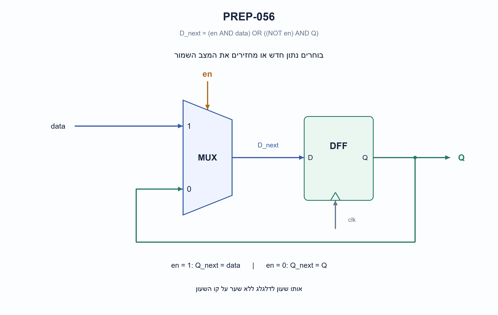
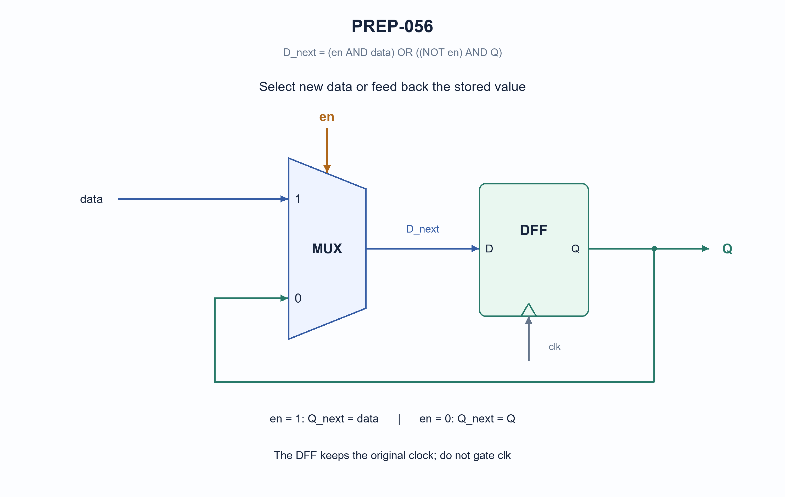

# PREP-056 — מימוש דלגלג עם אפשור באמצעות דלגלג רגיל ומשוב

**Status:** in review; AI-assisted proposed solution; difficulty uncalibrated. No human approval or learner tracking.

## Preserved original source

נתון פליפ-פלופ רגיל עם הכניסות data, clk ויציאת Q. עליכם לממש באמצעות הפליפפלופ ורכיבים לוגים נוספים פליפ-פלופ עם כניסת en

- [sources/prep-056.png](../sources/prep-056.png)

Companies reported only by supplied sources: Samsung, Apple.

## he: מימוש דלגלג עם אפשור באמצעות דלגלג רגיל ומשוב

נתון דלגלג D רגיל בעל כניסת נתון, שעון ומוצא. הוסיפו כניסת אפשור כך שבכל חזית שעון עולה, אם האפשור הוא 1 יישמר הנתון החדש, ואם הוא 0 יישמר הערך הקודם. מותר להשתמש בלוגיקה צירופית ובדלגלגים נוספים אם צריך. שרטטו את החיבורים והסבירו את פעולתם.

הבהרת מודל: הנתון והאפשור סינכרוניים לשעון ועומדים בזמני הכנה והחזקה. אין דרישה לאיפוס או לערך התחלתי קבוע. יש לשמר את שעון הקלט המקורי; אין לשער אותו באמצעות AND פשוט.

### Hints

1. מה צריך להופיע בכניסת D כדי שהדלגלג ישמור בדיוק את הערך שכבר קיים במוצא?
2. בכל חזית צריך לבחור בין שני מקורות נתונים: הנתון החדש והמוצא השמור. איזה רכיב מבצע בחירה כזאת?
3. הכניסו בורר לפני D: חברו את Q לכניסה 0, את הנתון לכניסה 1, ואת האפשור לבחירה.

### Proposed solution

**פתרון מוצע — בורר ומשוב, בלי לשנות את השעון.**

דלגלג D תמיד שומר את מה שנמצא בכניסת D בחזית הפעילה. כדי למנוע שינוי לא צריך למנוע את חזית השעון: אפשר פשוט להגיש לו שוב את הערך שהוא כבר מחזיק.

מציבים בורר 2:1 לפני כניסת D. כניסה 0 של הבורר מקבלת את Q, כניסה 1 מקבלת את הנתון החדש, והאפשור בוחר ביניהן. המוצא Q מתפצל גם החוצה וגם חזרה לבורר. קו המשוב הוא נתונים, לא שעון.

```text
D_next = en ? data : Q
D_next = (en AND data) OR ((NOT en) AND Q)
```

כשהאפשור 0, נבחר Q והחזית שומרת מחדש את אותו ערך. כשהאפשור 1, נבחר הנתון והוא נשמר בחזית. בין חזיתות המוצא נשאר קבוע גם אם הנתון או האפשור משתנים, בכפוף לאילוצי התזמון.

| אפשור | נתון | מצב לפני החזית | מצב אחרי החזית |
| --- | --- | --- | --- |
| 0 | כל ערך | Q | Q |
| 1 | 0 | כל ערך | 0 |
| 1 | 1 | כל ערך | 1 |

דוגמת ריצה בהנחה שלצורך ההדגמה המצב ההתחלתי הוא 0:

```text
edge:     1  2  3  4  5
data:     1  0  0  1  0
en:       1  0  1  0  1
Q_after:  1  1  0  0  0
```

הדלגלג הבודד הוא הזיכרון שחייבים לשמור. הבורר הוא צירופי ולכן אין צורך בדלגלג נוסף ואין מחזור השהיה נוסף על פעולת הדגימה הרגילה. אין לטעון שזה מינימום פיזי של שערים: ספריית תאים עשויה לספק דלגלג עם אפשור מובנה.

לא מחברים AND פשוט בין השעון לאפשור: שינוי אפשור בזמן שהשעון גבוה עלול ליצור חזית נוספת או פולס קצר. שער שעון ייעודי הוא פתרון אחר עם חוזה תזמון משלו, ואינו נחוץ כאן. איפוס לא נדרש במקור. בלי איפוס או טעינה ידועה, אין להניח שמוצא פיזי מתחיל באפס; דוגמת הריצה מניחה זאת לצורך הסבר בלבד.

קובץ SystemVerilog המצורף מממש במפורש את משוואת הבורר ומחבר את הדלגלג לשעון המקורי. קוד הפייתון הוא מודל דגימות, לא סימולציית HDL.



### assumptions

```json
[
  "דלגלג D דוגם בחזית עולה; האפשור והנתון עומדים בזמני הכנה והחזקה.",
  "המוצא הוא ביט אחד. אין דרישה לאיפוס או לערך הפעלה ידוע.",
  "השינוי הוא בנתיב הנתונים; השעון נשאר אותו שעון."
]
```

### optimality

```json
{
  "criterion": "מספר רכיבי הזיכרון הדרושים לשמירת ביט עם אפשור.",
  "result": "דלגלג אחד ובורר צירופי 2:1 מספיקים.",
  "proof": "כשאין טעינה צריך להבחין בין ערך שמור 0 לערך שמור 1; לכן נדרש זיכרון של ביט. משוב דרך הבורר מממש החזקה.",
  "scope": "אין טענה למינימום שערים, שטח, הספק או השהיה בספרייה פיזית."
}
```

### verification

```json
{
  "status": "בדיקות מודל פייתון עברו; ביקורת מקצועית עצמאית ממתינה.",
  "method": "השוואת משוואת השערים לאורקל שטוען רק כאשר האפשור פעיל.",
  "coverage": "כל 8 מעברי מצב/נתון/אפשור וכל 10,922 הרצפים באורכים 0–6 משני מצבי התחלה.",
  "script_path": "checks/check_prep_056_058_059_and_032_update.py",
  "scope": "לא בוצעו קומפילציה או סימולציית HDL, סינתזה או בדיקת תזמון פיזית."
}
```

### edge_cases

```json
[
  "אפשור 0 מחזיק גם כשהנתון מתחלף.",
  "אפשור 1 בכל חזית משחזר דלגלג D רגיל.",
  "ללא איפוס מצב ההתחלה הפיזי אינו מובטח.",
  "שינוי בין חזיתות אינו אמור לשנות Q; עדיין חייבים לכבד הכנה והחזקה."
]
```

### common_mistakes

```json
[
  "חסימת שעון באמצעות AND פשוט.",
  "חיבור המשוב לכניסה 1 והנתון לכניסה 0, שהופך את משמעות האפשור.",
  "הנחת ערך התחלה אפס בלי איפוס.",
  "הוספת דלגלג לאפשור ויצירת עיכוב של מחזור שלא נדרש."
]
```

### interview_answer

```json
"אשים בורר לפני D. האפשור יבחר בנתון החדש כשערכו 1 ובמשוב מהמוצא כשערכו 0. כך אותו שעון ממשיך להגיע לדלגלג ובחזית מתקבלת טעינה או החזקה. אין צורך בדלגלג נוסף או בשער על השעון."
```

### solution_extensions

```json
{
  "question": "איך מוסיפים איפוס סינכרוני בעל קדימות לאפשור?",
  "answer_outline": "בחזית, אם האיפוס פעיל טוענים 0; אחרת טוענים לפי הבורר. אפשר להוסיף בחירת איפוס לנתיב D בלי לחסום שעון.",
  "integration_status": "שאלת המשך מוכנה בתוכן; אינה מחוברת לתהליך ההמשך החי."
}
```

## en: Build a D flip-flop with enable using a normal DFF and feedback

Given an ordinary D flip-flop with data, clock and Q, add an enable input. At every rising clock edge, enable=1 must store the new data and enable=0 must retain the previous Q. Combinational logic and additional flip-flops are allowed if needed. Draw and explain the circuit.

Model clarification: data and enable are synchronous and meet setup/hold requirements. No reset or fixed initial value is required. Keep the original input clock; do not gate it with a plain AND gate.

### Hints

1. What should D receive to make the flip-flop store exactly the value it already holds?
2. At each edge select between two data sources: new data and stored Q. Which combinational component selects between them?
3. Put a 2:1 mux before D: connect Q to input 0, data to input 1 and enable to select.

### Proposed solution

**Proposed solution — a feedback mux, with the original clock unchanged.**

A D flip-flop stores D on the active edge. Retaining a value does not require suppressing that edge: feed the stored value back to D instead.

Put a 2:1 mux before D. Its input 0 receives Q, input 1 receives new data and select receives enable. Q fans out to both the external output and the feedback input. Feedback is a data path, not a clock path.

```text
D_next = en ? data : Q
D_next = (en AND data) OR ((NOT en) AND Q)
```

When enable is zero, the mux selects Q and the next edge stores the same value. When enable is one, the mux selects data and the edge captures it. Between edges Q remains unchanged even if data or enable changes, subject to setup/hold timing.

| Enable | Data | Q before edge | Q after edge |
| --- | --- | --- | --- |
| 0 | either | Q | Q |
| 1 | 0 | either | 0 |
| 1 | 1 | either | 1 |

For an illustrative assumed initial Q=0:

```text
edge:     1  2  3  4  5
data:     1  0  0  1  0
en:       1  0  1  0  1
Q_after:  1  1  0  0  0
```

One flip-flop provides the required storage. The mux is combinational, so no additional flip-flop or extra cycle of latency is needed. This is not a physical gate-count optimum; a cell library may contain an integrated enabled DFF.

Do not simply AND clock with enable. Changing enable while clock is high can create an extra edge or a short pulse. A dedicated clock-gating cell is a different design with its own timing contract and is unnecessary here. Reset was not requested: without reset or a known capture, hardware Q has no guaranteed power-up value. The trace assumes zero for illustration only.

The attached SystemVerilog explicitly implements the mux equation and retains the original clock. The Python code models sampled transitions and is not an HDL simulation.



### assumptions

```json
[
  "One-bit rising-edge DFF; enable and data meet setup/hold.",
  "No reset or guaranteed power-up value is requested.",
  "Only the data path changes; the input clock is unchanged."
]
```

### optimality

```json
{
  "criterion": "Storage elements required to retain one enabled bit.",
  "result": "One DFF plus a combinational 2:1 mux suffices.",
  "proof": "Disabled operation must distinguish stored zero and one, requiring one bit of state; mux feedback implements retention.",
  "scope": "No physical gate-count, area, power or delay optimum is claimed."
}
```

### verification

```json
{
  "status": "Python-model checks passed; independent professional review pending.",
  "method": "Compare the Boolean gate equation with an independent load-only-when-enabled oracle.",
  "coverage": "All 8 transitions and all 10,922 streams of lengths 0..6 from both initial states.",
  "script_path": "checks/check_prep_056_058_059_and_032_update.py",
  "scope": "No HDL compilation/simulation, synthesis or physical timing verification."
}
```

### edge_cases

```json
[
  "Enable zero holds even while data changes.",
  "Enable one on every edge behaves as a normal DFF.",
  "Without reset the hardware initial state is not guaranteed.",
  "Between-edge changes do not update Q; setup/hold still applies."
]
```

### common_mistakes

```json
[
  "Gating clock with a plain AND.",
  "Swapping mux data pins and inverting enable semantics.",
  "Assuming power-up zero without reset.",
  "Registering enable and introducing an unrequested extra cycle."
]
```

### interview_answer

```json
"Place a mux before D: enable selects new data when one and feedback Q when zero. The original clock still reaches the DFF, and each edge loads or retains the value. No extra flip-flop or clock gate is needed."
```

### solution_extensions

```json
{
  "question": "How do you add synchronous reset with priority over enable?",
  "answer_outline": "At the edge reset loads zero; otherwise use the enable mux. Add reset selection to D without gating the clock.",
  "integration_status": "Follow-up prepared in content; not connected to the live follow-up workflow."
}
```

## Implementation and verification

- [solutions/prep_056_dff_enable.py](../solutions/prep_056_dff_enable.py)
- [solutions/prep_056_dff_enable.sv](../solutions/prep_056_dff_enable.sv)
- [checks/check_prep_056_058_059_and_032_update.py](../checks/check_prep_056_058_059_and_032_update.py)
- [checks/prep-056-verification.json](../checks/prep-056-verification.json)

Follow-ups are authored but not connected to the live queue. No HDL compilation/simulation or physical-device test is implied.
