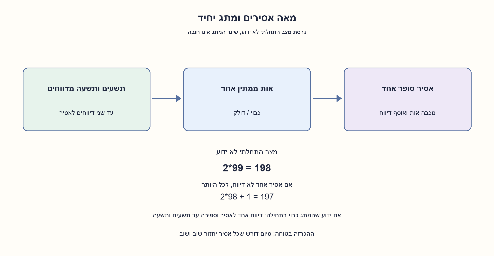
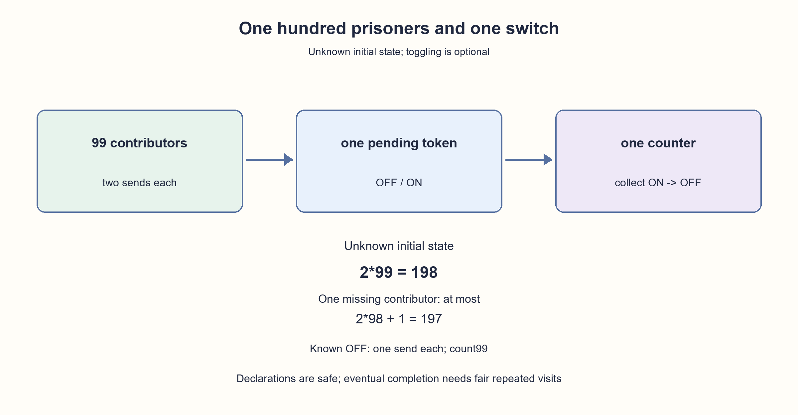

# PREP-057 — וריאציית100 אסירים

הצעה בסיוע AI; ביקורת אנושית ממתינה. המקור והרמזים הקודמים נשמרים.

[צילום המקור](../sources/2026-10-25-batch20-10.png)

## עברית

וריאציה נוספת:100 אסירים, חדר עם מתג יחיד וביקורים חוזרים. מותר לשנות את המתג או להשאירו כפי שהוא. האסירים מתאמים תוכנית מראש, זוכרים רק את פעולותיהם ואינם מתקשרים בזמן התהליך. כל אסיר, כולל הסופר, מבקר אינסוף פעמים בהנחת ההוגנות הנתונה. מצב המתג ההתחלתי אינו ידוע. תכננו הכרזה בטוחה שכולם ביקרו, והוכיחו סיום תחת ההוגנות; אל תבטיחו חסם קבוע על מספר הביקורים. ציינו בנפרד מה מתקצר אם ידוע שהמתג כבוי בתחילה. גרסת21 האסירים המקורית נשמרת.

1. הפרידו בין אסיר אחד שסופר לבין99 שמדווחים, ובין ביקור לבין אות שניתן לאסוף.
2. מתג דולק בתחילה עלול להוסיף לספירה אות שלא שייך לשום אסיר. איך מגבילים את התרומה של כל אסיר כדי להתגבר על אות כזה?
3. אפשרו לכל מדווח עד שני מעברי כבוי→דולק. הסופר בלבד מכבה וסופר עד198; אם מדווח אחד חסר, לכל היותר196 אותות אמיתיים ועוד אות התחלתי אחד.

### אותו פרוטוקול, מספר אסירים אחר
ממנים סופר אחד ו־99 מדווחים. כל מדווח זוכר אם שלח0,1 או2 אותות. אם הוא מוצא את המתג כבוי ועדיין לא שלח פעמיים, הוא מדליק ומגדיל את זיכרון השליחות; אחרת אינו משנה אותו. הסופר בלבד מכבה מתג דולק ומקדם מונה, ומכריז כשהגיע ל־198. ביקור סרק אינו נספר. אין חובה להזיז מתג בכל ביקור, ולכן אין צורך במתג סרק שני.

אות דולק ממתין עד שהסופר אוסף אותו, ואחרים לא מוחקים אותו. מצב התחלתי דולק יכול להוסיף לכל היותר אות דמה אחד, כי הסופר מכבה אותו באיסוף הראשון. אילו אחד מ־99 המדווחים לא היה מבקר,98 האחרים היו שולחים לכל היותר פעמיים כל אחד. לכן:

```text
count <= 2*98+1 = 197 < 198
```

מכאן ש־198 מוכיח שכל99 ביקרו; הסופר נמצא בחדר בעת ההכרזה, ולכן כל100 ביקרו. אין טענה שכל אחד דיווח פעמיים לפני ההכרזה: כאשר היה אות התחלתי, אחד יכול לדווח פעם אחת בלבד ועדיין להבטיח ביקור.

### בטיחות וסיום הם טענות נפרדות
הכרזה לעולם אינה שגויה, בכל סדר ביקורים. סיום דורש את ההוגנות שנמסרה: אם יש אות דולק הסופר יחזור ויאסוף; אם הוא כבוי ועדיין נדרשים אותות, יש מדווח שנותרו לו שליחות והוא יחזור. יש רק מספר סופי של שליחות ואיסופים מועילים, ולכן התהליך מסתיים בהוגנות, אף שאפשר לעכב כל צעד בהרבה ביקורי סרק. אין חסם קבוע על זמן או על מספר הביקורים. בדגימה אקראית בלתי תלויה ואחידה ההוגנות מתקיימת בהסתברות1; אין פירוש הדבר שכל רצף אינסופי אפשרי הוא הוגן.

אם המתג ידוע כבוי בתחילה, מספיקה שליחה אחת מכל מדווח וספירה עד99. אין להשתמש בקיצור הזה במצב התחלתי לא ידוע. הסופר מחזיק מונה עד198, כל מדווח זיכרון של שלושה מצבים, והעבודה המקומית בכל ביקור קבועה. לא הוכח זמן צפוי מיטבי או מינימום מצבים.

המודל הקיים מקבל n=100 ומממש את ענף המצב הלא ידוע. הורצו עשר ריצות מחזוריות הוגנות עבור2,3,5,21,100 אסירים ובשני מצבי התחלה, ונבדק סדר עוין שבו מדווח אחד חסר והסופר נעצר ב־197. סיום לכל סדר הוגן נשען על ההוכחה ולא על המדגם. שלושת הרמזים המקוריים נשארים בתור של21 אסירים; רמזי100 האסירים נשמרים כאן כחומר משלים ולא נבחרים אוטומטית לפי הסעיף.



## English

Additional variant:100 prisoners, one switch and repeated visits. A visitor may toggle or leave it unchanged. They agree beforehand, remember their own actions and do not communicate during the process. Every prisoner, including the counter, visits infinitely often under the supplied fairness premise. Initial switch state is unknown. Give a safe all-visited declaration and prove eventual termination under fairness without a fixed visit-count bound. Separately state what improves if the switch is known initially OFF. The original21-prisoner question remains unchanged.

1. Separate one counter from99 contributors, and a visit from a token that can be collected.
2. An initially ON switch may contribute one phantom token. Bound each contributor’s lifetime reports to handle it.
3. Allow each contributor at most two OFF→ON reports. Only the counter clears and counts to198; a missing contributor leaves at most196 genuine reports plus one initial token.

### Same protocol, different prisoner count
Choose one counter and99 contributors. Each contributor remembers whether they sent0,1 or2 reports. On seeing OFF with unused allowance, turn ON and increment the private sent count; otherwise leave it unchanged. Only the counter turns an ON signal OFF and increments their counter, declaring at198. Idle visits are not reports. Toggling is optional, so no second dummy switch is needed.

An ON token persists until the counter collects it; other contributors do not erase it. An initially ON state contributes at most one phantom because the counter clears it on collection. If one of99 contributors had not visited, only98 could have sent at most twice:

```text
count <= 2*98+1 = 197 < 198
```

Thus198 proves all99 visited; the counter is present when declaring, so all100 visited. It does not prove everyone sent twice before declaring: with a phantom, one contributor may have sent only once, which still proves a visit.

### Safety and termination are separate
Every declaration is safe under any visit order. Termination uses the stated fairness: an ON token is eventually collected by the returning counter; an OFF signal with more needed tokens eventually meets a contributor with unused allowance. Only finitely many productive sends/collections exist, so fair repeated visits finish the protocol, although arbitrarily many idle visits may delay a productive step. There is no fixed elapsed-time or visit-count bound. Independent uniform random visits are fair with probability one; not every conceivable infinite sequence is fair.

If the light is known initially OFF, one report each and99 collections suffice. Do not apply that shortcut to unknown initialization. The counter stores a count through198; each contributor has three local states; each visit takes constant local work. No expected-time or minimum-state optimality is claimed.

The existing model accepts n=100 and implements the unknown-start branch. Ten fair cyclic runs covered2,3,5,21,100 prisoners and both starting states; an adversarial schedule withholding one contributor stopped at197. General termination follows from the proof, not these examples. The original three21-prisoner hints stay in the existing queue; the hundred-prisoner hints are supplemental and are not automatically selected by variant.


