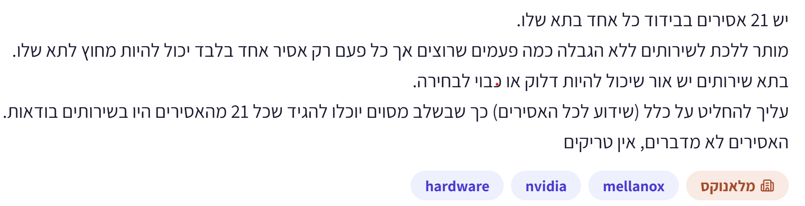
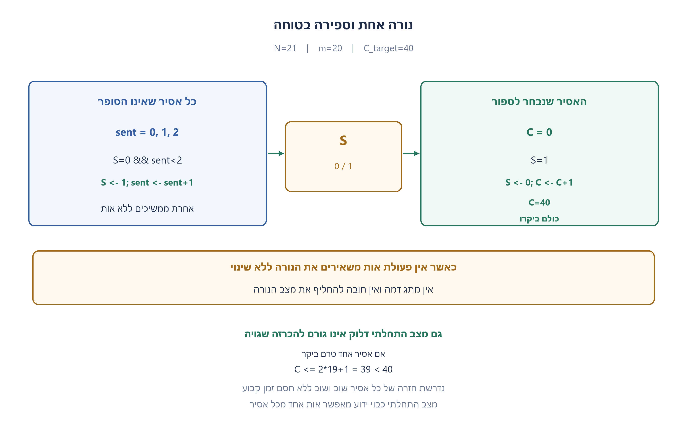
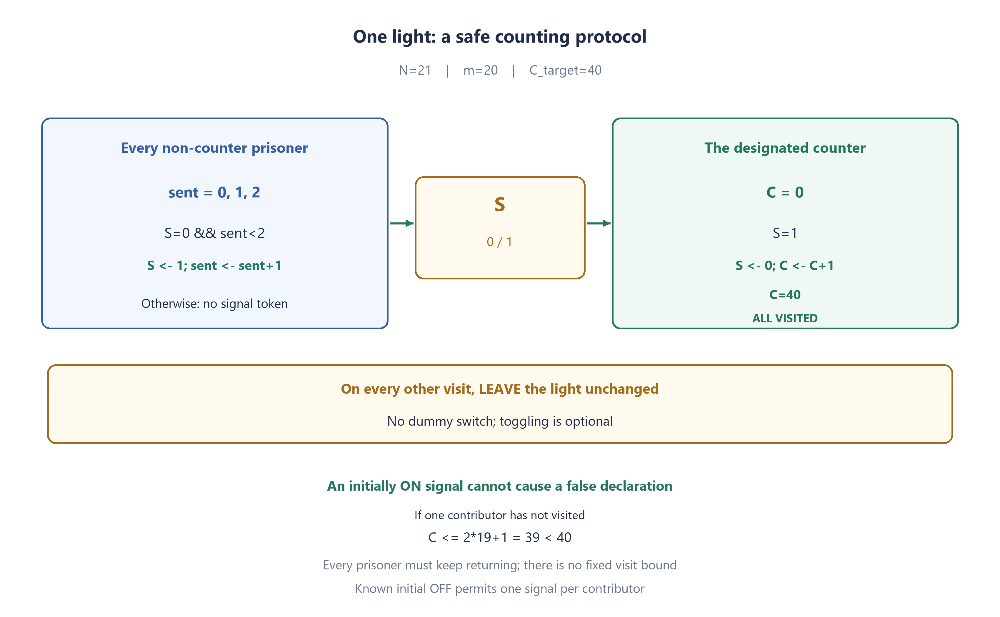

# PREP-057 — 21 אסירים — נורה אחת ואישור שכולם ביקרו

נקלטה ב־20 באוקטובר 2026. פתרון מוצע בסיוע AI. ביקורת מקצועית, בדיקת תרגום אנושית ובדיקת זכויות שימוש ממתינות. קושי אינו מכויל. שיוכי החברות הם דיווחי צילום המקור בלבד, ללא אימות עצמאי.

## מקור ללא שינוי



יש 21 אסירים בבידוד כל אחד בתא שלו.
מותר ללכת לשירותים ללא הגבלה כמה פעמים שרוצים אך בכל פעם רק אסיר אחד בלבד יכול להיות מחוץ לתא שלו.
בתא שירותים יש אור שיכול להיות דלוק או כבוי לבחירה.
עליך להחליט על כלל (שידוע לכל האסירים) כך שבשלב מסוים יוכלו להגיד שכל 21 מהאסירים היו בשירותים בוודאות.
האסירים לא מדברים, אין טריקים.

## נוסח השאלה לאתר

יש 21 אסירים מבודדים. בכל ביקור נכנס אסיר אחד בלבד לחדר המשותף ויוצא ממנו לפני הבא אחריו. מותר לאסירים להסכים מראש על תוכנית ולמנות בעלי תפקידים, אך אחרי תחילת התהליך אין ביניהם תקשורת מלבד מצב המתגים. כל אסיר זוכר את פעולותיו שלו; אין לספור זמן, לשמוע אחרים או להשאיר סימנים נוספים.

בשירותים נורה אחת שניתן לראות אם היא דולקת או כבויה, ולבחור אם לשנות את מצבה. מותר להשאיר את הנורה ללא שינוי. מצבה ההתחלתי אינו ידוע.

לצורך הבטחת סיום מניחים הוגנות: כל אסיר מבקר שוב ושוב. עצם ההיתר לבקר ללא הגבלה אינו מבטיח שאכן כולם יבקרו. תכננו תוכנית שבה אסיר יוכל בשלב מסוים להכריז בוודאות שכל 21 האסירים כבר היו בחדר לפחות פעם אחת. הסבירו מדוע אין הכרזה מוקדמת שגויה ומדוע התהליך יסתיים תחת הנחת ההוגנות. אין דרישה למספר ביקורים מינימלי או לחסם זמן קבוע.

הבהרות: האפשרות להסכמה מוקדמת, הזיכרון המקומי, מצב התחלתי לא ידוע והנחת ההוגנות נאמרים במפורש בעריכה משום שהמקור אינו מפרט את כולם. הסבירו גם כיצד התוכנית מתקצרת אם ידוע מראש שמתג האות כבוי.

### שלושה רמזים

1. אין צורך שכל אסיר ידע מי כבר ביקר. אפשר למנות אסיר אחד שיאסוף סימנים מהאחרים, ולתת לכל אסיר מספר מוגבל של סימנים.
2. מתג האות יכול לייצג סימן אחד שממתין לאיסוף. רק הסופר יכבה אותו, והאחרים ידליקו רק כשהוא כבוי. חישבו איך מצב התחלתי דלוק יכול להיראות כמו סימן שלא נשלח.
3. אפשרו לכל אחד מ־20 האסירים האחרים לשלוח לכל היותר שני סימנים. כמה סימנים לכל היותר יוכל הסופר לאסוף אם אחד מהם עוד לא ביקר, כולל סימן התחלתי שגוי? בביקור שאין בו פעולת אות אפשר להשאיר את הנורה כפי שהיא.

## הצעה לפתרון

**פתרון מוצע — סופר אחד, אות שממתין לאיסוף ושתי הזדמנויות דיווח לכל אסיר אחר.**

### קודם מפרידים שתי דרישות

בטיחות פירושה שאף הכרזה לא תהיה שגויה, בלי קשר לסדר הביקורים. סיום פירושו שהכרזה אכן תקרה; לכך צריך שכל האסירים יחזרו לבקר. לא ניתן להכריח אסיר שמעולם לא נבחר להגיע באמצעות מתג. מותר לקבוע תוכנית לפני הבידוד; בלי אפשרות כזאת המקור אינו מתאר את חידת הפרוטוקול הרגילה.

### מותר לא לשנות את הנורה

נסמן את הנורה S. אין כאן חובה ללחוץ בכל ביקור. כאשר אין פעולת אות לפי הכללים שלמטה, משאירים את מצבה ללא שינוי. זה הבדל מהותי מגרסת שני המתגים שבה חייבים להפוך מתג בכל ביקור.

### חלוקת תפקידים וכללי פעולה

ממנים אסיר אחד לסופר. 20 האחרים הם מדווחים. כל מדווח זוכר כמה פעמים שלח אות, ומתחיל מאפס; מותר לו לשלוח לכל היותר פעמיים. הסופר שומר מונה פרטי C, שמתחיל מאפס. רק הסופר מכבה את מתג האות, ורק מדווח רשאי להדליק אותו.

**ביקור של מדווח:** אם S כבוי והוא שלח פחות משני אותות, הוא מדליק את S ומגדיל את מונה השליחות הפרטי שלו באחד. הוא אינו שולח פעמיים באותו ביקור. אם S דלוק, או שכבר שלח פעמיים, משאירים את הנורה ללא שינוי.

**ביקור של הסופר:** אם S דלוק, הוא מכבה אותו ומגדיל את C באחד. אם S כבוי, משאירים את הנורה ללא שינוי. ברגע ש־C מגיע ל־40, הוא מכריז שכל 21 האסירים ביקרו. הסופר אינו שולח אות לעצמו ואינו סופר ביקורים רגילים או שינויים במתג הדמה.

### אינטואיציה — המתג שומר אסימון אחד

כשמדווח מדליק, הוא משאיר אסימון לסופר. כל עוד האור דלוק, מדווחים אחרים אינם נוגעים בו ולכן אינם מוחקים את האסימון. הסופר מכבה בעת האיסוף, וכך אותו אסימון לא נספר שוב בביקור הבא שלו. הנורה אינה יכולה לצבור כמה אסימונים; מדווח נוסף מחכה לביקור מתאים שבו ימצא אותה כבויה.

הסופר לא צריך לזהות מי שלח כל אסימון. ההגבלה המקומית של שתי שליחות לכל מדווח היא שמאפשרת להסיק בסוף שכולם השתתפו.

### למה דווקא 40, ומה עושים במצב התחלתי דלוק?

אור שדלק עוד לפני הביקור הראשון עשוי להיספר כאסימון אחד שאיש לא שלח. זהו **לכל היותר אסימון עודף אחד**, משום שהסופר מכבה אותו כשסופר. אחר כך כל הדלקה מגיעה ממדווח לפי הכללים.

נניח לשם סתירה שאחד מ־20 המדווחים עדיין לא ביקר כשהסופר מכריז. לכל היותר 19 מדווחים יכלו לשלוח, וכל אחד שולח לכל היותר שניים. יחד עם האסימון ההתחלתי:

```text
C <= 2*19 + 1 = 39 < 40
```

לכן אי אפשר להגיע ל־40 אם מדווח כלשהו לא ביקר. גם הסופר עצמו ביקר, מפני שהוא מבצע את ההכרזה במהלך ביקור שלו. מכאן שכל 21 האסירים ביקרו בוודאות.

הטענה אינה שכולם בהכרח שלחו פעמיים בזמן ההכרזה. אם התחילו באור דלוק, ייתכן שאחד שלח רק פעם אחת. ההכרזה דורשת ביקור, לא ניצול מלא של כל מכסת האותות.

### למה זה מסתיים?

אם S דלוק, ביקור עתידי של הסופר יאסוף אות ויכבה אותו. אם S כבוי ועדיין חסרים אותות, יש מדווח שטרם ניצל את שתי שליחותיו; תחת הוגנות הוא יבקר שוב וידליק. אחרי כל פעולה מועילה קטן מספר האותות שעוד צריך לשלוח או לאסוף. יש בסך הכול מכסה סופית של 40 אותות אמיתיים ואולי אות התחלתי, ולכן תחת ביקורים הוגנים הסופר יגיע לסף. אין חסם קבוע למספר הביקורים חסרי התועלת בין הפעולות.

בבחירה עצמאית ואחידה, חזרה אינסופית של כל אסיר מתרחשת בהסתברות 1, ולכן גם סיום הוא כמעט ודאי. הבטיחות עצמה אינה הסתברותית: גם סדר ביקורים חריג לא יפיק הכרזה שגויה. סדר לא הוגן עלול פשוט לא להסתיים.

### אם ידוע שהאות מתחיל כבוי

אפשר לקצר: כל אחד מ־20 המדווחים מדליק פעם אחת בלבד, והסופר מכריז אחרי 20 איסופים. אין אות התחלתי שגוי, וכל איסוף מוכיח מדווח אחר. בכל ביקור שאינו שולח או אוסף אות משאירים את הנורה ללא שינוי. זו חלופה רק כשמצב התחלתי כבוי ידוע; אסור להעביר אליה בשקט את הפתרון למצב לא ידוע.

דוגמה נגדית לשיטה המקוצרת כאשר המצב אינו ידוע: בשלושה אסירים, אור התחלתי דלוק נספר, מדווח אחד שולח עוד אות, והסופר מגיע לשניים למרות שהמדווח השני כלל לא ביקר. לכן מכסה של אות אחד וסף 20 אינם בטוחים בנוסח הנוכחי.

### זיכרון ואימות

כל מדווח שומר ערך מקומי 0,1,2; הסופר שומר מונה עד 40. הפעולה בכל ביקור היא בזמן קבוע; סך הזיכרון המקומי לכל האסירים הוא ליניארי במספרם, אך אין חסם דטרמיניסטי לאורך סדרת הביקורים. לא נטען שזהו הפרוטוקול המהיר או הקצר ביותר.

הקוד המצורף הוא מודל פרוטוקול לבדיקה. במציאות לכל אסיר יש רק זיכרונו שלו ומצב המתג הנראה; אין מחשב מרכזי שקורא את המונים הפרטיים. הבדיקות הממצות משתמשות בסימטריה בין מדווחים כדי לבדוק את כל המצבים הנגישים לפי מספר האותות שכל אחד שלח. בדיקות אקראיות הן דוגמאות נוספות בלבד; הוכחת הסיום נשענת בנפרד על ההוגנות.



### assumptions

[
  "21 אסירים, אחד בחדר בכל פעם, עם הסכמה מוקדמת וזיכרון אישי.",
  "מצב מתג האות אינו ידוע בהתחלה; נדרש להיות בטוחים גם אם הוא דלוק.",
  "מותר להשאיר את הנורה ללא שינוי; אין חובת לחיצה ואין מתג דמה.",
  "רק המתגים משמשים לתקשורת לאחר הבידוד; אין תזמון, סימנים או שמיעת אחרים.",
  "סיום מותנה בביקורים חוזרים והוגנים של כל אסיר; בטיחות אינה תלויה בהוגנות.",
  "אין דרישה למינימום ביקורים ואין חסם זמן קבוע."
]

### optimality

{
  "criterion": "הכרזה בטוחה עם מצב התחלתי לא ידוע וסיום תחת הוגנות.",
  "result": "סופר אחד, 20 מדווחים עם עד שני אותות כל אחד, וסף 40.",
  "proof": "אם מדווח אחד לא ביקר ניתן לספור לכל היותר 39, כולל אות התחלתי שגוי. לכן 40 מבטיח שכולם ביקרו.",
  "scope": "זו הוכחת בטיחות של הבנייה; אין טענה למינימום ביקורים, תוחלת זמן, זיכרון או מספר שינויים. ללא הוגנות אין הבטחת סיום."
}

### verification

"חיפוש ממצה עם צמצום סימטריה בדק 921 מצבים נגישים ו־3,433 מעברים בכל מצבי ההתחלה המותרים. נבדקו שימור אסימונים, היעדר הכרזה כשמדווח טרם שלח, מכסת שתי שליחות ופעולה חוקית בכל ביקור. נוספו 200 ריצות אקראיות עם זיכרון אישי. זהו מודל פייתון; סימולציות סופיות אינן הוכחת סיום בכל סדר ואין ניסוי פיזי או אישור מומחה. הוכחת סיום משתמשת בנפרד בהנחת הוגנות."

### edge_cases

[
  "מתג אות דלוק בהתחלה מוסיף לכל היותר אות שגוי אחד; סף כפול מגן מפניו.",
  "ביקורים חוזרים של אותו מדווח אינם מאפשרים יותר משתי שליחות.",
  "סופר שמגיע שוב בלי הדלקה חדשה אינו סופר אותו אות פעמיים.",
  "מדווח שאינו יכול לשלוח אינו מכבה אות שממתין לסופר.",
  "מותר להשאיר את הנורה ללא שינוי; אין חובת לחיצה ואין מתג דמה.",
  "סדר לא הוגן עשוי לא להסתיים אך אינו גורם להכרזה שגויה.",
  "ידיעה שכל האסירים רשאים לבקר אינה מוכיחה שאכן יבחרו את כולם."
]

### common_mistakes

[
  "להשתמש באות אחד מכל מדווח ובסף 20 כאשר המצב ההתחלתי לא ידוע.",
  "לספור ביקורים במקום הדלקות חדשות שנאספו.",
  "לאפשר למדווח לכבות מתג אות דלוק ולאבד דיווח של אחר.",
  "להתיר מספר לא מוגבל של אותות מכל מדווח.",
  "להבטיח סיום תוך מספר ביקורים קבוע או בלי הוגנות.",
  "לחשוב שהסופר צריך לדעת את זהות שולח האות.",
  "לכפות שינוי נורה בכל ביקור למרות שהשאלה מאפשרת להשאיר אותה ללא שינוי."
]

### interview_answer

"נמנה סופר. כל אחד מ־20 האחרים ידליק את מתג האות כשהוא כבוי, לכל היותר פעמיים. רק הסופר יכבה ויספור. אחרת משאירים את הנורה ללא שינוי. הסופר מכריז ב־40: אם אחד לא ביקר, יש לכל היותר 39 אותות כולל אות התחלתי שגוי. תחת הוגנות התהליך מסתיים; אין חסם זמן קבוע. אם מתחילים בכבוי ידוע, די באות אחד לכל מדווח ובסף 20."

### source_ambiguities

{
  "agreement": "אפשרות להסכמה מוקדמת וזיכרון אישי לא נאמרת במלואה במקור ונדרשת לפרוטוקול המוצע.",
  "initial_state": "המקור אינו קובע את מצב ההתחלה; הפתרון הראשי עובד גם במצב לא ידוע ומפריד את חלופת הכבוי הידוע.",
  "fairness": "אינסוף הזדמנויות או בחירה אקראית לא מפורטת אינם חסם זמן; ההנחה הנוספת היא שכל אסיר חוזר שוב ושוב.",
  "variant": "שני מתגים עם פעולת חובה אינם זהים לנורה אחת שאפשר להשאיר ללא שינוי."
}

### solution_extensions

{
  "question": "מדוע אי אפשר להבטיח שההכרזה תגיע אחרי מספר ביקורים קבוע, גם עם התוכנית הנכונה?",
  "direction": "אפשר לבחור שוב ושוב את אותו אסיר לפני שמגיעים לאחר. לכל חסם סופי אפשר לבנות קידומת ביקורים ארוכה יותר שחסרים בה אסירים. הוגנות מבטיחה סיום עתידי, לא חסם אחיד. בבחירה אקראית גם רצף ארוך כזה בעל הסתברות חיובית.",
  "status": "המשך מוכן בתוכן; אינו מחובר לתור ההמשך החי."
}

## English website wording

There are 21 isolated prisoners. One prisoner at a time enters the shared room and leaves before the next visitor. They may agree on a strategy and roles beforehand, but afterward their only communication is through the visible switch state. Each prisoner remembers their own actions. No timing, overhearing or extra marks are allowed.

The bathroom contains one visible light. A visitor may change its state or leave it unchanged. Its initial state is unknown.

For eventual termination assume fairness: every prisoner keeps returning. Permission to visit arbitrarily often does not itself guarantee that anyone actually does. Design a strategy allowing a prisoner eventually to declare with certainty that all 21 have visited at least once. Explain both why a false early declaration is impossible and why the protocol eventually finishes under fairness. Minimum visits and a fixed time bound are not required.

Editorial clarification: pre-agreement, private memory, unknown initial state and fairness are stated explicitly because the source does not fully specify them. Also explain the simpler variant when the signal switch is initially known OFF.

### Three hints

1. Not everyone needs to know who has visited. Designate one prisoner to collect signals and give every other prisoner a bounded allowance of signals.
2. The signal switch can store one pending token. Only the counter turns it OFF; contributors turn it ON only while it is OFF. How can an initially ON state masquerade as a token nobody sent?
3. Let each of the 20 contributors send at most two tokens. How many can the counter collect if one contributor has never visited, including one possible phantom initial token? A visit without a signal action may leave the light unchanged.

## Proposed solution

**Proposed solution — one counter, one pending token and two reporting opportunities per contributor.**

### Separate safety from termination

Safety means every declaration is correct under any visit order. Termination means a declaration eventually happens; that requires every prisoner to return. A switch cannot force an unselected prisoner to visit. The strategy is agreed before isolation; without pre-agreement, the source is not the usual coordinated-protocol puzzle.

### Leaving the light unchanged is permitted

Call the light S. There is no mandatory action on every visit. If no signal action below applies, leave it unchanged. This is materially different from the two-switch version that requires a toggle on every visit.

### Roles and visit rules

Designate one counter. The other 20 prisoners are contributors. Each remembers how many tokens they have sent, initially zero, with a lifetime allowance of TWO. The counter privately stores C, initially zero. Only the counter turns the signal OFF; only contributors turn it ON.

**Contributor visit:** if S is OFF and fewer than two tokens have been sent, turn S ON and increment the private sent count. Send only once on this visit. If S is ON or the allowance is exhausted, leave the light unchanged.

**Counter visit:** if S is ON, turn it OFF and increment C. If S is OFF, leave the light unchanged. When C reaches 40, declare that all 21 have visited. The counter never contributes a token to themself and does not count ordinary visits or dummy changes.

### Intuition: one stored token

A contributor's OFF-to-ON action leaves a token. While it is ON, other contributors do not change S, so they cannot erase it. The counter turns it OFF when collecting, preventing recounting on the next visit. The signal cannot store several tokens at once; the next contributor must wait for a suitable visit while it is OFF.

The counter never learns who sent each token. The private per-contributor allowance provides enough information to conclude that everybody participated.

### Why 40, including an initially ON signal?

An initially ON signal can be counted as one token nobody sent. It contributes at most ONE phantom token because the counter clears it on collection. Every later ON event is a genuine contributor action.

Suppose one of the 20 contributors had not visited when the counter declares. At most 19 contributors could have sent, at most twice each. Including the initial phantom:

```text
C <= 2*19 + 1 = 39 < 40
```

Thus C cannot reach 40 while any contributor is missing. The counter has also visited, because the declaration is made on their own visit. Therefore all 21 have certainly visited.

This does not claim everyone necessarily sent twice before the declaration. With an initially ON signal, one may have sent only once. The required fact is visiting, not exhausting all allowances.

### Why it eventually finishes

If S is ON, a future counter visit collects and clears it. If S is OFF and more tokens are needed, at least one contributor still has unused allowance; fairness guarantees a future visit when productive progress can occur. Each productive step reduces the remaining number of tokens to emit or collect. At most 40 genuine tokens and one initial token exist, so under fair repeated visitation the counter eventually reaches the threshold. No fixed bound limits the unproductive visits between those steps.

Independent uniform selection visits everyone infinitely often with probability one, so termination is almost sure in that model. Safety is not probabilistic: even an unusual order cannot produce a false declaration. An unfair order can simply fail to terminate.

### If the signal is initially known OFF

Use one token per contributor and declare after 20 collections. With no phantom token, every collection proves a distinct contributor. Leave the light unchanged on visits without a send/collect action. This is only the known-OFF variant; do not silently apply it to an unknown initial state.

Counterexample for the shortened strategy with unknown initial state: with three prisoners, the initially ON signal is counted, one contributor sends another token, and the counter reaches two although the other contributor has never visited. Thus a one-token allowance and threshold 20 are unsafe for the present unknown-state question.

### Memory and verification

Each contributor stores 0,1,2 locally; the counter stores a count through 40. Each visit takes constant work. Total private memory is linear in prisoner count, but no deterministic visit-sequence length bound exists. This is not a claim of optimal speed or minimum state.

The attached code is a protocol test model. Real prisoners access only their own memory and the visible switch, not everybody's private counters. Exhaustive checks exploit contributor symmetry to explore every reachable aggregate state by tokens emitted. Random executions are additional examples only; the termination proof separately uses fairness.



### assumptions

[
  "21 prisoners, one visitor at a time, with prior agreement and private memory.",
  "The signal's initial state is unknown; initially ON must be safe too.",
  "Visitors may leave the light unchanged; there is no mandatory toggle or dummy switch.",
  "Only switches communicate after isolation; no timing, marks or overhearing.",
  "Termination assumes fair repeated visits by every prisoner; safety does not require fairness.",
  "Minimum visits and a fixed time bound are not required."
]

### optimality

{
  "criterion": "Safe declaration from unknown initial state, terminating under fairness.",
  "result": "One counter, 20 contributors sending at most twice each, threshold 40.",
  "proof": "With one contributor absent at most 39 collections are possible, including one phantom initial token; 40 therefore certifies all visited.",
  "scope": "This proves construction safety, not minimum visits, expected time, memory or toggles. Without fairness termination is not guaranteed."
}

### verification

"Exhaustive symmetry-reduced search covered 921 reachable states and 3,433 transitions across all allowed initial switch settings. It checked token conservation, no declaration with an unsignaled contributor, two-token allowance and legal action on every visit. Added 200 seeded individual-memory simulations. These are Python models, not physical trials or expert approval; finite simulations are not universal termination proof. The written liveness proof separately assumes fairness."

### edge_cases

[
  "Initially ON contributes at most one phantom token; the doubled threshold covers it.",
  "Repeated visits by one contributor cannot create more than two tokens.",
  "A counter returning without a new ON event cannot recount a token.",
  "A contributor unable to send never erases a pending token.",
  "Visitors may leave the light unchanged; there is no mandatory toggle or dummy switch.",
  "An unfair order may not terminate but cannot cause a false declaration.",
  "Permission for everyone to visit does not guarantee they will be selected."
]

### common_mistakes

[
  "Using one token each and threshold 20 from an unknown initial state.",
  "Counting visits instead of newly collected ON signals.",
  "Letting contributors turn OFF a pending signal and erase somebody else's token.",
  "Allowing unlimited signals from one contributor.",
  "Promising fixed-time termination or termination without fairness.",
  "Assuming the counter must know the sender's identity.",
  "Imposing a mandatory toggle even though leaving the light unchanged is allowed."
]

### interview_answer

"Choose one counter. Each of the other 20 turns the signal ON while it is OFF at most twice. Only the counter turns it OFF and counts. Otherwise leave the light unchanged. Declare at 40: one absent contributor permits at most 39 tokens including a phantom initial ON. Fairness ensures eventual termination without a fixed bound. Known initial OFF permits one token each and threshold 20."

### source_ambiguities

{
  "agreement": "Prior agreement and private memory are not fully specified in the source and are required by this strategy.",
  "initial_state": "The source does not fix the initial state; the main solution handles unknown state and separates the known-OFF variant.",
  "fairness": "Unlimited opportunities or unspecified randomness do not create a time bound; repeated visitation of every prisoner is the added assumption.",
  "variant": "Two switches with a mandatory toggle are not the same as one optional light."
}

### solution_extensions

{
  "question": "Why can no fixed visit bound guarantee a declaration even with the correct protocol?",
  "direction": "The same prisoner can be selected repeatedly before another arrives. For any finite bound construct a longer prefix missing someone. Fairness guarantees eventual progress, not a uniform bound. Random selection assigns positive probability even to a long delaying prefix.",
  "status": "Follow-up prepared in content; not connected to the live follow-up queue."
}

## Files and verification

- [prep_057_prisoners_one_light.py](../solutions/prep_057_prisoners_one_light.py)

- [Verification script](../checks/check_prep_054_057.py)

- [Verification evidence](../checks/prep-057-verification.json)

No chat hint/solution request is recorded as learner activity. Publication is a pilot content action, not professional approval. The authored follow-up remains unconnected to the interactive queue.


## מקורות נוספים — 25.10.2026, מקבץ20

[צילום2](../sources/2026-10-25-batch20-02.png) הוא מקור נוסף ל־21 אסירים; [צילום10](../sources/2026-10-25-batch20-10.png) מוסיף [וריאציית100 אסירים](prep-057-hundred-prisoner-variant.md). הנוסח והרמזים הקודמים נשמרו.


## מקור נוסף — 31.10.2026, מקבץ110

[צילום מקור פרטי 10](../sources/2026-10-31-batch21-10.png)

יש 20 אסירים שנכנסים אחד אחרי השני לחדר. בחדר מנורה שאפשר להדליק, לכבות או לא לעשות כלום. בתחילה המתג כבוי. מותר להם לקבוע כלל אחד מראש. א. איך נדע מתי כל האסירים היו בחדר? ב. אם לא ידוע אם המתג בתחילה מכובה או דלוק, איך נדע?

שיוכי מקור מדווחים: NVIDIA.

מקור נוסף בלבד; הגרסה, הנוסח, הרמזים והפתרון נשמרו.
