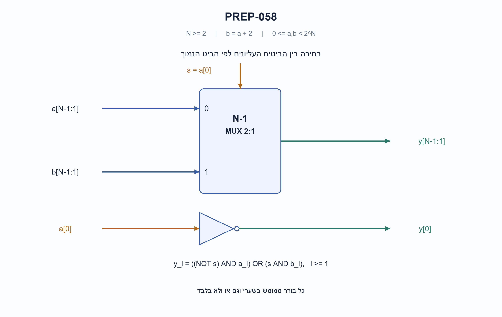
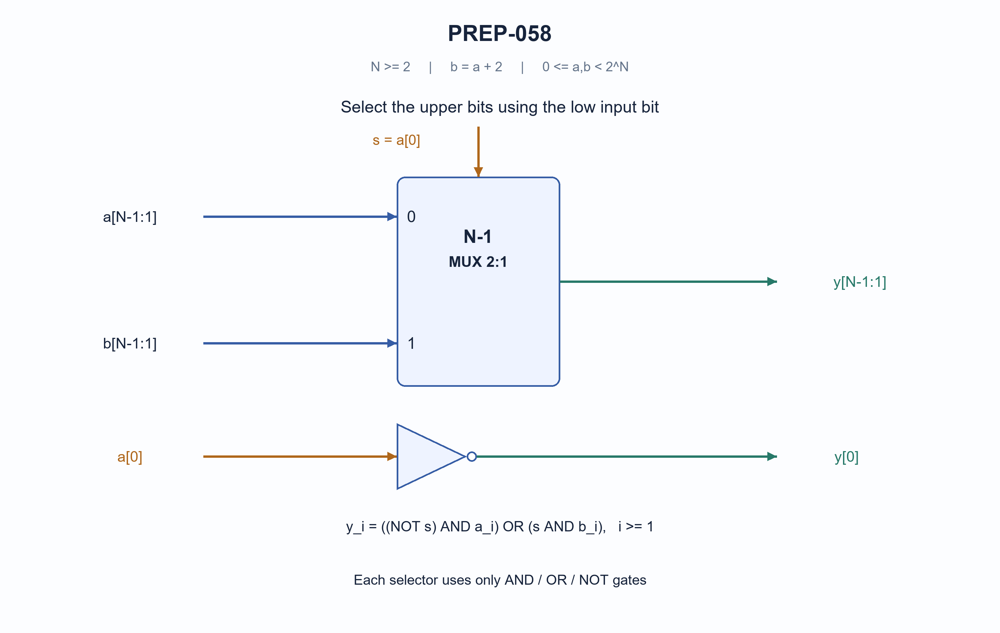

# PREP-058 — ממוצע שני מספרים בהפרש שתיים באמצעות שערים בלבד

**Status:** in review; AI-assisted proposed solution; difficulty uncalibrated. No human approval or learner tracking.

## Preserved original source

בנה מערכת המחשבת את הממוצע של a,b כאשר ידוע כי b=a+2. מותר להשתמש בשערים לוגיים. אסור להשתמש בסוכם, מחסר מכפל וכדומה.

- [sources/prep-058.png](../sources/prep-058.png)

Companies reported only by supplied sources: NVIDIA.

## he: ממוצע שני מספרים בהפרש שתיים באמצעות שערים בלבד

שני קלטים ללא סימן ברוחב N ביטים מקיימים בדיוק את הקשר המתמטי: המספר השני שווה לראשון ועוד 2. בנו מעגל צירופי המחזיר את הממוצע החשבוני שלהם, באמצעות שערים לוגיים בלבד, ללא מחבר, מחסר, מכפל או יחידת חשבון מוכנה. שרטטו והסבירו את המעגל.

הבהרות שנוספו למקור: N גדול או שווה 2; שני הקלטים מייצגים מספרים שלמים בין 0 לבין 2 בחזקת N פחות 1; הקשר מתקיים ללא גלישה. לכן הממוצע הוא מספר שלם שניתן לייצג באותו רוחב. אפשר להשתמש בבוררים רק כשהם ממומשים בשערים. אין דרישה למספר שערים מינימלי. מספרים עם סימן וקשר מודולרי הם וריאציות אחרות.

### Hints

1. כאשר ההפרש בין המספרים הוא שתיים, מהו המספר שנמצא בדיוק באמצע? איזו בעיה נשארת אם אסור להשתמש במחבר?
2. שני הקלטים בעלי אותה זוגיות. בדקו בנפרד מה קורה לביט הנמוך ולשאר הביטים כשהמספר הראשון זוגי או אי־זוגי.
3. הביט הנמוך של הממוצע הוא היפוך הביט הנמוך של הקלט הראשון. אם הקלט הראשון זוגי, העתיקו ממנו את הביטים העליונים; אם הוא אי־זוגי, העתיקו אותם מהקלט השני.

### Proposed solution

**פתרון מוצע — מנצלים את הקלט השני כדי להימנע מחישוב נשא.**

נסמן את הקלט הראשון ב־a ואת השני ב־b. לפי ההנחה, הממוצע הוא a+1. אי אפשר פשוט לומר ״נוסיף אחד״ כי מחבר אסור; צריך להראות שערים שמפיקים את הביטים.

שני הקלטים באותה זוגיות, כי ההפרש ביניהם שתיים. נבחן את הביט הנמוך של a:

**אם הוא 0**, a זוגי. הוספת אחד רק הופכת את הביט הנמוך ל־1, בלי לשנות את שאר הביטים. לכן מעתיקים את הביטים העליונים של a.

**אם הוא 1**, a אי־זוגי. גם b אי־זוגי, והממוצע הוא b−1. הורדת אחד ממספר אי־זוגי רק הופכת את הביט הנמוך מ־1 ל־0, בלי לשנות את העליונים. לכן מעתיקים את הביטים העליונים של b. זו הוכחה; אין במעגל מחסר שמבצע את הפעולה.

```text
s = a[0]
y[0] = NOT s
y[i] = ((NOT s) AND a[i]) OR (s AND b[i]),  i = 1..N-1
```

כל ביט עליון מקבל בורר: כש־s=0 הוא בוחר את a וכש־s=1 הוא בוחר את b. כל בורר ממומש בשני שערי AND ושער OR, והיפוך s משותף לכל הביטים וגם משמש כביט המוצא הנמוך. התרשים מציג בנק של N−1 בוררים כדי שהאוטובוסים יישארו קריאים; המשוואה מפרטת את מימושם בשערים.

דוגמה זוגית:

```text
a = 0110  (6)
b = 1000  (8)
s = 0
y = 0111  (7)   # upper bits from a, low bit inverted
```

דוגמה אי־זוגית, שבה יש שרשרת נשא אם מנסים לחשב a+1:

```text
a = 0111  (7)
b = 1001  (9)
s = 1
y = 1000  (8)   # upper bits from b, low bit inverted
```

במקום לחשב את שרשרת הנשא, השתמשנו בביטים של b שכבר ניתנו לנו. יש מספר קבוע של רמות שערים לכל ביט, O(N) שערים בספרייה אידאלית ו־O(N) חיווט. בפועל הפצת אות הבחירה והעומס משפיעים על התזמון; אין כאן טענה למינימום שערים או להשהיה פיזית בלתי תלויה ברוחב.

הפתרון מסתמך על הקשר המדויק ללא גלישה. למשל קלטים 1110 ו־0000 ברוחב ארבעה אינם מקיימים אותו כשלמים, ולכן אינם מקרה קלט תקין. אין להחיל את ההוכחה אוטומטית על ממוצע עם סימן או על חשבון מודולרי.

בקוד SystemVerilog המצורף נתיב הנתונים מכיל רק היפוך, AND, OR, שכפול וחיתוך ביטים. החיבור והחלוקה מופיעים רק באורקל המתמטי שבבדיקות, לא במעגל המוצע.



### assumptions

```json
[
  "שני קלטים ללא סימן באותו רוחב N>=2.",
  "הקשר b=a+2 מתקיים בשלמים ללא גלישה.",
  "המוצא הוא הממוצע המדויק ולא ממוצע מודולרי או עם סימן.",
  "הבוררים הם קיצור ציורי למימוש AND/OR/NOT, לא יחידות חשבון."
]
```

### optimality

```json
{
  "criterion": "מימוש צירופי ללא יחידות חשבון.",
  "result": "מהפך משותף ובורר שערים לכל אחד מ־N−1 הביטים העליונים.",
  "proof": "אם a זוגי, הממוצע הוא a עם ביט נמוך 1; אם אי־זוגי, הוא b עם ביט נמוך 0.",
  "scope": "O(N) שערים וחיווט; עומק לוגי אידאלי קבוע לכל ביט. לא הוכח מינימום שערים, ותזמון פיזי תלוי גם בעומסים ובהפצת האות."
}
```

### verification

```json
{
  "status": "בדיקות מודל פייתון עברו; ביקורת מקצועית עצמאית ממתינה.",
  "method": "השוואת הרכבת הביטים לאורקל עצמאי שמחשב ממוצע בשלמים.",
  "coverage": "כל 2,026 זוגות הקלט התקינים ברוחבים 2–10 ועוד 6 בדיקות דחיית קלט.",
  "script_path": "checks/check_prep_056_058_059_and_032_update.py",
  "scope": "לא בוצעו קומפילציה או סימולציית HDL, סינתזה או בדיקת תזמון פיזית."
}
```

### edge_cases

```json
[
  "ברוחב 2 הקלטים התקינים הם 0,2 ו־1,3.",
  "זוגי ואי־זוגי מטופלים במסלולי בחירה שונים.",
  "שרשרת אחדים בקלט a אינה דורשת חישוב נשא כי b נתון.",
  "זוג שנוצר רק אחרי גלישה אינו מקיים את ההנחות."
]
```

### common_mistakes

```json
[
  "אמירה להוסיף אחד בלי להראות איך, למרות האיסור על מחבר.",
  "בחירת הביטים העליונים מ־a גם כאשר a אי־זוגי.",
  "היפוך כל ביטי המספר במקום רק הביט הנמוך ובחירת העליונים.",
  "הנחת טיפול בגלישה או בסימן בלי לנסח חוזה מתאים."
]
```

### interview_answer

```json
"הקלטים באותה זוגיות. אהפוך את הביט הנמוך של הראשון. אם הוא היה 0, אקח את הביטים העליונים מהראשון; אם היה 1, אקח אותם מהשני. בורר לכל ביט שממומש בשערים נותן את הממוצע בלי מחבר, בהנחת קלטים ללא סימן והפרש שתיים ללא גלישה."
```

### solution_extensions

```json
{
  "question": "מה אפשר לעשות אם רק a נתון ולא b?",
  "answer_outline": "צריך לממש הגדלה באחד ברמת שערים, כולל שרשרת נשא או מבנה מקבילי שקול. כבר אי אפשר להשתמש בביטים העליונים של b כמידע חיצוני.",
  "integration_status": "שאלת המשך מוכנה בתוכן; אינה מחוברת לתהליך ההמשך החי."
}
```

## en: Average two numbers differing by two using only logic gates

Two unsigned N-bit inputs satisfy the exact mathematical relation b=a+2. Build a combinational circuit returning their arithmetic mean using only logic gates, with no adder, subtractor, multiplier or prebuilt arithmetic unit. Draw and explain the circuit.

Clarifications added to the terse source: N>=2, both inputs lie in 0..2^N-1 and the relation holds without overflow. Their mean is an integer representable at the same width. Muxes may be used only as gate-built selectors. Minimum gate count is not required. Signed and modular variants are different contracts.

### Hints

1. With a difference of two, which integer lies exactly midway? What remains to implement if an adder is forbidden?
2. Both inputs have the same parity. Separately examine the low output bit and the upper bits for even versus odd a.
3. Invert the low bit of a. If a is even, copy its upper bits; if a is odd, copy the upper bits of b.

### Proposed solution

**Proposed solution — use the second supplied input instead of calculating a carry.**

The mean is a+1 because b=a+2. Merely saying “increment a” is insufficient when adders are forbidden; specify the output bits instead.

The inputs have equal parity. If a[0]=0, a is even, so a+1 only changes its low bit from zero to one. Copy the upper bits from a.

If a[0]=1, both inputs are odd. The mean is also b−1, which changes only the low bit of odd b from one to zero. Copy the upper bits from b. This subtraction is a mathematical argument, not a subtractor in the implementation.

```text
s = a[0]
y[0] = NOT s
y[i] = ((NOT s) AND a[i]) OR (s AND b[i]),  i = 1..N-1
```

Each upper bit uses a selector: s=0 selects a, s=1 selects b. Implement each selector with two AND gates and one OR gate, sharing the inversion of s across the bank and the low output bit. The diagram groups N−1 selectors into a readable bus block; the equation specifies their gate-only implementation.

Even example:

```text
a = 0110  (6)
b = 1000  (8)
s = 0
y = 0111  (7)   # upper bits from a, low bit inverted
```

Odd example, where directly incrementing a would propagate a carry:

```text
a = 0111  (7)
b = 1001  (9)
s = 1
y = 1000  (8)   # upper bits from b, low bit inverted
```

Instead of calculating the carry chain, use the already-supplied bits of b. This construction has O(N) gates/wiring and bounded ideal logical depth per output bit. Real fanout, buffering and load affect timing; no minimum gate count or width-independent physical delay is claimed.

The exact no-overflow relation matters. Four-bit 1110 and 0000 do not satisfy b=a+2 over integers and are outside the contract. Do not automatically apply this proof to signed averages or modular inputs.

The attached SystemVerilog datapath uses only inversion, AND, OR, replication and bit slicing. Addition/division appears in the independent mathematical test oracle, not the proposed hardware.



### assumptions

```json
[
  "Equal-width unsigned inputs, N>=2.",
  "Exact integer relation b=a+2 with no overflow.",
  "Output is the exact arithmetic mean, not a signed or modular average.",
  "Mux blocks abbreviate AND/OR/NOT gate networks, not arithmetic units."
]
```

### optimality

```json
{
  "criterion": "Combinational implementation with no arithmetic units.",
  "result": "One shared inversion and one gate-built selector per upper bit.",
  "proof": "For even a, mean is a with low bit one; for odd a, mean is b with low bit zero.",
  "scope": "O(N) gates/wiring and bounded ideal per-bit depth. No gate-count minimum; physical timing depends on fanout, loads and buffering."
}
```

### verification

```json
{
  "status": "Python-model checks passed; independent professional review pending.",
  "method": "Compare gate-equivalent bit assembly against an independent integer-average oracle.",
  "coverage": "All 2,026 valid pairs at widths 2..10 plus six invalid-contract checks.",
  "script_path": "checks/check_prep_056_058_059_and_032_update.py",
  "scope": "No HDL compilation/simulation, synthesis or physical timing verification."
}
```

### edge_cases

```json
[
  "At width two valid pairs are 0,2 and 1,3.",
  "Even and odd a use different upper-bit sources.",
  "A run of ones in a requires no computed carry because b is supplied.",
  "Wrapped pairs violate the integer-relation contract."
]
```

### common_mistakes

```json
[
  "Saying “add one” without implementing it despite the adder prohibition.",
  "Copying upper a bits when a is odd.",
  "Complementing the entire number rather than the low bit and selecting the uppers.",
  "Silently assuming signed or overflow handling."
]
```

### interview_answer

```json
"Both inputs have equal parity. Invert the low bit of a. If it was zero copy upper bits from a; otherwise copy them from b. Gate-built per-bit selectors produce the mean without an adder, assuming unsigned inputs differing by exactly two without overflow."
```

### solution_extensions

```json
{
  "question": "What if only a is supplied, with no b?",
  "answer_outline": "Implement an incrementer at gate level, including carry propagation or an equivalent parallel structure. The upper bits of b are no longer available as external information.",
  "integration_status": "Follow-up prepared in content; not connected to the live follow-up workflow."
}
```

## Implementation and verification

- [solutions/prep_058_average_difference_two.py](../solutions/prep_058_average_difference_two.py)
- [solutions/prep_058_average_difference_two.sv](../solutions/prep_058_average_difference_two.sv)
- [checks/check_prep_056_058_059_and_032_update.py](../checks/check_prep_056_058_059_and_032_update.py)
- [checks/prep-058-verification.json](../checks/prep-058-verification.json)

Follow-ups are authored but not connected to the live queue. No HDL compilation/simulation or physical-device test is implied.
