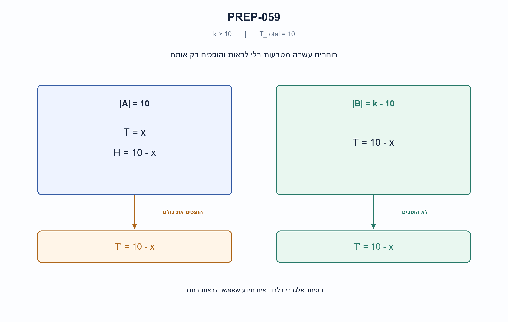

# PREP-059 — חלוקת מטבעות בחושך לשתי קבוצות עם אותו מספר פלי

**Status:** in review; AI-assisted proposed solution; difficulty uncalibrated. No human approval or learner tracking.

## Preserved original source

חידת הגיון:
אדם נכנס לחדר חשוך לחלוטין ובו שולחן עם k>10 מטבעות.
10 מטבעות נמצאות במצב "פלי" ויתר המטבעות (k-10) נמצאות על עץ (כמובן שלא ניתן לדעת איזה מטבעות כי החדר חשוך וגם נניח לשם השאלה שלא ניתן לזהות בעזרת מישוש המטבעות).
המטרה היא לבצע טקטיקה לחלוקת כל המטבעות לשתי קבוצות כך שיובטח שבכל ערימה יהיה מספר זהה של מטבעות במצב "פלי" (לאו דווקא מספר שווה של מטבעות בכל קבוצה, יכול להיות למשל שבשתי הקבוצות יהיה רק "עץ").
מותר להפוך את המטבעות, אך שוב אני מזכיר כי לא ניתן לזהות את מצב המטבע על ידי מישוש (כי אז אין שאלה)

- [sources/prep-059.png](../sources/prep-059.png)

Companies reported only by supplied sources: NVIDIA, Altair.

## he: חלוקת מטבעות בחושך לשתי קבוצות עם אותו מספר פלי

בחדר חשוך לחלוטין יש k מטבעות, כאשר k גדול מ־10. בדיוק 10 מהם מונחים כשצד הפלי כלפי מעלה והשאר כשצד העץ כלפי מעלה. אי אפשר לראות או למשש את הצד העליון, ואין סימן אחר שמגלה אותו. מותר לבחור מטבעות, להפרידם ולהפוך אותם.

חלקו את כל המטבעות לשתי קבוצות כך שבסיום יהיה בשתיהן אותו מספר מטבעות שצד הפלי שלהם למעלה, בלי לזהות את מצבו של אף מטבע. הקבוצות אינן חייבות להיות שוות בגודלן. הסבירו מדוע השיטה מבטיחה הצלחה.

הבהרה: נתון מספר הפלי ההתחלתי, ולא מיקומם. שני הצדדים מתחלפים בכל היפוך; לא ניתן להשאיר מטבע על שפתו.

### Hints

1. אין צורך לדעת אילו מטבעות הם פלי. נסו לבחור קבוצה בגודל שקשור למספר הפלי הכולל הידוע.
2. אם בחרתם 10 מטבעות ומתוכם x הם פלי, כמה פלי נשארו בקבוצה האחרת וכמה עץ יש בקבוצה שנבחרה?
3. הפכו את כל 10 המטבעות בקבוצה שנבחרה בלבד. מספר הפלי החדש בה שווה למספר העץ שהיה בה קודם.

### Proposed solution

**פתרון מוצע — בוחרים עשרה ומחליפים את התפקיד של פלי ועץ בקבוצה הזאת.**

1. בוחרים כל 10 מטבעות, בלי לבדוק את מצבם, ויוצרים מהם קבוצה A.
2. כל שאר k−10 המטבעות הם קבוצה B.
3. הופכים פעם אחת כל מטבע בקבוצה A בלבד. לא הופכים מטבעות בקבוצה B.

למה זה עובד? נסמן ב־x את מספר מטבעות הפלי שהיו בקבוצה A לפני ההיפוך. איננו יודעים את x ואין צורך לדעת אותו.

```text
A before: 10 coins = x tails + (10-x) heads
B before: 10-x tails
```

בכל המטבעות יחד היו בדיוק עשרה פלי, לכן אם x מהם נלקחו לקבוצה A, בקבוצה B נותרו 10−x. בקבוצה A יש בסך הכול עשרה מטבעות, ולכן 10−x מהם היו עץ. אחרי שנהפוך את כולם, בדיוק מטבעות העץ האלה הופכים לפלי:

```text
A after: 10-x tails
B after: 10-x tails   # unchanged
```

למשל, אם במקרה נבחרו שלושה פלי ושבעה עץ, בחוץ נשארו שבעה פלי. אחרי ההיפוך יש בקבוצה שנבחרה שבעה פלי — אותו מספר. המספר שלוש הוא דוגמה להוכחה בלבד, לא מידע שהמבצע רואה בחדר.

הקבוצות אינן צריכות להיות באותו גודל: בקבוצה A תמיד עשרה מטבעות ובקבוצה B כל השאר. מכיוון ש־k גדול מעשרה, שתיהן לא ריקות. כאשר k קטן מעשרים, לא כל ערך x בין אפס לעשר אפשרי, אבל הטענה האלגברית נכונה לכל סידור שמקיים את הנתונים; אין צורך לפצל למקרי גודל.

גם המקרים הקיצוניים עובדים כשאפשריים: אם נבחרו כל עשרת הפלי, אחרי ההיפוך בשתי הקבוצות אפס פלי. אם לא נבחר אף פלי, אחרי ההיפוך בשתיהן עשרה פלי.

זו אסטרטגיה מובטחת ולא ניסוי בהסתברות. הבחירה יכולה להיות כל בחירה קבועה של עשרה; היא אינה מותנית בכיוון המטבעות. קוד התוכנית המצורף מקבל רק את מספר המטבעות ומחזיר קבוצות של אינדקסים ורשימת ההיפוכים. רק קוד הבדיקה יודע את הכיוונים כדי לאמת את ההבטחה.

עשר פעולות היפוך מספיקות, וכן בחירה והפרדה של עשרה מטבעות; אין צורך לסרוק את כל הצדדים. ייצוג מפורש של שתי הקבוצות בקוד דורש O(k) זמן ומקום בגלל יצירת כל האינדקסים. אין כאן הוכחה למינימום פעולות פיזיות בכל מודל.



### assumptions

```json
[
  "k גדול מעשרה ובדיוק עשרה מטבעות פלי בתחילה.",
  "אין אפשרות להבחין בצדדים בראייה, במישוש או בסימון.",
  "מותר לבחור, להפריד ולהפוך; היפוך מחליף בין הצדדים.",
  "כל המטבעות מתחלקים לשתי קבוצות שיכולות להיות בגדלים שונים."
]
```

### optimality

```json
{
  "criterion": "הצלחה מובטחת ללא מידע על כיוונים.",
  "result": "בחירת כל עשרה והיפוך שלהם נותנים אותו מספר פלי בשתי הקבוצות.",
  "proof": "אם x פלי נבחרו, בחוץ 10−x פלי ובקבוצה הנבחרת 10−x עץ, שהופכים לפלי.",
  "scope": "לא הוכח מינימום פעולות. רשימות אינדקסים מפורשות בקוד דורשות O(k) זמן וזיכרון; האסטרטגיה הפיזית הופכת רק עשרה."
}
```

### verification

```json
{
  "status": "בדיקות מודל פייתון עברו; ביקורת מקצועית עצמאית ממתינה.",
  "method": "התוכנית אינה מקבלת כיוונים. אורקל עצמאי הופך את קבוצת האינדקסים באמצעות הפרש סימטרי וסופר פלי בשתי הקבוצות.",
  "coverage": "כל 12,375 סידורי עשרה פלי עבור k=11..16; עוד 500 מדגמים משוחזרים לגדלים גדולים; 2,026 מקרי הכללה.",
  "script_path": "checks/check_prep_056_058_059_and_032_update.py",
  "scope": "בדיקות קוד ואלגוריתם בלבד; אין בכך אישור מקצועי אנושי או בדיקה בחשבון חי."
}
```

### edge_cases

```json
[
  "k=11 נותן קבוצות בגדלים עשר ואחת; אין צורך בשוויון גדלים.",
  "אם כל הפלי נבחרו, שתי הקבוצות מסיימות עם אפס פלי.",
  "אם אין פלי בקבוצה הנבחרת, שתי הקבוצות מסיימות עם עשרה פלי, כאשר המצב אפשרי.",
  "אין צורך לדעת את x; הוא משתנה הוכחה בלבד."
]
```

### common_mistakes

```json
[
  "חלוקה לשתי קבוצות שוות בגודל בלי הצדקה לספירת הפלי.",
  "בחירת עשרה פלי במקום כל עשרה מטבעות, מה שמצריך מידע אסור.",
  "היפוך שתי הקבוצות במקום רק זו שנבחרה.",
  "ניסיון לנחש או לחוש צד במקום לנצל את הספירה הידועה."
]
```

### interview_answer

```json
"אקח כל עשרה מטבעות ואהפוך רק אותם. אם היו בהם x פלי, בחוץ נשארו 10−x פלי ובקבוצה שלקחתי היו 10−x עץ. אחרי ההיפוך גם בה יהיו 10−x פלי. לא צריך לראות אף מטבע ולא צריך קבוצות שוות בגודל."
```

### solution_extensions

```json
{
  "question": "מה משתנה אם נתון שיש בדיוק t מטבעות פלי, כאשר 0<t<k?",
  "answer_outline": "בוחרים כל t מטבעות והופכים רק אותם. אם x מהם פלי, בשתי הקבוצות יהיו t−x פלי אחרי ההיפוך.",
  "integration_status": "שאלת המשך מוכנה בתוכן; אינה מחוברת לתהליך ההמשך החי."
}
```

## en: Split coins in darkness into groups with equal tails counts

A completely dark room contains k coins, with k>10. Exactly ten are tails up and the rest heads up. You cannot see, feel or otherwise determine which face is up. You may choose, separate and flip coins.

Partition ALL coins into two groups so both end with the same number of tails-up coins, without discovering any individual orientation. The groups need not have equal sizes. Explain why your method guarantees success.

Clarification: the initial tails count is known, not their locations. Every flip exchanges heads and tails; coins cannot be left on their edges.

### Hints

1. You need not identify the tails. Choose a group whose size is related to the known total tails count.
2. If you select ten coins and x of them are tails, how many tails remain outside, and how many heads are in the selected group?
3. Flip every selected coin and none of the rest. The selected group’s new tails count equals its previous heads count.

### Proposed solution

**Proposed solution — choose ten and exchange heads with tails in that group.**

1. Select any ten coins without checking their faces; call them group A.
2. All remaining k−10 coins form group B.
3. Flip every coin in A once. Do not flip any coin in B.

Let x be the unknown number of tails initially selected into A. The procedure never needs to learn x.

```text
A before: 10 coins = x tails + (10-x) heads
B before: 10-x tails
```

Exactly ten tails existed overall, so B contains the 10−x tails not selected. Because A contains ten coins in total, it initially has 10−x heads. Flipping all of A turns exactly those heads into tails:

```text
A after: 10-x tails
B after: 10-x tails   # unchanged
```

For example, if the selection happens to contain three tails and seven heads, seven tails remain outside. After flipping the selection it also contains seven tails. Three is an illustrative unknown in the proof, not an observation available in the dark room.

The groups need not be equal in size: A always has ten coins and B has the rest. Both are nonempty because k>10. For k<20 not every x between zero and ten is feasible, but the algebra holds for every arrangement satisfying the givens, so separate size cases are unnecessary.

Feasible extreme cases also work: selecting all ten tails leaves zero tails in both groups after the flip; selecting no tails leaves ten tails in both groups. The latter requires enough heads to select, but the method does not assume that case is possible for every k.

The strategy is deterministic and guaranteed, not a probabilistic search. Any fixed selection of ten works, independent of orientations. The attached planner accepts only the number of coins and returns index groups and flip indices. Only the verifier sees orientations to check the guarantee.

Ten flips plus selecting/separating ten coins suffice; no orientation scan is required. Explicitly materializing both index groups in the code costs O(k) time and space because all indices are emitted. No minimum physical-operation count is proved.


### assumptions

```json
[
  "k>10 and initially exactly ten tails.",
  "No seeing, feeling or marks reveal orientations.",
  "Selection, separation and flipping are allowed; a flip exchanges faces.",
  "All coins are partitioned; group sizes may differ."
]
```

### optimality

```json
{
  "criterion": "Guaranteed success without orientation observations.",
  "result": "Choose any ten and flip them to equalize both tails counts.",
  "proof": "If x selected coins are tails, outside tails and selected heads both number 10−x; flipping converts the latter to tails.",
  "scope": "No minimum action count is proved. Materialized index groups cost O(k) time/space; only ten physical coins need flipping."
}
```

### verification

```json
{
  "status": "Python-model checks passed; independent professional review pending.",
  "method": "The planner receives no orientations. An independent oracle flips the planned indices using symmetric difference and counts tails in each group.",
  "coverage": "All 12,375 placements of ten tails for k=11..16; 500 reproducible larger samples; 2,026 generalized cases.",
  "script_path": "checks/check_prep_056_058_059_and_032_update.py",
  "scope": "Code/algorithm verification only; not human expert approval or authenticated live-account validation."
}
```

### edge_cases

```json
[
  "k=11 gives groups of ten and one; equal sizes are unnecessary.",
  "If all tails are selected both groups end with zero tails.",
  "If no tails are selected both end with ten tails, when that arrangement is feasible.",
  "x is a proof variable, never information required by the strategy."
]
```

### common_mistakes

```json
[
  "Splitting into equal-size piles without justifying equal tails counts.",
  "Selecting ten tails rather than any ten coins, requiring forbidden information.",
  "Flipping both piles rather than just the selected ten.",
  "Guessing or feeling orientations instead of using the known total."
]
```

### interview_answer

```json
"Take any ten coins and flip only those. If x selected coins were tails, 10−x tails remain outside and 10−x selected coins were heads. Flipping gives the selection 10−x tails too. No face observation or equal pile sizes are needed."
```

### solution_extensions

```json
{
  "question": "What if the known initial tails count is t with 0<t<k?",
  "answer_outline": "Choose any t coins and flip only them. If x selected coins were tails, both groups contain t−x tails afterward.",
  "integration_status": "Follow-up prepared in content; not connected to the live follow-up workflow."
}
```

## Implementation and verification

- [solutions/prep_059_dark_coin_groups.py](../solutions/prep_059_dark_coin_groups.py)
- [checks/check_prep_056_058_059_and_032_update.py](../checks/check_prep_056_058_059_and_032_update.py)
- [checks/prep-059-verification.json](../checks/prep-059-verification.json)

Follow-ups are authored but not connected to the live queue. No HDL compilation/simulation or physical-device test is implied.
