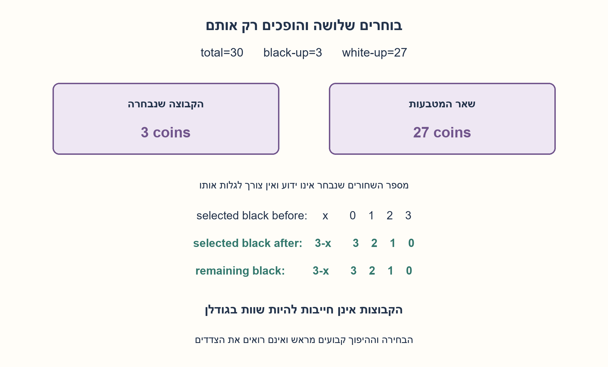
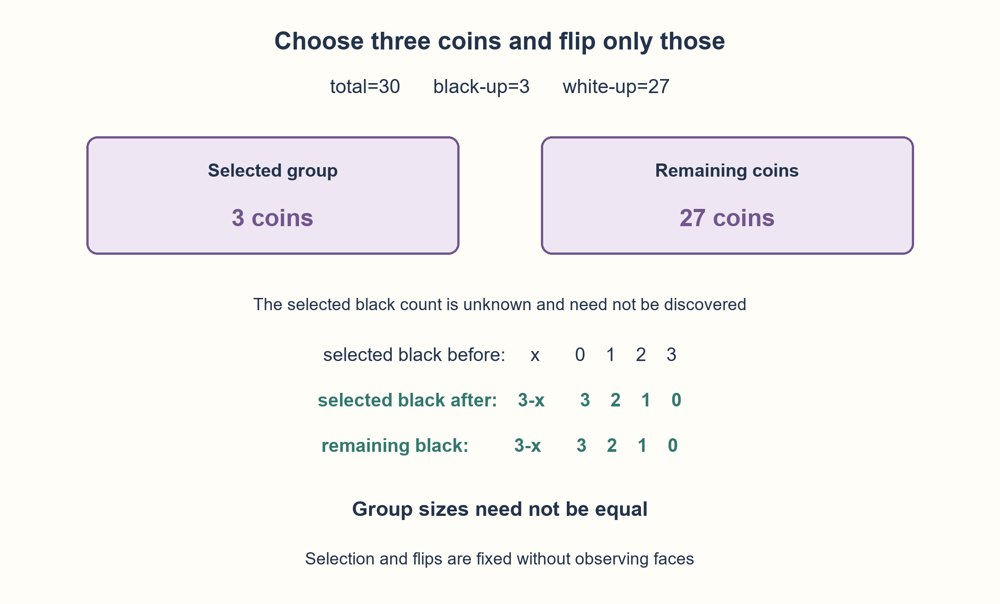

# PREP-059 — שלושים מטבעות, שלושה שחורים — אותה הבטחה בלי לראות

פתרון מוצע בסיוע AI; ביקורת אנושית ממתינה. הקושי לא כויל.

[צילום מקור פרטי](../sources/2026-10-30-batch40-11.png)

יש 30 מטבעות, לכל אחד צד שחור וצד לבן. בחדר חשוך נאמר שיש 27 מטבעות עם הלבן למעלה ו־3 עם השחור למעלה. צור בלי לראות שתי קבוצות שבהן מספר המטבעות עם השחור למעלה שווה. ניתן להפוך מטבעות, ומספר הלבנים בכל קבוצה אינו חשוב.

## עברית

שלושים מטבעות, שלושה שחורים — אותה הבטחה בלי לראות

### וריאציה מספרית: 30 מטבעות ושלושה צדדים שחורים למעלה
בחדר חשוך יש 30 מטבעות דו־צדדיים: 27 עם הלבן למעלה ו־3 עם השחור למעלה. אי אפשר לראות, למשש או לזהות את הצד העליון. מותר לחלק את המטבעות לשתי קבוצות ולהפוך מטבעות. הבטיחו שבסיום מספר הצדדים השחורים למעלה יהיה זהה בשתי הקבוצות; מספר הלבנים וגודל הקבוצות אינם חייבים להיות שווים. כל מטבע מתהפך משחור ללבן או להפך, ולא נשאר על שפתו.

1. איזה גודל קבוצה מתאים למספר השחורים הכולל הידוע?
2. אם בוחרים שלושה ובהם x שחורים, כמה שחורים נשארו בחוץ וכמה לבנים נבחרו?
3. הפכו רק את שלושת המטבעות שנבחרו. הלבנים בקבוצה הזאת יהפכו לשחורים, ומספרם הוא בדיוק מספר השחורים שנותרו בחוץ.

### בוחרים שלושה בלי לדעת את צדיהם
קחו כל שלושה מטבעות כקבוצה A; 27 האחרים הם B. הפכו כל מטבע ב־A פעם אחת בלבד. המבצע אינו בודק את הכיוונים ואינו משנה את התכנית לפי תוצאה שנראתה.

אם x מתוך שלושת הנבחרים היו שחורים, ב־B נשארו 3−x שחורים. ב־A היו 3−x לבנים, ואחרי ההיפוך דווקא הם הופכים לשחורים. לכן בשתי הקבוצות יש 3−x שחורים.

| x שחורים שנבחרו | שחורים ב־A אחרי ההיפוך | שחורים ב־B |
| --- | --- | --- |
| 0 | 3 | 3 |
| 1 | 2 | 2 |
| 2 | 1 | 1 |
| 3 | 0 | 0 |

כל ארבעת המקרים אפשריים במקור הזה. במקרה האחרון שתי הקבוצות מכילות אפס שחורים, וגם זו הצלחה. אין דרישה לשמור את מספר השחורים הכולל; ההיפוכים משנים אותו. אין גם צורך לחלק ל־15 ו־15: הגדלים כאן הם 3 ו־27.

זהו אותו אינווריאנט של גרסת עשרת הפלי, עם המספר הידוע 3 במקום 10. שלושה היפוכים מספיקים; לא הוכח מינימום כולל של פעולות פיזיות. התכנית בקוד מקבלת רק ספירה כוללת ומספר שחורים ידוע ומחזירה קבוצות ואינדקסי היפוך; רק הבודק רואה את הפנים. כל 4,060 המיקומים האפשריים של שלושת השחורים נבדקו בנפרד.

```python
"""Blind operation plan: does not accept or inspect coin orientations."""


def blind_plan(total=30, black_count=3):
    if type(total) is not int or type(black_count) is not int or not 0 < black_count < total:
        raise ValueError("this two-nonempty-group construction needs 0 < black_count < total")
    selected = tuple(range(black_count))
    rest = tuple(range(black_count, total))
    return selected, rest, selected
```




## English

Thirty coins, three black faces: the same blind guarantee

### Numeric variant:30 coins, three black faces up
A dark room contains 30 two-sided coins:27 white up and 3 black up. You cannot see, feel or otherwise identify their upper faces. Partition them into two groups and optionally flip coins so both groups finish with equal numbers of black-up faces. White counts and group sizes need not match. A flip exchanges black and white; no coin is left on its edge.

1. Which group size matches the known total black count?
2. If three chosen coins contain x black faces, how many black remain outside and how many selected faces are white?
3. Flip only the chosen three. Their white faces become black, and their count equals the black faces left outside.

### Choose three without learning their faces
Take any three coins as group A;the other 27 form B. Flip each coin in A exactly once. The operator neither observes orientations nor changes the plan based on them.

If x selected coins were black, B retains 3−x black faces. A originally contained 3−x white faces, and flipping turns those into black. Both groups therefore finish with 3−x black faces.

| Selected black x | Black in A after flipping | Black in B |
| --- | --- | --- |
| 0 | 3 | 3 |
| 1 | 2 | 2 |
| 2 | 1 | 1 |
| 3 | 0 | 0 |

All four cases are feasible here. The final row leaves zero black faces in both groups and still succeeds. Total black count need not stay fixed;flips change it. There is no requirement for 15-and 15 groups:the chosen sizes are 3 and 27.

This is the same invariant as the ten-tails version, with the known count 3 replacing 10. Three flips suffice;no minimum total physical-operation count is proved. The planner receives only total count and known black count, then returns index groups and flips;only the verifier sees faces. Every one of the 4,060 possible initial black-position sets was checked.

```python
"""Blind operation plan: does not accept or inspect coin orientations."""


def blind_plan(total=30, black_count=3):
    if type(total) is not int or type(black_count) is not int or not 0 < black_count < total:
        raise ValueError("this two-nonempty-group construction needs 0 < black_count < total")
    selected = tuple(range(black_count))
    rest = tuple(range(black_count, total))
    return selected, rest, selected
```




## חומר משלים / Supporting material

```json
{
  "assumptions": {
    "he": [
      "הצד העליון אינו מזוהה בשום אמצעי; מותר למנות ולבחור מטבעות.",
      "בדיוק שלושה שחורים מתוך 30 בתחילה; היפוך מחליף בין שני הצדדים.",
      "שתי הקבוצות לא ריקות, אך אינן חייבות להיות שוות בגודל."
    ],
    "en": [
      "No orientation information is available;coins may be counted and chosen.",
      "Exactly three of 30 start black up;flipping exchanges the two faces.",
      "Both groups are nonempty;their sizes need not match."
    ]
  },
  "optimality": {
    "he": "שלושה היפוכים ובחירת שלושה מספיקים. ייצוג מפורש של כל האינדקסים עולה O(N) זמן ומקום; התכנית הפיזית יכולה להשאיר את השאר כקבוצה משלימה. אין טענת מינימום בכל מודל פעולה.",
    "en": "Choosing and flipping three suffices. Explicitly materializing all indices costs O(N) time/space;the physical plan can leave the rest as the complement. No minimum across all operation models is claimed."
  },
  "verification": {
    "he": "כל 4,060 הסידורים של שלושה שחורים בין 30 מטבעות עברו. נבדקו חלוקה מלאה ללא חפיפה, שלושה היפוכים בלבד וארבעת ערכי x. המודל אינו מעביר צדדים לפונקציית התכנון.",
    "en": "All 4,060 arrangements of three black faces among 30 passed. Checked complete disjoint partition, exactly three flips and all four x values. Orientations are never passed to the planner."
  },
  "edge_cases": {
    "he": [
      "בחירת כל השחורים נותנת אפס שחורים בשתי הקבוצות.",
      "בחירת שלושה לבנים נותנת שלושה שחורים בכל קבוצה.",
      "בחירה קבועה, למשל שלושת הראשונים, מספיקה; אין צורך באקראיות."
    ],
    "en": [
      "Selecting all black coins leaves zero black in both groups.",
      "Selecting three white coins leaves three black in each group.",
      "A fixed choice, such as the first three, is sufficient;randomness is unnecessary."
    ]
  },
  "common_mistakes": {
    "he": [
      "לחלק לשתי קבוצות שוות בלי לקשר את הגודל למספר השחורים.",
      "להפוך את שתי הקבוצות במקום את שלושת הנבחרים בלבד.",
      "לדרוש שמספר השחורים הכולל יישאר שלושה.",
      "להשתמש בידיעת הבודק על המיקומים כחלק מהאלגוריתם."
    ],
    "en": [
      "Splitting equal-sized groups without using the known black count.",
      "Flipping both groups instead of only the selected three.",
      "Requiring total black count to remain three.",
      "Using the verifier orientation knowledge inside the planner."
    ]
  },
  "interview_answer": {
    "he": "אבחר שלושה ואהפוך רק אותם. אם היו בהם x שחורים, נותרו בחוץ 3−x שחורים; בנבחרים היו בדיוק 3−x לבנים שיהפכו לשחורים. שתי הקבוצות שוות במספר השחורים, בלי לדעת את x.",
    "en": "Choose three and flip only them. If they had x black faces, the rest had 3−x;the selected group had 3−x white faces that now become black. Both counts match without learning x."
  },
  "source_ambiguities": {
    "he": [
      "הנוסח המספרי מחליף פלי/עץ בשחור/לבן וב־30/3; אין בו דרישה לשוויון בגודל הקבוצות.",
      "שיוך Apple נוסף על סמך הצילום בלבד."
    ],
    "en": [
      "The numeric source replaces tails/heads with black/white and 30/3;it does not require equal group sizes.",
      "Apple attribution is added only from the supplied source."
    ]
  },
  "solution_extensions": {
    "he": [
      {
        "question": "מה עושים כשיש N מטבעות ובדיוק b שחורים ידועים?",
        "answer_direction": "עבור 0<b<N בוחרים b והופכים אותם:אם x שחורים נבחרו, בשתי הקבוצות מתקבלים b−x. במקרי b=0 או b=N צריך להתייחס בנפרד לדרישת קבוצות לא ריקות.",
        "principle": "הקבוצה הנבחרת בגודל מספר המטרה הידוע."
      }
    ],
    "en": [
      {
        "question": "What if N coins contain a known b black faces?",
        "answer_direction": "For 0<b<N choose and flip b coins:if x selected faces were black, both groups end with b−x. Treat b=0 or b=N separately if nonempty groups are required.",
        "principle": "Choose a group as large as the known target count."
      }
    ]
  }
}
```
