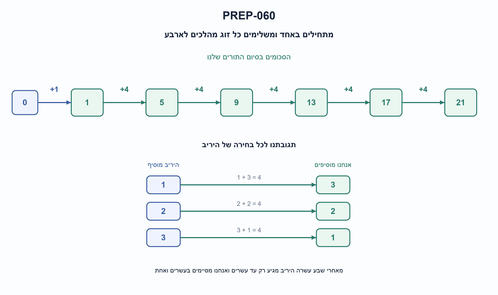
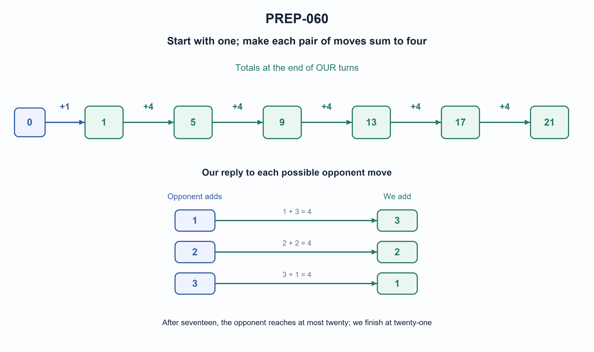

# PREP-060 — משחק הגעה ל־21 — אסטרטגיה מנצחת לשחקן הראשון

Status: in review; AI-assisted proposed solution; uncalibrated difficulty. Human professional/parity/reuse review pending. No learner activity recorded.

## Preserved source

נתון משחק שני שחקנים הבא: מתחילים מ-0 ואז כל שחקן בתורו מוסיף 1, 2 או 3.
הראשון שמגיע ל-21 מנצח. האם לשחקן הראשון יש אסטרטגיה מנצחת? אם כן, מהי?

[Source image](../sources/prep-060.png)

Companies reported by supplied source only: Intel, Vayyar.

## he: משחק הגעה ל־21 — אסטרטגיה מנצחת לשחקן הראשון

שני שחקנים מתחילים בסכום 0 ומשחקים בתורות. בכל תור מוסיפים לסכום 1, 2 או 3. השחקן שמביא את הסכום בדיוק ל־21 מנצח. האם לשחקן הראשון יש אסטרטגיה שמבטיחה ניצחון גם מול יריב שבוחר כל מהלך חוקי? תארו אותה והוכיחו מדוע היא עובדת.

הבהרת כללים: הסכום משותף וגלוי, אין דילוג על תור, ואין מהלך שמעלה אותו מעל 21. המשחק מסתיים מיד בהגעה ליעד. אין אקראיות או מידע מוסתר. אין צורך לכתוב קוד, אך אפשר להיעזר בבדיקת מצבים.

### Three progressive hints

1. חשבו מהסוף: מאילו סכומים אפשר לנצח מיד, ואיזה סכום הייתם רוצים להשאיר ליריב לפני התור שלו?
2. אחרי שהיריב מוסיף 1, 2 או 3, האם אפשר להגיב כך שסכום שני המהלכים יהיה תמיד אותו מספר?
3. מצאו סדרה של סכומים בהפרשים של 4 שמסתיימת ב־21. האם אפשר להגיע לאיבר הראשון כבר במהלך הפתיחה ואז לשמור על הסדרה?

### Proposed solution

**פתרון מוצע — מתחילים ב־1, ואז משלימים כל מהלך של היריב ל־4.**

במהלך הראשון נוסיף 1. אחר כך נפעל לפי הטבלה:

| היריב מוסיף | אנחנו מוסיפים | תוספת בשני התורות יחד |
| --- | --- | --- |
| 1 | 3 | 4 |
| 2 | 2 | 4 |
| 3 | 1 | 4 |

לכן בסיום כל תור שלנו הסכום יהיה:

```text
1 -> 5 -> 9 -> 13 -> 17 -> 21
```

אין צורך לנחש מה היריב יעשה: כל בחירה שלו מאפשרת תגובה חוקית. לדוגמה, אם פתחנו ב־1 והוא מוסיף 3, הסכום 4 ונוסיף 1 כדי להגיע ל־5. אם אחר כך הוא מוסיף 1, נוסיף 3 כדי להגיע ל־9.

**למה היריב לא מנצח לפנינו?** אחרי שהשארנו 17, היריב יכול להגיע רק ל־18, 19 או 20. אנחנו משלימים בהתאמה ל־21 ומנצחים. באותה דרך, לפני כל יעד מוקדם יותר, היריב אינו יכול לקפוץ מעבר ליעד הבא שלנו משום שהוא מוסיף לכל היותר 3 ואנחנו מעלים כל זוג תורות ב־4.

**איך מוצאים את הרעיון?** עובדים לאחור. בסכומים 18,19,20 מי שתורו יכול להגיע מיד ל־21. לכן 17 הוא מצב מפסיד לשחקן שעומד לשחק: כל מהלך שלו נותן ליריב ניצחון מידי. גם 13 הוא מצב מפסיד, כי כל תוספת משאירה 14,15 או 16, והיריב יכול להגיע ל־17. כך מקבלים 9,5,1. הסכום ההתחלתי 0 מאפשר לנו להגיע ל־1 מיד.

חשוב להבחין: 1,5,9,13,17 הם מצבים מפסידים **למי שתורו לשחק מהם**. לכן טוב לנו להשאיר אותם ליריב בסיום התור שלנו. ב־21 המשחק כבר הסתיים; אין תור נוסף.

במונחי אינווריאנט, אחרי כל תור שלנו הסכום שקול ל־1 מודולו 4. הפתיחה מקיימת זאת, והשלמה ל־4 משמרת זאת עד ליעד. זו הוכחת ניצחון מול כל יריב חוקי, לא רק מול משחק אקראי. הקוד המצורף בוחר את השארית של המרחק ליעד בחלוקה ל־4; שארית אפס מציינת מצב שאין ממנו ניצחון מובטח, בהנחת יריב מושלם.

עלות בחירת מהלך היא זמן וזיכרון קבועים במודל שבו הסכום נכנס במילה; כאן המשחק עצמו בעל יעד קבוע. אין כאן טענה למינימום מספר התורות: נדרשת אסטרטגיה שמבטיחה ניצחון. הבדיקה העצמאית פתרה את כל 22 הסכומים כולל המצב הסופי, ובדקה את כל 243 רצפי חמש הבחירות של היריב נגד האסטרטגיה.



### assumptions

```json
[
  "מתחילים ב־0 ובכל תור מוסיפים בדיוק 1,2 או 3 לסכום המשותף.",
  "ניצחון בהגעה מדויקת ל־21; אין דילוג או חריגה מהיעד.",
  "שני השחקנים רואים את הסכום, והאסטרטגיה צריכה לעבוד מול כל בחירה חוקית."
]
```

### optimality

```json
{
  "criterion": "ניצחון מובטח לשחקן הראשון.",
  "result": "פתיחה ב־1 ותגובה של 4 פחות מהלך היריב.",
  "proof": "אחרי כל תור שלנו הסכום 1 מודולו 4, ולכן נגיע ל־21; היריב יכול להגיע לכל היותר ל־20 אחרי 17.",
  "scope": "אין טענה למינימום תורות. קבלת החלטה O(1) במודל מספרים בגודל מילה; יעד 21 קבוע."
}
```

### verification

```json
{
  "status": "בדיקות מודל פייתון עברו; סקירה מקצועית עצמאית ממתינה.",
  "method": "אורקל תכנון דינמי עצמאי של מצבים מנצחים ומפסידים, ובדיקה מול כל בחירות היריב.",
  "coverage": "22 סכומים, 243 רצפי תגובות שלמים ו־13 קלטים לא תקינים.",
  "script_path": "checks/check_prep_060.py",
  "scope": "בדיקת משחק סופי מדויק; אין בכך אישור מקצועי אנושי או פעילות לומד באתר."
}
```

### edge_cases

```json
[
  "בסכומים 18,19,20 אפשר לנצח מיד.",
  "17 הוא מצב מפסיד למי שתורו, לא למי שהשאיר אותו ליריב.",
  "ב־21 כבר אין מהלך.",
  "השלמה ל־4 תמיד בין 1 ל־3 ואינה חורגת מ־21 במסלול האסטרטגיה."
]
```

### common_mistakes

```json
[
  "פתיחה ב־3 בגלל בלבול עם גרסה שבה מי שאומר 21 מפסיד.",
  "ניסיון להשלים ל־3 במקום ל־4.",
  "החלפת משמעות מצב מנצח ומפסיד בלי לציין תור של מי.",
  "בדיקה רק נגד מהלכים אקראיים במקום הוכחה לכל תגובה."
]
```

### interview_answer

```json
"אפתח ב־1. בכל תור הבא אוסיף 4 פחות מה שהיריב הוסיף. כך אחרי התורות שלי נקבל 1,5,9,13,17,21. אחרי 17 היריב יכול להגיע רק עד 20 ולכן אני מגיע ל־21. זו אסטרטגיה מובטחת לכל תגובה חוקית."
```

### solution_extensions

```json
{
  "question": "מה משתנה אם היעד הוא T ומותר להוסיף 1 עד m?",
  "answer_outline": "כשניצחון הוא בהגעה מדויקת, משאירים ליריב סכומים שהמרחק שלהם מהיעד מתחלק ב־m+1. אם המרחק ההתחלתי אינו מתחלק, מוסיפים את השארית ואז משלימים ל־m+1. אם מתחלק, לשחקן השני יש אסטרטגיה מול יריב מושלם. יש לשמר את אותם כללי חריגה ותור.",
  "integration_status": "המשך מוכן בתוכן; אינו מחובר לתור ההמשך החי."
}
```

## en: Reach 21 — a forced win for the first player

Two players start from a shared total of zero and alternate turns. Each turn adds 1, 2 or 3. Whoever brings the total to exactly 21 wins. Does the first player have a strategy that guarantees victory against every legal opponent response? Describe it and prove it works.

Rules clarified: the total is public and shared, passing is forbidden and moves past 21 are illegal. Play stops immediately at 21. There is no randomness or hidden information. Code is optional; a state analysis may help.

### Three progressive hints

1. Work backward: from which totals can the player to move win immediately, and which total would you want to leave before the opponent’s turn?
2. After the opponent adds 1, 2 or 3, can you respond so the two moves always add the same amount?
3. Find a sequence spaced four apart ending at 21. Can your opening reach its first term and then maintain it?

### Proposed solution

**Proposed solution — open with one, then complement each opponent move to four.**

Add one first. On subsequent turns:

| Opponent adds | We add | Combined addition |
| --- | --- | --- |
| 1 | 3 | 4 |
| 2 | 2 | 4 |
| 3 | 1 | 4 |

The totals at the end of our turns are therefore:

```text
1 -> 5 -> 9 -> 13 -> 17 -> 21
```

No prediction is necessary: every opponent choice allows a legal complement. For example, after opening at one, an opponent adding three reaches four; add one to reach five. If the next opponent move is one, add three to reach nine.

**Why can the opponent not win first?** After we leave seventeen, they can reach only eighteen, nineteen or twenty. We then complete to twenty-one. The same spacing keeps earlier responses below our next target: they add at most three, while each paired round advances four.

**How to discover the strategy:** work backward. Totals eighteen through twenty permit an immediate win. Thus seventeen loses for the player about to move: every choice gives the other player an immediate win. Thirteen also loses because any move leaves fourteen, fifteen or sixteen, from which the opponent reaches seventeen. Continue backward to nine, five and one. Starting at zero lets us choose one immediately.

Be precise: one, five, nine, thirteen and seventeen lose **for the player whose turn begins at that total**. We therefore want to leave those totals to our opponent. At twenty-one the game has ended; there is no next turn.

The invariant is total congruent to one modulo four at the end of every one of our turns. The opening establishes it and complementing to four preserves it until the target. This proves a forced win, not merely success against random play. The attached code selects the remaining distance modulo four; remainder zero indicates no forced winning move against perfect opposition.

Choosing a move costs constant time and auxiliary words when the total fits a machine word; this instance has a fixed target. No minimum-turn count is claimed. An independent checker solved all twenty-two totals including the terminal state and checked all 243 sequences of five opponent replies.



### assumptions

```json
[
  "Start at zero; each alternating turn adds exactly one, two or three to a shared total.",
  "Win on exactly twenty-one; no passing or overshooting.",
  "The total is public and the strategy must withstand every legal response."
]
```

### optimality

```json
{
  "criterion": "Forced first-player victory.",
  "result": "Open with one, then respond with four minus the opponent move.",
  "proof": "Our end-of-turn total stays one modulo four through twenty-one; after seventeen the opponent reaches at most twenty.",
  "scope": "No minimum-turn claim. Move selection is O(1) in a word-operation model; this target is fixed."
}
```

### verification

```json
{
  "status": "Python-model checks passed; independent expert review pending.",
  "method": "Independent winning/losing-state DP and every opponent response sequence.",
  "coverage": "Twenty-two totals, 243 full reply sequences, thirteen invalid inputs.",
  "script_path": "checks/check_prep_060.py",
  "scope": "Exact finite-game verification, not human expert approval or learner activity."
}
```

### edge_cases

```json
[
  "Totals eighteen through twenty allow an immediate win.",
  "Seventeen loses for the player to move, not for the player who left it.",
  "At twenty-one play is over.",
  "The complement lies in one through three and never overshoots on the strategy path."
]
```

### common_mistakes

```json
[
  "Opening with three by recalling a version where saying twenty-one loses.",
  "Complementing to three instead of four.",
  "Calling states winning or losing without specifying whose turn it is.",
  "Testing only random opposition instead of proving every reply."
]
```

### interview_answer

```json
"Open with one and thereafter add four minus the opponent’s addition. Our turn-end totals are one, five, nine, thirteen, seventeen and twenty-one. After seventeen the opponent reaches at most twenty, so we reach twenty-one first against every legal reply."
```

### solution_extensions

```json
{
  "question": "What changes for target T with additions one through m?",
  "answer_outline": "For exact-target wins, leave positions whose remaining distance is divisible by m+1. If the initial remainder is nonzero, open with it and then complement to m+1. If zero, the second player can force the win under perfect play. Keep the same overshoot and turn rules.",
  "integration_status": "Follow-up prepared in content; not connected to the live follow-up queue."
}
```

## Saved implementation and verification

- [solutions/prep_060_game_twenty_one.py](../solutions/prep_060_game_twenty_one.py)
- [checks/check_prep_060.py](../checks/check_prep_060.py)
- [checks/prep-060-verification.json](../checks/prep-060-verification.json)
