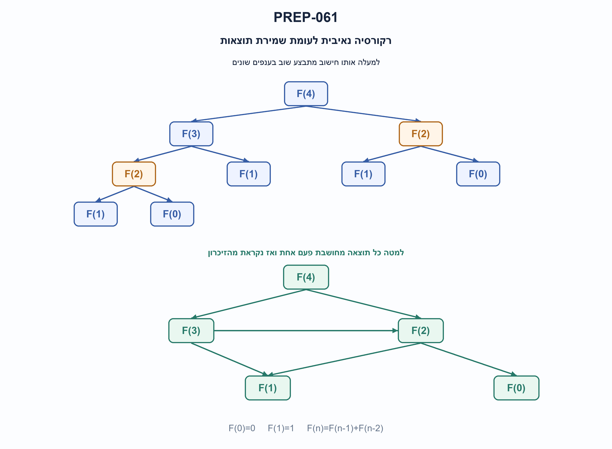
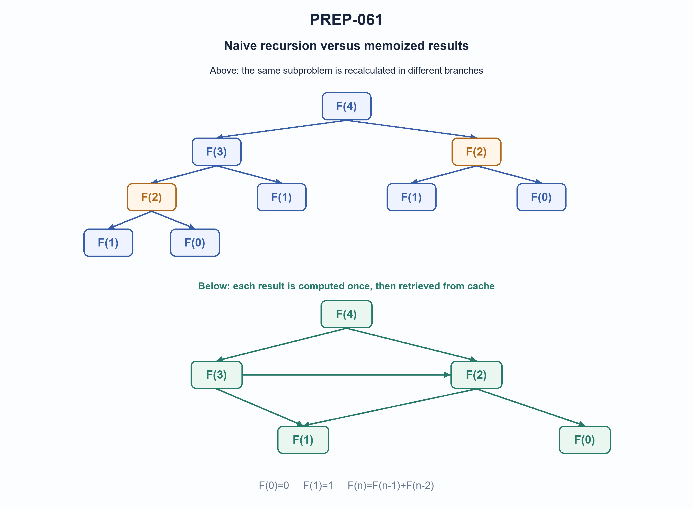

# PREP-061 — פיבונצ׳י בתוכנה — רקורסיה, סיבוכיות ושיפור

Status: in review; AI-assisted proposed solution; uncalibrated difficulty. Human professional/parity/reuse review pending. No learner activity recorded.

## Preserved source

ממש באופן רקורסיבי את אלגוריתם פיבונצ׳י. מהי סיבוכיות האלגוריתם? כיצד ניתן לשפר את הסיבוכיות?

[Source image](../sources/prep-061.png)

Companies reported by supplied source only: Intel, IBM.

## he: פיבונצ׳י בתוכנה — רקורסיה, סיבוכיות ושיפור

ממשו בפייתון פונקציה רקורסיבית שמחזירה את איבר פיבונצ׳י באינדקס n. נתחו את זמן הריצה ואת זיכרון העזר. הסבירו מה גורם לחוסר היעילות והציגו שיפור ששומר תוצאות ביניים ושיפור איטרטיבי. השוו את הסיבוכיות של החלופות.

הבהרות: F(0)=0 ו־F(1)=1, ולכל n>=2 מתקיים F(n)=F(n−1)+F(n−2). הקלט הוא מספר שלם אי־שלילי, ללא ערכי בוליאן; ערכים אחרים נדחים. נדרש ערך מדויק, לא חישוב מודולרי. בניתוח הראשוני ספרו פעולות חשבון במודל עלות יחידה, ואז ציינו מה משתנה במספרים השלמים הבלתי מוגבלים של Python. מגבלת עומק הרקורסיה של הסביבה עדיין חלה. זו שאלת תוכנה, בנפרד ממימוש סדרה בחומרה.

### Three progressive hints

1. כתבו את שני תנאי העצירה ואת קריאות הרקורסיה. ציירו את הקריאות עבור n=4: האם אותו אינדקס מחושב יותר מפעם אחת?
2. עץ הקריאות חוזר על תתי־בעיות. כמה אינדקסים שונים בין 0 ל־n קיימים, ומה יקרה אם נשמור את התוצאה של כל אחד?
3. לשיפור איטרטיבי, כדי לחשב איבר חדש דרושים רק שני הקודמים. עדכנו אותם במקביל מהערכים הישנים, והבחינו בין מספר משתנים קבוע למספר ביטים קבוע.

### Proposed solution

**פתרון מוצע — קודם מבינים את עץ הרקורסיה, ואז מבטלים חישובים חוזרים.**

לפי ההגדרה, שני איברי הבסיס ידועים. עבור אינדקס גדול יותר מחשבים רקורסיבית את שני הקודמים ומחזירים את סכומם. בדיקת הקלט מתבצעת פעם אחת בכניסה החיצונית; הפונקציה הפנימית מקבלת רק אינדקסים תקינים.

### הרקורסיה הישירה

בקריאה F(4) מחשבים F(3) ו־F(2). אבל F(3) בעצמה מחשבת שוב את F(2). בכל ענף החישוב מתחיל מחדש, ולכן אותו אינדקס עשוי להופיע פעמים רבות. השרטוט העליון מציג את עץ הקריאות המלא של F(4); שני הצמתים הכתומים הם שתי קריאות נפרדות לאותה תת־בעיה.

```text
T(n) = T(n-1) + T(n-2) + Theta(1)
C(n) = 2*F(n+1) - 1
```

הנוסחה השנייה סופרת את מספר הקריאות, כולל הקריאה הראשית והבסיסים. היא נובעת מאותם תנאי בסיס ומכך שבכל קריאה לא בסיסית יש שתי קריאות ילדים. לכן הזמן הוא Theta(phi^n), כאשר phi הוא יחס הזהב, בערך 1.618. החסם O(2^n) נכון אך פחות הדוק. עומק הקריאות המרבי ליניארי ב־n, ולכן יש O(n) מסגרות במחסנית, ולא מחסנית מעריכית: הענפים אינם כולם פעילים יחד.

### שיפור עם זיכרון תוצאות

נשמור כל תוצאה לפי האינדקס שלה. בפעם הראשונה מחשבים אותה, ובביקור הבא באותו אינדקס מחזירים את הערך השמור. בתרשים התחתון כל תת־בעיה מופיעה פעם אחת; החצים מציינים תלות של חישוב באחר, ולא כיוון החזרת הערך.

יש לכל היותר n+1 אינדקסים שונים, ולכל אחד תוספת אחת לכל היותר. במודל פעולות חשבון בעלות יחידה מתקבלים O(n) זמן, O(n) ערכים שמורים ו־O(n) עומק מחסנית. כאן המטמון מוגדר בתוך הפונקציה ולכן אינו שומר תוצאות בין קריאות נפרדות אליה. שמירת תוצאות אינה מבטלת את מגבלת עומק הרקורסיה של Python.

### שיפור איטרטיבי

אם נדרש רק האיבר האחרון, אין צורך לשמור את כל הקודמים. מתחילים בזוג 0,1. בכל איטרציה הזוג החדש הוא האיבר השני והסכום של שני האיברים הישנים:

```text
before iteration k: (a,b) = (F(k),F(k+1))
after iteration:     (a,b) = (F(k+1),F(k+2))
```

אחרי n איטרציות a הוא F(n). ההשמה המקבילית בפייתון חשובה: צד ימין מחושב מהערכים הישנים לפני ששני השמות מתעדכנים.

דוגמה עבור n=5:

```text
k:       0      1      2      3      4      5
(a,b): (0,1)  (1,1)  (1,2)  (2,3)  (3,5)  (5,8)
return a = 5
```

במודל עלות יחידה זה O(n) זמן ו־O(1) משתנים מספריים נוספים, ללא מחסנית רקורסיה. אין טענה שזה האלגוריתם המהיר ביותר בכל מודל; יש שיטות נוספות כגון הכפלה מהירה.

### מה משתנה במספרים מדויקים של Python?

האיבר F(n) דורש Theta(n) ביטים, ולכן שני משתנים אינם O(1) ביטים. בגרסה האיטרטיבית עלות החיבורים גדלה עם האינדקס; בהנחת חיבור ליניארי במספר הביטים, סכום העלויות הוא O(n^2) פעולות ביטים וזיכרון O(n) ביטים. מטמון של כל האיברים דורש O(n^2) ביטים לערכים, בנוסף למחסנית ולתקורה. גבולות O(n) זמן ו־O(1) מקום שנאמרים בראיון מתייחסים לספירת פעולות ומספר ערכים, לא לביטים מדויקים בלתי מוגבלים.

הקוד הבא כולל את שלוש החלופות. לרקורסיה הישירה משתמשים רק ב־n קטן; לגרסה ללא מגבלת מחסנית בוחרים באיטרציה. אין צורך להגדיל את מגבלת הרקורסיה כדי לפתור את השאלה.

```python
"""PREP-061: recursive Fibonacci, local memoization and iterative improvement.

Convention F(0)=0, F(1)=1; exact nonnegative integer indices, bool excluded.
Unit-cost arithmetic complexity differs from Python arbitrary-precision cost.
Recursive variants are for explanation/small n and depend on recursion limits.
"""
from functools import cache


def validate_index(n: int) -> None:
    if type(n) is not int or n < 0:
        raise ValueError("n must be a nonnegative integer, not bool")


def fibonacci_recursive(n: int) -> int:
    validate_index(n)

    def fib(k: int) -> int:
        if k < 2:
            return k
        return fib(k - 1) + fib(k - 2)

    return fib(n)


def fibonacci_memoized(n: int) -> int:
    validate_index(n)

    @cache
    def fib(k: int) -> int:
        if k < 2:
            return k
        return fib(k - 1) + fib(k - 2)

    return fib(n)


def fibonacci_iterative(n: int) -> int:
    validate_index(n)
    a, b = 0, 1
    for _ in range(n):
        a, b = b, a + b
    return a
```

בדיקות משוות לאורקל עצמאי של הכפלה מהירה. נבדקו ערכי הבסיס, רצפי אינדקסים, מקרים גדולים באיטרציה ודחיית קלטים. ספירת הקריאות נמדדה על המימוש הרקורסיבי עצמו מול הנוסחה, ולא הוסקה רק ממדידת זמן.



### assumptions

```json
[
  "מוסכמת האינדוקס היא F(0)=0 ו־F(1)=1.",
  "קלט int אי־שלילי בלבד, לא bool; הפלט מספר שלם מדויק.",
  "ניתוח פעולות בעלות יחידה מופרד מעלויות מספרים גדולים.",
  "המימושים הרקורסיביים כפופים לעומק המחסנית; המטמון מקומי לקריאה אחת."
]
```

### optimality

```json
{
  "criterion": "ביטול חישובים חוזרים והפחתת זיכרון כשנדרש איבר יחיד.",
  "result": "נאיבי Theta(phi^n) פעולות ו־O(n) מסגרות; מטמון O(n) פעולות וערכים; איטרציה O(n) פעולות ומספר קבוע של ערכים.",
  "proof": "מספר הקריאות הנאיבי הוא 2F(n+1)−1. מטמון מחשב כל אינדקס פעם אחת, והאינווריאנט האיטרטיבי שומר שני איברים סמוכים.",
  "scope": "אין טענה לאלגוריתם המהיר ביותר. באיטרציה מדויקת יש O(n) ביטי ערכים ו־O(n^2) זמן ביטים עם חיבור ליניארי; מטמון הערכים דורש O(n^2) ביטים."
}
```

### verification

```json
{
  "status": "בדיקות קוד פייתון עברו; סקירה מקצועית עצמאית ממתינה.",
  "method": "השוואה לאורקל הכפלה מהירה עצמאי ומדידת מספר הקריאות בפועל.",
  "coverage": "25 אינדקסים ברקורסיה נאיבית, 201 עם מטמון, 1,001 באיטרציה; 25 בדיקות ספירת קריאות; אינדקסים 2,000 ו־10,000; 21 בדיקות קלט לא תקין.",
  "script_path": "checks/check_prep_061.py",
  "scope": "אין ניסוי שמוכיח סיבוכיות מתזמון; הגבולות מנומקים בנפרד. רקורסיה נבדקה באינדקסים מתונים, ואין בכך אישור אנושי."
}
```

### edge_cases

```json
[
  "n=0 מחזיר 0 ו־n=1 מחזיר 1.",
  "שלילי, שבר, מחרוזת ו־bool נדחים.",
  "שני איברים שווים בערכם עדיין צריכים להשתתף נכון בעדכון הזוג.",
  "באינדקסים גדולים גם מטמון רקורסיבי עלול להיתקל במגבלת מחסנית.",
  "מספר משתנים קבוע אינו מספר ביטים קבוע."
]
```

### common_mistakes

```json
[
  "רק תנאי עצירה n=1, שגורם לבעיה בקלט 0.",
  "טענה שזמן הרקורסיה הנאיבית ליניארי בגלל עומק המחסנית.",
  "החלפת a ואז חישוב b מהערך החדש במקום עדכון מקביל.",
  "הצהרה שמטמון מעלים את עומק הרקורסיה.",
  "טענה למקום O(1) ביטים או לפעולות Python בזמן קבוע ללא תלות באורך המספר."
]
```

### interview_answer

```json
"הרקורסיה הישירה מחברת את שני האיברים הקודמים אך מחשבת שוב תתי־בעיות: הזמן Theta(phi^n), ועומק המחסנית O(n). מטמון מוריד את מספר החישובים ל־O(n) עם O(n) ערכים ומחסנית. אם נדרש רק F(n), שני איברים מתעדכנים במקביל בלולאה: O(n) פעולות ומספר משתנים קבוע. במספרים מדויקים העלות תלויה גם במספר הביטים."
```

### solution_extensions

```json
{
  "question": "איך אפשר להקטין את מספר פעולות החשבון מעבר למעבר על כל האינדקסים?",
  "answer_outline": "אפשר להשתמש בזהויות הכפלה מהירה שמחשבות זוג F(k),F(k+1) ומשלבות אותו לאינדקס כפול. כך יש O(log n) רמות ומספר פעולות חשבון מסדר זה, אך הכפל והמספרים הגדולים אינם בעלי עלות ביטים קבועה. זה שיפור נוסף, לא נדרש כדי להבין את המטמון והאיטרציה.",
  "integration_status": "המשך מוכן בתוכן; אינו מחובר לתור ההמשך החי."
}
```

## en: Software Fibonacci — recursion, complexity and improvements

Implement a recursive Python function returning Fibonacci number F(n). Analyze running time and auxiliary storage. Explain the inefficiency, then provide a memoized improvement and an iterative improvement, comparing their complexity.

Clarifications: F(0)=0, F(1)=1 and F(n)=F(n−1)+F(n−2) for n>=2. Accept an exact nonnegative integer index, excluding bool, and reject other inputs. Return an exact value, not a modular result. First count unit-cost arithmetic operations, then explain Python arbitrary-precision costs. Recursive variants remain subject to the environment’s recursion limit. This is a software task, separate from hardware generation of the sequence.

### Three progressive hints

1. Write the two base cases and recursive calls. Draw F(4): does the same index get computed more than once?
2. The call tree repeats subproblems. How many distinct indices from zero through n exist, and what if each result were stored?
3. An iterative version needs only the previous two terms. Update them simultaneously from their old values, distinguishing a constant number of variables from a constant number of bits.

### Proposed solution

**Proposed solution — understand the call tree, then eliminate repeated work.**

The two base values are known. A larger index recursively obtains the preceding two terms and returns their sum. Validate input once in the outer function; the helper then receives only valid indices.

### Direct recursion

F(4) calls F(3) and F(2), but F(3) calls F(2) again. Each branch starts its work afresh, so the same index appears repeatedly. The upper diagram is the full F(4) call tree; the orange nodes are separate calls for the same subproblem.

```text
T(n) = T(n-1) + T(n-2) + Theta(1)
C(n) = 2*F(n+1) - 1
```

The second formula counts all calls, including the root and base cases. It follows from the base counts and two child calls per nonbase invocation. Running time is Theta(phi^n), where the golden ratio phi is about 1.618. O(2^n) is a valid but looser upper bound. Maximum active depth is linear, giving O(n) stack frames rather than exponential stack space: the entire tree is not active simultaneously.

### Memoization

Store each result by index. Compute it on the first visit and retrieve it on later visits. The lower diagram has one node per distinct subproblem; arrows show computational dependencies, not the direction of returned values.

There are at most n+1 indices and at most one addition per nonbase index. Under unit-cost arithmetic this gives O(n) time, O(n) cached values and O(n) stack depth. The supplied cache is local to one outer call, so separate calls do not share it. Memoization does not remove Python’s recursion-depth limit.

### Iteration

When only the final term is required, store only two adjacent terms. Start with zero and one and simultaneously replace the pair by the second term and the old-value sum:

```text
before iteration k: (a,b) = (F(k),F(k+1))
after iteration:     (a,b) = (F(k+1),F(k+2))
```

After n iterations, a equals F(n). Python’s parallel assignment evaluates the right side using old values before updating either name.

For n=5:

```text
k:       0      1      2      3      4      5
(a,b): (0,1)  (1,1)  (1,2)  (2,3)  (3,5)  (5,8)
return a = 5
```

In the unit-cost model iteration takes O(n) time and O(1) additional numeric variables, with no recursion stack. This is not a fastest-algorithm claim across all models; other methods such as fast doubling exist.

### Python exact-integer costs

F(n) needs Theta(n) bits, so two variables do not mean O(1) bits. Iterative addition costs grow with index; with linear-time bit addition, the summed cost is O(n^2) bit operations and O(n) stored bits. Caching all terms uses O(n^2) value bits, in addition to stack and object overhead. Interview bounds of O(n) time and O(1) storage refer to operation counts and a number of values, not unbounded exact bit complexity.

The code below provides all three methods. Use direct recursion only for small n and iteration when a recursion-free implementation is needed; increasing the recursion limit is unnecessary.

```python
"""PREP-061: recursive Fibonacci, local memoization and iterative improvement.

Convention F(0)=0, F(1)=1; exact nonnegative integer indices, bool excluded.
Unit-cost arithmetic complexity differs from Python arbitrary-precision cost.
Recursive variants are for explanation/small n and depend on recursion limits.
"""
from functools import cache


def validate_index(n: int) -> None:
    if type(n) is not int or n < 0:
        raise ValueError("n must be a nonnegative integer, not bool")


def fibonacci_recursive(n: int) -> int:
    validate_index(n)

    def fib(k: int) -> int:
        if k < 2:
            return k
        return fib(k - 1) + fib(k - 2)

    return fib(n)


def fibonacci_memoized(n: int) -> int:
    validate_index(n)

    @cache
    def fib(k: int) -> int:
        if k < 2:
            return k
        return fib(k - 1) + fib(k - 2)

    return fib(n)


def fibonacci_iterative(n: int) -> int:
    validate_index(n)
    a, b = 0, 1
    for _ in range(n):
        a, b = b, a + b
    return a
```

Checks compare against an independent fast-doubling oracle, covering base cases, ranges of indices, larger iterative cases and invalid inputs. The actual recursive implementation’s call counts were profiled against the exact formula rather than inferred only from elapsed time.



### assumptions

```json
[
  "Convention F(0)=0, F(1)=1.",
  "Accept nonnegative exact int indices, excluding bool; return exact integers.",
  "Unit-cost operation counts are distinguished from big-integer costs.",
  "Recursive versions obey stack limits; memoization is local to one call."
]
```

### optimality

```json
{
  "criterion": "Eliminate repeated work and reduce storage when only one term is required.",
  "result": "Naive: Theta(phi^n) operations and O(n) frames; memoized: O(n) operations/values; iterative: O(n) operations and constant value count.",
  "proof": "Naive calls equal 2F(n+1)−1. Memoization computes each index once; iteration maintains adjacent Fibonacci values.",
  "scope": "No fastest-method claim. Exact iteration stores O(n) value bits and takes O(n^2) bit time with linear addition; cached term values require O(n^2) bits."
}
```

### verification

```json
{
  "status": "Python-code checks passed; independent professional review pending.",
  "method": "Independent fast-doubling oracle and profiling of actual naive call counts.",
  "coverage": "Twenty-five naive indices, 201 memoized, 1,001 iterative; twenty-five call-count checks; indices 2,000 and 10,000; twenty-one invalid inputs.",
  "script_path": "checks/check_prep_061.py",
  "scope": "No timing-based asymptotic proof; complexity is reasoned separately. Recursion checked at modest indices; no human expert approval."
}
```

### edge_cases

```json
[
  "n=0 returns zero; n=1 returns one.",
  "Negative, fractional, string and bool inputs are rejected.",
  "Equal adjacent values still participate correctly in pair updates.",
  "Even memoized recursion may hit the stack limit at large n.",
  "Constant variable count is not constant bit storage."
]
```

### common_mistakes

```json
[
  "Using only an n=1 base case and mishandling zero.",
  "Calling naive running time linear because stack depth is linear.",
  "Updating a before calculating b from old values.",
  "Claiming caching removes recursive depth.",
  "Claiming O(1) bits or size-independent Python arithmetic."
]
```

### interview_answer

```json
"Direct recursion sums the previous two values but repeats subproblems, taking Theta(phi^n) operations and O(n) stack depth. Memoization reduces this to O(n) computed values and stack. For only F(n), loop with two simultaneously updated terms: O(n) operations and constant variable count. Exact-integer costs also depend on bit length."
```

### solution_extensions

```json
{
  "question": "How can the arithmetic-operation count improve beyond visiting every index?",
  "answer_outline": "Fast-doubling identities compute the pair F(k),F(k+1) and combine to a doubled index in O(log n) levels/arithmetic operations. Multiplications and large integers are not constant bit cost. This is an additional extension, not required for memoization and iteration.",
  "integration_status": "Follow-up prepared in content; not connected to the live follow-up queue."
}
```

## Saved implementation and verification

- [solutions/prep_061_fibonacci_software.py](../solutions/prep_061_fibonacci_software.py)
- [checks/check_prep_061.py](../checks/check_prep_061.py)
- [checks/prep-061-verification.json](../checks/prep-061-verification.json)


## מקור נוסף — 30.10.2026, מקבץ70, צילום 15

[צילום מקור פרטי](../sources/2026-10-30-batch70-15.png)

זהו מקור נוסף לשאלה הקיימת; צילום זה אינו מוסיף שינוי טכני לגרסה.

החלטת קליטה: `additional_source_existing_question`.

תמלול המקור (נתוני מקור):

```text
כתוב פונקציה המממשת את סדרת פיבונאצ׳י: F0=0, F1=1, Fn=Fn−1+Fn−2. כתוב מימוש רקורסיבי ורגיל.
```
