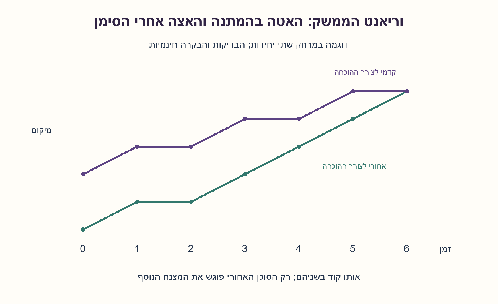
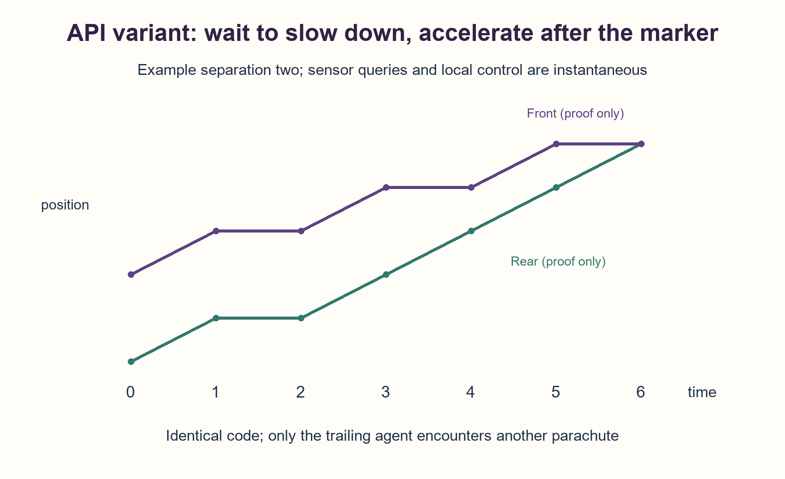

# PREP-062 — תוספת API מ־2026-10-24 / API addendum

[צילום המקור הפנימי](../sources/prep-062-api-2026-10-24.png)

הצעה בסיוע AI; ביקורת מקצועית אנושית ממתינה. המודל והתוכן הישנים נשארים ללא שינוי.

### ג. וריאנט נוסף מהמקור החדש — API מפורש, מודל זמן נפרד
שני רובוטים זהים מתחילים יחד על מסילה אינסופית, וכל אחד משאיר מצנח קבוע בנקודת ההתחלה שלו. אותה פונקציה תרוץ בשניהם. הפעולות move_left(), move_right() מזיזות יחידה אחת ביחידת זמן; no_operation() ממתינה יחידת זמן. on_parachute() מחזירה אמת כאשר הרובוט נמצא על אחד המצנחים, ללא זיהוי בעליו, ו־did_meet() מחזירה אם הוא נמצא עם האחר. כתבו תוכנית שתבטיח מפגש.

הבהרה נפרדת מהמודל א–ב: המקור החדש אינו נותן מחיר זמן לבדיקות ולבקרה. בווריאנט ג נבחר במפורש שהן מיידיות, ורק תנועה והמתנה צורכות זמן. מותרת פעולת ההמתנה שה־API מספק; אין להוסיף אותה בדיעבד למקור הרכבות. המרחק הוא מספר שלם לא שלילי, הכיוון ״ימינה״ משותף, היחידות שוות וההתחלה מסונכרנת. אין קריאת קואורדינטות, מרחק או זהות רובוט/מצנח. בדיקות מתבצעות בין פעולות; תנועה רציפה במהלך הצעד. יש לנתח בנפרד את התוכנית במודל הזה, ולא להשתמש אוטומטית ביחס המהירויות של שלוש ההוראות מהסעיפים הקודמים.

### פתרון נפרד לווריאנט ג — מאטים באמצעות המתנה מפורשת
כאן בדיקות ובקרה אינן עולות זמן, ולכן צריך להאט באמצעות no_operation(). שני הרובוטים מתחילים בצעד ימינה לפני בדיקת מצנח, כדי להתעלם מהסימן שלהם. אחר כך שניהם מתקדמים לאט: אם אין מצנח, ממתינים יחידה ואז צועדים ימינה. רק הרובוט האחורי מגיע למצנח שהשאיר הקדמי; מאותו רגע הוא מפסיק להמתין וצועד ימינה בכל יחידת זמן. הקדמי ממשיך לשלב המתנות, ולכן האחורי משיג אותו. השמות ״קדמי״ ו״אחורי״ משמשים רק להסבר ואינם נתונים לתוכנית.

```python
def rendezvous():
    if did_meet():
        return
    move_right()  # Leave the initial own parachute before testing.
    while not did_meet():
        if on_parachute():
            while not did_meet():
                move_right()
            return
        no_operation()
        if did_meet():
            return
        move_right()
```

הקוד קורא רק את חמש פונקציות ה־API שהותרו. אין שימוש ב־move_left כי אין בו צורך, ואין בדיקה ״של מי המצנח״. בזמן אפס בודקים did_meet כדי לכסות נחיתה משותפת. אחרי תנועה/המתנה בודקים שוב, לפני המשך. אין שינוי מצנחים, זיהוי רובוטים או גישה למרחק.

### הוכחת זמן במודל ה־API
לצורך ההוכחה נמקם את האחורי ב־0 ואת הקדמי ב־D, כאשר D שלם חיובי. הצעד ה־D של התוכנית האיטית מסתיים בזמן 2D−1: האחורי נמצא בסימן D והקדמי ב־2D. האחורי מזהה מצנח מיד ונכנס ללולאה המהירה; הקדמי מתחיל המתנה. במחזור זוגי של שתי יחידות זמן הקדמי ממתין ואז הולך, והאחורי הולך פעמיים. הפער קטן באחת. במקטע ההמתנה של המחזור הזוגי ה־D הם נפגשים:

```text
t_meet = (2D-1) + 2(D-1) + 1 = 4D-2
```

למשל D=2: שניהם הולכים בזמנים 0–1, ממתינים ב־1–2 והולכים ב־2–3. בזמן 3 האחורי מגיע למצנח השני ומאיץ; בזמנים 3–4 ו־5–6 רק הוא הולך, והמפגש בזמן 6. עבור D=1 המפגש בזמן 2. המרחק אינו חלק מהקוד, הזיכרון המקומי קבוע והזמן O(D); אין טענת זמן מינימלי.

### לא מערבבים מודלים
ה־6D−1 והגרפים מהפתרון הקודם שייכים למודל שבו כל הוראה עולה זמן. ה־4D−2 והגרף המסומן API שייכים רק לווריאנט ג עם בדיקות מיידיות. אם גם בדיקות/בקרה עולות זמן צריך לתזמן אותן במפורש ולהוכיח שוב; אין הבטחה לנוסחה הזאת אז. בדיקת מצנח בנקודות סריג אינה מבטיחה גילוי במרחק חצי־שלם, וכיוונים שונים או התחלה בזמנים שונים אינם מכוסים. אין מגבלת זמן אחידה בלי חסם על D.

רתמת הבדיקה מחזיקה מיקומים לצורכי פיזיקה בלבד; הבקר המקומי מקבל רק שני ביטי חישה. היא בודקת גם שיתוף מיקום בתוך צעד, ולא רק משווה נקודות סוף. תחת סריג שלם ומהירויות 0 או 1 בכיוון משותף, הפגישה הראשונה בפועל היא בגבול יחידת זמן. הבדיקות החדשות נפרדות מבדיקות המפרש הישן ואינן ניסוי פיזי.



### C. Added source variant — explicit API with a separate timing model
Two identical robots start simultaneously on an infinite track, each leaving a stationary parachute at its initial position. Install the same function on both. move_left() and move_right() move one unit in one time unit; no_operation() waits one time unit. on_parachute() is true at either parachute without identifying ownership, and did_meet() reports co-location with the other robot. Write a program guaranteeing a meeting.

Separate clarification from models A–B: the new source does not assign time to sensor queries or local control. Variant C explicitly makes them instantaneous; only movement and waiting consume time. Its API permits waiting, which must not be retroactively added to the train source. Separation is a nonnegative integer, both share right orientation and time units, and start together. Programs cannot read coordinates, distance or robot/marker identity. Query between actions; movement is continuous within an action. Analyze this model separately instead of automatically reusing the earlier three-instruction speed ratio.

### Separate solution for variant C — slow down with explicit waiting
Here queries and control cost no time, so use no_operation() to create a speed difference. Both robots first move right before testing a parachute, thereby leaving their own marker. Until another marker is observed, each alternates waiting one unit and moving right one unit. Only the trailer reaches the leader's abandoned parachute. It then stops waiting and moves right every time unit, catching the leader that still waits between movements. “Trailer” and “leader” are proof labels, not information supplied to the program.

```python
def rendezvous():
    if did_meet():
        return
    move_right()  # Leave the initial own parachute before testing.
    while not did_meet():
        if on_parachute():
            while not did_meet():
                move_right()
            return
        no_operation()
        if did_meet():
            return
        move_right()
```

The code uses only the allowed API. move_left is unnecessary, and no query identifies marker ownership. An initial did_meet handles coincident landing. After every completed movement or wait, query meeting before continuing. No marker modification, robot identity or distance access is needed.

### API-model meeting time
For the proof put the trailer at zero and the leader at positive integer D. The D-th slow movement finishes at time 2D-1, placing them at D and 2D. The trailer immediately senses the marker and accelerates; the leader begins a wait. During each following two-tick block the trailer moves twice and the leader waits then moves, decreasing the gap by one. They meet during the waiting tick of block D:

```text
t_meet = (2D-1) + 2(D-1) + 1 = 4D-2
```

For D=2 both move over 0–1, wait over 1–2 and move over 2–3. At time three the trailer finds the other marker. Only it moves over 3–4 and 5–6; meeting occurs at six. D=1 meets at two. D never appears in the program. Local state is constant size and time O(D), without a minimum-time claim.

### Do not mix execution models
The earlier 6D-1 result and old diagrams charge time for every executed primitive. The 4D-2 result and API-labelled trajectory use instantaneous queries/control only. If queries/control also consume time, schedule them explicitly and prove the result again; this formula is not promised. Point tests on unit lattice sites can miss half-integer marker spacing, and independent directions or asynchronous starts are outside the guarantee. There is no uniform fixed time bound without a bound on D.

The harness holds positions only to simulate the environment; local controllers receive just marker and meeting booleans. Collision checking covers shared position inside a step, not merely endpoints. With integer initial spacing and common-direction velocities zero or one, this program's first meeting is at a tick boundary. New API checks are separate from the old paid-instruction interpreter and are not physical robot experiments.



[מודל API](../solutions/prep_062_api_robots.py) · [בדיקות](../checks/check_prep_062_api.py) · [תוצאות](../checks/prep-062-api-verification.json)
