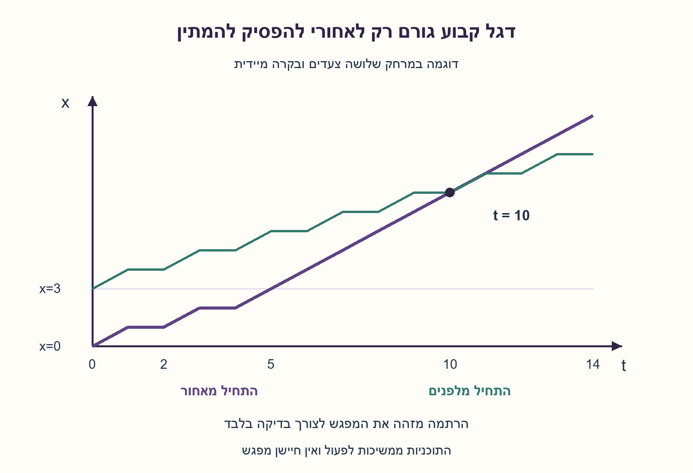
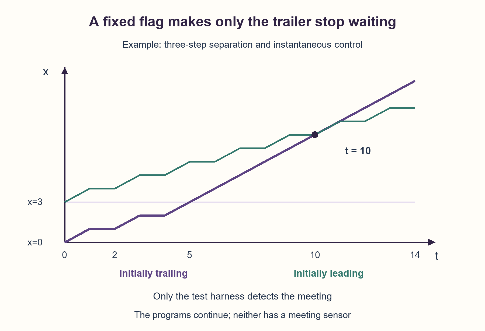

# PREP-062 — וריאנט ד׳: דגלים ללא חיישן מפגש

פתרון מוצע בסיוע AI; ביקורת מקצועית, תרגום וזכויות שימוש ממתינות. קושי אינו מכויל.

## מקור שמור ללא שינוי

[צילום מקור](../sources/2026-10-24-batch20-06.png)

נתונים לך שני רובוטים שנמצאים במרחק מסוים אחד מהשני (הבעיה היא חד מימדית). ליד כל רובוט יש דגל שהרובוט יכול לזהות. עליך לתת את אותו אלגוריתם לשני הרובוטים על מנת שיפגשו. הפעולות שאתה יכול להשתמש בהן הן זוז ימינה/שמאלה, עצירה ובדיקה האם יש דגל לידך.

## עברית

### ד. מקור נוסף — דגלים והמתנה, ללא חיישן מפגש
שני רובוטים זהים נמצאים במקומות לא ידועים על ישר. ליד כל אחד דגל קבוע. התקינו את אותו אלגוריתם בשניהם כדי שיימצאו יחד באותו מקום. מותר לנוע ימינה או שמאלה, לעצור/להמתין ולבדוק רק אם יש דגל במיקום הנוכחי. אין חיישן מפגש, זהות רובוט או זהות דגל.

מודל מפורש נוסף: ישר אינסופי, דגלים נשארים באתרי ההתחלה, מרחק שלם לא שלילי בצעדי יחידה, התחלה מסונכרנת וכיוון ימינה משותף. צעד יחידה והמתנה נמשכים כל אחד יחידת זמן; בדיקת דגל ובקרה מקומית מיידיות. ״עצירה״ מתפרשת כהמתנה ליחידת זמן, לא כסיום התוכנית לעד. המטרה היא מפגש פיזי לפחות פעם אחת, לא זיהוי אוטומטי שלו או עצירה משותפת. מקור זה אינו מספק did_meet(), ואין להוסיף אותה. תעדו במפורש מה ההוכחה אינה מכסה.

### רמזים

1. האם דגל נשאר במקום גם אחרי שהרובוט שהתחיל לידו כבר התרחק? חפשו אירוע שיקרה רק לאחד מהם כששניהם הולכים ימינה.
2. אחרי ששניהם עזבו את הדגל שלהם, רק הרובוט האחורי יוכל לפגוש דגל נוסף. אפשר להשתמש בדגל כדי לשנות את כמות ההמתנה שלו.
3. התחילו בצעד ימינה בלי בדיקת דגל. עד לדגל הבא המתינו יחידה ואז לכו צעד; אחריו לכו בלי המתנות. כל לולאה כוללת פעולה שצורכת זמן, ואין צורך לזהות את רגע המפגש.

### הצעה לפתרון

### וריאנט ד — מפגש ללא ידיעה שנפגשנו
כאן אין did_meet(). לכן לא נכתוב תנאי עצירה שקורא אותה. שני הרובוטים יריצו אותו קוד לנצח; נוכיח שבמהלך הריצה יהיה רגע שבו מיקומיהם שווים. זה בדיוק יעד המפגש הפיזי בנוסח הזה, ולא הבטחה שיזהו את המפגש או יישארו יחד אחריו.

### אותו קוד, אירוע שונה בסביבה
שניהם מתחילים בצעד ימינה. כך עוזבים את הדגל העצמי לפני שבודקים דגל. בהמשך כל אחד ממתין יחידה ואז הולך ימינה, עד שהוא רואה דגל. הקדמי מתקדם הרחק משני הדגלים ולכן ממשיך להמתין. האחורי מגיע בסוף לדגל שהקדמי השאיר, ומאותו רגע הולך בכל יחידת זמן בלי להמתין. אין צורך לדעת של מי הדגל: אחרי שהלכנו ימינה מהדגל שלנו, דגל שפוגשים בהמשך הוא האחר.

```python
def rendezvous():
    move_right()
    while not on_flag():
        wait_one_tick()
        move_right()
    while True:
        move_right()
```

move_right() ו־wait_one_tick() צורכות זמן יחידה; on_flag() והבקרה מיידיות. אלו שמות עריכה לפעולות שבמקור. שום לולאה אינה מסתובבת רק על בדיקה מיידית: בכל איטרציה יש תנועה או המתנה מתוזמנת. אין חיישן מפגש, קריאת מיקום, בעלות דגל, מזהה, קריאת המרחק או שינוי דגלים.

### ההוכחה במודל ד
לניתוח בלבד נמקם את האחורי ב־0 ואת הקדמי ב־D, כאשר D שלם חיובי. עד גילוי הדגל, שניהם מבצעים תנועות באותם זמנים ולכן המרחק נשמר. הצעד ה־D של האחורי מסתיים בזמן 2D−1; הוא נמצא בדגל הקדמי, בעוד הקדמי כבר ב־2D.

כעת הקדמי ממתין ואז הולך בכל זוג יחידות זמן, והאחורי הולך בשתיהן. הפער קטן באחת בכל זוג. בזוג ה־D, בזמן ההמתנה של הקדמי, הפער האחרון נסגר:

```text
t_meet = (2D - 1) + 2(D - 1) + 1 = 4D - 2
```

עבור D=3 הם נפגשים בזמן 10 במיקום 8. אם D=0 הם נפגשו כבר בזמן ההתחלה, אף שהתוכניות אינן מזהות זאת וממשיכות. המרחק אינו דרוש לתוכנית. נשמרים מספר קבוע של מצבים מקומיים, והזמן עד המפגש O(D); זו אינה טענת מינימום זמן.

### מה נשמר ומה שונה מהווריאנטים הקודמים?
המודלים א׳–ב׳ מחייבים זמן גם לבדיקות ולקפיצות, והנוסחה שלהם היא 6D−1. במודל ג׳ יש wait מפורש וגם did_meet(). במודל ד׳ אין did_meet(), ובדיקות ובקרה אינן עולות זמן. נוסחת 4D−2 זהה לזו של ג׳ משום שמסלולי התנועה לפני המפגש זהים, ולא משום שנוסף חיישן אסור.

אם ״עצירה״ פירושה פקודת halt סופית בלבד, אין מכאן היתר להמתנה מתוזמנת. אם המרחק חצי־שלם ובודקים דגל רק בין צעדי יחידה, אפשר לדלג על הדגל תמיד ולא להיפגש. כיווני ימין שונים, זמנים לא מסונכרנים, משכי פעולה שונים או דגל שנע עם הרובוט דורשים מודל ופתרון נוספים. אין חסם זמן קבוע שאינו תלוי ב־D.

### אימות והפרדה בין בקרה לבדיקה
הבקר המקומי בקוד המודל מקבל ביט אחד בלבד: האם יש דגל כאן. רק רתמת הסימולציה מחזיקה את המיקומים ובודקת חפיפה פיזית, גם בתוך צעד. היא אינה מוסרת את המפגש לבקר ואינה עוצרת את התוכנית. עברו 772 מקרי מרחק שלם, 201,984 נקודות מסלול מול נוסחה עצמאית, מפגש התחלתי ושלוש דוגמאות נגדיות במרחק חצי־שלם. נוסחה והוכחה כללית מלוות את הבדיקה הסופית; זה אינו ניסוי ברובוטים.

שלושת הרמזים הקיימים בשאלה נשמרו עבור המודלים הקודמים. שלושת רמזי ד׳ הוכנו בחומר הווריאנט ובמסמך שלו; המערכת אינה בוחרת אותם אוטומטית לפי וריאנט בתור הרמזים.



## English

### D. Additional source — flags and waiting, without a meeting sensor
Two identical robots occupy unknown positions on a line, with a fixed flag at each starting point. Install the same algorithm on both so they occupy one location together. They may move right/left, stop/wait, and test only whether a flag is at their current position. No meeting sensor, robot identity or flag identity is available.

Separate explicit model: infinite line, flags left at the initial sites, nonnegative integer separation in unit steps, synchronized start and common right orientation. A unit move and a wait each take one time unit; flag queries and local control are instantaneous. Interpret “stop” as a one-unit wait, not permanent termination. The target is physical co-location at least once, not automatically detecting it or stopping together. This source supplies no did_meet(), and none may be added. State what the proof does not cover.

### Hints

1. Does a flag remain where it was after its original robot leaves? Look for an event occurring to only one robot when both move right.
2. After leaving their own flags, only the trailer can encounter another flag. Use that event to change its waiting behavior.
3. First move right without testing the starting flag. Until another flag, alternate one-unit waiting and movement; afterward move without waiting. Every loop executes a timed action; no meeting detection is needed.

### Proposed solution

### Variant D — meeting without knowing that a meeting occurred
There is no did_meet() here, so do not invent a stopping condition using it. Both robots run the same code indefinitely. We prove that their positions coincide at some time during execution. This meets the physical-rendezvous objective, without promising detection or remaining together afterward.

### Identical code, a different environmental event
Both first move right, leaving their own flags before testing. Each then alternates a one-unit wait and a right step until sensing a flag. The leader moves away from both flags and continues waiting. The trailer eventually reaches the leader's abandoned flag, then moves every time unit without waits. Marker ownership is unnecessary: after moving right from your own flag, the next encountered flag must be the other one.

```python
def rendezvous():
    move_right()
    while not on_flag():
        wait_one_tick()
        move_right()
    while True:
        move_right()
```

move_right() and wait_one_tick() each consume one time unit; on_flag() and local control are instantaneous. These names label the source's permitted operations. No loop spins only on a free query: every iteration executes movement or a timed wait. There is no meeting sensor, coordinate query, marker-ownership test, identity, distance input or marker modification.

### Proof in model D
For analysis alone put the trailer at zero and leader at positive integer D. Before marker detection their movement schedules match, preserving their gap. The trailer's D-th movement ends at time 2D−1, at the leader's flag; the leader is then at 2D.

Afterward the leader waits then moves in every two-tick block, while the trailer moves twice. The gap shrinks by one per block. In block D, during the leader's waiting tick, the final gap closes:

```text
t_meet = (2D - 1) + 2(D - 1) + 1 = 4D - 2
```

For D=3 they meet at time 10 and position 8. With D=0 they are already co-located initially, although neither detects this and both continue. D is absent from the local program. The controller stores a constant number of local states; time to rendezvous is O(D), with no minimum-time claim.

### What stays and what differs?
Models A–B charge time for queries and jumps and have meeting time 6D−1. Model C supplies explicit waiting and did_meet(). Model D lacks did_meet() and makes queries/control free. Its 4D−2 matches C because the pre-meeting trajectories match, not because an unauthorized sensor was added.

If “stop” means permanent halt only, timed waiting is not automatically allowed. Half-integer spacing can make endpoint flag tests miss the other flag forever, preventing rendezvous. Different right orientations, asynchronous starts, unequal action durations or flags carried along by robots need further models and algorithms. No fixed deadline independent of D is established.

### Verification separates local control from the test environment
The local model controller receives one bit only: whether a flag is here. Only the harness holds positions and tests physical co-location, including within a step. It neither informs the controller of meeting nor stops its program. Passed 772 integer-distance cases, 201,984 trajectory points against an independent formula, initial co-location and three half-integer counterexamples. The finite checks accompany the general proof; they are not robot experiments.

The question's original three interactive hints remain for the earlier models. Three D-specific progressive hints are prepared in the variant material and document; the existing queue does not automatically select hints by variant.



## חומר משלים דו־לשוני / Bilingual material

```json
{
  "assumptions": {
    "he": [
      "כיוון קדימה משותף, התחלה מסונכרנת ושעונים שווים.",
      "מרחק הסימנים הוא מספר שלם חיובי של צעדי יחידה; זו הנחת עריכה ולא נתון מפורש במקור.",
      "מצנחים הם סימני נקודה קבועים; החיישן נבדק במקום הנוכחי בלבד ואינו מזהה את בעל הסימן.",
      "כל הוראה מבוצעת עולה יחידת זמן, כולל בדיקה וקפיצה; קפיצה מותנית שלא מבוצעת אינה צורכת זמן.",
      "שני הסוכנים נעים ברציפות בזמן צעד. מפגש הוא מקום משותף, לא דרישת גילוי או עצירה אוטומטית.",
      "למעבד המקומי רק מונה פקודות וקריאת סימן; נתוני הסביבה מוסתרים ממנו.",
      "וריאנט API נפרד ג: תנועה והמתנה אורכות יחידה; בדיקות ובקרה מיידיות. מודלי א–ב נשארים ללא שינוי.",
      "וריאנט ד׳: חישת דגל בלבד, ללא חיישן מפגש; המתנה וצעד בזמן יחידה, בקרה מיידית ויעד של מפגש פיזי בלבד."
    ],
    "en": [
      "Common forward orientation, synchronized start and equal clocks.",
      "Positive integer marker separation in unit steps is an explicit editorial assumption, not a stated source fact.",
      "Parachutes are fixed point markers; the sensor tests only the current location and cannot identify ownership.",
      "Every executed primitive costs one tick, including test and jump; a skipped guarded jump consumes no execution tick.",
      "Movement is continuous during its tick. Meeting means shared location, not automatic detection or stopping.",
      "The local CPU has only a program counter and marker bit; environment data is hidden from it.",
      "Separate API variant C: movement/wait cost one tick; queries/control are instantaneous; all original A/B timing assumptions remain unchanged for those variants.",
      "Variant D: marker presence only, no meeting sensor; unit wait/movement, instantaneous control and physical rendezvous only."
    ]
  },
  "optimality": {
    "he": {
      "criterion": "הבטחת מפגש בכל מרחק שלם במודל ההוראות שנבחר.",
      "result": "פגישה בזמן 6D−1; זיכרון מקומי קבוע וזמן ליניארי במרחק.",
      "proof": "לפני הסימן הפער D; אחרי המעבר ללולאה המהירה הוא קטן באחת בכל שלוש הוראות.",
      "scope": "אין טענה למינימום זמן או הוראות; לא מכסה מרחק ממשי שרירותי, כיוונים בלתי תלויים, שעונים שונים או בקרה חינמית.",
      "variant_d": "זמן מפגש 4D−2 במרחק שלם חיובי במודל ד׳; מספר קבוע של מצבים מקומיים, ללא טענת זמן מינימלי או זיהוי המפגש."
    },
    "en": {
      "criterion": "Guaranteed meeting for every integer separation in the declared instruction model.",
      "result": "Meeting at 6D−1; constant local memory and linear time in separation.",
      "proof": "The gap is D before marker discovery; afterward it decreases by one per three-instruction cycle.",
      "scope": "No minimum-time or minimum-program claim; does not cover arbitrary real separation, independent orientations, unequal clocks or free control.",
      "variant_d": "Meeting time 4D−2 for positive integer spacing in D; constant local states, without minimum-time or meeting-detection claim."
    }
  },
  "verification": {
    "he": "עברו 1,536 הרצות מפרש: מרחקים 1 עד 256, שני סדרי סוכנים ושלוש הזזות צירים. זמן המפגש וזמן בדיקת הסימן הושוו לנוסחאות עצמאיות. נבדקו מרחק אפס וארבע דוגמאות חצי־שלמות שבהן הסימן מוחמץ, וכן כיווני קדימה הפוכים. החיישן המקומי אינו מקבל מיקומים. זו בדיקת מודל סופית ולא ניסוי פיזי או הוכחה למודלים אחרים. וריאנט API נפרד: 1,536 בדיקות מסלול למרחק חיובי מול 4D−2, בכיוון משותף, התחלה מסונכרנת ובדיקות מיידיות בלבד. וריאנט ד׳ נבדק בנפרד: 772 מרחקים/הזזות/החלפות, 201,984 נקודות מסלול מול נוסחה עצמאית ושלוש דוגמאות נגדיות חצי־שלמות; רק הרתמה רואה מפגש.",
    "en": "Passed 1,536 interpreter runs: distances 1..256, both agent orders and three translations. Meeting and marker-test times matched independent formulas. Checked initial coincidence, four noninteger marker misses and opposite forward directions. The local sensor never receives positions. Finite model checks are not physical experiments or proof for other execution models. Separate API variant: finite trajectory checks compare meeting with 4D-2 for 1,536 positive-distance cases; common orientation, synchronized start and instantaneous queries/control only. Variant D separately passed 772 distance/translation/agent-order cases and 201,984 trajectory points against an independent formula, plus three half-integer counterexamples; only the harness sees meetings."
  },
  "edge_cases": {
    "he": [
      "לבדוק סימן לפני הצעד הראשון יזהה אצל שניהם את המצנח העצמי ולא ישבור סימטריה.",
      "מרחק של יחידה אחת מוביל למפגש בזמן 5 ולא בזמן 3 במודל שמחשב בנפרד בדיקה וקפיצה.",
      "אין צורך לשנות קוד כשהסוכן השני מתחיל משמאל; התפקידים מתחלפים מאליהם.",
      "סימן במרחק חצי יחידה עלול שלא להידגם לעולם.",
      "התחלה באותה נקודה היא מפגש בזמן אפס.",
      "המודל אינו דורש זיהוי מפגש מתוך התוכנית עצמה.",
      "בווריאנט API בודקים מפגש התחלתי ועוזבים את המצנח העצמי לפני בדיקת הסימן; ההמתנה הותרה רק במקור החדש.",
      "בד׳ גם אחרי מפגש ממשיכים לפעול; D=0 הוא מפגש התחלתי. ׳עצירה׳ חייבת להתיר המתנה מתוזמנת, לא רק halt סופי."
    ],
    "en": [
      "Testing before the first step sees each agent’s own marker and does not break symmetry.",
      "Unit separation meets at 5, not 3, when test and jump each consume their own tick.",
      "If the other agent starts on the left, roles swap automatically without a code change.",
      "A marker half a unit away may never be sampled.",
      "Coincident starts are a meeting at time zero.",
      "The program itself need not detect that a meeting has happened.",
      "API variant: explicitly check initial coincidence; leave the own marker before testing on_parachute. Its waiting primitive is allowed by the new source only.",
      "D continues after a meeting; D=0 is initially co-located. “Stop” must permit a timed wait rather than permanent halt only."
    ]
  },
  "common_mistakes": {
    "he": [
      "להניח ששתי תוכניות זהות עם מהירות זהה ייפגשו בלי אירוע השובר סימטריה.",
      "לזהות את המצנח העצמי בתחילת העבודה ולעבור אצל שניהם למהירות גבוהה.",
      "לספור בדיקה וקפיצה פעם כזמן אפס ופעם כיחידה.",
      "להשתמש בפקודת המתנה או סעיף אחר שלא הותרו.",
      "לקרוא בקוד למרחק או למיקום האחר שהסוכן אינו יודע.",
      "להרחיב את ההוכחה למרחקים לא שלמים או לכיוונים שונים בלי פתרון נוסף.",
      "העתקת זמן 6D−1 והשרטוטים מהמודל הישן לווריאנט API עם המתנה ובדיקות חינמיות.",
      "הוספת did_meet() לגרסת הדגלים, או לולאת בדיקות מיידיות שאינה מניעה את הזמן."
    ],
    "en": [
      "Expecting identical programs with identical motion to meet without a symmetry-breaking observation.",
      "Detecting the initial own marker and making both agents fast.",
      "Counting tests and jumps as free in one part and costly in another.",
      "Introducing an unauthorized WAIT or ELSE.",
      "Reading hidden separation or the other position from inside agent code.",
      "Generalizing the proof to noninteger separation or different orientations without another solution.",
      "Reusing the paid-instruction 6D-1 time or old diagrams for the API variant with free queries and explicit waiting.",
      "Adding did_meet() to the flag-only variant or busy-looping on instantaneous queries without a timed action."
    ]
  },
  "interview_answer": {
    "he": "שניהם נעים באותו כיוון בלולאה איטית: צעד, בדיקת מצנח וקפיצה. רק האחורי יגיע למצנח שהקדמי השאיר. הוא יעבור ללולאה של שני צעדים וקפיצה, ולכן יתקדם בממוצע פי שניים ויסגור פער. במודל של הוראה אחת ליחידת זמן ומרחק שלם הפגישה בזמן 6D−1. אותם תנאי כיוון ותזמון חייבים להיות מפורשים. בד׳ ללא חיישן מפגש: צעד ימינה, ואז המתנה וצעד עד דגל נוסף, ומשם צעדים בלי המתנות. מוכיחים מפגש פיזי בלי לדרוש שהתוכנית תזהה אותו.",
    "en": "Both advance in the same direction using a slow step/test/jump loop. Only the trailer reaches the leader’s fixed marker, then switches to two steps and a jump. Its average speed doubles and closes the gap. With one tick per executed primitive and integer separation, meeting occurs at 6D−1. Direction and timing assumptions must be explicit. In D without meeting sensing: move right, then wait/move until another flag, then move without waiting. Prove physical co-location without requiring program detection."
  },
  "source_ambiguities": {
    "he": {
      "distance": "X במקור לא צוין כשלם. הפתרון הדיסקרטי נבדק רק לסריג של צעדי יחידה; לחצי־יחידה קיימת דוגמה נגדית.",
      "timing": "הצילומים אינם קובעים מחיר לבדיקה ולקפיצה; המודל כאן מעניק יחידה לכל הוראה מבוצעת.",
      "orientation": "כיוון קדימה משותף והתחלה מסונכרנת נאמרים במפורש בעריכה.",
      "operation_count": "מקור הרכבות אומר שלוש פעולות אך מונה MF,MB,ifP,GOTO; נשמר הטקסט המקורי ומובהר שבעריכה יש ארבע צורות.",
      "static": "המילה סטטי במקור הרובוטים מתארת את המצנח, לא את הרובוט.",
      "api_variant": "המקור החדש מתיר המתנה אך אינו קובע זמן לבדיקות. וריאנט ג בוחר בדיקות ובקרה מיידיות ומגדיר כיוון משותף, התחלה יחד וסריג שלם.",
      "variant_d": "צילום ד׳ מוסיף עצירה/המתנה אך אינו מספק חיישן מפגש, משכי פעולה או סריג. ההבהרות של ד׳ נבחרו במפורש ואינן מחליפות את מודלי א׳–ג׳."
    },
    "en": {
      "distance": "Source X is not explicitly integer. The discrete solution assumes a unit lattice; half-unit separation provides a counterexample.",
      "timing": "The screenshots do not assign costs to tests/jumps; this model charges one tick to every executed primitive.",
      "orientation": "Common forward direction and synchronized start are explicit editorial additions.",
      "operation_count": "The train source says three operations but listsMF,MB,ifP,GOTO; the literal source is retained and four forms are clarified.",
      "static": "Static in the robot source refers to the parachute marker, not the moving robot.",
      "api_variant": "New API explicitly permits waiting but leaves query timing unspecified. Variant C chooses zero-time queries/control and keeps common orientation, synchronized start and integer spacing explicit.",
      "variant_d": "Source D permits stopping/waiting but specifies neither a meeting sensor, action timing nor lattice. D's declared choices do not replace A–C."
    }
  },
  "solution_extensions": {
    "he": {
      "question": "מה משתנה אם בדיקה וקפיצה הן חינמיות או שהמרחק הוא חצי יחידה?",
      "direction": "הסבירו מדוע יחס המהירויות או זיהוי הסימן כבר אינם מובטחים בתוכנית הנתונה. צריך לבחור במפורש מודל תנועה וחישה אחר או אלגוריתם שמייצר האטה ממשית; אין להסיק שהמודל החדש נפתר מאותו חישוב.",
      "status": "המשך מוכן בתוכן; אינו מחובר לתור ההמשך החי.",
      "variant_d": "מה אם נדרש גם לעצור יחד כשנפגשים? המפגש הפיזי המוכח אינו נותן כשלעצמו אירוע חישה או פרוטוקול עצירה. יש להגדיר תקשורת/חישה מותרות או להוכיח פרוטוקול אחר; לא מוסיפים חיישן בשקט. ההרחבה אינה ממומשת."
    },
    "en": {
      "question": "What changes if test/jump are free or the markers are half a unit apart?",
      "direction": "Explain why this program no longer guarantees the speed ratio or marker observation. Specify another movement/sensing model or a genuinely slowing algorithm; do not reuse the old proof unchanged.",
      "status": "Follow-up prepared in content; not connected to the live follow-up queue.",
      "variant_d": "What if both must also stop on meeting? Proven physical co-location does not itself provide a sensing event or stopping protocol. Define permitted sensing/communication or prove another protocol; never silently add a sensor. This extension is not implemented."
    }
  },
  "prompt_variants": {
    "he": {
      "D": {
        "prompt": "### ד. מקור נוסף — דגלים והמתנה, ללא חיישן מפגש\nשני רובוטים זהים נמצאים במקומות לא ידועים על ישר. ליד כל אחד דגל קבוע. התקינו את אותו אלגוריתם בשניהם כדי שיימצאו יחד באותו מקום. מותר לנוע ימינה או שמאלה, לעצור/להמתין ולבדוק רק אם יש דגל במיקום הנוכחי. אין חיישן מפגש, זהות רובוט או זהות דגל.\n\nמודל מפורש נוסף: ישר אינסופי, דגלים נשארים באתרי ההתחלה, מרחק שלם לא שלילי בצעדי יחידה, התחלה מסונכרנת וכיוון ימינה משותף. צעד יחידה והמתנה נמשכים כל אחד יחידת זמן; בדיקת דגל ובקרה מקומית מיידיות. ״עצירה״ מתפרשת כהמתנה ליחידת זמן, לא כסיום התוכנית לעד. המטרה היא מפגש פיזי לפחות פעם אחת, לא זיהוי אוטומטי שלו או עצירה משותפת. מקור זה אינו מספק did_meet(), ואין להוסיף אותה. תעדו במפורש מה ההוכחה אינה מכסה.",
        "hints": [
          "האם דגל נשאר במקום גם אחרי שהרובוט שהתחיל לידו כבר התרחק? חפשו אירוע שיקרה רק לאחד מהם כששניהם הולכים ימינה.",
          "אחרי ששניהם עזבו את הדגל שלהם, רק הרובוט האחורי יוכל לפגוש דגל נוסף. אפשר להשתמש בדגל כדי לשנות את כמות ההמתנה שלו.",
          "התחילו בצעד ימינה בלי בדיקת דגל. עד לדגל הבא המתינו יחידה ואז לכו צעד; אחריו לכו בלי המתנות. כל לולאה כוללת פעולה שצורכת זמן, ואין צורך לזהות את רגע המפגש."
        ],
        "integration_status": "רמזי ד׳ נשמרו, אך אינם נבחרים אוטומטית בתור הרמזים הקיים."
      }
    },
    "en": {
      "D": {
        "prompt": "### D. Additional source — flags and waiting, without a meeting sensor\nTwo identical robots occupy unknown positions on a line, with a fixed flag at each starting point. Install the same algorithm on both so they occupy one location together. They may move right/left, stop/wait, and test only whether a flag is at their current position. No meeting sensor, robot identity or flag identity is available.\n\nSeparate explicit model: infinite line, flags left at the initial sites, nonnegative integer separation in unit steps, synchronized start and common right orientation. A unit move and a wait each take one time unit; flag queries and local control are instantaneous. Interpret “stop” as a one-unit wait, not permanent termination. The target is physical co-location at least once, not automatically detecting it or stopping together. This source supplies no did_meet(), and none may be added. State what the proof does not cover.",
        "hints": [
          "Does a flag remain where it was after its original robot leaves? Look for an event occurring to only one robot when both move right.",
          "After leaving their own flags, only the trailer can encounter another flag. Use that event to change its waiting behavior.",
          "First move right without testing the starting flag. Until another flag, alternate one-unit waiting and movement; afterward move without waiting. Every loop executes a timed action; no meeting detection is needed."
        ],
        "integration_status": "D hints are saved but not automatically selected by the existing hint queue."
      }
    }
  }
}
```
