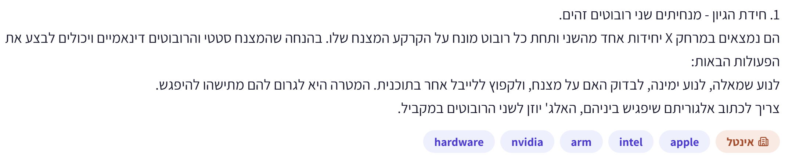
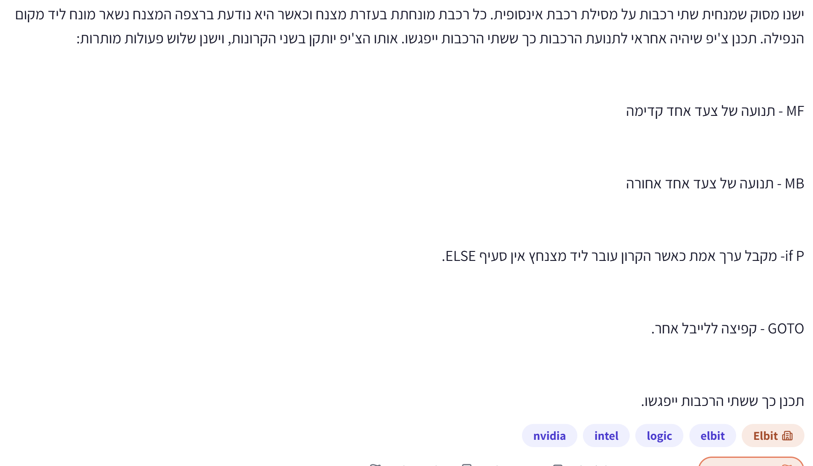
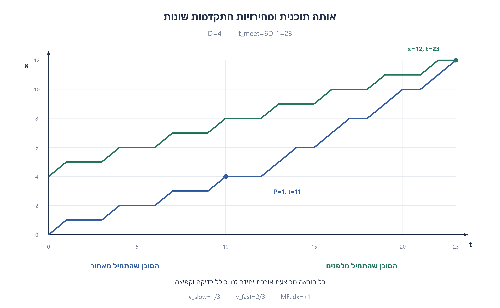
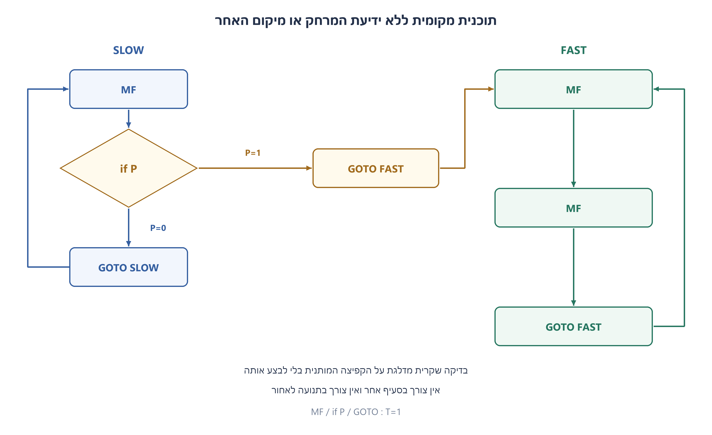
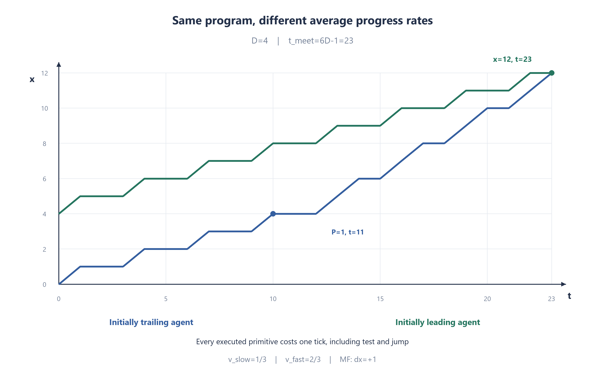
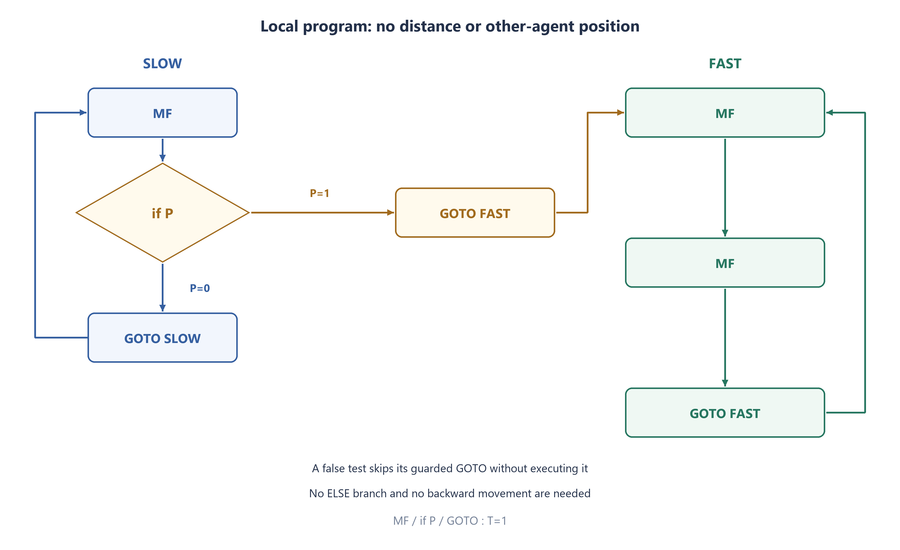

# PREP-062 — מפגש רובוטים ורכבות זהים בעזרת סימני נחיתה קבועים

פתרון מוצע בסיוע AI. ביקורת מקצועית, בדיקת תרגום אנושית ובדיקת זכויות שימוש ממתינות. קושי אינו מכויל. שיוכי חברות מדווחים בצילומי המקור בלבד ואינם אימות עצמאי.

## המקורות שנשמרו ללא שינוי

### robots



1. חידת הגיון - מנחיתים שני רובוטים זהים.
הם נמצאים במרחק איקס יחידות אחד מהשני ותחת כל רובוט מונח על הקרקע המצנח שלו. בהנחה שהמצנח סטטי והרובוטים דינאמיים ויכולים לבצע את הפעולות הבאות:
לנוע שמאלה, לנוע ימינה, לבדוק האם על מצנח, ולקפוץ ללייבל אחר בתוכנית. המטרה היא לגרום להם מתישהו להיפגש.
צריך לכתוב אלגוריתם שיפגיש ביניהם, האלג׳ יוזן לשני הרובוטים במקביל.

### trains



ישנו מסוק שמנחית שתי רכבות על מסילת רכבת אינסופית. כל רכבת מונחת בעזרת מצנח וכאשר היא נוגעת ברצפה המצנח נשאר מונח ליד מקום הנפילה. תכנן צ׳יפ שיהיה אחראי לתנועת הרכבת כך ששתי הרכבות יפגשו. אותו הצ׳יפ יותקן בשני הקרונות, ישנן שלוש פעולות מותרות:

MF - תנועה של צעד אחד קדימה
MB - תנועה של צעד אחד אחורה
if P - מקבל ערך אמת כאשר הקרון עובר ליד מצנח. אין סעיף ELSE.
GOTO - קפיצה ללייבל אחר.

תכננו כך ששתי הרכבות ייפגשו.

## נוסח האתר בעברית

שני מקורות מתארים את אותה בעיית מפגש עם שני ניסוחים. תנו תוכנית מקומית אחת המותקנת בשני הסוכנים הזהים, כך שייפגשו בלי שאף אחד יודע את המרחק או את מיקום האחר.

**א. רובוטים:** שני רובוטים מונחים על ישר אינסופי במרחק לא ידוע X. מתחת לכל אחד נשאר מצנח קבוע בקרקע. מותר לנוע יחידה ימינה או שמאלה, לבדוק אם נמצאים על מצנח ולקפוץ לתווית בתוכנית. שניהם מתחילים יחד באותה תוכנית. המצנחים הם הסימנים הקבועים; הרובוטים עצמם נעים.

**ב. רכבות:** שני קרונות עם אותו שבב נוחתים על מסילה אינסופית. סימני המצנחים נשארים במקומות הנחיתה. הפקודות הרשומות הן MF לצעד קדימה, MB לצעד אחורה, בדיקת if P וקפיצת GOTO. אין סעיף ELSE. המקור אומר ״שלוש פעולות״ אך מונה ארבע צורות פקודה; בנוסח הערוך משתמשים בארבע הרשומות, בלי להמציא מגבלה נוספת.

**מודל התזמון שנבחר במפורש:** המרחק בין הסימנים הוא מספר שלם חיובי D של צעדי יחידה; X במקור לא הוגדר כשלם. לשניהם אותה משמעות לכיוון קדימה, או ימינה ברובוטים, אותה יחידת זמן והתחלה מסונכרנת. כל הוראה שבוצעה — תנועה, בדיקה או קפיצה — אורכת יחידת זמן אחת. הבדיקה מותנית רק בהוראה הבאה: אם P אמת מבצעים את ה־GOTO המותנה במחזור הבא; אם לא, מדלגים עליו בלי לבצעו. זו אינה פקודת בדיקה וקפיצה חינמית. תנועה נמשכת ברציפות לאורך יחידת הזמן; פגישה היא הימצאות באותה נקודה גם באמצע צעד.

אין גישה לקואורדינטות, למרחק, לזהות הסוכן או למצב האחר. אפשר לזהות רק שהמקום הנוכחי מסומן, לא איזה מצנח זה. הציגו תוכנית ללא ELSE, הסבירו כיצד הסימנים שוברים את הסימטריה והוכיחו שהיא מסתיימת במודל הזה. ציינו אילו מסקנות אינן מובטחות אם הכיוונים, השעונים או המרחקים אינם מקיימים את ההנחות. הנחות התזמון והסריג נוספו בעריכה משום שהצילומים אינם קובעים אותן.

### שלושה רמזים

1. אם שניהם מבצעים תמיד אותן פקודות באותה סביבה מקומית, המרחק נשמר. איזה אירוע יקרה רק לאחד מהם כאשר שניהם מתקדמים לאותו כיוון?
2. הסוכן שמתחיל מאחור יגיע לסימן ההתחלה של הקדמי. אחרי שכבר עזבו את סימניהם שלהם, מפגש עם סימן יכול לשנות את אופן ההתקדמות של האחורי בלבד.
3. צרו לולאה עם צעד אחד ושלוש הוראות מבוצעות בסך הכול, ולולאה אחרת עם שני צעדים בשלוש הוראות. מעבר לולאה אחרי זיהוי הסימן נותן לאחורי מהירות ממוצעת גדולה יותר, בלי לשנות את מהירות הצעד הבודד.

## הצעה לפתרון

**פתרון מוצע — אותו קוד, אבל המצנח של הסוכן הקדמי מעביר רק את האחורי ללולאה מהירה יותר.**

### איך שוברים את הסימטריה?

נקרא לצורך ההוכחה בלבד לסוכן שמשמאל ״אחורי״ ולסוכן שמימין ״קדמי״. הסוכנים אינם מקבלים שמות אלה ואין הבדל בקוד שלהם. שניהם מתקדמים ימינה. הקדמי מתרחק משני המצנחים, והאחורי יגיע בסופו של דבר למצנח שהקדמי השאיר. לכן הסביבה המקומית שלהם תפסיק להיות זהה.

אין צורך לדעת איזה מצנח רואים: לא בודקים לפני הצעד הראשון, כך שכבר עזבנו את המצנח שלנו. מאחר שנעים רק קדימה, הסימן הבא שנמצא שייך לנקודת ההתחלה של האחר. המצנח נשאר במקומו גם כשהסוכן שלו כבר רחוק.

### התוכנית לשניהם

```text
SLOW:
    MF
    if P:
        GOTO FAST
    GOTO SLOW
FAST:
    MF
    MF
    GOTO FAST
```

בגרסת הרובוטים מחליפים כל MF בפקודת צעד ימינה. אין צורך ב־MB או בפקודת המתנה חדשה. ההזחה אומרת שה־GOTO ל־FAST הוא ההוראה היחידה המוגנת על ידי if P; ה־GOTO ל־SLOW אחריו אינו חלק מתנאי ואינו ELSE.

### תזמון בלי להחביא הוראות חינמיות

כאשר אין סימן, מחזור איטי מבצע שלוש הוראות: MF, בדיקת P, וקפיצה ל־SLOW. רק הראשונה נעה. ה־GOTO המותנה לא מבוצע ולכן אינו גוזל זמן במקרה השקרי. מתקבל צעד אחד בכל שלוש יחידות זמן.

כאשר יש סימן, מבוצעים MF, בדיקה מוצלחת ו־GOTO ל־FAST, כל אחד במחזור נפרד. משם המחזור המהיר מבצע MF, MF, GOTO ל־FAST — שני צעדים בשלוש יחידות. מהירות ההליכה של צעד נשארת אחת; ההבדל הוא כמה מהזמן מוקדש לתנועה וכמה לבקרה.

```text
SLOW: MF, ifP(false), GOTO SLOW  -> 1 step / 3 ticks
FAST: MF, MF, GOTO FAST         -> 2 steps / 3 ticks
```

### הוכחת מפגש לכל מרחק שלם חיובי

נמקם בהוכחה את האחורי ב־0 ואת הקדמי ב־D. לפני זיהוי הסימן שניהם באותו מופע של הלולאה האיטית, ולכן מרחקם נשאר D. אחרי הצעד ה־D האחורי נמצא במצנח הקדמי. הצעד מסתיים בזמן ‎3D−2, הבדיקה מתבצעת בזמן ‎3D−1 והקפיצה ל־FAST בזמן ‎3D. באותו זמן האחורי ב־D והקדמי ב־2D, ושניהם עומדים להתחיל מחזור בן שלוש הוראות.

בכל מחזור כזה שני הסוכנים זזים בצעד הראשון; בצעד השני רק האחורי זז; בשלישי שניהם מבצעים קפיצה. לכן הפער קטן באחת בכל מחזור. אחרי D מחזורים הוא מתאפס, והפגישה הראשונה מתרחשת בצעד השני של המחזור האחרון:

```text
t_meet = 3D + 3(D-1) + 2 = 6D-1
```

המרחק אינו נדרש לתוכנית; הוא מופיע רק בהוכחה. זמן הריצה ליניארי במרחק במודל הזה, והתוכנית שומרת רק מונה פקודות ממספר קבוע של מצבים. אין טענה לזמן מפגש מיטבי או למינימום הוראות.

### דוגמה וגבולות המודל

עבור D=4, האחורי מגיע לסימן בזמן 10, בודק אותו בזמן 11, מסיים את הקפיצה בזמן 12, ופוגש את הקדמי בזמן 23 במיקום 12. הגרף מציג בנפרד תנועה והשהיית בקרה; החלקים האופקיים אינם צעדים נוספים.

אם D אינו שלם, בדיקת נקודה רק בין צעדי יחידה יכולה להחמיץ אותו לעד: בסימנים 0 ו־0.5 שתי התוכניות לעולם לא יראו את הסימן של האחר, ושתיהן נשארות באותה מהירות. אם שני כיווני הקדימה הפוכים ומופנים החוצה, תוכנית זו גם אינה מפגישה. אין להציג את ההוכחה כאילו כיסתה מרחק ממשי שרירותי, כיוונים בלתי תלויים או התחלה אסינכרונית. נדרש אז מודל חישה או אלגוריתם אחר.

גם מודל שבו כל פקודות הבקרה אורכות אפס זמן שונה: שתי הלולאות עלולות לנוע באותה מהירות פיזית, ולכן ההסבר של יחס המהירויות לא תקף אוטומטית. כאן כל הוראה מבוצעת מקבלת זמן אחד במפורש.

המטרה היא עצם המפגש הפיזי, לא זיהוי האחר באמצעות חיישן שלא הותר. אם דורשים להפסיק אוטומטית לפני התנגשות, צריך להוסיף יכולת גילוי מתאימה; הקוד אינו קורא את מיקום האחר. מודל הפייתון מפריד בין המעבד המקומי שרואה רק P לבין הסביבה שמחזיקה מיקומים ומאתרת מפגש לצורכי בדיקה.

עברו 1,536 הרצות מפרש במרחקים 1 עד 256, בשני סדרי הסוכנים ובשלוש הזזות של מערכת הצירים. הזמן הושווה לנוסחה עצמאית. נבדקו גם מפגש התחלתי, ארבע דוגמאות נגדיות של חצי־יחידה וכיוון קדימה שונה. זו בדיקה סופית של המודל, לצד הוכחה לכל D שלם; לא ניסוי ברובוטים או ברכבות.





### assumptions

[
  "כיוון קדימה משותף, התחלה מסונכרנת ושעונים שווים.",
  "מרחק הסימנים הוא מספר שלם חיובי של צעדי יחידה; זו הנחת עריכה ולא נתון מפורש במקור.",
  "מצנחים הם סימני נקודה קבועים; החיישן נבדק במקום הנוכחי בלבד ואינו מזהה את בעל הסימן.",
  "כל הוראה מבוצעת עולה יחידת זמן, כולל בדיקה וקפיצה; קפיצה מותנית שלא מבוצעת אינה צורכת זמן.",
  "שני הסוכנים נעים ברציפות בזמן צעד. מפגש הוא מקום משותף, לא דרישת גילוי או עצירה אוטומטית.",
  "למעבד המקומי רק מונה פקודות וקריאת סימן; נתוני הסביבה מוסתרים ממנו."
]

### optimality

{
  "criterion": "הבטחת מפגש בכל מרחק שלם במודל ההוראות שנבחר.",
  "result": "פגישה בזמן 6D−1; זיכרון מקומי קבוע וזמן ליניארי במרחק.",
  "proof": "לפני הסימן הפער D; אחרי המעבר ללולאה המהירה הוא קטן באחת בכל שלוש הוראות.",
  "scope": "אין טענה למינימום זמן או הוראות; לא מכסה מרחק ממשי שרירותי, כיוונים בלתי תלויים, שעונים שונים או בקרה חינמית."
}

### verification

"עברו 1,536 הרצות מפרש: מרחקים 1 עד 256, שני סדרי סוכנים ושלוש הזזות צירים. זמן המפגש וזמן בדיקת הסימן הושוו לנוסחאות עצמאיות. נבדקו מרחק אפס וארבע דוגמאות חצי־שלמות שבהן הסימן מוחמץ, וכן כיווני קדימה הפוכים. החיישן המקומי אינו מקבל מיקומים. זו בדיקת מודל סופית ולא ניסוי פיזי או הוכחה למודלים אחרים."

### edge_cases

[
  "לבדוק סימן לפני הצעד הראשון יזהה אצל שניהם את המצנח העצמי ולא ישבור סימטריה.",
  "מרחק של יחידה אחת מוביל למפגש בזמן 5 ולא בזמן 3 במודל שמחשב בנפרד בדיקה וקפיצה.",
  "אין צורך לשנות קוד כשהסוכן השני מתחיל משמאל; התפקידים מתחלפים מאליהם.",
  "סימן במרחק חצי יחידה עלול שלא להידגם לעולם.",
  "התחלה באותה נקודה היא מפגש בזמן אפס.",
  "המודל אינו דורש זיהוי מפגש מתוך התוכנית עצמה."
]

### common_mistakes

[
  "להניח ששתי תוכניות זהות עם מהירות זהה ייפגשו בלי אירוע השובר סימטריה.",
  "לזהות את המצנח העצמי בתחילת העבודה ולעבור אצל שניהם למהירות גבוהה.",
  "לספור בדיקה וקפיצה פעם כזמן אפס ופעם כיחידה.",
  "להשתמש בפקודת המתנה או סעיף אחר שלא הותרו.",
  "לקרוא בקוד למרחק או למיקום האחר שהסוכן אינו יודע.",
  "להרחיב את ההוכחה למרחקים לא שלמים או לכיוונים שונים בלי פתרון נוסף."
]

### interview_answer

"שניהם נעים באותו כיוון בלולאה איטית: צעד, בדיקת מצנח וקפיצה. רק האחורי יגיע למצנח שהקדמי השאיר. הוא יעבור ללולאה של שני צעדים וקפיצה, ולכן יתקדם בממוצע פי שניים ויסגור פער. במודל של הוראה אחת ליחידת זמן ומרחק שלם הפגישה בזמן 6D−1. אותם תנאי כיוון ותזמון חייבים להיות מפורשים."

### source_ambiguities

{
  "distance": "X במקור לא צוין כשלם. הפתרון הדיסקרטי נבדק רק לסריג של צעדי יחידה; לחצי־יחידה קיימת דוגמה נגדית.",
  "timing": "הצילומים אינם קובעים מחיר לבדיקה ולקפיצה; המודל כאן מעניק יחידה לכל הוראה מבוצעת.",
  "orientation": "כיוון קדימה משותף והתחלה מסונכרנת נאמרים במפורש בעריכה.",
  "operation_count": "מקור הרכבות אומר שלוש פעולות אך מונה MF,MB,ifP,GOTO; נשמר הטקסט המקורי ומובהר שבעריכה יש ארבע צורות.",
  "static": "המילה סטטי במקור הרובוטים מתארת את המצנח, לא את הרובוט."
}

### solution_extensions

{
  "question": "מה משתנה אם בדיקה וקפיצה הן חינמיות או שהמרחק הוא חצי יחידה?",
  "direction": "הסבירו מדוע יחס המהירויות או זיהוי הסימן כבר אינם מובטחים בתוכנית הנתונה. צריך לבחור במפורש מודל תנועה וחישה אחר או אלגוריתם שמייצר האטה ממשית; אין להסיק שהמודל החדש נפתר מאותו חישוב.",
  "status": "המשך מוכן בתוכן; אינו מחובר לתור ההמשך החי."
}

## English website wording

Two sources describe the same marker-assisted rendezvous problem. Give one local program installed in both identical agents so they meet without either knowing the distance or the other agent's position.

**A. Robots:** two robots land on an infinite line at unknown separation X. Each leaves a stationary parachute on the ground. They may move one unit right or left, test whether their current position has a parachute, and jump to a label. They start the same program simultaneously. The markers stay fixed; the robots move.

**B. Trains:** two identical-chip carriages land on an infinite track, leaving markers at the landing sites. The listed forms are MF for one step forward, MB for one step backward, if P, and GOTO. There is no ELSE. The source says “three operations” but lists four forms; the edited question permits those four rather than inventing an additional three-form limit.

**Explicit chosen timing model:** marker separation is a positive integer D of unit movement steps; the source's X was not specified as integer. Both agents share the same forward direction, or right direction for robots, equal time units and a synchronized start. EVERY executed primitive—movement, test or jump—takes one time unit. A test guards only the next instruction: if P is true, its guarded GOTO executes on the next tick; otherwise that GOTO is skipped without execution. Testing and jumping are not free or fused. Movement is continuous within its unit interval; meeting means occupying the same point, including inside a step.

Agents cannot read coordinates, separation, identity or the other's state. They see only a marker underfoot, not which marker it is. Provide a program without ELSE, explain how the fixed markers break symmetry, and prove termination in this model. State the limits when direction, clock or lattice assumptions fail. Timing and lattice assumptions were added explicitly because the screenshots do not fix them.

### Three hints

1. If both always execute identical instructions in identical local surroundings, their separation stays fixed. Which event happens to only one agent when both move in the same direction?
2. The initially trailing agent reaches the leading agent’s starting marker. Once they have left their own markers, seeing a marker can change only the trailing agent’s behavior.
3. Build one loop with one movement among three executed primitives and another with two movements among three. Switching loops after the marker gives the trailer a higher average speed without changing the speed of an individual step.

## Proposed solution

**Proposed solution — identical code, but only the trailer encounters the leader’s fixed marker and switches to a faster loop.**

### Breaking symmetry

For the proof only, call the left agent the trailer and the right agent the leader. Neither receives that identity and both run identical code. Both move right. The leader moves away from both markers; the trailer eventually reaches the leader’s abandoned starting marker. Their local observations therefore become different.

No marker identity is needed: do not test before the first movement, so the agent has already left its own marker. With forward-only movement, the next marker is the other starting site. The marker stays there even while its former owner moves far away.

### Program installed in both agents

```text
SLOW:
    MF
    if P:
        GOTO FAST
    GOTO SLOW
FAST:
    MF
    MF
    GOTO FAST
```

For robots replace every MF by one unit right. Neither MB nor a new WAIT instruction is needed. Indentation means if P guards only GOTO FAST. The following GOTO SLOW is unconditional, not an ELSE.

### Timing every executed instruction

Without a marker, SLOW executes MF, the P test, and GOTO SLOW: three ticks with one movement. The guarded GOTO is skipped, not executed, on a false test. Thus average progress is one step per three ticks.

On a marker, MF, the successful test and GOTO FAST each take separate ticks. FAST then repeats MF, MF, GOTO FAST: two movements in three ticks. Individual movement speed is unchanged; only the fraction of time spent moving changes.

```text
SLOW: MF, ifP(false), GOTO SLOW  -> 1 step / 3 ticks
FAST: MF, MF, GOTO FAST         -> 2 steps / 3 ticks
```

### Meeting proof for every positive integer separation

For analysis put the trailer at 0 and leader at D. Until the marker event, both remain in the same phase of SLOW, so their gap stays D. The trailer’s D-th movement reaches the leader’s marker at time 3D-2. Its test runs at 3D-1 and its separate GOTO FAST at 3D. At time 3D the trailer is at D, the leader at 2D, and both are ready to begin a three-instruction cycle.

Within each such cycle both move on the first tick, only the trailer on the second, and both jump on the third. The gap therefore decreases by one per cycle. On the second tick of the D-th cycle they meet for the first time:

```text
t_meet = 3D + 3(D-1) + 2 = 6D-1
```

The program never knows D; only the proof uses it. Time is linear in separation in this model, and local memory is a constant-size program counter. No optimal meeting-time or minimum-instruction claim is made.

### Example and model limits

With D=4 the trailer reaches the marker at time 10, tests at 11, completes its jump at 12 and meets the leader at time 23 at position 12. The trajectory plot separates movement from stationary control ticks; horizontal pieces are not extra movement steps.

A noninteger D can be missed forever by point tests between unit steps. With markers at 0 and 0.5, neither program ever observes the other marker, so both keep equal average speed. If their forward directions point away from each other, this program also fails. The proof therefore does not cover arbitrary real separations, independent orientations or asynchronous starts. Those require another sensing model or algorithm.

Free control instructions are also a different model: both loops may then have the same physical speed, so the average-speed argument does not transfer automatically. Here every executed primitive explicitly costs one tick.

The target is physical rendezvous, not recognizing the other agent using a forbidden sensor. Automatic stopping before collision would need an added detection capability; the program never reads the other position. The Python model separates the local CPU, which sees only P, from an environment that stores hidden positions and detects meetings for testing.

Passed 1,536 interpreter runs for separations 1 through 256, both initial agent orders and three coordinate translations, checked against the independent meeting-time formula. Also checked initial coincidence, four half-unit counterexamples and an incompatible-forward-direction example. Finite model tests accompany the all-integer proof; they are not robot or train experiments.





### assumptions

[
  "Common forward orientation, synchronized start and equal clocks.",
  "Positive integer marker separation in unit steps is an explicit editorial assumption, not a stated source fact.",
  "Parachutes are fixed point markers; the sensor tests only the current location and cannot identify ownership.",
  "Every executed primitive costs one tick, including test and jump; a skipped guarded jump consumes no execution tick.",
  "Movement is continuous during its tick. Meeting means shared location, not automatic detection or stopping.",
  "The local CPU has only a program counter and marker bit; environment data is hidden from it."
]

### optimality

{
  "criterion": "Guaranteed meeting for every integer separation in the declared instruction model.",
  "result": "Meeting at 6D−1; constant local memory and linear time in separation.",
  "proof": "The gap is D before marker discovery; afterward it decreases by one per three-instruction cycle.",
  "scope": "No minimum-time or minimum-program claim; does not cover arbitrary real separation, independent orientations, unequal clocks or free control."
}

### verification

"Passed 1,536 interpreter runs: distances 1..256, both agent orders and three translations. Meeting and marker-test times matched independent formulas. Checked initial coincidence, four noninteger marker misses and opposite forward directions. The local sensor never receives positions. Finite model checks are not physical experiments or proof for other execution models."

### edge_cases

[
  "Testing before the first step sees each agent’s own marker and does not break symmetry.",
  "Unit separation meets at 5, not 3, when test and jump each consume their own tick.",
  "If the other agent starts on the left, roles swap automatically without a code change.",
  "A marker half a unit away may never be sampled.",
  "Coincident starts are a meeting at time zero.",
  "The program itself need not detect that a meeting has happened."
]

### common_mistakes

[
  "Expecting identical programs with identical motion to meet without a symmetry-breaking observation.",
  "Detecting the initial own marker and making both agents fast.",
  "Counting tests and jumps as free in one part and costly in another.",
  "Introducing an unauthorized WAIT or ELSE.",
  "Reading hidden separation or the other position from inside agent code.",
  "Generalizing the proof to noninteger separation or different orientations without another solution."
]

### interview_answer

"Both advance in the same direction using a slow step/test/jump loop. Only the trailer reaches the leader’s fixed marker, then switches to two steps and a jump. Its average speed doubles and closes the gap. With one tick per executed primitive and integer separation, meeting occurs at 6D−1. Direction and timing assumptions must be explicit."

### source_ambiguities

{
  "distance": "Source X is not explicitly integer. The discrete solution assumes a unit lattice; half-unit separation provides a counterexample.",
  "timing": "The screenshots do not assign costs to tests/jumps; this model charges one tick to every executed primitive.",
  "orientation": "Common forward direction and synchronized start are explicit editorial additions.",
  "operation_count": "The train source says three operations but listsMF,MB,ifP,GOTO; the literal source is retained and four forms are clarified.",
  "static": "Static in the robot source refers to the parachute marker, not the moving robot."
}

### solution_extensions

{
  "question": "What changes if test/jump are free or the markers are half a unit apart?",
  "direction": "Explain why this program no longer guarantees the speed ratio or marker observation. Specify another movement/sensing model or a genuinely slowing algorithm; do not reuse the old proof unchanged.",
  "status": "Follow-up prepared in content; not connected to the live follow-up queue."
}

## Files and verification

- [prep_062_identical_agents.py](../solutions/prep_062_identical_agents.py)

- [Checks](../checks/check_prep_062.py)

- [Evidence](../checks/prep-062-verification.json)

No chat request was written as learner progress. The prepared follow-up is not connected to the interactive queue.
