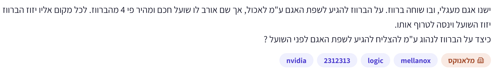
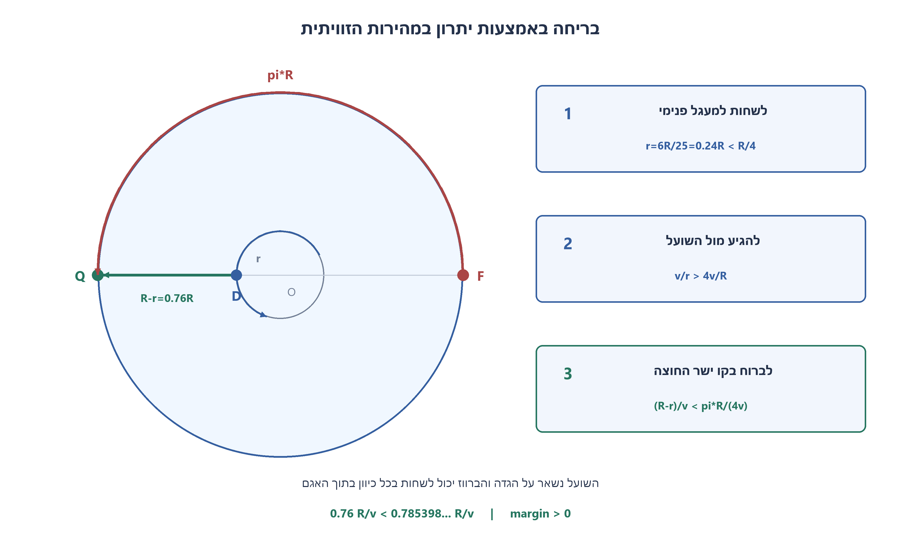
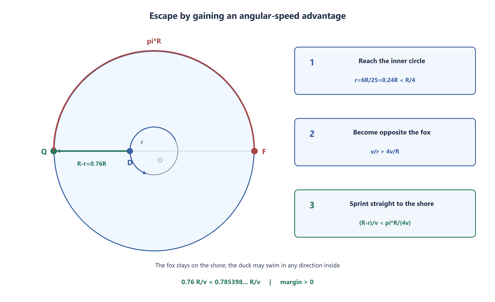

# PREP-063 — ברווז ושועל סביב אגם מעגלי — בריחה למרות יתרון מהירות

פתרון מוצע בסיוע AI. ביקורת מקצועית, בדיקת תרגום אנושית ובדיקת זכויות שימוש ממתינות. קושי אינו מכויל. שיוכי חברות מדווחים בצילומי המקור בלבד ואינם אימות עצמאי.

## המקורות שנשמרו ללא שינוי

### duck-fox



ישנו אגם מעגלי, ובו שוחה ברווז. על הברווז להגיע לשפת האגם ע״מ לאכול, אך שם אורב לו שועל חכם ומהיר פי 4 מהברווז. לכל מקום אליו יזוז הברווז יזוז השועל וינסה לטרוף אותו.
כיצד על הברווז לנהוג ע״מ להצליח להגיע לשפת האגם לפני השועל?

## נוסח האתר בעברית

ברווז שוחה בנקודה פנימית של אגם עגול ברדיוס R. מהירות השחייה המרבית שלו היא v. שועל חכם יכול לנוע רק לאורך הגדה המעגלית, במהירות מרבית 4v. שניהם רואים זה את זה ויכולים לבחור כיוון בכל רגע. השועל אינו יכול להיכנס למים או לחצות דרך האגם.

תנו אסטרטגיה שמאפשרת לברווז להגיע לנקודה כלשהי על הגדה לפני השועל, גם אם השועל בוחר תגובה מיטבית. בריחה נחשבת מוצלחת ברגע שהברווז מגיע לגדה והשועל אינו באותה נקודה. הסבירו מדוע ריצה רדיאלית פשוטה מהמרכז אינה מספיקה, כיצד אפשר להשיג מצב נגדי לשועל ומדוע שלב הבריחה מהיר מספיק.

הבהרות שנוספו למקור: התנועה רציפה ואידאלית, הכיוון ניתן לשינוי ללא זמן תגובה, ו״לפני השועל״ הוא אי־שוויון ממש ולא הגעה יחד. לצורך הפתרון מותר לברווז לשחות תחילה למרכז מכל נקודה פנימית, משום שהשועל נשאר על הגדה; התחלה במרכז אינה מגבלה נוספת על הנקודה הפנימית המקורית. מצב התחלה שבו שניהם כבר באותה נקודת גדה אינו נכלל בהבטחת הבריחה. לא נדרשת אסטרטגיה בעלת זמן מינימלי או יחס מהירויות מרבי.

### שלושה רמזים

1. השועל מהיר יותר לאורך דרך, אבל כדי להישאר מול הברווז צריך להשוות מהירות זוויתית סביב מרכז האגם. איך היא תלויה ברדיוס שבו הברווז שוחה?
2. במעגל פנימי שרדיוסו קטן מרבע רדיוס האגם, הברווז יכול לשנות זווית מהר יותר מהשועל. השתמשו בכך כדי להגיע לנקודה שמולו, ואז חישבו את שני זמני ההגעה לגדה.
3. הרדיוס הפנימי חייב לעמוד בשני תנאים יחד: להיות קטן מ־R/4 לצורך יתרון זוויתי, אבל גדול מספיק כדי שהקטע שנותר לשחייה יהיה קצר מחצי היקף הגדה חלקי ארבע. נסו r=0.24R.

## הצעה לפתרון

**פתרון מוצע — מתקרבים מספיק לגדה כדי לקצר את הבריחה, אבל נשארים מספיק קרובים למרכז כדי להרוויח בזווית.**

### למה לא פשוט לשחות ישר החוצה?

מהמרכז, אפילו אם בוחרים את נקודת הגדה הרחוקה ביותר מהשועל, לברווז יש מרחק R וזמן R/v. לשועל יש לכל היותר חצי היקף, כלומר מרחק πR וזמן πR/(4v), שהוא בערך ‎0.7854R/v. השועל יכול להגיע קודם. לכן יתרון מרחק לבדו מהמרכז אינו מספיק.

### הרעיון: מהירות זוויתית ולא רק מהירות לאורך מסלול

זווית ברדיאנים מוכפלת ברדיוס נותנת מרחק לאורך מעגל. לכן מהירות זוויתית היא מהירות התנועה חלקי הרדיוס. לשועל יש לכל היותר ‎4v/R. לברווז ששוחה במעגל פנימי ברדיוס r יש ‎v/r. אם r קטן מ־R/4, הברווז משנה את זוויתו מהר יותר גם משועל מהיר פי ארבע.

נבחר רדיוס קבוע ומפורש:

```text
r = 6R/25 = 0.24R
duck angular speed = v/r = 25v/(6R)
fox angular speed <= 4v/R = 24v/(6R)
angular advantage >= v/(6R) > 0
```

### שלב ראשון — להגיע למעגל הפנימי

מהמרכז שוחים בכל כיוון עד מרחק r. השועל יכול לנוע בגדה כרצונו, אך אינו יכול לגעת בברווז שנשאר בתוך המים. אין צורך שהשועל יישאר במקום או יבחר כיוון נוח.

### שלב שני — להגיע למצב נגדי לשועל

מסתכלים על הזווית בין כיוון הברווז מהמרכז לבין כיוון השועל. בוחרים כיוון הקפה שמגדיל את ההפרש הזוויתי הקצר עד 180 מעלות, ושוחים על המעגל הפנימי בכיוון זה.

גם אם השועל רודף באותו כיוון ובמהירותו המרבית, הברווז מגדיל את ההפרש לפחות בקצב ‎v/(6R). אם השועל מסתובב לכיוון אחר, הוא אינו יכול להקטין את קצב ההתקדמות מתחת לחסם הזה. עוצרים את ההקפה ברגע שהזוויות נגדיות. נדרשת השלמה של לכל היותר π רדיאנים של הפרש, ולכן זמן שלב זה חסום על ידי ‎6πR/v. זהו חסם מספיק לשיטה, לא טענה לזמן מיטבי.

ההפרש נמדד לאורך הכיוון שנבחר עד לפגיעה הראשונה בזווית הנגדית; אין צורך להמשיך להסתובב או להניח שהשועל משתף פעולה. רדיוס שווה בדיוק ל־R/4 לא נותן יתרון זוויתי ממש, ולכן אינו כשלעצמו מבטיח שנוכל ליצור מצב נגדי מכל זווית התחלה.

### שלב שלישי — בריחה רדיאלית לנקודה קבועה

ברגע שהברווז והשועל נגדיים, הברווז מפסיק להקיף ושוחה בקו ישר החוצה לנקודת הגדה שבאותו כיוון. כעת היעד קבוע; אין צורך להמשיך לעקוב אחרי השועל או לשנות את נקודת היציאה.

לברווז נותר מרחק ‎R−r=0.76R. השועל נמצא בדיוק בצד הנגדי של אותה נקודת יעד, ולכן כל מסלול שלו לאורך הגדה אליה הוא לפחות חצי היקף, πR. גם בבחירת כיוון מיטבית:

```text
T_duck = (R-r)/v = 19R/(25v) = 0.76R/v
T_fox  >= pi*R/(4v)          ≈ 0.785398R/v
T_fox - T_duck >= (pi/4 - 19/25)*R/v > 0
```

לכן הברווז מגיע קודם, עם יתרון ממש של כ־‎0.025398R/v. השועל יכול להבין מיד את התוכנית ולרוץ לכיוון הנכון; גם אז אינו יכול לעבור את חצי ההיקף מהר יותר מהחסם. התרשים מציג את הברווז על המעגל הפנימי מול השועל בדיוק בתחילת הספרינט, לא את רגע ההתחלה במרכז.

### למה חשוב לבחור את הרדיוס נכון?

לא כל מעגל קטן מרבע מספיק. מעגל קטן מדי נותן יתרון זוויתי אבל משאיר יותר מדי מרחק לגדה. צריך את שני התנאים יחד:

```text
(1-pi/4)*R < r < R/4
0.214602...*R < r < 0.25R
```

הבחירה ‎0.24R נמצאת בפנים. למשל ‎r=R/5 משאיר זמן שחייה ‎0.8R/v, גדול מזמן השועל ‎πR/(4v), ולכן השלב הרדיאלי של שיטה זו אינו מובטח בבחירה הזאת.

### הנחות ואימות

ההוכחה משתמשת בכך שהשועל מוגבל לגדה, שהברווז יכול לשנות כיוון ולהתבונן ברציפות, וששניהם מיוצגים כנקודות. היא אינה מתירה לשועל לקצר דרך המים ואינה מוכיחה הצלחה עם זמני תגובה או תאוצה מוגבלת. מצד שני, אין צורך להניח שהשועל תמיד רודף בצורה מסוימת: חסם המהירות הזוויתית וחסם אורך הקשת תקפים לכל תגובה מותרת.

עברו 16 בדיקות קנה מידה, 720 בדיקות קואורדינטות עצמאיות של יעד נגדי, 8,241 חישובי יישור במהירות שועל קבועה ו־200 דוגמאות של מדיניות שועל המשתנה במקטעים. הבדיקות המספריות בודקות את הנוסחאות; ההוכחה לכל תנועה מותרת היא אי־השוויונים שלמעלה, לא רשימת הדוגמאות. אין טענה לאסטרטגיה מהירה ביותר או ליחס המהירויות המרבי האפשרי.



### assumptions

[
  "אגם עגול ברדיוס חיובי R; מהירות ברווז מרבית v חיובית ושועל עד 4v.",
  "השועל נע רק לאורך הגדה, בלי לקצר דרך המים.",
  "הברווז מתחיל בנקודה פנימית בטוחה ויכול לשחות תחילה למרכז; ההוכחה מתחילה אחרי הכנה זו.",
  "התבוננות ותנועה רציפות, שינוי כיוון אידאלי וסוכנים נקודתיים.",
  "בריחה היא הגעה לגדה לפני השועל באותה נקודה, עם יתרון זמן ממש."
]

### optimality

{
  "criterion": "בנייה שמבטיחה בריחה מול כל תגובת שועל מותרת ביחס מהירויות ארבע.",
  "result": "רדיוס 6R/25, יישור זוויתי לניגוד, וספרינט בזמן 19R/(25v).",
  "proof": "v/r גדול מ־4v/R; במצב נגדי השועל צריך לפחות חצי היקף, וזמנו גדול ממש מזמן השחייה הנותר.",
  "scope": "אין טענה לזמן מינימלי או ליחס מהירויות קריטי מיטבי; מדובר באסטרטגיה מספיקה תחת ההנחות האידאליות."
}

### verification

"עברו 16 בדיקות קנה מידה, 720 בדיקות יעד נגדי בקואורדינטות עצמאיות, 8,241 מקרי יישור לשועל במהירות זוויתית קבועה ו־200 דוגמאות לשועל עם מהירות משתנה במקטעים. יתרון הזמן המנורמל כ־0.025398. ההוכחה לכל מדיניות היא חסמי המהירות ואורך הקשת; הדוגמאות אינן מחליפות אותה ואין ניסוי פיזי."

### edge_cases

[
  "מ־R/4 בדיוק אין יתרון זוויתי ממש.",
  "רדיוס קטן מדי כמו R/5 אינו מספיק לספרינט רדיאלי בטוח בשיטה הזאת.",
  "אם כבר נמצאים במצב נגדי אפשר לדלג על ההקפה.",
  "השועל רשאי לשנות כיוון כרצונו ועדיין כפוף לחסם מהירות זוויתית.",
  "בחירה של יעד קבוע בספרינט היא חלק מההוכחה.",
  "מצב התחלתי של תפיסה על הגדה אינו ניתן לתיקון על ידי התוכנית."
]

### common_mistakes

[
  "להשוות רק מהירות קווית ולהסיק שאי אפשר לברוח.",
  "לרוץ ישר מהמרכז ולשכוח שהשועל מגיע בחצי היקף מהר יותר.",
  "לבחור כל r קטן מ־R/4 בלי לבדוק את זמן הספרינט.",
  "להניח שהשועל מחויב למדיניות נוחה או שיישאר במקום.",
  "להרשות לשועל לשחות או לקצר בקוטר בניגוד למודל.",
  "לטעון ליחס מהירויות מרבי על סמך הבנייה המספיקה בלבד."
]

### interview_answer

"אשחה למעגל ברדיוס 0.24R, שבו המהירות הזוויתית שלי גדולה מזו של שועל המהיר פי ארבע על הגדה. אקיף עד שאהיה מולו ואז אשחה ישר החוצה ליעד קבוע. לי נותר 0.76R/v זמן; לו לפחות πR/(4v), בערך 0.7854R/v. לכן אגיע לפניו. הבחירה ברדיוס חייבת לאפשר גם יתרון זוויתי וגם זמן ספרינט קצר יותר."

### source_ambiguities

{
  "start": "המקור אינו קובע נקודת התחלה. מכל נקודה פנימית בטוחה אפשר לשחות למרכז, ולכן השימוש במרכז בהוכחה אינו מצמצם את השאלה.",
  "fox_region": "השועל מוגבל לגדה במודל הערוך; מתן אפשרות שחייה משנה את הבעיה.",
  "geometry": "מודל נקודתי עם תנועה רציפה, ללא זמני תגובה או תאוצה, נאמר במפורש.",
  "numeric_tag": "התגית 2312313 נשמרת כמקור לא מסווג ואינה חברת השמה או קושי מקצועי."
}

### solution_extensions

{
  "question": "איזה תנאי מספיק על יחס מהירויות כללי k מתקבל מאותה שיטה של מעגל פנימי ואחריו קו רדיאלי?",
  "direction": "צריך r/R<1/k ליתרון זוויתי וגם r/R>1−π/k לספרינט. קיים רדיוס כזה כאשר k<π+1. זהו תנאי מספיק לשיטה הזאת בלבד; אין להסיק שזה היחס הקריטי המיטבי לכל אסטרטגיה.",
  "status": "המשך מוכן בתוכן; אינו מחובר לתור ההמשך החי."
}

## English website wording

A duck is strictly inside a circular pond of radius R and can swim at speed at most v. A clever fox can move only along the circular shore at speed at most 4v. Both observe each other continuously and may choose direction at any time. The fox cannot enter the water or cut across the pond.

Give a strategy that gets the duck to some point on the shore before the fox, even against the fox's best response. Escape succeeds upon reaching the shore while the fox is not at the same point. Explain why a simple radial sprint from the center is insufficient, how the duck can become opposite the fox, and why the final sprint is fast enough.

Explicit additions to the source: ideal continuous motion, instantaneous turns without reaction delay, and a STRICT time advantage rather than a tie. The duck may first swim from any safe interior point to the center because the fox stays on the shore; using the center is therefore without loss of generality after a preparatory swim. A start with both already at the same shore point is excluded. Minimum escape time and the largest beatable speed ratio are not required.

### Three hints

1. The fox is faster along a path, but staying opposite the duck depends on angular speed about the center. How does the duck’s angular speed depend on its swimming radius?
2. On an inner circle of radius less than one quarter of the pond radius, the duck can change angle faster than the fox. Use this to become opposite, then compare both remaining arrival times.
3. The inner radius must satisfy two conditions: below R/4 for angular advantage, but large enough that the remaining radial swim takes less than half the shoreline divided by four. Try r=0.24R.

## Proposed solution

**Proposed solution — stay close enough to the center to win angularly, but far enough outward to shorten the final escape.**

### Why not sprint straight from the center?

Even the shore point farthest from the fox is distance R from the center, taking the duck R/v. The fox has at most half the circumference to cover, distance piR, taking piR/(4v), about 0.7854R/v. It can arrive first. A distance advantage from the center alone is insufficient.

### Angular speed is the key

Arc length is radius times angle in radians, so angular speed equals linear speed divided by radius. The fox has angular speed at most 4v/R. A duck on an inner circle of radius r has angular speed v/r. If r<R/4, the duck changes its angle faster despite being four times slower along its path.

Choose a definite radius:

```text
r = 6R/25 = 0.24R
duck angular speed = v/r = 25v/(6R)
fox angular speed <= 4v/R = 24v/(6R)
angular advantage >= v/(6R) > 0
```

### Phase 1: reach the inner circle

Swim in any direction from the center until radius r. The fox may move anywhere on the shore, but cannot touch a duck remaining inside the pond. It need not stand still or choose a convenient direction.

### Phase 2: become opposite the fox

Observe the angular difference between the duck's radius direction and the fox's. Choose the orbit direction that increases the shorter angular separation toward 180 degrees, then swim around the inner circle in that direction.

Even a fox pursuing in the same direction at full speed cannot stop the separation increasing at rate at least v/(6R). Changing fox direction cannot reduce progress below that bound. Stop orbiting at the first instant their angles are opposite. At most pi radians of relative separation are needed, so this phase takes at most 6 piR/v. This is a sufficient bound, not an optimal-time claim.

Measure the unwrapped relative angle in the chosen direction until its first opposite hit; do not continue orbiting or assume cooperation. Radius exactly R/4 gives no strict angular advantage, so by itself it cannot force opposition from every initial angular gap.

### Phase 3: sprint radially to a fixed endpoint

At opposition the duck stops orbiting and swims straight outward to the shore point on its current radius. The endpoint is now fixed; it need not track the fox or keep changing targets.

The duck has R-r=0.76R left. The fox is diametrically opposite that SAME endpoint, so every shore path to it is at least half a circumference, piR. Even its best directional choice gives:

```text
T_duck = (R-r)/v = 19R/(25v) = 0.76R/v
T_fox  >= pi*R/(4v)          ≈ 0.785398R/v
T_fox - T_duck >= (pi/4 - 19/25)*R/v > 0
```

The duck therefore arrives strictly earlier, by at least about 0.025398R/v. The fox can understand the sprint instantly and choose the better way around; it still cannot cover the half-circumference sooner. The diagram depicts opposition at the start of the final sprint, not the initial center position.

### The radius must satisfy BOTH requirements

Not every radius below a quarter works. Too small a circle wins angularly but leaves too long a final radial swim. Require both:

```text
(1-pi/4)*R < r < R/4
0.214602...*R < r < 0.25R
```

The choice 0.24R lies strictly inside. For example r=R/5 leaves swim time 0.8R/v, exceeding the fox's piR/(4v), so this strategy's radial finish would not be guaranteed at that radius.

### Assumptions and checks

The proof uses a shore-only fox, continuous observation and direction changes, and point-agent geometry. It does not allow the fox to cut through the water and does not cover reaction delays or acceleration limits. It does not require any particular fox pursuit policy: the angular-speed and shortest-arc bounds hold for every allowed response.

Passed 16 scale checks,720 independent coordinate checks of opposite endpoints,8,241 constant-fox-velocity alignment cases and 200 piecewise-changing fox-policy samples. Numerical checks validate the formulas; the universal proof is the inequalities above, not the finite sample list. No fastest-strategy or largest-beatable-speed-ratio claim is made.



### assumptions

[
  "Circular pond with positive radius R, positive duck speed v and fox speed at most 4v.",
  "Fox motion is restricted to the shore, without water shortcuts.",
  "A safe interior duck may first swim to the center; the proof begins after this preparation.",
  "Continuous observation/motion, ideal direction changes and point agents.",
  "Escape means arriving at a shore endpoint strictly before the fox reaches that same point."
]

### optimality

{
  "criterion": "A strategy guaranteeing escape against every allowed fox response at speed ratio 4.",
  "result": "Radius 6R/25, angular alignment to opposition, then radial sprint in 19R/(25v).",
  "proof": "v/r exceeds 4v/R; at opposition the fox needs at least half the shoreline, taking strictly longer than the remaining swim.",
  "scope": "No minimum-time or optimal critical-speed-ratio claim; this is a sufficient ideal-model construction."
}

### verification

"Passed 16 scale checks,720 independent opposite-endpoint coordinate checks,8,241 constant-angular-velocity alignment cases and 200 piecewise-varying fox samples. Normalized strict margin is about 0.025398. The all-policy proof is the speed/arc inequalities; samples do not replace it and are not a physical experiment."

### edge_cases

[
  "ExactlyR/4 supplies no strict angular advantage.",
  "Too small a radius such asR/5 does not guarantee this strategy’s radial finish.",
  "Already opposite means the orbiting phase can be skipped.",
  "The fox may change direction freely but still obeys the angular-speed bound.",
  "A fixed endpoint during the sprint is part of the proof.",
  "An initial capture at the shore cannot be undone by the strategy."
]

### common_mistakes

[
  "Comparing only linear speed and declaring escape impossible.",
  "Sprinting from the center while forgetting the fox covers half a circumference sooner.",
  "Choosing anyr<R/4 without checking final sprint time.",
  "Assuming a cooperative fox policy or a stationary fox.",
  "Letting the fox swim or cut across a diameter contrary to the model.",
  "Claiming an optimal critical speed ratio from this sufficient construction alone."
]

### interview_answer

"Swim to radius 0.24R, where the duck’s angular speed exceeds the four-times-faster shore fox’s. Orbit until opposite, then sprint radially to a fixed endpoint. The duck needs 0.76R/v while the fox needs at leastpiR/(4v), about 0.7854R/v, so the duck arrives first. The chosen radius must satisfy both angular and sprint inequalities."

### source_ambiguities

{
  "start": "The source does not specify start position. Any safe interior point can first reach the center, so centering the proof does not restrict the original interior start.",
  "fox_region": "The edited fox is shore-only; swimming would change the problem.",
  "geometry": "Point agents, continuous motion and no reaction/acceleration delay are explicit.",
  "numeric_tag": "Source tag 2312313 is retained as an unclassified tag, not a company or calibrated difficulty."
}

### solution_extensions

{
  "question": "What sufficient condition on a general speed ratiok follows from this inner-circle-then-radial strategy?",
  "direction": "Require r/R<1/k for angular advantage and r/R>1−pi/k for the sprint. Such a radius exists fork<pi+1. This is sufficient for this strategy, not a claim of the optimal critical ratio over all strategies.",
  "status": "Follow-up prepared in content; not connected to the live follow-up queue."
}

## Files and verification

- [prep_063_duck_fox.py](../solutions/prep_063_duck_fox.py)

- [Checks](../checks/check_prep_063.py)

- [Evidence](../checks/prep-063-verification.json)

No chat request was written as learner progress. The prepared follow-up is not connected to the interactive queue.
