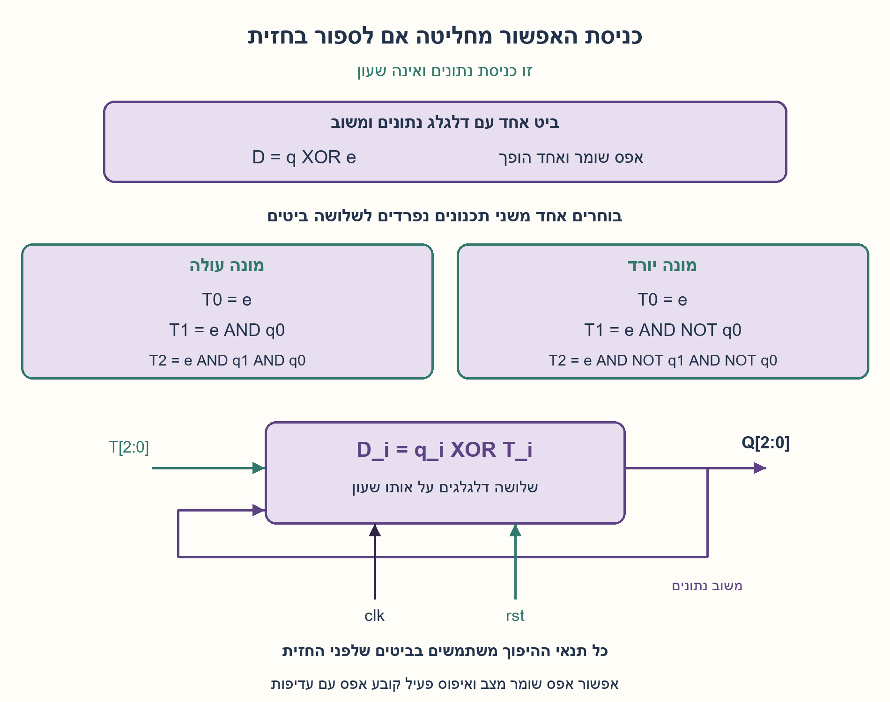
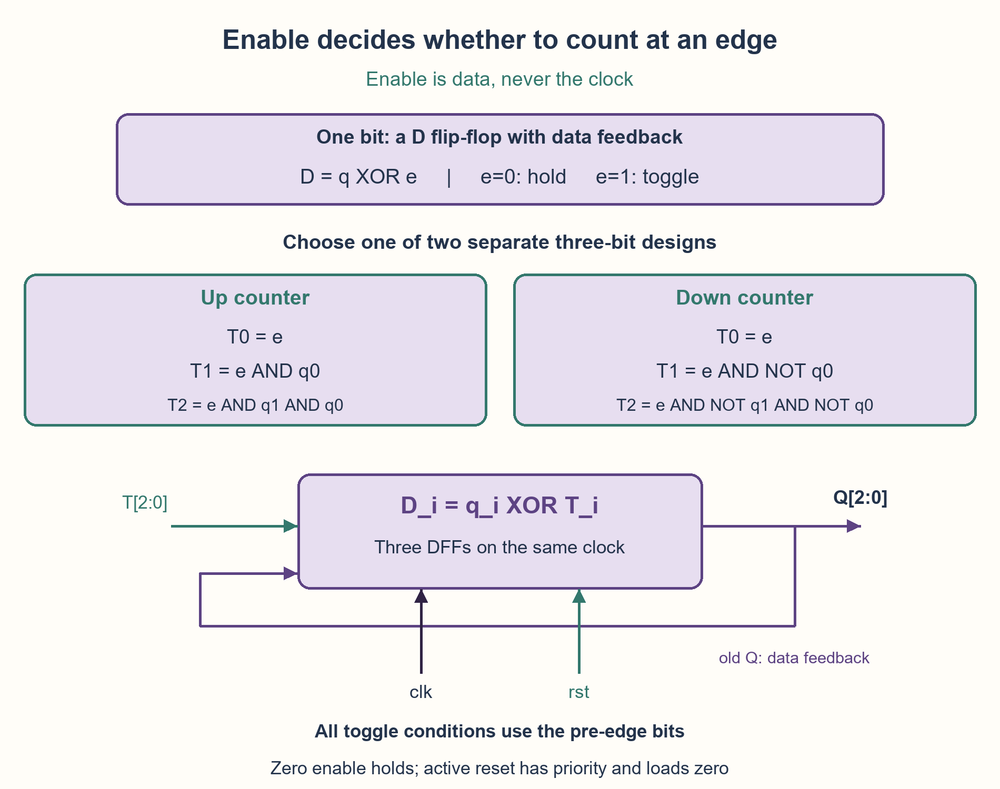

# PREP-064 — מקור נוסף / Additional source

פתרון מוצע בסיוע AI; ביקורת מקצועית ותרגום ממתינות. / AI-assisted proposed solution; professional and parity review pending.

## מקור / Source

[צילום מקור](../sources/2026-10-24-batch30-10.png)

א. בנה מערכת שמהווה מונה עבור ביט בודד - כניסה אחת ויציאה אחת (כאשר נכנס 1 הפלט ישתנה בהתאמה, כאשר נכנס 0 הפלט לא ישתנה)
ב. כעת בנה מונה עבור שלושה ביטים - כניסה אחת ושלוש יציאות
ג. בנה מחסר עבור שלושה ביטים - כניסה אחת ושלוש יציאות

## עברית

### מקור נוסף: בונים את המונה בשלושה שלבים
א. תכננו רכיב בעל כניסת אפשור e ומוצא של ביט אחד. בכל חזית שעון עולה, e=1 הופך את המוצא ו־e=0 משאיר אותו ללא שינוי. ב. תכננו מונה עולה בן שלושה ביטים, עם כניסת אפשור אחת ושלוש יציאות. ג. תכננו בנפרד מונה יורד בן שלושה ביטים עם אותו ממשק.

הבהרות עריכה: השעון הוא כניסת תזמון משתמעת נוספת ואינו e. שלוש היציאות מייצגות יחד מספר בינארי ללא סימן בטווח 0–7. ב־e=1 מוסיפים או מפחיתים אחד, לפי התכנון; ב־e=0 מחזיקים. הספירה מודולו 8: 7 עולה ל־0 ו־0 יורד ל־7. כל הדלגלגים חולקים חזית עולה, e סינכרוני ועומד בהכנה ובהחזקה. לצורך התחלה ידועה נוסף איפוס סינכרוני פעיל בגבוה שקובע 0 וגובר על e; הוא לא נכתב במקור. השתמשו בדלגלגים ושערים, הציגו משוואות ודוגמה. אלו שני תכנונים נפרדים, לא דרישה להוסיף כניסת כיוון לממשק. הגרסה המקורית עם inc,dec והחזקה כשהם שווים נשמרת ללא שינוי.

### רמזים

1. מה עושה XOR כשאחד הקלטים שלו הוא אפס, ומה הוא עושה כשהקלט הזה אחד? שמרו את הביט בדלגלג וחזרו אליו דרך לוגיקת נתונים.
2. בספירה למעלה, ביט גבוה מתהפך רק כאשר כל הביטים שמתחתיו הם אחד. מה התנאי המקביל בספירה למטה? זכרו לחסום כל ספירה כאשר e=0.
3. כתבו D_i=q_i XOR T_i. לשני הכיוונים T0=e. לעלייה T1=e AND q0 ו־T2=e AND q1 AND q0; לירידה החליפו את בדיקות הביטים הנמוכים בבדיקות אפס. כל q הוא הערך הישן באותה חזית.

### מתחילים מביט אחד: לשמור או להפוך
ביט הוא מונה מודולו 2: הוספת אחד הופכת 0 ל־1 ו־1 ל־0. נשמור q בדלגלג D ונחזיר אותו לכניסה דרך XOR:

```text
D = q XOR e
```

אם e=0 אז D=q, ואם e=1 אז D=NOT q. הדלגלג דוגם רק בחזית עולה, ולכן e שנשאר אחד במשך שלושה מחזורי שעון גורם לשלושה היפוכים, לא להיפוך יחיד. זו ספירת מחזורים שבהם e=1, לא גלאי קצה של e. כשהשעון אינו מתקדם המצב נשמר, גם אם e משתנה. תנאי ההכנה וההחזקה נדרשים כרגיל; e אינו שעון. זה אותו קשר נתונים שב־PREP-074, כעת כחלק מבניית מונה.

### משלושה ביטים למספר אחד
q2 הוא הביט המשמעותי ו־q0 הנמוך. שלושה דלגלגים מייצגים את המספר 4q2+2q1+q0. אין כאן שלושה מונים עצמאיים. בכל חזית נחשב לכל ביט T_i: האם להפוך אותו. נכניס לדלגלג D_i=q_i XOR T_i.

### מונה עולה עם אפשור אחד
q0 מתהפך בכל בקשת ספירה. q1 מתהפך כשהביט הנמוך הישן הוא 1, כי הוספת אחד עוטפת אותו ל־0. q2 מתהפך רק כשהזוג הנמוך הישן הוא 11. לכן:

```text
T0 = e
T1 = e AND q0
T2 = e AND q1 AND q0
D_i = q_i XOR T_i
```

כאשר e=0, כל T אפס וכל הדלגלגים מחזיקים. כאשר e=1, רצף האחדים הנמוכים מתהפך לאפס והאפס הבא מתהפך לאחד. זה בדיוק חיבור אחד. מ־111 כל הביטים מתהפכים ל־000, בהתאם למודולו 8.

### מונה יורד הוא תכנון נפרד
בירידה q0 מתהפך בכל בקשה. אם q0 הישן אפס, חיסור אחד דורש השאלה ולכן גם q1 מתהפך. אם שני הביטים הנמוכים הישנים אפס, גם q2 מתהפך. לכן:

```text
T0 = e
T1 = e AND NOT q0
T2 = e AND NOT q1 AND NOT q0
D_i = q_i XOR T_i
```

כאן רצף האפסים הנמוכים מתהפך לאחד והאחד הבא מתהפך לאפס: בדיוק חיסור אחד. מ־000 מקבלים 111. המונח ״מחסר״ במקור מתפרש כאן כמונה יורד המפחית אחד לכל בקשה, ולא כרכיב שמחסר שני מספרים שלא ניתנו בממשק. לביט יחיד, עלייה וירידה זהות מודולו 2.

### השעון והאיפוס
כל שלושת הדלגלגים מקבלים אותו clk; אף Q אינו מחובר לשעון של דלגלג אחר. כל תנאי T מחושב מהמצב שלפני אותה חזית. למשל, בעלייה מ־011 שלושת התנאים פעילים יחד ולכן מקבלים 100; אם מחשבים q1 מתוך q0 שכבר שונה, התוצאה עלולה להיות שגויה. איפוס סינכרוני פעיל בגבוה קובע 000 בחזית וגובר על e. האיפוס נוסף במפורש לעריכה; בלי איפוס או מצב התחלתי מובטח, משוואות המעבר תקפות אך הערך ההתחלתי לא ידוע.

דוגמה שנוספה: מתחילים ב־110 ומזינים e ברצף 1,0,1,1. המונה העולה נותן 111,111,000,001. המונה היורד נותן 101,101,100,011. אלו שתי ריצות של שני תכנונים שונים, ולא שינוי כיוון באמצעות כניסה נסתרת.

### הקשר לגרסה המקורית
ב־PREP-064 המקורית יש שתי בקרות inc,dec: עלייה רק ב־10, ירידה רק ב־01, וב־00 או 11 מחזיקים. המונה העולה כאן מתקבל מהצבה inc=e,dec=0; היורד מתקבל מהצבה inc=0,dec=e. אין שינוי בהתנהגות המקורית כששתי הבקרות אחד, ואין צורך להכפיל שאלות זהות במאגר. וריאנט זה מדגיש את ההתקדמות מביט אחד לשלושה ואת ההבדל בין אפשור לשעון.

### נכונות, עלות ומקרי קצה
התנאים הופכים בדיוק את רצף הביטים הנמוכים הנדרש בחיבור או בחיסור אחד, וחוסמים כל שינוי ב־e=0. הדלגלגים מספקים זיכרון, ולכן זה אינו מעגל צירופי המתנדנד במשוב. שמונה מצבים נבדלים דורשים לפחות שלושה ביטי זיכרון, ושלושה דלגלגים מספיקים; זהו מינימום אחסון לוגי בלבד, לא טענת מינימום שערים או השהיה. מעגל יחיד דורש ביט זיכרון אחד.

ל־n ביטים אפשר להכליל את המכפלה של כל הביטים הנמוכים או משלימיהם. שרשרת ארוכה עלולה להגדיל השהיה, ולכן יש לבדוק ספריית שערים, פיצול חוטים ותקופת שעון; אין בתיאור הזה תדר מובטח. גלישה אינה רוויה: 7→0 ו־0→7 נדרשים כאן. אם רוצים רוויה או ספירת קצוות של e, זהו חוזה אחר עם לוגיקה נוספת.

### מה נבדק?
מודל שערים הושווה לאורקל אריתמטי עצמאי בכל 40 מקרי מצב/אפשור/כיוון ברוחבים אחד ושלושה, ב־40 מקרי עדיפות איפוס ובכל 5,120 רצפי אפשור באורך שמונה מכל מצב התחלתי ולשני הכיוונים. נבדקו גם שקילות לבקרות המונה המקורי וערכי גבול. זו בדיקת פייתון, לא קומפילציית HDL, סינתזה או סימולציית תזמון פיזית.

שלושת הרמזים המקוריים והתור שלהם נשמרו. שלושה רמזים מדורגים לווריאנט הזה הוכנו בחומר המשלים ובמסמך; אין בחירה אוטומטית שלהם לפי וריאנט בתור הקיים. התוכן הנוסף מוצע בסיוע AI וממתין לביקורת מקצועית.



## English

### Additional source: build the counter in three stages
(a) Design a component with enable e and one output bit. At each rising clock edge, e=1 toggles the output and e=0 retains it. (b) Design a three-bit up counter with one enable input and three outputs. (c) Separately design a three-bit down counter with the same interface.

Editorial clarifications: a clock is an additional implicit timing input, never e. The three outputs together encode an unsigned binary value 0..7. When e=1, add or subtract one according to the design; e=0 holds. Wrap modulo eight: up from seven gives zero and down from zero gives seven. All flip-flops share one rising edge; synchronous e meets setup/hold. For known initialization, add a synchronous active-high reset loading zero and overriding e; reset was absent from the source. Use gates and flip-flops, with equations and an example. These are separate designs, not a requirement to add a direction port. The original inc/dec interface and hold behavior for equal controls remain unchanged.

### Hints

1. What does XOR do when one input is zero or one? Store the bit in a flip-flop and return it through data logic.
2. Counting up toggles a higher bit only when every lower bit is one. What is the corresponding condition for counting down? Block every count when e=0.
3. Write D_i=q_i XOR T_i. Both directions use T0=e. Up uses T1=e AND q0, T2=e AND q1 AND q0; down tests lower bits for zero instead. Every q is the old value at the same edge.

### Start with one bit: retain or invert
A bit is a modulo-two counter: adding one changes zero to one or one to zero. Store q in a DFF and feed it back through XOR:

```text
D = q XOR e
```

With e=0, D=q; with e=1, D=NOT q. Sampling happens only at a rising clock edge, so e held high for three clock cycles causes three toggles, not one. This counts cycles with e=1 rather than edges of e. Without an advancing clock the state remains, even if e changes. Setup/hold still applies; e is never the clock. This is PREP-074's data-feedback relationship, now used to build a counter.

### Three bits encode one number
q2 is the MSB and q0 the LSB. Three DFFs encode 4q2+2q1+q0; they are not independent counters. At every edge compute T_i, whether bit i must toggle, and drive D_i=q_i XOR T_i.

### Separately enabled up counter
q0 toggles on every count request. q1 toggles when old q0 is one because adding one wraps it to zero. q2 toggles only when the old low pair is 11:

```text
T0 = e
T1 = e AND q0
T2 = e AND q1 AND q0
D_i = q_i XOR T_i
```

At e=0 every T is zero, so every bit holds. At e=1, trailing ones turn to zero and the next zero turns to one: precisely addition of one. From 111 all bits toggle to 000, as modulo-eight counting requires.

### The down counter is a separate design
q0 again toggles for every request. If old q0 is zero, subtracting one borrows and toggles q1. If both old low bits are zero, q2 toggles too:

```text
T0 = e
T1 = e AND NOT q0
T2 = e AND NOT q1 AND NOT q0
D_i = q_i XOR T_i
```

Trailing zeros turn to one and the next one turns to zero, exactly subtraction of one. From 000 the result is 111. The source's “subtractor” is interpreted as a down counter subtracting one per request, not as an arithmetic block subtracting two numbers absent from the interface. At width one, up and down are identical modulo two.

### Clock and reset
All DFFs share clk; no Q output clocks another flip-flop. Every T uses the state before that same edge. For example, incrementing 011 activates all three toggles simultaneously and gives 100. Computing q1 from an already changed q0 can produce a wrong answer. Added synchronous active-high reset loads 000 at an edge and overrides e. Without a reset or guaranteed initialization, transition equations still apply but initial phase/value is unknown.

Added example: start at 110 and apply e=1,0,1,1. The up design produces 111,111,000,001. The down design produces 101,101,100,011. These are two runs of separate designs, not direction changes through an undisclosed input.

### Relationship to the original question
Original PREP-064 has inc,dec: only 10 counts up, only 01 counts down, and 00/11 hold. The new up design is the specialization inc=e,dec=0; down uses inc=0,dec=e. Nothing changes the original both-high hold behavior, and an equivalent specialization does not require another catalog question. This variant emphasizes building from one bit to three and distinguishing enable from clock.

### Correctness, cost and boundaries
The toggle conditions invert exactly the required trailing bit pattern for a unit increment/decrement and block every change at e=0. Flip-flops provide memory; this is not an oscillating combinational feedback loop. Eight distinguishable states require at least three logical memory bits and three DFFs suffice. That proves minimum logical storage only, not minimum gates or delay. The one-bit case requires one memory bit.

For n bits, extend the product of all lower bits or their complements. Long chains may increase delay, so examine the gate library, fanout and clock period. No physical frequency is guaranteed here. Wrapping is not saturation: 7→0 and 0→7 are required. Saturating behavior or counting only edges of e is a different contract requiring further logic.

### Actual verification
Gate equations were compared with an independent arithmetic oracle for all 40 state/enable/direction cases at widths one and three, 40 reset-priority cases, and all 5,120 eight-cycle enable streams from every initial state in both directions. Equivalence to the original counter controls and boundary transitions were also checked. This is Python verification, not HDL compilation, synthesis or physical timing simulation.

Original hints and their queue remain unchanged. Three progressive variant hints are prepared in supplementary material and the addendum; the current queue does not automatically select them by variant. New AI-assisted proposed material awaits professional review.



## חומר משלים / Supplementary material

```json
{
  "assumptions": {
    "he": [
      "פלט ללא סימן בן שלושה ביטים; ספירה מודולו 8, לא רוויה.",
      "כל הדלגלגים משתמשים באותה חזית עולה; הבקרות עומדות בזמני ההכנה וההחזקה.",
      "איפוס סינכרוני פעיל בגבוה מחזיר 000 וגובר על inc,dec. אות האיפוס נוסף כהבהרת תכנון.",
      "שתי בקרות שוות, כולל שתיהן 1, גורמות להחזקה. שערי XOR מותרים; רכיבי FA/HA וסוכם או מחסר מוכנים אסורים.",
      "הווריאנט מוסיף clk משתמע נפרד מ־e; בכל חזית e=0 מחזיק ו־e=1 סופר. עלייה וירידה הם שני תכנונים נפרדים, מודולו 8; איפוס סינכרוני בעדיפות הוא תוספת עריכה."
    ],
    "en": [
      "Unsigned three-bit output wraps modulo eight rather than saturating.",
      "All flip-flops share one rising clock edge; controls meet setup/hold.",
      "Synchronous active-high reset loads 000 and overrides inc/dec; reset was added as an explicit engineering convention.",
      "Equal controls, including both one, hold. XOR gates are allowed; FA/HA and prebuilt arithmetic blocks are forbidden.",
      "The variant makes implicit clk separate from e; at each edge e=0 holds and e=1 counts. Up/down are separate modulo-eight designs. Priority synchronous reset is an editorial addition."
    ]
  },
  "optimality": {
    "he": {
      "criterion": "זיכרון הדרוש לייצוג כל שמונת ערכי המונה.",
      "result": "שלושה דלגלגים מספיקים ונחוצים; לוגיקה צירופית של אותות היפוך ושערי XOR.",
      "proof": "מונה העובר בין שמונה ערכי פלט שונים חייב להבחין בשמונה מצבים, ולכן נדרשים לפחות שלושה ביטי זיכרון. המימוש משתמש בדיוק בשלושה.",
      "scope": "אין הוכחה למינימום שערים, שטח, הספק או השהיה; האיפוס ולוגיקת הספרייה משפיעים על המימוש הפיזי.",
      "batch30_variant": "נדרשים ביט זיכרון אחד למונה מודולו 2 ושלושה לשמונה מצבים. אין טענת מינימום שערים, תדר או השהיה."
    },
    "en": {
      "criterion": "Storage required to represent all eight counter values.",
      "result": "Three flip-flops are necessary and sufficient, with combinational toggle logic and XOR gates.",
      "proof": "Eight distinguishable output values require at least three state bits; this construction uses exactly three.",
      "scope": "No minimum gate-count, area, power or delay proof; reset and cell-library choices affect physical implementation.",
      "batch30_variant": "One memory bit is necessary for modulo two and three for eight states. No minimum gate count, maximum frequency or minimum delay claim."
    }
  },
  "verification": {
    "he": "עברו 32 מעברי מצב ובקרה ועוד 32 מקרי עדיפות איפוס. נבדקו כל 43,688 רצפי הבקרה באורכים 0–6 מכל שמונת המצבים, הכוללים 247,584 חזיתות, וכל 32,768 רצפי הבקרה והאיפוס באורך 4, הכוללים 131,072 חזיתות. משוואות השערים הושוו לאורקל אריתמטי עצמאי. מודל פייתון בלבד; ללא קומפילציית HDL, סימולציה, סינתזה או תזמון פיזי.\n\nהווריאנט עבר 40 מעברי מצב/אפשור/כיוון, 40 מקרי איפוס ו־5,120 רצפי אפשור באורך 8 מכל מצב; אורקל אריתמטי וסכום בקשות נפרדים, וכן הצבה בבקרות המונה המקורי. מודל פייתון בלבד.",
    "en": "Passed 32 state/control transitions and 32 reset-priority cases. Checked all 43,688 control streams of lengths zero through six from eight starting states, covering 247,584 edges, and all 32,768 length-four control/reset streams covering 131,072 edges. Gate equations were compared with an independent arithmetic oracle. Python models only; no HDL compilation/simulation, synthesis or physical timing.\n\nThe variant passed 40 state/enable/direction transitions, 40 reset cases and 5,120 eight-cycle enable streams from every state, against arithmetic and total-request oracles plus specialization of the original controls. Python models only."
  },
  "edge_cases": {
    "he": [
      "111 בעלייה עובר ל־000; 000 בירידה עובר ל־111.",
      "inc=dec=1 מחזיק בדיוק כמו inc=dec=0.",
      "איפוס פעיל יחד עם פקודת ספירה מחזיר אפס.",
      "בהיעדר חזית שעון הפלט אינו משתנה; ללא איפוס או אתחול ידוע אין להניח מצב התחלתי פיזי.",
      "011 בעלייה ו־100 בירידה הופכים שלושה ביטים יחד לפי המצב הישן.",
      "e שנשאר 1 גורם לספירה בכל חזית, לא רק בעליית e. גלישה 111→000 בעלייה ו־000→111 בירידה. איפוס גובר גם כש־e=1. ללא התחלה ידועה אין ערך התחלתי מובטח."
    ],
    "en": [
      "111 increment wraps to 000; 000 decrement wraps to 111.",
      "Both controls one hold exactly as both zero do.",
      "Reset together with a count command returns zero.",
      "No clock edge means no output update; without reset or known initialization, hardware starting state is not guaranteed.",
      "011 up and 100 down toggle all three bits using the old state.",
      "Held-high e counts at every clock edge, not only at an e rising edge. Wrap 111→000 upward and 000→111 downward. Reset overrides e=1. Without known initialization no initial output is guaranteed."
    ]
  },
  "common_mistakes": {
    "he": [
      "לתת עדיפות ל־inc כאשר שתי הבקרות 1; המקור דורש החזקה.",
      "להשתמש בבלוק סוכם או מחסר למרות איסור FA/HA.",
      "להשתמש בביט שכבר התעדכן בחישוב הביט הבא באותה חזית.",
      "לחבר q0 לשעון של הדלגלג הבא או לחסום שעון בשער פשוט.",
      "לדרוש רוויה ב־0 וב־7 בלי לציין שזה שינוי מן ההנחה של מודולו 8.",
      "חיבור e לשעון; שרשור Q כשעון; שימוש בביט שכבר עודכן בחישוב הביט הבא; הפיכת שלוש היציאות למונים עצמאיים; הוספת כניסת כיוון נסתרת או רוויה שלא נתבקשה."
    ],
    "en": [
      "Prioritizing inc when both controls are one; the source requires hold.",
      "Using an adder/subtractor block despite the FA/HA restriction.",
      "Using already-updated low bits to compute higher bits at the same edge.",
      "Clocking a later flip-flop from q0 or gating the clock with a plain gate.",
      "Silently saturating at zero/seven instead of the declared modulo-eight convention.",
      "Using e as clock, clocking from Q, using an already updated lower bit, treating outputs as independent counters, or adding an undisclosed direction input/saturation."
    ]
  },
  "interview_answer": {
    "he": "אצור פקודות עלייה וירידה בלעדיות. הביט הנמוך מתהפך בכל ספירה. ביט 1 מתהפך בעלייה אם q0=1 ובירידה אם q0=0; ביט 2 מתהפך בעלייה אם q1q0=11 ובירידה אם הם 00. לכל דלגלג D אחבר q XOR T. כך שלושה דלגלגים באותו שעון מממשים ספירה מעגלית, ושתי בקרות שוות מחזיקות.\n\nלביט אחד D=q XOR e. לשלושה ביטים כל D_i=q_i XOR T_i; בעלייה T_i=e AND כל הביטים הנמוכים, ובירידה e AND כל משלימיהם. כל הדלגלגים באותה חזית ומחשבים מהמצב הישן. זהו צמצום של inc/dec המקוריים ואינו משנה את התנהגותם.",
    "en": "Decode exclusive up/down requests. The low bit toggles on every count; bit one toggles up at q0=1 or down at q0=0; bit two toggles up at low pair 11 or down at 00. Feed each DFF with q XOR T. Three same-clock flip-flops implement the wrapping counter, while equal controls hold.\n\nFor one bit D=q XOR e. For three, D_i=q_i XOR T_i; up toggles when e and all lower bits are one, down when e and all lower bits are zero. Shared edge, old-state conditions. These specialize the original inc/dec behavior without changing it."
  },
  "solution_extensions": {
    "he": {
      "question": "כיצד תשנו את המעגל למונה רווי שאינו עובר מ־7 ל־0 או מ־0 ל־7?",
      "direction": "זהו מפרט אחר. חסמו את U כאשר כל שלושת q הם 1 ואת D כאשר כולם 0, ואז השתמשו באותה לוגיקת היפוך. בדקו במפורש את שני הגבולות ואת מצב שתי הבקרות יחד.",
      "status": "שאלת המשך מוכנה בתוכן; אינה מחוברת לתור ההמשך החי.",
      "batch30_variant": "אם רוצים ספירת עליות של e בלבד, נוסיף זיכרון של e הקודם וניצור בקשה e AND NOT e_prev; זו כבר ספירת קצוות, ולקלט אסינכרוני נדרש גם חוזה סנכרון. ההרחבה מוצעת ולא מומשה ב־HDL."
    },
    "en": {
      "question": "How would you change this to a saturating counter that does not wrap at zero/seven?",
      "direction": "This changes the contract. Block U when all three q bits are one and D when all are zero, then reuse the toggle logic. Explicitly test both boundaries and simultaneous controls.",
      "status": "Follow-up prepared in content; not connected to the interactive follow-up queue.",
      "batch30_variant": "To count only rising edges of e, store previous e and form e AND NOT e_prev. That is a different edge-counting contract; asynchronous input also requires synchronization assumptions. This extension is proposed, not HDL-implemented."
    }
  },
  "source_ambiguities": {
    "he": {
      "batch30_variant": "המקור מציין כניסה אחת אך אינו מציין clk, איפוס, חזית, מודולו או משמעות ׳מחסר׳. הוגדר במפורש מונה יורד עם אפשור על שעון משותף. כניסות התזמון/האיפוס נוספו כהבהרות, ולא דווחו כקלטים מקוריים."
    },
    "en": {
      "batch30_variant": "The source says one input but omits clock, reset, edge, wrap and what 'subtractor' means. We explicitly choose a shared-clock enabled down counter; timing/reset ports are added clarifications, not claimed original inputs."
    }
  },
  "relationship_note": {
    "he": "מקור נוסף ל־PREP-064: עלייה עם inc=e,dec=0 וירידה עם inc=0,dec=e; שלב הביט הבודד הוא קשר המשוב של PREP-074. אין שינוי במזהה, בהיסטוריית תרגול או בכלל ההחזקה של הגרסה המקורית.",
    "en": "Additional PREP-064 source: up sets inc=e,dec=0; down sets inc=0,dec=e. The one-bit stage is PREP-074 feedback. Identity, practice history and the original equal-controls hold rule remain unchanged."
  },
  "prompt_variants": {
    "he": {
      "batch30_variant": {
        "prompt": "### מקור נוסף: בונים את המונה בשלושה שלבים\nא. תכננו רכיב בעל כניסת אפשור e ומוצא של ביט אחד. בכל חזית שעון עולה, e=1 הופך את המוצא ו־e=0 משאיר אותו ללא שינוי. ב. תכננו מונה עולה בן שלושה ביטים, עם כניסת אפשור אחת ושלוש יציאות. ג. תכננו בנפרד מונה יורד בן שלושה ביטים עם אותו ממשק.\n\nהבהרות עריכה: השעון הוא כניסת תזמון משתמעת נוספת ואינו e. שלוש היציאות מייצגות יחד מספר בינארי ללא סימן בטווח 0–7. ב־e=1 מוסיפים או מפחיתים אחד, לפי התכנון; ב־e=0 מחזיקים. הספירה מודולו 8: 7 עולה ל־0 ו־0 יורד ל־7. כל הדלגלגים חולקים חזית עולה, e סינכרוני ועומד בהכנה ובהחזקה. לצורך התחלה ידועה נוסף איפוס סינכרוני פעיל בגבוה שקובע 0 וגובר על e; הוא לא נכתב במקור. השתמשו בדלגלגים ושערים, הציגו משוואות ודוגמה. אלו שני תכנונים נפרדים, לא דרישה להוסיף כניסת כיוון לממשק. הגרסה המקורית עם inc,dec והחזקה כשהם שווים נשמרת ללא שינוי.",
        "hints": [
          "מה עושה XOR כשאחד הקלטים שלו הוא אפס, ומה הוא עושה כשהקלט הזה אחד? שמרו את הביט בדלגלג וחזרו אליו דרך לוגיקת נתונים.",
          "בספירה למעלה, ביט גבוה מתהפך רק כאשר כל הביטים שמתחתיו הם אחד. מה התנאי המקביל בספירה למטה? זכרו לחסום כל ספירה כאשר e=0.",
          "כתבו D_i=q_i XOR T_i. לשני הכיוונים T0=e. לעלייה T1=e AND q0 ו־T2=e AND q1 AND q0; לירידה החליפו את בדיקות הביטים הנמוכים בבדיקות אפס. כל q הוא הערך הישן באותה חזית."
        ],
        "integration_status": "הרמזים הוכנו כתוכן משלים; התור הקיים אינו בוחר אותם אוטומטית לפי וריאנט."
      }
    },
    "en": {
      "batch30_variant": {
        "prompt": "### Additional source: build the counter in three stages\n(a) Design a component with enable e and one output bit. At each rising clock edge, e=1 toggles the output and e=0 retains it. (b) Design a three-bit up counter with one enable input and three outputs. (c) Separately design a three-bit down counter with the same interface.\n\nEditorial clarifications: a clock is an additional implicit timing input, never e. The three outputs together encode an unsigned binary value 0..7. When e=1, add or subtract one according to the design; e=0 holds. Wrap modulo eight: up from seven gives zero and down from zero gives seven. All flip-flops share one rising edge; synchronous e meets setup/hold. For known initialization, add a synchronous active-high reset loading zero and overriding e; reset was absent from the source. Use gates and flip-flops, with equations and an example. These are separate designs, not a requirement to add a direction port. The original inc/dec interface and hold behavior for equal controls remain unchanged.",
        "hints": [
          "What does XOR do when one input is zero or one? Store the bit in a flip-flop and return it through data logic.",
          "Counting up toggles a higher bit only when every lower bit is one. What is the corresponding condition for counting down? Block every count when e=0.",
          "Write D_i=q_i XOR T_i. Both directions use T0=e. Up uses T1=e AND q0, T2=e AND q1 AND q0; down tests lower bits for zero instead. Every q is the old value at the same edge."
        ],
        "integration_status": "Hints are prepared supplementary content; the current queue does not automatically select them by variant."
      }
    }
  }
}
```
