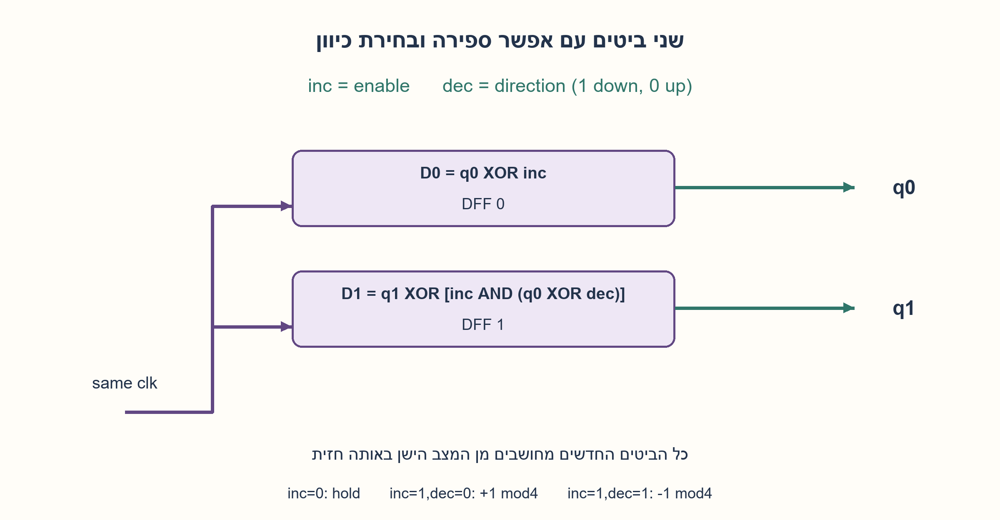
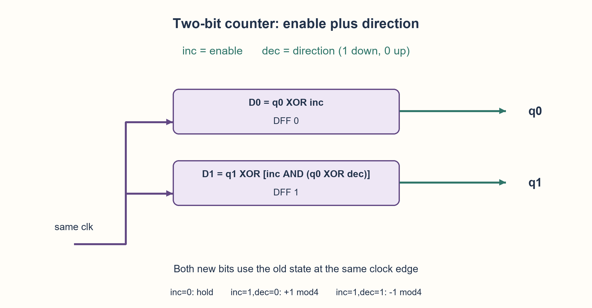

# PREP-064 — שתי יציאות וכיוון / Two outputs and direction

פתרון מוצע; ביקורת מקצועית אנושית ממתינה. [צילום המקור הפרטי](../sources/2026-10-30-batch90-10.png).

## עברית

### וריאציה חדשה: שתי יציאות ואות כיוון
א. תכננו מונה בן שני ביטים: Inc=1 מגדיל באחד בחזית העולה הבאה, ו־Inc=0 שומר מצב.
ב. הוסיפו Dec כאות בחירת כיוון: Dec=1 סופר למטה ו־Dec=0 למעלה. נשמר Inc כאפשר־ספירה, ולכן Inc=0 שומר מצב בכל כיוון. המצב הוא 0..3 מודולו 4, עם איפוס סינכרוני לאפס.

זהו חוזה עריכה מפורש: בצילום נאמר שתי יציאות ו־Dec כאות כיוון, אך לא נקבע במפורש איך Dec פועל כש־Inc=0. אם הכוונה לשתי בקשות עצמאיות, זוהי הגרסה המקורית למעלה; שם 11 מחזיק מצב, ואילו כאן 11 מקטין. אין להחליף ביניהן בשקט.

1. הפרידו את ההחלטה אם לספור מההחלטה לאיזה כיוון.
2. בעלייה q1 מתהפך כש־q0 הישן הוא 1; בירידה כש־q0 הישן הוא 0.
3. T0=Inc ו־T1=Inc AND (q0 XOR Dec). כל כניסת D היא q XOR T.

### אותה אריתמטיקה, ממשק בקרה אחר
מחזיקים q1,q0 בשני DFF שמקבלים אותו שעון. החלק הראשון מתקבל כאשר Dec=0. בכל ספירה q0 מתהפך. עבור q1, בעלייה צריך להעביר נשא כשהביט הנמוך הישן הוא 1; בירידה צריך השאלה כשהוא 0. לכן:

```text
T0 = Inc
T1 = Inc AND (q0 XOR Dec)
D0 = q0 XOR T0
D1 = q1 XOR T1
```

כאשר Inc=0 שני אותות ההיפוך אפס. כאשר Inc=1,Dec=0 נקבל עלייה מודולו 4; כאשר שניהם 1 נקבל ירידה מודולו 4. למשל 00 בירידה עובר ל־11, ו־11 בעלייה ל־00. זה שונה מן הממשק הקודם שבו שני אותות פעילים הם בקשות סותרות ושומרים מצב.

שני ביטי זיכרון נחוצים לארבעה מצבים מובחנים ומספיקים. זו מינימליות של מספר ביטי מצב בלבד, לא של השערים. משתמשים בערכי q הישנים באותה חזית, אין שרשור שעונים ואין חסימת שעון באמצעות Inc. איפוס גובר על הבקרות. אם Inc או Dec מגיעים מתחום שעון אחר, נדרש חוזה CDC נפרד.

נבדקו כל 32 צירופי מצב, בקרה ואיפוס, ועוד 21,844 רצפי בקרה באורכים 0–6 מכל מצב התחלתי מול אורקל חשבוני. זהו מודל לוגי בפייתון ולא סימולציית HDL או הוכחת תזמון פיזי.

```python
"""Two-bit gate equations: inc enables counting, dec chooses its direction."""


def next_state(state, inc, dec, reset=0):
    if type(state) is not int or not 0 <= state < 4 or any(bit not in (0, 1) for bit in (inc, dec, reset)):
        raise ValueError("two-bit state and binary controls required")
    if reset:
        return 0
    q0, q1 = state & 1, (state >> 1) & 1
    toggle0 = inc
    toggle1 = inc & (q0 ^ dec)
    return ((q1 ^ toggle1) << 1) | (q0 ^ toggle0)
```




## English

### New variant: two outputs and a direction control
A. Design a two-bit counter: Inc=1 increments at the next rising edge, and Inc=0 holds.
B. Add Dec as a direction selector: Dec=1 counts down and Dec=0 counts up. Retain Inc as count-enable, so Inc=0 holds in either direction. State wraps modulo four, with synchronous reset to zero.

This is an explicit editorial contract: the screenshot says two outputs and describes Dec as direction, but does not specify its behavior when Inc=0. Independent request controls are the original variant above: there 11 holds; here 11 decrements. Do not silently interchange the interfaces.

1. Separate whether to count from which direction to use.
2. Counting up toggles q1 at old q0=1; counting down toggles it at old q0=0.
3. T0=Inc and T1=Inc AND (q0 XOR Dec). Each D input is q XOR T.

### The arithmetic is similar; the control interface differs
Store q1,q0 in two DFFs sharing one clock. Part A is the Dec=0 case. Every enabled count toggles q0. Counting up toggles q1 when old q0=1; counting down toggles it when old q0=0. Thus:

```text
T0 = Inc
T1 = Inc AND (q0 XOR Dec)
D0 = q0 XOR T0
D1 = q1 XOR T1
```

Inc=0 clears both toggles. Inc=1,Dec=0 increments modulo four; both high decrements modulo four. For example 00 decrements to 11, and 11 increments to 00. This differs from the original interface, where two active independent requests conflict and hold state.

Two state bits are necessary and sufficient for four distinct states. That minimizes state bits only, not gate count. Use the old q values at the shared edge; do not cascade clocks or gate the clock with Inc. Reset overrides controls. Asynchronous or cross-domain controls need a separate CDC contract.

Checks covered all 32 state/control/reset combinations and 21,844 control sequences of lengths 0–6 from each initial state against arithmetic. This is a Python logical model, not HDL or physical timing simulation.

```python
"""Two-bit gate equations: inc enables counting, dec chooses its direction."""


def next_state(state, inc, dec, reset=0):
    if type(state) is not int or not 0 <= state < 4 or any(bit not in (0, 1) for bit in (inc, dec, reset)):
        raise ValueError("two-bit state and binary controls required")
    if reset:
        return 0
    q0, q1 = state & 1, (state >> 1) & 1
    toggle0 = inc
    toggle1 = inc & (q0 ^ dec)
    return ((q1 ^ toggle1) << 1) | (q0 ^ toggle0)
```



