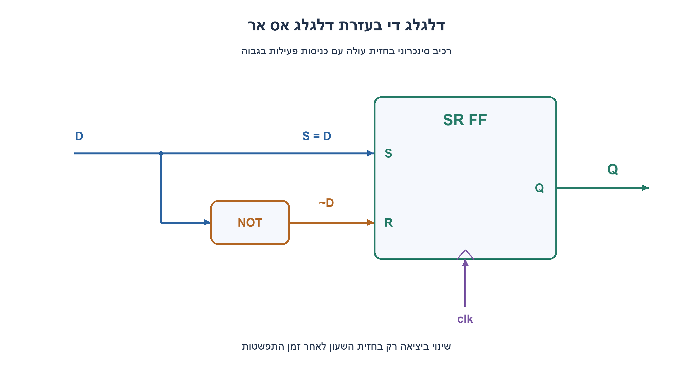
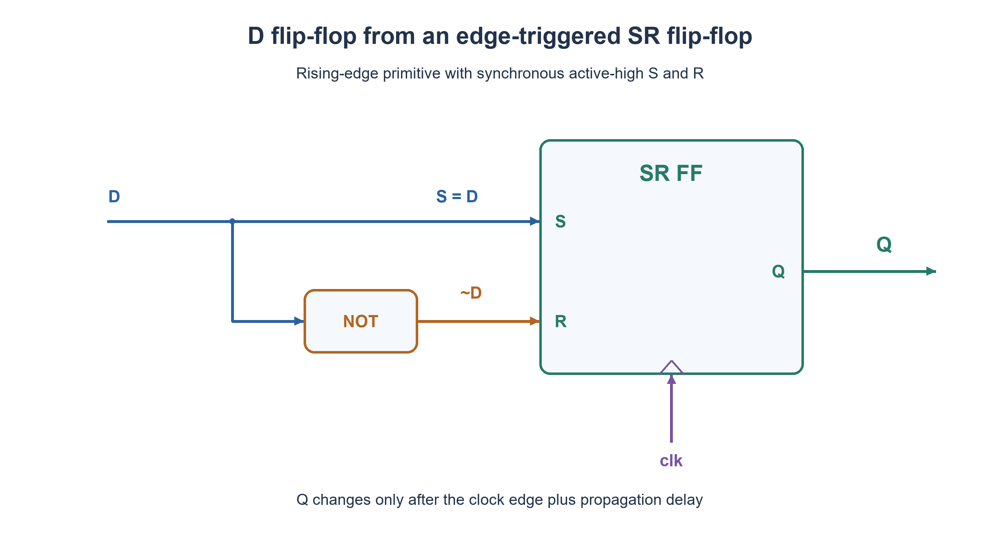

# PREP-065 — מימוש דלגלג D בעזרת דלגלג SR

## מקור שנמסר

ממש DFF בעזרת SRFF

[צילום המקור הפנימי](../sources/prep-065.png)

סטטוס: פתרון מוצע בסיוע AI; בדיקה מקצועית אנושית ממתינה. השיוך לחברות הוא דיווח מהצילום בלבד.

## מימוש דלגלג D בעזרת דלגלג SR

ממשו דלגלג D באמצעות דלגלג SR ושערים לוגיים. הציגו חיבורים וטבלת פעולת הרכיב.

הנחה מפורשת שנוספה למקור: הרכיב הנתון הוא דלגלג SR בחזית עולה, עם כניסות S,R סינכרוניות פעילות בגבוה: 00 שומר, 01 מאפס, 10 קובע 1, ו־11 אסור. אין זו הנחה על נועל שקוף או על כניסות preset/clear אסינכרוניות. הקלט D יציב סביב חזית השעון בהתאם לזמני ההכנה וההחזקה, לרבות המסלול דרך המהפך. אין דרישת איפוס נוספת. הסבירו מה משתנה אם הרכיב הנתון הוא דווקא נועל SR.

### רמזים

1. מה צריכה להיות היציאה מיד אחרי חזית כאשר D=0, ומה כאשר D=1?
2. כניסת Set יכולה לבקש לשמור 1, וכניסת Reset יכולה לבקש לשמור 0. צריך שהבקשות לא יהיו פעילות יחד בזמן הדגימה.
3. בחרו S כך שיעלה בדיוק כאשר D=1 ואת R כהיפוכו. בדקו את שני ערכי D ואת המצב האסור 11.

### הצעה לפתרון

### הרעיון: לתרגם נתון לפקודת קביעה או איפוס

דלגלג D צריך לשמור אחרי כל חזית את הערך שהיה על D בזמן הדגימה. אין צורך לחשב משוב מ־Q: אם D=1 נבקש Set, ואם D=0 נבקש Reset. לכן נחבר:

```text
S = D
R = NOT D
clk של דלגלג SR = clk של המערכת
Q של דלגלג SR = Q של דלגלג D
```

בשרטוט יש נקודת פיצול על D: הענף הישיר מגיע ל־S, והענף השני עובר במהפך ומגיע ל־R. חץ clk נכנס לכניסת השעון, ולא לאחת מכניסות הנתונים.

### בדיקה בטבלה

| D | S | R | Q אחרי חזית עולה |
| --- | --- | --- | --- |
| 0 | 0 | 1 | 0 |
| 1 | 1 | 0 | 1 |

לשם השוואה, טבלת דלגלג SR היא 00: שמירת Q הישן, 01: 0, 10: 1, 11: מצב אסור. החיבורים שלנו משתמשים רק ב־01 וב־10. לכן Q(next)=D לכל ערך קודם של Q. בהיעדר חזית, Q נשמר גם אם D משתנה. במעגל אמיתי השינוי ביציאה מגיע אחרי השהיית clock-to-Q.

### מדוע סוג הרכיב חשוב?

אם SR הוא נועל שקוף או רכיב עם S,R אסינכרוניים, אותו חיבור יכול לגרום ל־Q לעקוב אחרי D בין חזיתות. זה אינו דלגלג D בחזית. נועל SR עם אפשור ובקשות S=EN AND D, R=EN AND NOT D נותן נועל D; כדי לקבל פעולה בחזית אפשר להשתמש במבנה master–slave תקין עם שלבי שעון משלימים ומגבלות תזמון. זה פתרון אחר, עם רכיבים והנחות נוספות, ולא מה שהשרטוט הזה טוען לממש.

### עלות והנחות תזמון

במודל הנבחר מספיקים דלגלג SR אחד ומהפך אחד. מבחינת ביטי מצב נדרש ביט אחד ואנו משתמשים בביט אחד; אין כאן הוכחת מינימום לשטח או להשהיה. במציאות המסלול הישיר והמסלול המהופך אינם באותה השהיה: מעבר D עלול ליצור לזמן קצר S=R=1. במודל סינכרוני אידאלי אין לכך השפעה אם לא דוגמים את החפיפה, אבל יש לבחור primitive מתאים ולעמוד בזמני setup/hold ולמנוע הפרת המצב האסור סמוך לחזית. הניסוח S=~R אינו הבטחה לאפס גליצ'ים פיזיים.

בדיקות פייתון עברו על כל ארבעת שילובי Q,D, שמונת שילובי Q,S,R, ועל 4,094 רצפי נתונים באורכים 0–10 משני מצבים התחלתיים, עם 36,868 חזיתות. הן בדקו גם שמירה בלי חזית ודחיית 11 בחזית. מצורף קוד SystemVerilog תיאורי, שלא קומפל או הורץ בסימולטור HDL. ההצעה ממתינה לביקורת מקצועית.



### assumptions

[
  "דלגלג SR בחזית עולה עם S,R סינכרוניים פעילים בגבוה; 11 אסור.",
  "D עומד בתזמון בשני הנתיבים, כולל המהפך; אין איפוס נוסף.",
  "הקשר בין DFF לנועל מוסבר בנפרד ואינו משנה בשקט את הרכיב הנתון."
]

### optimality

{
  "criterion": "מספר ביטי מצב.",
  "result": "ביט מצב אחד ומהפך אחד מספיקים במודל.",
  "proof": "יש לשמר שני מצבים, ולכן נדרש לפחות ביט אחד.",
  "scope": "אין הוכחת מינימום שערים, שטח או השהיה; סוג ה־primitive מהותי."
}

### verification

"עברו 4 שילובי Q,D, שמונת שילובי SR, 4,094 רצפים ו־36,868 חזיתות במודל פייתון. קוד HDL לא קומפל ולא סומלץ; תזמון וגליצ׳ים פיזיים לא נבדקו."

### edge_cases

[
  "Q ראשוני אינו חייב להיות ידוע; החזית החוקית הראשונה קובעת D.",
  "אין חזית: Q נשמר.",
  "שינוי D סמוך לחזית עלול להפר תזמון.",
  "S,R אסינכרוניים או נועל שקוף אינם מממשים את אותו חוזה."
]

### common_mistakes

[
  "לחבר S=D וגם R=D, וכך להגיע ל־11.",
  "להשתמש בנועל שקוף ולקרוא לו DFF.",
  "להניח שהמהפך מוחק כל חפיפה רגעית.",
  "להציג איפוס אסינכרוני כקלט נתונים סינכרוני."
]

### interview_answer

"בהנחה שזה דלגלג SR סינכרוני בחזית, אחבר S=D ו־R=NOT D ואשתמש באותו clk. D=0 בוחר איפוס ו־D=1 בוחר קביעה, לכן אחרי החזית Q=D. אם נתון נועל או S,R אסינכרוניים, זה אינו אותו מימוש וצריך לדון במבנה שעון מתאים."

### solution_extensions

{
  "question": "כיצד תוסיפו אפשור EN כך שב־EN=0 נשמור Q?",
  "direction": "ל־SR סינכרוני אפשר לבחור S=EN AND D ו־R=EN AND NOT D. ב־EN=0 מתקבל 00 ושמירה. בדקו גם תזמון של EN.",
  "status": "מוכן בתוכן; לא מחובר לתור המשך חי."
}

## Implementing a D flip-flop using an SR flip-flop

Implement a D flip-flop using an SR flip-flop and logic gates. Give the connections and operation table.

Explicit editorial assumption: the supplied SR primitive is rising-edge triggered, with synchronous active-high S,R: 00 holds, 01 resets, 10 sets, and 11 is forbidden. It is not a transparent latch or asynchronous preset/clear input pair. D meets setup and hold on both paths, including the inverter path. No additional reset is required. Explain why a transparent SR latch would change the answer.

### Hints

1. What should Q become after an edge for D=0, and for D=1?
2. Set requests a stored one; reset requests zero. The requests must not both be active when sampled.
3. Let S be high exactly when D=1, and make R its complement. Check both D values and the forbidden 11 input.

### Proposed solution

### Translate data into a set or reset request

A D flip-flop stores the value sampled on D at each edge. No Q feedback is needed: request set when D=1 and reset when D=0. Connect:

```text
S = D
R = NOT D
SR clock = system clock
SR Q = D-flip-flop Q
```

The diagram branches D: one wire goes directly to S and the other passes through an inverter to R. The clock arrow enters the clock port, never a data port.

### Operation table

| D | S | R | Q after the rising edge |
| --- | --- | --- | --- |
| 0 | 0 | 1 | 0 |
| 1 | 1 | 0 | 1 |

For comparison, the SR primitive holds old Q on 00, resets on 01, sets on 10, and forbids 11. This wiring uses only 01 and 10, proving Q(next)=D for either previous Q. Without a rising edge Q holds even if D changes. Physical Q changes after clock-to-Q propagation delay.

### Why the primitive type matters

If SR is a transparent latch or the named S,R ports are asynchronous controls, this wiring can make Q follow D between edges. That is not an edge-triggered DFF. Gating an SR latch with S=EN AND D and R=EN AND NOT D produces a D latch; a valid master–slave design with complementary phases and timing constraints can create edge behavior. That is a different construction with additional primitives and assumptions, not what this schematic claims.

### Cost and timing assumptions

One SR state bit plus one inverter suffices in the declared model. One state bit is necessary and used; no minimum area or propagation-delay claim is made. Physical direct and inverted paths differ in delay, so a D transition can briefly produce S=R=1. An ideal synchronous primitive ignores an overlap away from its sampling aperture, but real primitive behavior, setup/hold and forbidden-state timing must be checked. Complementary Boolean equations do not guarantee glitch-free physical signals.

Python checks covered all four Q,D combinations, eight Q,S,R rows, and 4,094 data streams of lengths zero through ten from both starting states, totaling 36,868 rising edges. They also verified holding without an edge and rejecting 11 at an edge. Behavioral SystemVerilog is supplied but was not compiled or HDL-simulated. Independent professional review is pending.



### assumptions

[
  "Rising-edge synchronous active-high SR primitive; 11 forbidden.",
  "D meets timing on both paths, including inversion; no additional reset.",
  "Transparent-latch interpretation is distinguished explicitly."
]

### optimality

{
  "criterion": "State-bit count.",
  "result": "One state bit plus one inverter suffices.",
  "proof": "Two stored values require at least one state bit.",
  "scope": "No minimum gate/area/delay claim; primitive semantics matter."
}

### verification

"Passed four Q,D combinations, eight SR rows, 4,094 streams and 36,868 edges in Python. HDL uncompiled/unsimulated; physical timing and glitches untested."

### edge_cases

[
  "Initial Q may be unknown; the first valid edge establishes D.",
  "No edge means hold.",
  "D changes near the edge may violate timing.",
  "Asynchronous S,R or transparent latches have a different contract."
]

### common_mistakes

[
  "Driving both S and R from D, reaching 11.",
  "Calling a transparent latch a DFF.",
  "Assuming inversion removes every transient overlap.",
  "Treating asynchronous clear as a synchronous data input."
]

### interview_answer

"For an edge-triggered synchronous SR primitive, wire S=D and R=NOT D on the same clock. D=0 resets and D=1 sets, so Q after the edge equals D. A transparent latch or asynchronous controls need a different clocked construction."

### solution_extensions

{
  "question": "How would you add an enable EN that holds Q when zero?",
  "direction": "For synchronous SR use S=EN AND D and R=EN AND NOT D. Disabled gives 00 and hold; EN also has timing constraints.",
  "status": "Prepared in content, not connected to the live follow-up queue."
}

## Files

- [Code](../solutions/prep_065_dff_from_sr.py)
- [Code](../solutions/prep_065_dff_from_sr.sv)
- [Verification](../checks/check_prep_065.py)
- [Evidence](../checks/prep-065-verification.json)
