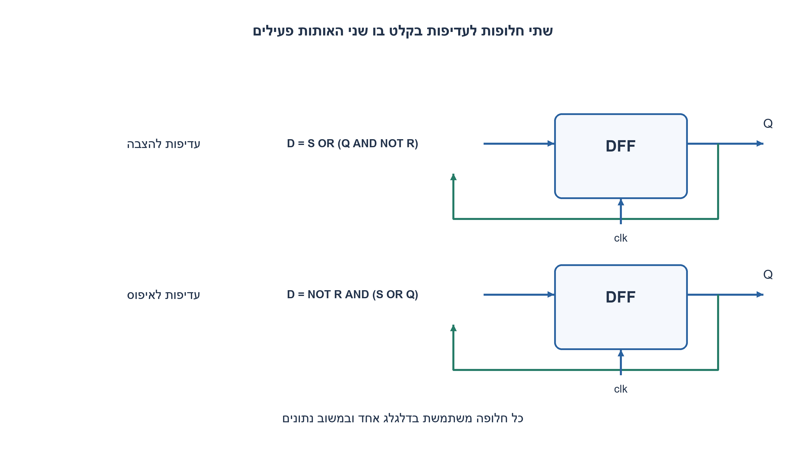
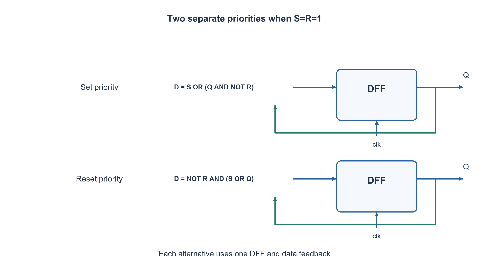

# PREP-065 — מימוש דלגלג D בעזרת דלגלג SR

פתרון מוצע בסיוע AI; ביקורת מקצועית אנושית ממתינה. הקושי אינו מכויל.

[צילום מקור פרטי](../sources/2026-11-07-batch30-03.png)

בנה דלגלג SR מן DFF. פעם שאם בכניסה 11 יוצא 1; פעם אחרת שאם בכניסה 11 יוצא 0.

חברות לפי הדיווח בצילום בלבד: NVIDIA.

## עברית

### וריאציה הפוכה: SR בעזרת דלגלג D, עם שתי אפשרויות עדיפות
ממשו רכיב SR דוגם בחזית עולה באמצעות דלגלג D אחד ושערים. בנו שתי חלופות נפרדות: S=R=1 יוצר1 בחלופה הראשונה, ו־0 בשנייה. בשתיהן00 משמר מצב,10 מציב1 ו־01 מאפס.

זו פרשנות מפורשת למקור המקוצר: ״פעם״ מתאר שני מימושים חלופיים, לא החלפה אוטומטית בכל הופעת11. נוספה כניסת rst סינכרונית פעילה בגבוה לאתחול ידוע0; עדיפותה גבוהה מ־S,R. הקלטים עומדים ב־setup/hold. אין לשנות בדיעבד את רכיב ה־SR המקורי, שבו11 אסור, ואין כאן נועל אסינכרוני.

1. כתבו טבלת מצב הבא הכוללת גם את המצב הנוכחי Q.
2. בגרסת עדיפות להצבה, S=1 צריך להכריע בלי קשר ל־R. בגרסת עדיפות לאיפוס, R=1 צריך להכריע בלי קשר ל־S.
3. הזינו לדלגלג D את S OR(Q AND NOT R) להצבה, ואת NOT R AND(S OR Q) לאיפוס. המשוב הוא נתון ולא שעון.

### כיוון ההמרה השתנה
בתרגיל המקורי משתמשים ב־SR כדי ליצור D; כאן להפך, נותנים ל־DFF לוגיקת מצב הבא של SR. מאחר שדלגלג D דוגם `Qnext=D`, מספיק לחשב בשערים את פונקציית Qnext מן הקלטים וה־Q הישן.

|S|R|עדיפות להצבה|עדיפות לאיפוס|
|---|---|---|---|
|0|0|Q|Q|
|0|1|0|0|
|1|0|1|1|
|1|1|1|0|

לכן בגרסת הצבה `D=S OR(Q AND NOT R)`. אם S=1 התוצאה1; אם S=0 אז R=1 מאפס, ו־R=0 משמר Q. בגרסת איפוס `D=NOT R AND(S OR Q)`. אם R=1 התוצאה0; אחרת S=1 מציב ו־S=0 משמר Q. ארבעת המקרים מוכיחים את הפונקציות לכל Q ישן.

כל חלופה משתמשת בדלגלג אחד ובלוגיקה לפני D. איור שתי החלופות אינו אומר שצריך שני דלגלגים כדי לממש אחת מהן. rst משמש רק לאתחול הידוע שהוספנו; בלי איפוס או פרוטוקול קלט מתאים אין ערך הפעלה מובטח. אין שעון שנוצר מ־S או R.

כאן11 הוא בקשה מוגדרת עם עדיפות. הדבר אינו הופך11 בנועל NOR מצולב רגיל למותר: שם שני המוצאים עלולים להיות0 יחד, והשחרור יכול להיות תלוי תזמון או מטא־יציבות. גם חיבור S,R לכניסות preset/clear אסינכרוניות של תא DFF אינו אותו מימוש סינכרוני, ואינו מקיים אוטומטית את חוזה העדיפות.

### קוד SystemVerilog; תוצאות סימולציה בדוח נפרד

```systemverilog
`timescale 1ns/1ps
// These are two ALTERNATIVE one-DFF implementations, not one alternating SR cell.
module prep065_set_priority(input wire clk, rst, s, r, output reg q);
  always @(posedge clk)
    if (rst) q <= 1'b0;
    else q <= s | (q & ~r);
endmodule

module prep065_reset_priority(input wire clk, rst, s, r, output reg q);
  always @(posedge clk)
    if (rst) q <= 1'b0;
    else q <= ~r & (s | q);
endmodule
```




### assumptions

```json
[
  "שני מימושים נפרדים, כל אחד דלגלג D יחיד; דגימה בחזית עולה.",
  "rst סינכרוני גובר ומאתחל0;00 משמר את Q הקודם."
]
```

### optimality

ביט מצב אחד וכל מספר קבוע של שערים דו־כניסתיים; אין טענת מינימום טרנזיסטורים או השהיה.

### verification

16 בדיקות Python ממצות: שני מצבים ישנים, ארבע בקשות ושתי עדיפויות, מול טבלת אמת נפרדת. RTL ואיפוס נבדקים בנפרד בדוח הסימולציה.

אימות RTL בפועל: ששת מימושי החומרה של האצווה קומפלו ב־Icarus Verilog12 עם ‎-g2012 -Wall והורצו ב־vvp בסביבה מבודדת ללא רשת. הרתמה המשולבת עברה172,128 בדיקות; רתמת FIFO נפרדת עברה15,729 בדיקות עם5,587 כתיבות ו־5,587 קריאות מאושרות. הכיסוי כולל שתי גרסאות SR, שני סדרי קלט טורי, כל קלטי BCD והסף, ותעבורת FIFO דיגיטלית מוגבלת. ראיה: checks/batch1107-native-verification.json. אין סינתזה, STA, סימולציית מטא־יציבות או אישור CDC פיזי.

### edge_cases

```json
[
  "11 בשני המימושים,00 במצב0 ובמצב1, איפוס יחד עם11.",
  "קלט לא יציב סביב החזית אינו מבטיח פונקציה דיגיטלית אידאלית."
]
```

### common_mistakes

החלפת שתי הנוסחאות; פירוש ״פעם״ כ־toggle ללא ביט היסטוריה; טענה ש־11 בנועל NOR מוגדר; שימוש ב־preset/clear במקום נתון D.

### interview_answer

אני כותב Qnext לפי טבלת SR. עדיפות להצבה נותנת S OR(Q AND NOT R), ועדיפות לאיפוס נותנת NOT R AND(S OR Q). זהו DFF רגיל עם משוב נתונים.

### source_ambiguities

הנוסח המקוצר פורש כשתי חלופות בעלות עדיפות שונה; reset וסוג החזית נוספו במפורש. לא שונה החוזה המקורי של PREP-065.

### solution_extensions

```json
{
  "question": "כיצד יוצרים התחלפות אוטומטית של התוצאה בכל בקשת11?",
  "direction": "זהו חוזה אחר התלוי בהיסטוריה; אפשר להגדיר11 כ־Qnext=NOT Q, אבל אין לקרוא לזה עדיפות set/reset.",
  "tests": "הבחנה בין עדיפות לבין toggle."
}
```

## English

### Reverse conversion: SR from one DFF, with two priority choices
Implement rising-edge SR behavior using one D flip-flop and gates. Construct two separate alternatives: S=R=1 produces1 in the first, and0 in the second. Both hold at00, set at10 and reset at01.

This explicitly interprets the terse source as two alternative implementations, not automatic alternation on successive11 events. A synchronous active-high rst is added for known initialization to0 and overrides S,R. Inputs meet setup/hold. Do not retroactively change the original SR primitive, whose11 was forbidden; this is not an asynchronous latch.

1. Write next-state behavior including current Q.
2. With set priority, S1 overrides R; with reset priority, R1 overrides S.
3. Drive D with S OR(Q AND NOT R) for set priority, or NOT R AND(S OR Q) for reset priority. Feedback is data, not a clock.

### The direction of conversion changed
The original builds D behavior from SR storage; this variant builds SR behavior from a DFF. Since a DFF samples `Qnext=D`, gates need only compute the required next state from inputs and old Q.

|S|R|Set priority|Reset priority|
|---|---|---|---|
|0|0|Q|Q|
|0|1|0|0|
|1|0|1|1|
|1|1|1|0|

Set priority gives `D=S OR(Q AND NOT R)`: S1 forces1; otherwise R1 clears and R0 holds. Reset priority gives `D=NOT R AND(S OR Q)`: R1 forces0; otherwise S1 sets and S0 holds. These four cases prove the equations for either old Q.

Each alternative uses one DFF with logic before D. Showing both in a diagram does not mean two DFFs are required for either single design. The added rst provides known initialization; without reset or an agreed input initialization protocol, power-up state is not promised. S and R are data inputs, never generated clocks.

Here11 is explicitly defined by priority. That does not legalize11 in an ordinary cross-coupled NOR latch, where both outputs can be0 and release can be timing-dependent/metastable. Connecting S,R to asynchronous preset/clear pins of a DFF also does not implement this synchronous priority contract automatically.

### SystemVerilog; simulation results are in a separate report

```systemverilog
`timescale 1ns/1ps
// These are two ALTERNATIVE one-DFF implementations, not one alternating SR cell.
module prep065_set_priority(input wire clk, rst, s, r, output reg q);
  always @(posedge clk)
    if (rst) q <= 1'b0;
    else q <= s | (q & ~r);
endmodule

module prep065_reset_priority(input wire clk, rst, s, r, output reg q);
  always @(posedge clk)
    if (rst) q <= 1'b0;
    else q <= ~r & (s | q);
endmodule
```




### assumptions

```json
[
  "Two separate alternatives, each one rising-edge DFF.",
  "Synchronous rst overrides and initializes0;00 holds old Q."
]
```

### optimality

One state bit and constant-size two-input gate logic, without a transistor-count/delay minimum.

### verification

Sixteen exhaustive Python checks cover two old states, four requests and two priorities against a separate truth table. RTL/reset checks are recorded separately in simulation evidence.

Executed RTL verification: the six batch hardware implementations were compiled with Icarus Verilog12 -g2012 -Wall and run with vvp in an isolated network-denied environment. The combined harness passed172,128 checks; the separate FIFO harness passed15,729 checks with5,587 accepted writes and5,587 accepted reads. Scope includes both SR priorities, both serial input orders, BCD/threshold inputs and bounded ideal FIFO traffic. Evidence: checks/batch1107-native-verification.json. No synthesis, STA, metastability simulation or physical CDC closure was performed.

### edge_cases

```json
[
  "11 under both priorities,00 holding0/1 and reset coinciding with11.",
  "Unstable inputs near capture do not guarantee ideal digital behavior."
]
```

### common_mistakes

Swapping priority equations; interpreting the wording as toggle without history; treating NOR-latch11 as defined; using preset/clear instead of D logic.

### interview_answer

Write Qnext from the SR table. Set priority is S OR(Q AND NOT R), reset priority is NOT R AND(S OR Q): an ordinary DFF with data feedback.

### source_ambiguities

The terse wording is interpreted as two priority alternatives; reset and edge sensitivity are explicit additions. The original PREP-065 contract is retained.

### solution_extensions

```json
{
  "question": "How could11 alternate the result on each occurrence?",
  "direction": "That is another history-dependent contract: define11 as Qnext=NOT Q, rather than calling it set/reset priority.",
  "tests": "Priority versus toggle semantics."
}
```
