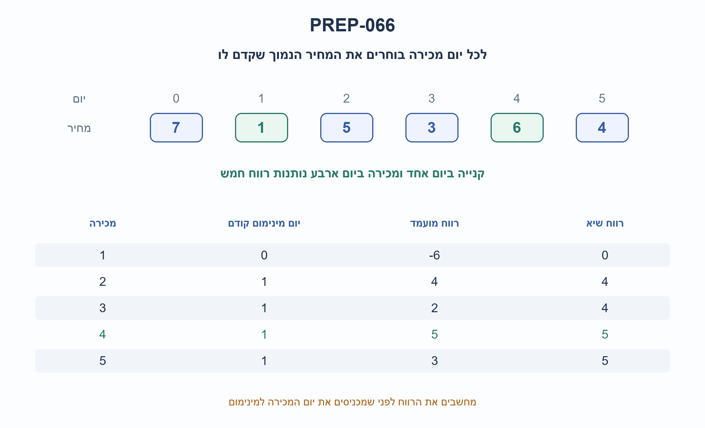
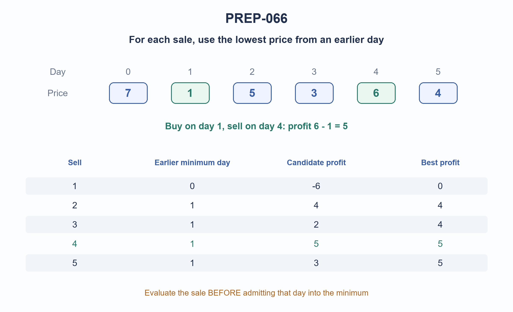

# PREP-066 — הימים הטובים ביותר לקנייה ומכירה של מניה / Best buy and sell days for one stock transaction

מקור שנמסר ב־21.10.2026. פתרון מוצע בסיוע AI; סקירה מקצועית, תרגום וזכויות שימוש ממתינים.

Source supplied 2026-10-21. AI-assisted proposed solution; professional, translation and reuse reviews pending.

[צילום המקור / Original screenshot](../sources/prep-066.png)

## הנוסח המקורי / Original text

יש לנו מערך עם N תאים, בכל תא מצוין המחיר של המניה ביום הספציפי הזה (כל אינדקס של תא מייצג יום). רשום פונקציה שמקבלת מערך כזה ומחזירה 2 ימים כך שהרווח יהיה מקסימלי. כלומר יום רכישה ויום מכירה.

## עברית

### הימים הטובים ביותר לקנייה ומכירה של מניה

נתון מערך prices של מחירי מניה במשך N ימים. כל אינדקס הוא יום, החל מ־0. כתבו פונקציה המוצאת עסקה אחת עם יום קנייה buy ויום מכירה sell, כך ש־buy<sell והרווח prices[sell]−prices[buy] מרבי. החזירו את שני האינדקסים ואת הרווח, לא רק את המחירים.

הבהרות שנוספו למקור: המחירים שלמים מדויקים ואי־שליליים; אין עמלות או מכירה בחסר. בגרסה הראשית מותר לא לבצע עסקה: אם אין רווח חיובי, או שיש פחות משני ימים, מחזירים None. בשוויון רווחים מעדיפים יום קנייה מוקדם יותר ואז יום מכירה מוקדם יותר. הציגו גם את השינוי כאשר חייבים לבצע עסקה חוקית אחת, אפילו בהפסד. אין למיין את הקלט או לשנות את סדר הימים.

### שלושה רמזים

1. אם יום המכירה היה ידוע, איזה מידע על הימים שלפניו היה מספיק כדי לבחור יום קנייה?

2. לכל יום מכירה מספיק לשמור את המחיר הנמוך ביותר שנראה לפניו ואת האינדקס הראשון שלו.

3. עברו משמאל לימין: קודם חשבו רווח מול המינימום הקודם, אחר כך הכניסו את היום הנוכחי למינימום. עדכנו שיא רק ברווח גדול יותר כדי לשמר שוויונות.

## הצעה לפתרון

### הרעיון: מתייחסים לכל יום כמועמד למכירה

אי אפשר לבחור סתם את המינימום והמקסימום במערך: ייתכן שהמקסימום הגיע לפני המינימום. במקום זאת, כשמגיעים ליום sell, שומרים רק את מחיר הקנייה הנמוך ביותר בימים שקדמו לו. כל קנייה יקרה יותר באותו קטע תיתן רווח קטן יותר לאותה מכירה, ולכן אינה יכולה לשפר את המועמד.

נשמור low_day, ושיא best המכיל קנייה, מכירה ורווח. מתחילים עם יום 0 כמינימום וסורקים מיום 1. לכל יום מחשבים את הרווח מול המינימום הקודם, מעדכנים שיא אם הרווח גדול יותר, ורק אז בודקים אם היום הנוכחי הוא מינימום חדש. הסדר מבטיח שקנייה ומכירה אינן באותו יום. מקבלים את שני הימים בפועל; המשתנה best אינו רק מספר הרווח.

### קוד פייתון והבחנה בין שתי הגרסאות

```python
"""One optional or mandatory trade; zero-based days and stable earliest ties.

Input contract: a sequence of nonnegative exact integer prices. Validation is
outside this algorithm. Return (buy_day, sell_day, profit), or None.
"""


def best_trade(prices, *, mandatory=False):
    if len(prices) < 2:
        return None
    low_day = 0
    best = None
    for sell in range(1, len(prices)):
        profit = prices[sell] - prices[low_day]
        if (mandatory or profit > 0) and (best is None or profit > best[2]):
            best = (low_day, sell, profit)
        # Strictly smaller preserves the earliest day at equal prices.
        if prices[sell] < prices[low_day]:
            low_day = sell
    return best

```

ברירת המחדל היא עסקה אפשרית בלבד. כאשר הרווח אינו חיובי best נשאר None. הדגל mandatory=True מאפשר גם רווח אפס או הפסד; עדיין בוחרים את העסקה בעלת הרווח המרבי. אין זוג ימים חוקי אם N<2, ולכן גם בגרסה זו חוזר None. בדוגמה prices=[9,8,7], ברירת המחדל מחזירה None, והגרסה המחייבת מחזירה (0,1,-1).

### דוגמת ריצה

עבור prices=[7,1,5,3,6,4], המועמדים מיום מכירה 1 עד 5 נותנים רווחים ‎-6,4,2,5,3. ביום 1 המחיר 1 הופך למינימום לקראת הימים הבאים. השיא הוא (buy=1,sell=4,profit=5). התרשים מציג את המינימום הקודם בכל שלב. ב־[3,1,1,5,5] מחזירים (1,3,4): שומרים את היום הראשון בכל מינימום שווה, ואת העסקה הראשונה באותו רווח.

### למה זה נכון?

לפני בדיקת sell, האינווריאנט הוא ש־low_day מצביע על המינימום הראשון ב־prices[0:sell]. באתחול זה נכון, והעדכון בסוף הצעד משמר זאת ליום הבא. לכן המועמד הוא העסקה הטובה ביותר שמוכרת באותו יום. כל עסקה חוקית מסתיימת באחד הימים שנסרקים, ושמירת המועמד הטוב ביותר נותנת מקסימום גלובלי. יום המינימום אינו יכול לנוע אחורה; יחד עם עדכונים מחמירים בלבד נשמרים כללי השוויון. בגרסה האפשרית מתעלמים מעסקאות שאינן עדיפות על רווח האפס של הימנעות מעסקה.

### עלות ואימות

מעבר אחד: O(N) פעולות ומספר קבוע של אינדקסים וערכים, כלומר O(1) מקום עזר במודל מילים. כדי להבטיח פתרון לקלט כללי צריך לבדוק מספר ליניארי של מחירים במקרה הגרוע, משום שמחיר שלא נקרא עשוי לשנות את העסקה הטובה. אם מספרים מדויקים גדולים מילה, זמן החשבון והאחסון תלוי גם באורך הביטים. אין הקצאת מערך עזר ואין מיון.

הקוד נבדק מול אורקל המונה באופן עצמאי את כל זוגות buy<sell: כל 21,845 המערכים באורכים 0–7 עם מחירים 0–3, בשתי הגרסאות, ועוד 500 מערכי מספרים גדולים בשתיהן. אלה בדיקות קוד ולא אישור מקצועי אנושי; הפתרון מוצע וממתין לסקירה.



### הנחות

- אינדקסי ימים מתחילים ב־0; חייבים לקנות לפני שמוכרים, בלי שינוי סדר הקלט.
- מחירים שלמים מדויקים אי־שליליים; אין עמלות, מכירה בחסר או יותר מעסקה אחת.
- בגרסה הראשית אין עסקה אם אין רווח חיובי; בגרסה המחייבת מותר הפסד. N<2 מחזיר None בשתיהן.
- בשוויון מעדיפים יום קנייה מוקדם ואז יום מכירה מוקדם.

### נכונות ועלות

```json
{
  "criterion": "זמן במקרה הגרוע ומספר משתני עזר במודל מילים.",
  "result": "O(N) זמן ו־O(1) מילות עזר; הזמן אופטימלי אסימפטוטית.",
  "proof": "כל מכירה משתמשת במינימום הקודם. במקרה הגרוע מחיר שלא נקרא יכול ליצור מינימום או מקסימום המשנים את העסקה, ולכן נדרשת קריאה ליניארית.",
  "scope": "שלמים בגודל שרירותי מחייבים עלות ביטים נוספת; זו אינה הבטחת תזמון פיזי."
}
```

### אימות

עברו 43,690 השוואות לאורקל עצמאי: 21,845 מערכים באורכים 0–7 מעל 0–3, כל אחד בשתי גרסאות. עוד 1,000 בדיקות על 500 מערכי מספרים גדולים. נבדקו זוג האינדקסים, הרווח, שוויונות והימנעות מעסקה, ולא רק הרווח. קוד פייתון רץ בפועל; סקירה מקצועית עצמאית ממתינה.

### מקרי קצה

- מערך ריק או יום אחד: None.
- מחירים יורדים: הימנעות או העסקה המפסידה הכי מעט, לפי החוזה.
- כל המחירים שווים: אין עסקה בגרסה הראשית; (0,1,0) בגרסה המחייבת.
- מינימום או רווח חוזר: שומרים את הימים המוקדמים.
- המקסימום לפני המינימום אינו עסקה חוקית.

### טעויות נפוצות

- מיון המחירים מוחק את סדר הימים.
- בחירת מינימום ומקסימום גלובליים עלולה למכור לפני הקנייה.
- עדכון המינימום לפני חישוב המועמד מאפשר בטעות אותו יום בשני התפקידים.
- החזרת המחירים או הרווח בלבד אינה מחזירה את הימים שנדרשו.
- אתחול רווח 0 בלי בחינת הגרסה המחייבת מסתיר הפסד שהוא עדיין העסקה החוקית הטובה ביותר.

### תשובה קצרה לראיון

אסרוק לפי יום המכירה ואשמור את המחיר הנמוך ביותר שהיה לפניו ואת היום הראשון שלו. בכל תא אחשב רווח ואעדכן את זוג הימים הטוב ביותר, ורק אחר כך אעדכן מינימום. כך מתקבל O(N) זמן ו־O(1) מילות עזר. מראש אברר אם מותר להימנע מעסקה ומה מחזירים כשאין שני ימים.

### שאלת המשך

```json
{
  "question": "מה משתנה אם מותר לבצע כמה עסקאות אך להחזיק לכל היותר מניה אחת?",
  "direction": "בלי עמלות או מגבלות נוספות אפשר לצבור כל עלייה חיובית בין ימים סמוכים. זו בעיה אחרת: המינימום והשיא של עסקה יחידה אינם הפתרון לה. הוספת עמלה או יום מנוחה כבר מצריכה מצבי תכנון דינמי.",
  "status": "שאלת המשך מוכנה בתוכן; אינה מחוברת לתור ההמשך החי."
}
```

## English

### Best buy and sell days for one stock transaction

Given N daily stock prices, with days indexed from zero, find one transaction with buy<sell maximizing prices[sell]−prices[buy]. Return the buy index, sell index and profit, not just the price values.

Editorial clarifications: prices are exact nonnegative integers, with no fees or short selling. The primary contract permits no transaction: return None if no strictly positive profit exists, or fewer than two days exist. Ties prefer the earliest buy day, then the earliest sell day. Also explain the variant requiring one legal transaction even at a loss. Do not sort the input or change temporal order.

### Three hints

1. If the selling day were fixed, what information about earlier days would determine the best purchase?

2. For each sale, retain the smallest earlier price and its first index.

3. Scan left to right: evaluate against the earlier minimum before admitting today's price. Replace the best trade only on strictly greater profit to preserve ties.

## Proposed solution

### Fix the selling day first

Choosing the global minimum and maximum can sell before buying. Instead, when visiting sell, retain the lowest price strictly before it. A more expensive earlier purchase cannot improve the profit for that sale, so only the earliest minimum index matters.

Store low_day and best=(buy,sell,profit). Initialize the minimum to day zero and scan from day one. First evaluate today's sale against the earlier minimum, update the best trade if its profit is strictly larger, then admit today's price into the minimum. This ordering guarantees buy<sell. Store actual indices as well as profit.

### Python and the two contracts

```python
"""One optional or mandatory trade; zero-based days and stable earliest ties.

Input contract: a sequence of nonnegative exact integer prices. Validation is
outside this algorithm. Return (buy_day, sell_day, profit), or None.
"""


def best_trade(prices, *, mandatory=False):
    if len(prices) < 2:
        return None
    low_day = 0
    best = None
    for sell in range(1, len(prices)):
        profit = prices[sell] - prices[low_day]
        if (mandatory or profit > 0) and (best is None or profit > best[2]):
            best = (low_day, sell, profit)
        # Strictly smaller preserves the earliest day at equal prices.
        if prices[sell] < prices[low_day]:
            low_day = sell
    return best

```

The default permits no trade: nonpositive profits never replace None. With mandatory=True, zero-profit or losing trades are considered, and the least loss wins if necessary. Fewer than two days provide no legal pair in either contract, so return None. For [9,8,7], the default returns None; the mandatory variant returns (0,1,-1).

### Trace

For prices=[7,1,5,3,6,4], sales on days one through five yield candidates -6,4,2,5,3. Day one's price becomes the minimum for later sales. The result is (buy=1,sell=4,profit=5); the diagram records the earlier minimum at each step. For [3,1,1,5,5], return (1,3,4): preserve the first equal-price minimum and first equal-profit trade.

### Correctness

Before evaluating sell, low_day is the first minimum in prices[0:sell]. This holds initially and is preserved by the end-of-step update. The candidate is therefore the best trade selling on that day. Every legal trade ends on a scanned day, so retaining the best candidate finds the global optimum. The minimum index never moves backward; strict updates preserve earliest-buy then earliest-sell ties. The optional contract discards trades no better than the zero profit of abstaining.

### Cost and checks

One scan takes O(N) operations and O(1) auxiliary machine words. A general exact algorithm must inspect a linear number of prices in the worst case: an unread price can change the optimum. With arbitrary-size integers, arithmetic and storage also depend on bit length. There is no sorting or auxiliary array.

The executed code matched an independent all-buy/sell-pairs oracle on every one of 21,845 arrays of lengths zero through seven over prices zero through three, under both contracts, plus 500 large-integer arrays under both contracts. This is code verification, not independent human expert approval; the solution remains proposed.



### Assumptions

- Zero-based days; purchase must precede sale and input order is unchanged.
- Exact nonnegative integer prices; no fees, short selling or multiple trades.
- Primary contract abstains without positive profit; mandatory variant accepts a loss. N<2 returns None in both.
- Ties prefer earliest buy, then earliest sell.

### Correctness and cost

```json
{
  "criterion": "Worst-case time and auxiliary-variable count in the word model.",
  "result": "O(N) time and O(1) auxiliary words; asymptotically optimal time.",
  "proof": "Each sale uses its earlier minimum. An unread price can create a new minimum or maximum changing the optimum, giving a linear worst-case input-read bound.",
  "scope": "Arbitrary-size integer costs also depend on bit length; no physical timing guarantee."
}
```

### Verification

Passed 43,690 independent-oracle checks: 21,845 arrays of lengths 0..7 over 0..3 under both contracts, plus 1,000 checks on 500 large-integer arrays. Assertions cover indices, profit, tie order and abstention, not profit alone. Python executed; independent professional review pending.

### Edge cases

- Empty or one-day input returns None.
- Descending prices: abstain or take the smallest loss, according to contract.
- Equal prices: no optional trade; mandatory returns (0,1,0).
- Repeated minima/profits preserve earliest days.
- A maximum before the minimum is not a legal buy/sell pair.

### Common mistakes

- Sorting destroys temporal order.
- Global min/max may sell before purchasing.
- Admitting the current minimum before evaluation can accidentally allow same-day trades.
- Returning prices or profit alone fails to return the requested days.
- Initializing mandatory profit to zero can hide the best legal loss.

### Short interview answer

Scan by selling day, retaining the lowest earlier price and its first index. Evaluate profit and update the best pair before updating the minimum. This gives O(N) time and O(1) auxiliary words. First clarify whether abstention is allowed and what to return with fewer than two days.

### Follow-up

```json
{
  "question": "What if multiple transactions are allowed while holding at most one share?",
  "direction": "Without fees or further constraints, sum positive consecutive-day rises. This is a different contract; a single prefix minimum/best trade does not solve it. Fees or cooldown introduce dynamic-programming states.",
  "status": "Follow-up prepared in content; not connected to the live follow-up queue."
}
```

## קבצים קבועים / Permanent artifacts

- [solutions/prep_066_best_stock_trade.py](../solutions/prep_066_best_stock_trade.py)

- [checks/check_prep_066.py](../checks/check_prep_066.py)

- [checks/prep-066-verification.json](../checks/prep-066-verification.json)
