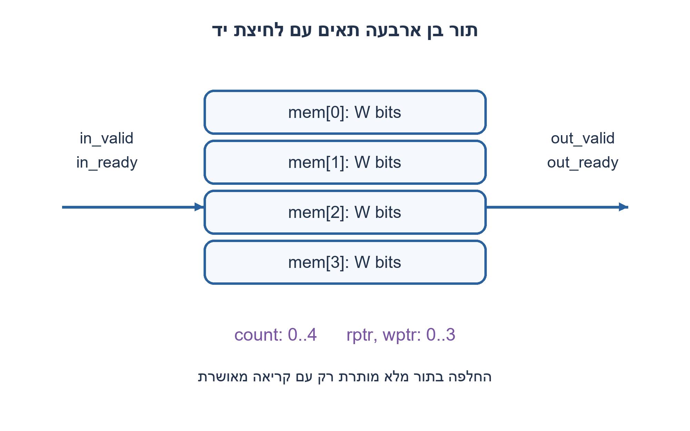
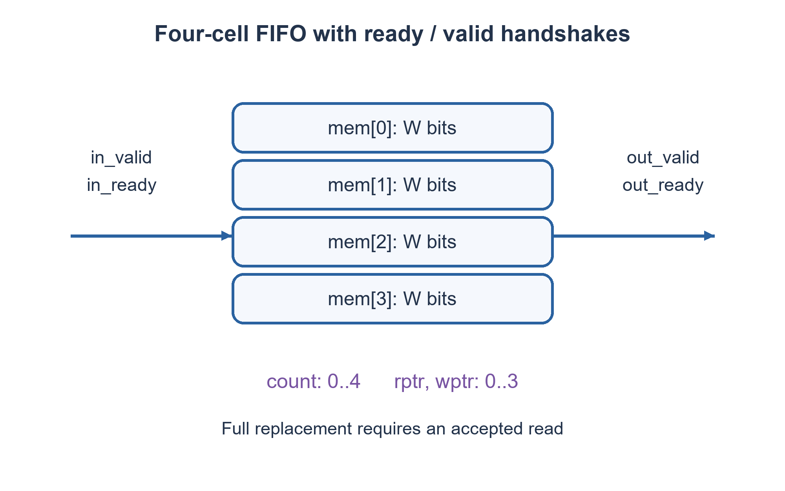

# PREP-067 — FIFO סינכרוני בחומרה עם שמונה תאים

פתרון מוצע בסיוע AI; ביקורת מקצועית אנושית ממתינה. הקושי אינו מכויל.

[צילום מקור פרטי](../sources/2026-11-07-batch10-04.png)

ממש רכיב FIFO עם עומק 4 וכן יציאת ready שאומרת שניתן לקבל מידע, ויציאת vld שאומרת שניתן לקרוא מידע מהרכיב. ניתן להשתמש בכמה FF שרוצים, בבוררים ובשערים לוגיים.

חברות לפי הדיווח בצילום בלבד: NVIDIA.

## עברית

### וריאציה: FIFO בעומק ארבע עם ready ו־valid
ממשו תור חומרה בן ארבע מילים באמצעות FF, בוחרים ושערים. הציגו ממשק שמודיע מתי ניתן להכניס מידע ומתי ניתן לקרוא מידע.

השלמות חוזה: כל מילה היא W סיביות, W חיובי. יש שעון יחיד ואיפוס סינכרוני. לכניסה in_valid,in_ready,in_data; ליציאה out_valid,out_ready,out_data. פעולה מתקבלת בעליית שעון כאשר שני אותות לחיצת היד 1. הראש מוצג בצירוף ללא קריאה הרסנית; בעת חסימת הצרכן הוא יציב. בתור ריק אין מעקף ישיר מהכניסה ליציאה. בתור מלא מותר לקבל כתיבה רק יחד עם קריאה מאושרת באותה עלייה. זו וריאציה נפרדת מממשק הקריאה הרשומה בפתרון המקורי.

1. איך תבחינו בין ריק ומלא כשהמצביעים שווים?
2. מונה תפוסה0..4 מגדיר valid. האם תור מלא יכול לקבל מילה אם מוציאים ממנו מילה באותה עלייה?
3. הגדירו pop=out_valid AND out_ready; אז in_ready=(count<4) OR pop. קדמו כל מצביע רק על פעולה מאושרת ועדכנו count לפי ההפרש.

### זיכרון, מצביעים ותפוסה
שומרים ארבע מילים, מצביעי קריאה וכתיבה בני שתי סיביות ומונה תפוסה בן שלוש סיביות. rptr מצביע על הראש הישן; wptr על המקום לכתיבה הבאה. חיבור הראש `out_data=mem[rptr]` הוא בוחר4:1. אין לאפס את התוכן: count=0 פוסל אותו.

```text
out_valid = (count != 0)
pop = out_valid AND out_ready
in_ready = (count < 4) OR pop
push = in_valid AND in_ready
```

בעלייה מאושרת push כותב ומקדם wptr מודולו4; pop מקדם rptr. אם רק push, המונה עולה; אם רק pop, יורד; אם שתיהן או אף אחת, נשאר. איפוס מאפס count ושני מצביעים וגובר על כל פעולה.

בתור מלא שתי הפעולות אפשריות: הצרכן דוגם את הראש הישן לפני העלייה, והכתיבה מחליפה את התא באותה עלייה. ההשמות הלא־חוסמות שומרות את כלל הישן־לפני־החדש. בתור ריק out_valid=0 ולכן לא מתבצעת קריאה אף אם out_ready=1; הכתיבה נכנסת והופכת תקפה לאחר העלייה. בתפוסה1 עם pop+push מוחלף הפריט הישן בלי לפגוע בסדר.

אינווריאנט: count הוא מספר ההכנסות המאושרות פחות ההוצאות המאושרות מאז האיפוס, תמיד0..4; הליכה מ־rptr לאורך count תאים מחזירה בדיוק את התור לפי סדר הקבלה. כל פעולה משמרת זאת. תחת out_valid=1 ו־out_ready=0 אין pop ולכן הראש אינו מתקדם. הכתיבה אינה יכולה לדרוס את הראש משום שתור מלא חסום ללא pop.

המימוש צורך4W ביטי נתונים ועוד7 ביטי מצב, בוחר W-ביטי4:1 ולוגיקה קטנה. קיים נתיב צירופי מ־out_ready אל in_ready; שרשור מודולים עלול להאריך אותו. אין להסיק תדר מקסימלי מקוד RTL בלבד.

### קוד SystemVerilog; תוצאות סימולציה בדוח נפרד

```systemverilog
`timescale 1ns/1ps
module prep067_fifo4_batch1107b10 #(parameter integer W=8)(
 input logic clk,rst,in_valid,out_ready,
 input logic [W-1:0] in_data,
 output wire in_ready,out_valid,
 output wire [W-1:0] out_data);
 logic [W-1:0] mem[0:3];
 logic [1:0] rptr,wptr;
 logic [2:0] count;
 wire pop=out_valid && out_ready;
 wire push=in_valid && in_ready;
 assign out_valid=(count!=0);
 assign in_ready=(count<4)||pop;
 assign out_data=mem[rptr];
 always @(posedge clk) begin
   if(rst) begin count<=0; rptr<=0; wptr<=0; end
   else begin
     if(push) begin mem[wptr]<=in_data; wptr<=wptr+1'b1; end
     if(pop) rptr<=rptr+1'b1;
     case({push,pop})
       2'b10:count<=count+1'b1;
       2'b01:count<=count-1'b1;
       default:count<=count;
     endcase
   end
 end
endmodule
```




### assumptions

שעון יחיד; W>0; ללא מעקף ריק; החלפה בתור מלא; הצגת ראש צירופית.

### optimality

4W+7 ביטי זיכרון ובוחר4:1; זמן פעולה אלגוריתמי O(1) לתור בעל עומק קבוע.

### verification

אימות RTL אמיתי: Icarus Verilog 12 קימפל את חמש הווריאציות והרתמה עברה 138,967 בדיקות בסביבה מבודדת ללא רשת: 2,046 מילים טוריות, 5,000 מחזורי FIFO, 1,300 מחזורי חלון וכל 16 זוגות המקסימום. בדיקת Python עצמאית מרחיבה את הכיסוי ל־4,094 מילים ו־10,000 מחזורי FIFO. ראיות: checks/batch1107b10-native-verification.json ו־checks/batch1107b10-hardware-model-verification.json. זו סימולציה דיגיטלית מוגבלת; לא בוצעו סינתזה או ניתוח תזמון.

### edge_cases

```json
[
  "ריק, מלא, חסימת הצרכן, מילוי עד מלא וריקון.",
  "push+pop בתפוסה1 ובתפוסה4; גלישת מצביעים ואיפוס."
]
```

### common_mistakes

קידום מצביע על בקשה שנדחתה; קריאת כניסה בתור ריק כאילו יש מעקף; פירוש data כש־valid=0; בלבול בין ready לבין בקשת כתיבה.

### interview_answer

אשמור ארבע מילים ומונה תפוסה. valid אומר שיש ראש, ready אומר שיש מקום או שבדיוק מתפנה מקום. רק לחיצת יד מאושרת מזיזה מצביע.

### source_ambiguities

רוחב המילה, כיוון ready/valid וההתנהגות במלא/ריק הוגדרו כהשלמה; המקור מזכיר רק דגלי ready ו־vld.

### solution_extensions

```json
{
  "question": "איך שוברים את נתיב ready הצירופי?",
  "direction": "הוספת מאגר החלקה או רישום ready דורשים מקום שמור נוסף ושינוי השהיה.",
  "tests": [
    "עצירת צרכן לאחר רצף כתיבות",
    "אימות שאין אובדן או שכפול"
  ]
}
```

## English

### Variant: depth-four ready/valid FIFO
Implement a four-word hardware FIFO using flip-flops, multiplexers and gates. Indicate when input can be accepted and when output can be read.

Completed contract: positive word width W, one clock and synchronous reset. Input has in_valid,in_ready,in_data; output has out_valid,out_ready,out_data. Transfer occurs at a rising edge with both handshake signals high. The head is shown combinationally and remains stable under downstream backpressure. There is no empty input-to-output bypass. A full FIFO accepts replacement only with a simultaneous accepted read. This is distinct from the original registered-read interface.

1. How do equal pointers distinguish empty from full?
2. Occupancy0..4 defines valid. Can a full FIFO accept a word when one is removed at the same edge?
3. Set pop=out_valid AND out_ready; then in_ready=(count<4) OR pop. Advance pointers only on accepted transfers and update count by their difference.

### Storage, pointers and occupancy
Store four words, two two-bit pointers and a three-bit occupancy. rptr identifies the oldest word; wptr identifies the next write location. `out_data=mem[rptr]` is a4:1 word selector. Contents need no reset because count0 invalidates them.

```text
out_valid = (count != 0)
pop = out_valid AND out_ready
in_ready = (count < 4) OR pop
push = in_valid AND in_ready
```

At the edge, push writes and advances wptr modulo4; pop advances rptr. Push only increments count, pop only decrements it; both or neither hold it. Reset clears count and both pointers, overriding all transfers.

A full FIFO can transfer both ways: the consumer samples the old head before the edge and the write replaces the slot at that edge. Nonblocking assignments preserve old-before-new semantics. At empty, out_valid0 prevents a read even when out_ready1; a write becomes visible after the edge. At occupancy1, simultaneous pop/push replaces the old item without reordering.

Invariant: count equals accepted inputs minus accepted outputs since reset, always0..4. The count locations starting at rptr contain exactly the queue in acceptance order. Each operation preserves this. Under valid1/ready0 there is no pop, so the head holds. A write cannot overwrite it because a full queue blocks writes without a pop.

Storage costs4W data bits plus7 control bits, a W-bit4:1 selector and small control logic. A combinational path connects out_ready to in_ready; chaining FIFOs may extend it. RTL alone does not establish a maximum clock frequency.

### SystemVerilog; simulation results are in a separate report

```systemverilog
`timescale 1ns/1ps
module prep067_fifo4_batch1107b10 #(parameter integer W=8)(
 input logic clk,rst,in_valid,out_ready,
 input logic [W-1:0] in_data,
 output wire in_ready,out_valid,
 output wire [W-1:0] out_data);
 logic [W-1:0] mem[0:3];
 logic [1:0] rptr,wptr;
 logic [2:0] count;
 wire pop=out_valid && out_ready;
 wire push=in_valid && in_ready;
 assign out_valid=(count!=0);
 assign in_ready=(count<4)||pop;
 assign out_data=mem[rptr];
 always @(posedge clk) begin
   if(rst) begin count<=0; rptr<=0; wptr<=0; end
   else begin
     if(push) begin mem[wptr]<=in_data; wptr<=wptr+1'b1; end
     if(pop) rptr<=rptr+1'b1;
     case({push,pop})
       2'b10:count<=count+1'b1;
       2'b01:count<=count-1'b1;
       default:count<=count;
     endcase
   end
 end
endmodule
```




### assumptions

One clock; W>0; no empty bypass; full replacement; combinational head visibility.

### optimality

4W+7 storage bits and a4:1 selector; O(1) operations for fixed depth.

### verification

Executed RTL verification: Icarus Verilog 12 compiled the five variants and the harness passed 138,967 checks in an isolated network-denied environment: 2,046 serial words, 5,000 FIFO cycles, 1,300 window cycles and all 16 maximum-input pairs. Independent Python checks extend coverage to 4,094 words and 10,000 FIFO cycles. Evidence: checks/batch1107b10-native-verification.json and checks/batch1107b10-hardware-model-verification.json. This is bounded digital simulation, not synthesis or timing analysis.

### edge_cases

```json
[
  "Empty, full, backpressure, fill and drain.",
  "Simultaneous transfers at occupancy1 and4, pointer wrap and reset."
]
```

### common_mistakes

Advancing on rejected requests; inventing empty bypass; consuming data while invalid; confusing ready with a write request.

### interview_answer

Use four words and occupancy. Valid means a head exists; ready means there is space or one is being freed. Only accepted handshakes advance pointers.

### source_ambiguities

Word width, handshake direction and boundary behavior are explicit additions; the source states only ready and vld indications.

### solution_extensions

```json
{
  "question": "How can the combinational ready path be broken?",
  "direction": "A skid buffer or registered-ready contract needs reserved capacity and a changed latency.",
  "tests": [
    "Consumer stalls after consecutive writes",
    "Check no loss or duplication"
  ]
}
```
