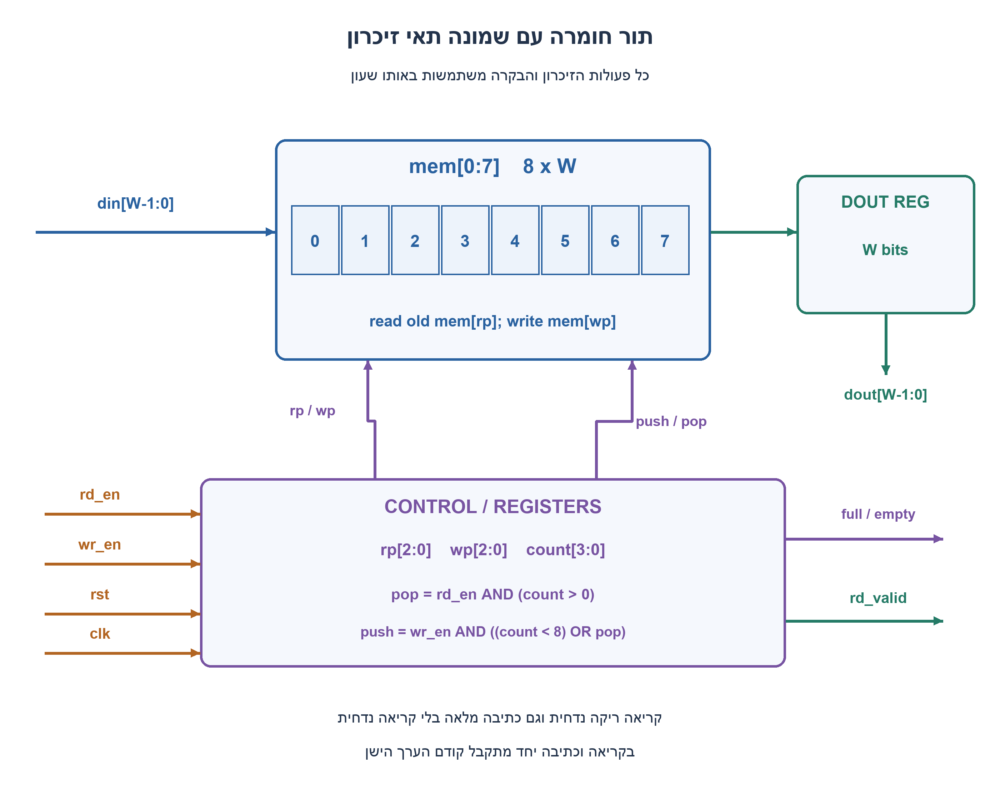
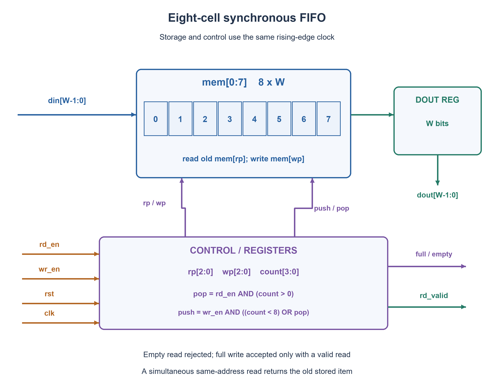

# PREP-067 — FIFO סינכרוני בחומרה עם שמונה תאים

## מקור שנמסר

יש לממש FIFO בחומרה בגודל של 8 "תאי זיכרון".

[צילום המקור הפנימי](../sources/prep-067.png)

סטטוס: פתרון מוצע בסיוע AI; בדיקה מקצועית אנושית ממתינה. השיוך לחברות הוא דיווח מהצילום בלבד.

## FIFO סינכרוני בחומרה עם שמונה תאים

ממשו FIFO בחומרה בעומק שמונה תאים. הציגו זיכרון, מצביעי קריאה וכתיבה, דגלי full/empty ומימוש התנהגותי.

הבהרות שנוספו למקור: בכל תא W ביטים, כאשר W מספר שלם חיובי. שעון עולה משותף לקריאה ולכתיבה ואיפוס סינכרוני פעיל בגבוה. קריאה מריק נדחית, ללא העברה מיידית של כתיבה ליציאה. כתיבה למלא נדחית אלא אם מתקבלת באותה חזית קריאה, ואז שניהם מתקבלים והפריט הישן נקרא לפני דריסתו. בכל מצב ביניים שתי בקשות מתקבלות יחד. dout הוא פלט רשום: אחרי קריאה שהתקבלה הוא מכיל את הפריט שנקרא ו־rd_valid=1 למחזור הבא; בלי קריאה הוא שומר ערך ו־rd_valid=0. איפוס גובר על הבקשות, מרוקן ומאפס את פלט הקריאה. אין דרישה לשני תחומי שעון.

### רמזים

1. איזה מידע צריך לשמור כדי לדעת מאיזה תא לקרוא, לאיזה תא לכתוב וכמה תאים תפוסים?
2. המצביעים חוזרים אחרי תא 7 לתא 0. מדוע שוויון בין המצביעים לבדו אינו מבדיל בין מלא לריק?
3. הוסיפו מונה תפוסה 0–8. קבעו קודם pop לפי המצב הישן, ואז push שיכול להתקבל במלא רק אם pop התקבל. עדכנו count בתוספת push פחות pop.

### הצעה לפתרון

### מפרידים נתונים מסדר התור

לא מזיזים את כל הפריטים. נשמור מערך mem עם שמונה מילים ברוחב W, מצביע קריאה rp ומצביע כתיבה wp בני שלושה ביטים, ומונה count בן ארבעה ביטים כדי לייצג גם 8. rp מצביע לפריט הוותיק ביותר כאשר התור אינו ריק; wp הוא התא הבא שאליו תבוצע כתיבה שהתקבלה. המצביעים מתקדמים מעגלית, ולכן אחרי 7 מגיע 0.

```text
empty = (count == 0)
full  = (count == 8)
pop   = rd_en AND NOT empty
push  = wr_en AND (NOT full OR pop)
```

את כל התנאים מחשבים מהמצב שלפני החזית. אותות wr_accepted ו־rd_accepted בקוד הם אותות קבלה צירופיים המתארים מה יתקבל בחזית הבאה, ונחסמים בזמן rst. הם שונים מ־rd_valid, שמתאר את נתוני הקריאה הרשומים לאחר החזית.

### מה עושים בחזית?

אם rst=1: מאפסים rp,wp,count,dout,rd_valid. אין צורך לאפס את כל תאי mem: count=0 מונע קריאת ערך ישן. בלי איפוס: rd_valid מקבל pop. אם pop=1, שומרים ב־dout את mem[rp] הישן ומקדמים rp. אם push=1, כותבים din ל־mem[wp] ומקדמים wp. לבסוף count מקבל count+push−pop.

| תפוסה לפני החזית | wr_en | rd_en | push | pop | תפוסה אחרי החזית |
| --- | --- | --- | --- | --- | --- |
| 0 | 0 | 1 | 0 | 0 | 0 |
| 0 | 1 | 1 | 1 | 0 | 1 |
| 1–7 | 1 | 1 | 1 | 1 | ללא שינוי |
| 8 | 1 | 0 | 0 | 0 | 8 |
| 8 | 1 | 1 | 1 | 1 | 8 |

יתר המקרים נובעים מהמשוואות: רק כתיבה חוקית מגדילה את count, רק קריאה חוקית מקטינה, וללא בקשות נשמר המצב. ב־count=1 וקריאה וכתיבה יחד נקרא הפריט היחיד הישן, והפריט החדש נשאר בתור. בריק שתי בקשות אינן קוראות את din מיד: רק הכתיבה מתקבלת, כפי שהוגדר.

### המקרה העדין: תור מלא ושתי בקשות

במלא rp=wp. נניח שהתור מכיל A עד H ושניהם מצביעים לתא A. קריאה וכתיבת X יחד מחזירות A ומחליפות את התא ב־X, מקדמות את שני המצביעים ושומרות count=8. הסדר הלוגי החדש הוא B,C,D,E,F,G,H,X. בקוד SystemVerilog עם מערך אוגרים והשמות לא חוסמות, צד ימין של dout <= mem[rp] נקרא מהערך הישן, לפני עדכון mem. אם מחליפים את המערך בבלוק RAM, חייבים לבחור התנהגות read-first מתאימה או להוסיף טיפול מפורש; אין להניח שכל RAM יתנהג כך.

### למה זה נכון וכמה זה עולה?

האינווריאנט: 0≤count≤8 והפריטים החיים נמצאים במיקומים rp עד rp+count−1 מודולו 8, לפי סדר הכניסה. הוספה כותבת בקצה הזה, וקריאה מוציאה מראשו. התנאים חוסמים גלישה וחסר, ושתי פעולות חוקיות מקיימות את שני הקצוות יחד. מכאן נשמר סדר FIFO.

הנתונים דורשים 8W ביטים. במימוש הזה יש עוד 6 ביטי מצביעים, 4 ביטי מונה, W ביטי פלט וביט rd_valid: סך לוגי 9W+11 ביטים, לפני תקורות המימוש הפיזי. הבקרה דורשת מספר קבוע של פעולות למחזור, ועד פריט אחד נקרא ואחד נכתב בכל חזית. אין כאן טענת שטח מינימלי; למשל אפשר להבדיל בין מלא וריק גם בעזרת ביטי גלישה במקום count. עיכוב ושעון מרבי תלויים במימוש הזיכרון ובספריית התאים.

בדיקת מודל בפייתון מול deque עצמאי עברה על 65,408 מעברים ממצבים בעלי נתונים בני ביט אחד: כל תוכני התור באורכים 0–8, כל סיבובי rp, הבקרות, din והפלט הקודם. עוד 16,352 מקרי איפוס ו־100,000 חזיתות מדגמיות עם נתונים בני 16 ביט נבדקו. קוד SystemVerilog צורף אך לא קומפל ולא סומלץ. אין בכך בדיקת RAM פיזית, CDC או תזמון. הפתרון מוצע וממתין לביקורת מקצועית.



### assumptions

[
  "עומק 8, רוחב W≥1; שעון יחיד ואיפוס סינכרוני פעיל בגבוה.",
  "אין bypass בריק; במלא אפשר לקרוא ולכתוב יחד ולהחזיר את הפריט הישן.",
  "dout רשום; rd_valid תקף אחרי חזית קריאה שהתקבלה. בלי קריאה dout נשמר.",
  "איפוס מנקה את מצב הבקרה והפלט, אך לא את הזיכרון; נדרשת חזית איפוס לפני שימוש.",
  "מערך אוגרים תומך בקריאת ערך ישן וכתיבה יחד; מימוש RAM חלופי מחייב חוזה תואם."
]

### optimality

{
  "criterion": "קצב וסיבוכיות למימוש שנבחר.",
  "result": "עד קריאה וכתיבה אחת בחזית; O(1) פעולות בקרה למחזור. מצב לוגי 9W+11 ביטים.",
  "proof": "אין הזזת התור; רק גישה ממוספרת, קידום שני מצביעים ועדכון תפוסה.",
  "scope": "אין מינימום שטח/מספר FF/השהיה; העלות הפיזית תלויה במיפוי זיכרון."
}

### verification

"עברו 65,408 מעברים ממצבי תור בני ביט אחד, 16,352 מקרי עדיפות איפוס ו־100,000 חזיתות מדגמיות עם נתוני 16 ביט מול deque עצמאי. קוד SystemVerilog לא קומפל ולא סומלץ."

### edge_cases

[
  "שוויון rp=wp יכול להיות ריק או מלא; count מכריע.",
  "בריק שתי בקשות מקבלות רק כתיבה, ללא rd_valid.",
  "במלא שתי בקשות מתקבלות יחד; יש להחזיר את הערך הישן.",
  "ב־count=1 שתי בקשות מחליפות את הפריט בלי שינוי תפוסה.",
  "איפוס בעת שתי בקשות דוחה אותן ומאפס פלט.",
  "כמה סיבובים אינם משנים סדר; אין לאפס את הזיכרון כדי למנוע קריאת זבל."
]

### common_mistakes

[
  "מונה בן שלושה ביטים שאינו מסוגל לייצג 8.",
  "שוויון המצביעים משמש גם כמלא וגם כריק בלי ביט נוסף.",
  "הגדלת count על בקשה שנדחתה.",
  "שינוי מדיניות גבול בלי לתעד אותה.",
  "לקרוא mem לאחר שדרסנו את התא במודל תוכנה.",
  "להציג FIFO חד־שעוני כפתרון בטוח לשני שעונים בלתי תלויים."
]

### interview_answer

"אשתמש במערך 8×W, שני מצביעים בני שלושה ביטים ומונה תפוסה בן ארבעה. pop חוקי רק כשהתור אינו ריק; push חוקי כשאינו מלא או כשיש pop באותה חזית. אקרא את הפריט הישן, אכתוב בקצה, אקדם רק מצביעים של פעולות שהתקבלו ואעדכן count ב־push פחות pop. הפלט רשום עם rd_valid."

### solution_extensions

{
  "question": "מה נדרש אם צד הקריאה והכתיבה פועלים בשעונים שונים?",
  "direction": "זה FIFO אסינכרוני: נדרשים מצביעים וביטי גלישה, קידוד Gray וסנכרון לכל תחום שעון, חישוב דגלים מקומי וניתוח CDC. אין להעביר count בינארי רב־ביטי ישירות.",
  "status": "מוכן בתוכן; לא מחובר לתור המשך חי."
}

## Eight-cell synchronous hardware FIFO

Implement a hardware FIFO of depth eight. Show memory, read/write pointers, full/empty flags and behavioral code.

Editorial clarifications: each cell has W bits for positive integer W. Read and write share one rising-edge clock; reset is synchronous active high. Empty reads are rejected with no write-to-read bypass. Full writes are rejected unless a read is accepted at that same edge; then both are accepted and the old item is read before overwrite. Both requests are accepted at intermediate occupancy. dout is registered: after an accepted read it holds that item and rd_valid=1 for the following cycle; otherwise it holds its old value with rd_valid=0. Reset overrides requests, empties the FIFO and clears read outputs. This is not a dual-clock FIFO.

### Hints

1. What state tells us where to read, where to write and how many cells are occupied?
2. Pointers wrap from cell seven to zero. Why can pointer equality mean either full or empty?
3. Add occupancy 0..8. Determine pop from old state, then allow push at full only if pop is accepted. Update count by push minus pop.

### Proposed solution

### Separate stored data from queue order

Do not shift every item. Use mem[0:7] of W-bit words, three-bit read/write pointers rp,wp, and a four-bit occupancy count that can represent eight. rp identifies the oldest item when nonempty; wp is the next accepted-write location. Both pointers wrap from seven to zero.

```text
empty = (count == 0)
full  = (count == 8)
pop   = rd_en AND NOT empty
push  = wr_en AND (NOT full OR pop)
```

All decisions use the pre-edge state. The combinational wr_accepted and rd_accepted outputs describe what will be accepted at the next edge and are blocked during reset. They differ from rd_valid, which describes the registered read result after the edge.

### Edge updates

With rst=1 clear rp,wp,count,dout,rd_valid. Memory cells need not be reset because zero occupancy blocks stale-data reads. Otherwise assign rd_valid=pop. If pop, capture old mem[rp] in dout and advance rp. If push, write din to mem[wp] and advance wp. Set count to count+push−pop.

| Pre-edge occupancy | wr_en | rd_en | push | pop | Post-edge occupancy |
| --- | --- | --- | --- | --- | --- |
| 0 | 0 | 1 | 0 | 0 | 0 |
| 0 | 1 | 1 | 1 | 0 | 1 |
| 1–7 | 1 | 1 | 1 | 1 | unchanged |
| 8 | 1 | 0 | 0 | 0 | 8 |
| 8 | 1 | 1 | 1 | 1 | 8 |

Other cases follow directly: a legal write alone increments occupancy, a legal read alone decrements it, and no requests hold it. At occupancy one, simultaneous operations return the old sole item and retain the new one. At empty, simultaneous requests accept only the write; there is no immediate din bypass by contract.

### The subtle full case

At full, rp=wp. Suppose items A through H fill the FIFO and both pointers address A. Reading while writing X returns A, replaces that cell with X, advances both pointers and keeps occupancy eight. Logical order becomes B,C,D,E,F,G,H,X. In the supplied register-array SystemVerilog, nonblocking assignments read old mem[rp] before updating memory. A replacement RAM block needs documented read-first behavior or explicit collision handling; not every RAM has this behavior.

### Correctness and cost

Invariant: occupancy stays in zero through eight, and live items occupy rp through rp+count−1 modulo eight in insertion order. Push appends at the end, pop removes the front, boundary guards prevent overflow/underflow, and legal simultaneous operations update both ends. Thus FIFO order is preserved.

Storage uses 8W data bits. This construction also has six pointer bits, four count bits, W output bits and one valid bit, totaling 9W+11 logical state bits before physical implementation overhead. Control uses a constant number of operations per cycle and supports up to one read and one write per edge. No minimum-area claim is made; wrap bits can replace the occupancy scheme. Delay and maximum clock rate depend on memory/cell technology.

Python comparison against an independent deque passed 65,408 transitions over every one-bit live queue content of lengths zero through eight, all rp rotations, controls, din and previous dout. A further 16,352 reset cases and 100,000 sampled sixteen-bit edges passed. Supplied SystemVerilog was not compiled or HDL-simulated. These are not physical RAM, CDC or timing checks. Independent professional review is pending.



### assumptions

[
  "Depth eight, W≥1; one rising-edge clock and synchronous active-high reset.",
  "No bypass at empty; full permits simultaneous read/write with old-data return.",
  "Registered dout; rd_valid marks the cycle after an accepted read. No read holds dout.",
  "Reset clears control/output state, not memory; reset edge required before use.",
  "Register array provides old-data simultaneous read/write; replacement RAM requires a matching contract."
]

### optimality

{
  "criterion": "Throughput and operation count for this construction.",
  "result": "Up to one read and one write per edge; O(1) control operations/cycle; 9W+11 logical state bits.",
  "proof": "No shifting: indexed access, at most two pointer advances and occupancy update.",
  "scope": "No minimum area/FF/delay claim; physical cost depends on storage mapping."
}

### verification

"Passed 65,408 one-bit-state transitions, 16,352 reset-priority cases and 100,000 sampled sixteen-bit edges against independent deque. SystemVerilog uncompiled/unsimulated."

### edge_cases

[
  "Equal pointers mean empty or full; count distinguishes them.",
  "Empty with both requests accepts only push and no read-valid.",
  "Full with both requests accepts both and must return old data.",
  "At count one both requests replace the item without changing occupancy.",
  "Reset with both requests rejects both and clears read outputs.",
  "Wrap preserves order; occupancy prevents stale reads without resetting memory."
]

### common_mistakes

[
  "Using a three-bit count that cannot represent eight.",
  "Pointer equality alone for both full and empty.",
  "Changing occupancy on rejected requests.",
  "Silently changing boundary policy.",
  "Overwriting before reading in a software model.",
  "Claiming single-clock control safely handles unrelated clocks."
]

### interview_answer

"Use eight W-bit cells, two three-bit pointers and four-bit occupancy. Pop only when nonempty; push when not full or with a same-edge valid pop. Read old front, write at tail, advance only accepted-operation pointers and update count by push minus pop. Read output is registered with rd_valid."

### solution_extensions

{
  "question": "What changes when readers and writers use unrelated clocks?",
  "direction": "An asynchronous FIFO needs wrap-aware pointers, Gray encoding, cross-domain synchronizers, local flags and CDC analysis. Do not pass a multi-bit binary occupancy count directly between clocks.",
  "status": "Prepared in content, not connected to the live follow-up queue."
}

## Files

- [Code](../solutions/prep_067_fifo8.py)
- [Code](../solutions/prep_067_fifo8.sv)
- [Verification](../checks/check_prep_067.py)
- [Evidence](../checks/prep-067-verification.json)
