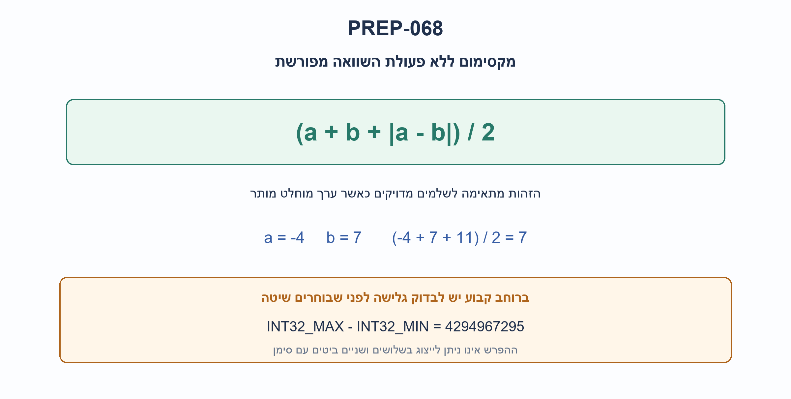
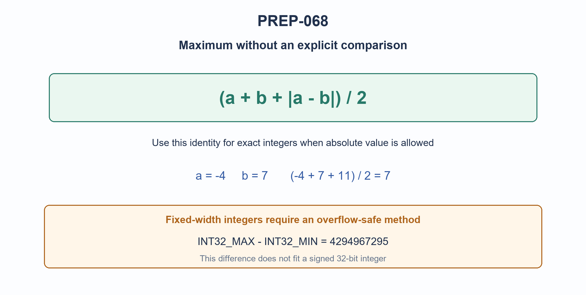

# PREP-068 — מקסימום של שני שלמים ללא השוואות / Maximum of two integers without comparisons

מקור שנמסר ב־21.10.2026. פתרון מוצע בסיוע AI; סקירה מקצועית, תרגום וזכויות שימוש ממתינים.

Source supplied 2026-10-21. AI-assisted proposed solution; professional, translation and reuse reviews pending.

[צילום המקור / Original screenshot](../sources/prep-068.png)

## הנוסח המקורי / Original text

כתוב פונקציה המקבלת שני משתנים ומחזירה את המקסימום ללא השוואות

## עברית

### מקסימום של שני שלמים ללא השוואות

כתבו פונקציה המקבלת שני מספרים שלמים a,b ומחזירה את הגדול מביניהם, בלי שימוש באופרטורי השוואה, min/max מובנים או תנאי שבודק מי גדול יותר.

המקור אינו מגדיר טיפוסים ופעולות מותרות. לכן פתרו שתי גרסאות מפורשות: א. שלמים מדויקים בפייתון כאשר abs מותר. ב. אם גם abs אסור: קלטים עם סימן ברוחב 32 ביטים, ופעולות ביטים ואריתמטיקה ללא סימן מותרות. יש להימנע מגלישה בחשבון עם סימן ומהזזה של מספר שלילי. אין דרישה לזמן ביצוע קבוע מבחינת אבטחת מידע; קוד ללא if אינו מוכיח זאת.

### שלושה רמזים

1. לפני חיפוש טריק, בררו אם מותר ערך מוחלט והאם המספרים מוגבלים ברוחב.

2. כשערך מוחלט מותר, בדקו מה קורה ל־a+b+abs(a-b) בכל אחד משני סדרי המספרים.

3. ברוחב קבוע: אם הסימנים שונים בוחרים את הלא־שלילי. רק כששניהם באותו סימן אפשר ללמוד מסימן ההפרש בלי גלישה מתמטית; בנו מסכה לבחירה.

## הצעה לפתרון

### קודם מגדירים מה בדיוק אסור

הביטוי ״ללא השוואות״ אינו אוסר אוטומטית abs, ואינו קובע אם חשבון מדויק או גולש. אי אפשר להעביר טריק משפה לשפה בלי לברר זאת. הפתרונות כאן אינם משתמשים באופרטור השוואה, ב־min/max או בתנאי סדר בתוך הפונקציה. בדיקות האורקל רשאיות כמובן להשוות כדי לאמת תוצאות.

### גרסה א: ערך מוחלט ושלמים מדויקים

הזהות היא max(a,b)=(a+b+abs(a-b))//2. אם a הוא הגדול, הערך המוחלט הוא a-b והמונה שווה 2a. אחרת הוא b-a והמונה 2b. כאשר a=b מקבלים אותו ערך. המונה תמיד זוגי, ולכן החלוקה בשלמים מדויקת גם לערכים שליליים. למשל a=-4,b=7 נותנים (-4+7+11)//2=7.

```python
def max_without_comparisons(a, b):
    return (a + b + abs(a - b)) // 2
```

בפייתון int תומך בחשבון מדויק. עבור מספרים שאורכם עד B ביטים, הפעולות כאן עולות O(B) זמן ו־O(B) ביטי ערכי ביניים, ולא O(1) זמן בלתי תלוי בגודל. הזהות אינה פתרון כללי בטוח לטיפוסים עם סימן ברוחב קבוע: a+b או a-b עלולים לגלוש, וערך מוחלט של המספר השלילי הקיצוני אינו תמיד ניתן לייצוג. היא גם אינה מתחייבת ל־float עם NaN, אינסוף או עיגול; אלה מחוץ לחוזה.

### גרסה ב: בחירה בטוחה בשני שלמים עם סימן בני 32 ביטים

נייצג את הביטים כ־uint32_t. נסמן sa,sb כביטי הסימן. אם הסימנים שונים, a שלילי אומר שבוחרים b; a לא־שלילי אומר שבוחרים a. אם הסימנים שווים, ההפרש המתמטי נמצא בטווח עם סימן, ולכן הביט הגבוה של ההפרש בחשבון ללא סימן נותן את סימנו. אסור להסתמך על סימן הפרש כרוך כאשר הסימנים שונים: INT32_MAX−INT32_MIN נותן 4294967295, שהביט הגבוה שלו 1 למרות שהראשון גדול יותר.

נבנה choose_b בגודל ביט אחד: 1 בוחר b, ו־0 בוחר a. המסכה 0−choose_b היא או 32 אפסים או 32 אחדים בחשבון ללא סימן. שערי הביטים בוחרים את הייצוג המתאים. לבסוף ממירים חזרה לערך עם סימן דרך int64_t, כשהתוצאה מוכחת בתוך הטווח, בלי המרה מחוץ לטווח ובלי גלישה עם סימן.

```cpp
// C++11 or later; requires exact-width int32_t/uint32_t and int64_t.
// Materialize modulo-2^32 subtraction before shifting. Integer promotions are
// safe even when int is wider than 32 bits: no signed overflow, negative signed
// right shift, or out-of-range unsigned-to-signed conversion is required.
// This artifact is supplied, but was not compiled in the current environment.
#include <cstdint>

std::int32_t max_i32(std::int32_t a, std::int32_t b) {
    const std::uint32_t ua = static_cast<std::uint32_t>(a);
    const std::uint32_t ub = static_cast<std::uint32_t>(b);
    const std::uint32_t sa = ua >> 31;
    const std::uint32_t sb = ub >> 31;
    const std::uint32_t different = sa ^ sb;
    // Store first: integer promotion may otherwise perform subtraction in a
    // wider signed int. Conversion here restores modulo-2^32 before shifting.
    const std::uint32_t difference = ua - ub;
    const std::uint32_t difference_sign = difference >> 31;
    const std::uint32_t choose_b =
        (different & sa) | ((different ^ 1u) & difference_sign);
    const std::uint32_t mask = 0u - choose_b;
    // XOR avoids applying ~ to a value that might promote to signed int.
    const std::uint32_t keep_a = mask ^ UINT32_C(0xffffffff);
    const std::uint32_t bits = (ua & keep_a) | (ub & mask);
    const std::int64_t signed_value =
        static_cast<std::int64_t>(bits & UINT32_C(0x7fffffff)) -
        static_cast<std::int64_t>(bits >> 31) * INT64_C(2147483648);
    return static_cast<std::int32_t>(signed_value);
}

```

שימו לב למשתנה difference: שומרים את ההפרש ב־uint32_t לפני ההזזה. במערכת שבה int רחב מ־32 ביטים, קידום טיפוסים עשוי לחשב את ההפרש בטיפוס עם סימן רחב יותר; ההשמה מחזירה אותו למודולו 2^32 לפני בדיקת הביט הגבוה. המסכה המשלימה משתמשת ב־XOR עם 32 אחדים, בלי להחיל NOT על מספר שעשוי להתקדם לטיפוס עם סימן.

קיים גם מודל פייתון מפורש לאריתמטיקה ללא סימן בקובץ המצורף. הוא אינו מחליף קומפילציה של C++. ברוחב קבוע זה מספר קבוע של פעולות ומילות עזר; אין כאן הוכחת מינימום הוראות, הבטחה שלקוד המכונה אין קפיצות, או הבטחת זמן קבוע לצורכי אבטחה.

### אימות והקשר

שתי דרכי פייתון נבדקו על כל 65,536 הזוגות בטווח ‎-128..127 ועל 81 זוגות קצה בני 32 ביטים. מודל רוחב קבוע עבר עוד 10,000 זוגות אקראיים מתועדים; נוסחת abs עברה עוד 500 זוגות בני עד 2048 ביטים. בדיקת AST מאמתת שאין בקוד פייתון השוואות, תנאים או לולאות, ושהקריאה היחידה היא abs בגרסה שמתירה אותו. אורקל הבדיקה הוא max המובנה, מחוץ לפתרון.

קוד C++ צורף אך לא קומפל או הורץ בסביבה הנוכחית. זו וריאציית תוכנה מקושרת ל־PREP-018 העוסק בהשוואה בחומרה; אין להציג את שניהם כאותה משימת מימוש. זו הצעה בסיוע AI הממתינה לביקורת מקצועית.



### הנחות

- גרסה א: שני int מדויקים בפייתון, abs מותר, השוואות ו־min/max אסורים.
- גרסה ב: קלטי int32_t תקינים וקיום uint32_t,int64_t; abs אסור, אריתמטיקה ללא סימן ופעולות ביטים מותרות.
- אין תנאי הבודק סדר בפונקציה; אין הבטחה אבטחתית לזמן קבוע או לקוד מכונה ללא קפיצות.
- float, NaN, אינסוף וטיפוסים בעלי השוואה מותאמת אינם בתחום.

### עמימות במקור

```json
{
  "operations": "המקור לא מגדיר אם abs מותר; שתי הגרסאות מצהירות במפורש על הבחירה.",
  "types": "המקור אינו קובע רוחב או גלישה. הפתרון מפריד שלמים מדויקים וקלט 32 ביטים עם סימן."
}
```

### נכונות ועלות

```json
{
  "criterion": "עלות שתי בניות תקינות לפי מודל המספרים.",
  "result": "שלמים עד B ביטים: O(B) זמן וביטי ביניים; רוחב 32 קבוע: O(1) פעולות ומילות עזר.",
  "proof": "לזהות מספר קבוע של חיבורים, חיסור, ערך מוחלט וחלוקה בשתיים על עד B ביטים; שיטת המסכה מפעילה מספר קבוע של פעולות על מילים.",
  "scope": "לא נטען למינימום פעולות, ללא קפיצות בקוד מכונה או זמן קבוע אבטחתי; C++ לא קומפל."
}
```

### אימות

עברו 65,536 זוגות קטנים בשתי שיטות פייתון, 81 זוגות גבול בני 32 ביטים, עוד 10,000 זוגות אקראיים במודל רוחב קבוע ועוד 500 זוגות גדולים בנוסחה המדויקת. בדיקת AST שוללת השוואות, תנאים ולולאות בפונקציות. אורקל max נמצא בבדיקה בלבד. C++ לא קומפל ולא הורץ; סקירה מקצועית ממתינה.

### מקרי קצה

- a=b מחזיר את הערך עצמו.
- שני מספרים שליליים: הגדול הוא הקרוב יותר לאפס.
- INT32_MIN מול INT32_MAX דורש טיפול בסימנים שונים לפני שימוש בסימן ההפרש.
- abs(INT32_MIN) או a+b יכולים לגלוש בשפה בעלת רוחב קבוע.
- מספרי Python ענקיים עדיין תקינים אך פעולותיהם אינן בזמן קבוע.

### טעויות נפוצות

- הסתרת ההשוואה בתוך max או תנאי, בניגוד להגדרה.
- שימוש בסימן a-b בלי לטפל בגלישה ובסימנים שונים.
- שימוש בנוסחת ערך מוחלט כש־abs אינו פעולה מותרת.
- הזזה של מספר שלילי או חיסור עם סימן בלי להגדיר שפה ורוחב.
- טענה שקוד ללא if מבטיח זמן קבוע לצורכי אבטחה.

### תשובה קצרה לראיון

קודם אברר טיפוסים והאם abs מותר. בשלמים מדויקים אפשר להחזיר (a+b+abs(a-b))//2, כי המונה הוא פעמיים הגדול. ברוחב קבוע הנוסחה עלולה לגלוש; אחלץ סימנים ואבחר את הלא־שלילי בסימנים שונים, ובאותו סימן אשתמש בסימן ההפרש ובמסכה על מספרים ללא סימן. לא אטען שאלה פעולות בזמן קבוע במספרי Python גדולים.

### שאלת המשך

```json
{
  "question": "האם פתרון ללא תנאים בקוד המקור בטוח נגד דליפות תזמון?",
  "direction": "לא בהכרח. המהדר, מימוש abs, רוחב מספרים וזיכרון משפיעים על התזמון. נדרשים מודל איום ומימוש קבוע־זמן ייעודי ואימות קוד המכונה. זו דרישת אבטחה נוספת ולא תוצאה של האיסור על השוואות.",
  "status": "שאלת המשך מוכנה בתוכן; אינה מחוברת לתור ההמשך החי."
}
```

### מקורות טכניים

```json
[
  {
    "title": "תיעוד Python — ערך מוחלט",
    "url": "https://docs.python.org/3/library/functions.html#abs",
    "use": "הגדרת הפעולה המותרת בגרסה א; אינה הוכחה לזהות או לזמן הריצה."
  },
  {
    "title": "טיוטת C++ — המרות שלמים",
    "url": "https://eel.is/c++draft/conv.integral",
    "use": "המרה בין ייצוגי שלמים לפי מודולו רוחב היעד."
  },
  {
    "title": "טיוטת C++ — פעולות הזזה",
    "url": "https://eel.is/c++draft/expr.shift",
    "use": "כללי רוחב והזזה; הקוד משתמש בערכים ללא סימן ובכמות הזזה תקינה."
  }
]
```

### קשר לשאלות קודמות

וריאציית תוכנה מקושרת ל־PREP-018: כאן מתכננים פונקציה לפי אילוצי פעולות וטיפוסים, ולא משווים בין שני מספרים באמצעות מימוש שערים. נשמרת כשאלה נפרדת.

## English

### Maximum of two integers without comparisons

Write a function returning the larger of two integers a,b without comparison operators, builtin min/max, or a conditional that tests which value is larger.

The source leaves types and allowed operations unspecified. Solve two explicit variants: A. Exact Python integers, with abs allowed. B. If abs is forbidden too: signed 32-bit inputs, allowing bit operations and unsigned arithmetic. Avoid signed overflow and shifting a negative signed value. No security constant-time requirement is implied; source without if does not prove one.

### Three hints

1. Before choosing a trick, clarify whether absolute value is allowed and whether integers have fixed width.

2. With absolute value allowed, inspect a+b+abs(a-b) under either ordering of the inputs.

3. For fixed width, opposite signs select the nonnegative input. Only same-sign inputs allow the difference sign to determine order safely; build a selection mask.

## Proposed solution

### Clarify the forbidden operations first

“Without comparisons” does not automatically forbid abs or define overflow behavior. A language-specific trick is not portable without those choices. These functions contain no comparison operator, builtin min/max or conditional testing order. The independent checker may compare results.

### A. Exact integers with absolute value

Use max(a,b)=(a+b+abs(a-b))//2. When a is larger, the absolute value is a-b and the numerator becomes 2a; otherwise it becomes 2b. Equal inputs give their common value. The numerator is always even, so integer division is exact even with negative inputs. For a=-4,b=7, (-4+7+11)//2 gives seven.

```python
def max_without_comparisons(a, b):
    return (a + b + abs(a - b)) // 2
```

Python int arithmetic is exact. For inputs of up to B bits, these operations take O(B) time and O(B) intermediate-value bits, not size-independent O(1) time. The formula is not generally safe for fixed-width signed types: a+b or a-b may overflow, and the most-negative absolute value may be unrepresentable. Floating-point NaNs, infinities and rounding are outside the contract.

### B. Overflow-safe signed 32-bit selection

Work on uint32_t bit representations and extract signs sa,sb. For opposite signs, choose b exactly when a is negative. For matching signs, the mathematical difference fits the signed range, so the high bit of unsigned modular subtraction indicates its sign correctly. Do not blindly use a wrapped difference's sign for opposite-sign inputs: INT32_MAX−INT32_MIN is 4294967295, with high bit one despite a being larger.

Build a one-bit choose_b: one selects b, zero selects a. Unsigned 0−choose_b creates either all-zero or all-one bits. Bitwise selection chooses an input representation. Convert it back through int64_t, with a result proven in range, avoiding out-of-range conversion and signed overflow.

```cpp
// C++11 or later; requires exact-width int32_t/uint32_t and int64_t.
// Materialize modulo-2^32 subtraction before shifting. Integer promotions are
// safe even when int is wider than 32 bits: no signed overflow, negative signed
// right shift, or out-of-range unsigned-to-signed conversion is required.
// This artifact is supplied, but was not compiled in the current environment.
#include <cstdint>

std::int32_t max_i32(std::int32_t a, std::int32_t b) {
    const std::uint32_t ua = static_cast<std::uint32_t>(a);
    const std::uint32_t ub = static_cast<std::uint32_t>(b);
    const std::uint32_t sa = ua >> 31;
    const std::uint32_t sb = ub >> 31;
    const std::uint32_t different = sa ^ sb;
    // Store first: integer promotion may otherwise perform subtraction in a
    // wider signed int. Conversion here restores modulo-2^32 before shifting.
    const std::uint32_t difference = ua - ub;
    const std::uint32_t difference_sign = difference >> 31;
    const std::uint32_t choose_b =
        (different & sa) | ((different ^ 1u) & difference_sign);
    const std::uint32_t mask = 0u - choose_b;
    // XOR avoids applying ~ to a value that might promote to signed int.
    const std::uint32_t keep_a = mask ^ UINT32_C(0xffffffff);
    const std::uint32_t bits = (ua & keep_a) | (ub & mask);
    const std::int64_t signed_value =
        static_cast<std::int64_t>(bits & UINT32_C(0x7fffffff)) -
        static_cast<std::int64_t>(bits >> 31) * INT64_C(2147483648);
    return static_cast<std::int32_t>(signed_value);
}

```

Notice the intermediate difference: store the subtraction into uint32_t before shifting. Where int is wider than 32 bits, integer promotion can compute the subtraction in a wider signed type; the assignment restores modulo 2^32 before extracting its high bit. The complementary mask uses XOR with 32 one-bits rather than applying NOT to a value that might promote to signed int.

The attached Python model explicitly masks unsigned operations; it is not a substitute for compiling C++. At fixed width this uses a constant number of operations and words. It proves neither minimum instruction count, branch-free machine code nor security constant-time execution.

### Verification and relationship

Both Python methods matched the independent builtin-max oracle for all 65,536 pairs in -128..127 and 81 signed32 boundary pairs. The fixed-width model passed 10,000 seeded signed32 pairs; the abs formula also passed 500 pairs of up to 2048 bits. An AST check confirms no Python comparisons, conditionals or loops, and only one function call: abs in the variant explicitly permitting it. The oracle is outside the proposed functions.

C++ source is supplied but was not compiled or run in this environment. This software exercise is linked to PREP-018, a hardware-comparison exercise with different implementation constraints. AI-assisted proposed solution; independent professional review pending.



### Assumptions

- Variant A uses exact Python int inputs, permits abs, forbids comparisons and builtin min/max.
- Variant B has valid int32_t inputs and available uint32_t/int64_t; abs forbidden, unsigned arithmetic and bit operations allowed.
- No ordering conditional inside the function; no security constant-time or branch-free-machine-code guarantee.
- Floats, NaN, infinity and custom comparison types are excluded.

### Source ambiguities

```json
{
  "operations": "Source does not say whether abs is allowed; both variants declare the choice explicitly.",
  "types": "Source does not specify width/overflow. Exact integers and signed32 inputs are treated separately."
}
```

### Correctness and cost

```json
{
  "criterion": "Costs of two correct constructions under their integer models.",
  "result": "Up to B-bit integers: O(B) time/intermediate bits; fixed32: O(1) word operations/storage.",
  "proof": "A fixed number of additions, subtraction, absolute value and division by two touches up to B bits; the mask construction has a fixed word-operation count.",
  "scope": "No minimum-operation, branch-free machine-code or security constant-time claim; C++ not compiled."
}
```

### Verification

Passed 65,536 small pairs in both Python methods, 81 signed32 boundary pairs, 10,000 additional fixed-width random pairs and 500 large exact-integer pairs. AST excludes comparisons, conditionals and loops inside the functions; builtin max appears only in the checker. C++ was not compiled/run; professional review pending.

### Edge cases

- Equal inputs return their shared value.
- Of two negative inputs, the value nearer zero is larger.
- INT32_MIN versus INT32_MAX requires opposite-sign handling before interpreting difference sign.
- abs(INT32_MIN) or a+b may overflow fixed-width types.
- Huge Python integers work, but arithmetic is not constant bit cost.

### Common mistakes

- Hiding the forbidden comparison in max or a conditional.
- Using the sign of a-b without overflow/opposite-sign handling.
- Using the absolute-value formula when abs is forbidden.
- Shifting a negative signed value or subtracting signed inputs without declaring language/width semantics.
- Claiming that no if guarantees security constant-time execution.

### Short interview answer

Clarify types and whether abs is allowed. Exact integers permit (a+b+abs(a-b))//2 because the numerator is twice the maximum. Fixed-width overflow needs sign handling: choose the nonnegative input for opposite signs; for equal signs use difference sign and unsigned masks. Large Python integers do not have constant bit cost.

### Follow-up

```json
{
  "question": "Does source code without conditionals prevent timing leakage?",
  "direction": "Not necessarily. Compiler output, abs implementation, integer size and memory behavior matter. A threat model, dedicated constant-time implementation and machine-code verification are additional security requirements, not consequences of forbidding comparisons.",
  "status": "Follow-up prepared in content; not connected to the live follow-up queue."
}
```

### Technical references

```json
[
  {
    "title": "Python documentation — abs",
    "url": "https://docs.python.org/3/library/functions.html#abs",
    "use": "Defines the operation allowed in variant A; not the identity or complexity proof."
  },
  {
    "title": "C++ draft — integral conversions",
    "url": "https://eel.is/c++draft/conv.integral",
    "use": "Integral-representation conversions modulo destination width."
  },
  {
    "title": "C++ draft — shifts",
    "url": "https://eel.is/c++draft/expr.shift",
    "use": "Shift-width rules; supplied selection uses unsigned values and valid counts."
  }
]
```

### Relationship to earlier questions

Linked software variation of PREP-018: this asks for an operation/type-constrained function rather than a gate-level numeric comparator. Retained as a separate exercise.

## קבצים קבועים / Permanent artifacts

- [solutions/prep_068_max_without_comparisons.py](../solutions/prep_068_max_without_comparisons.py)

- [solutions/prep_068_max_without_comparisons.cpp](../solutions/prep_068_max_without_comparisons.cpp)

- [checks/check_prep_068.py](../checks/check_prep_068.py)

- [checks/prep-068-verification.json](../checks/prep-068-verification.json)
