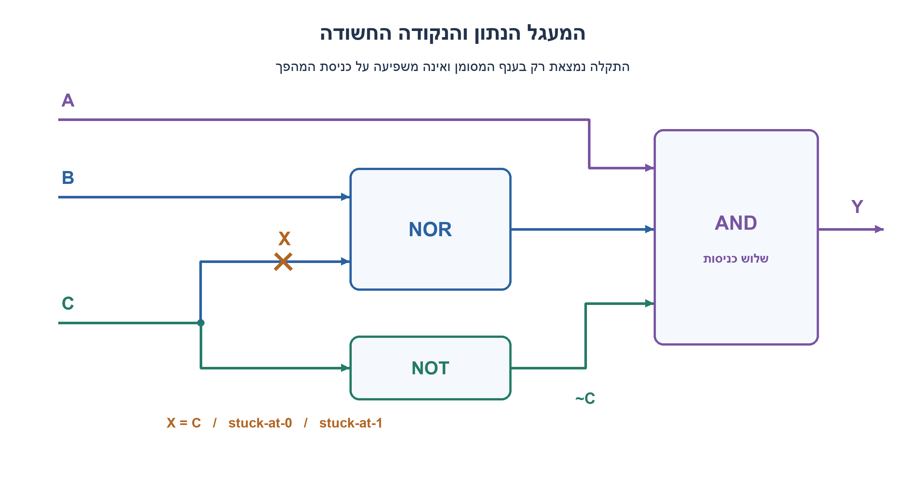
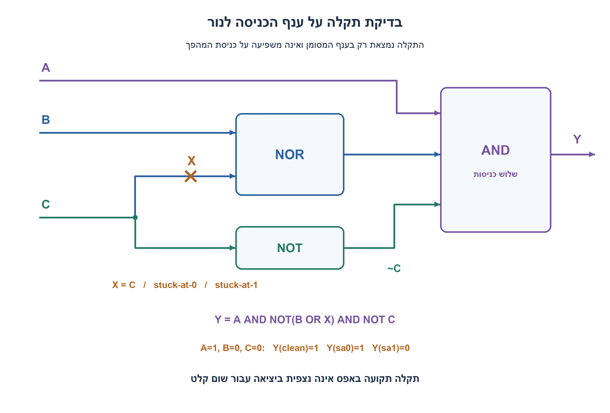
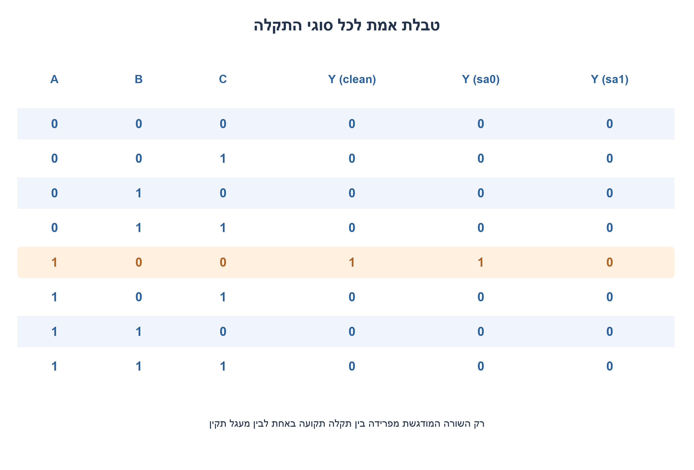
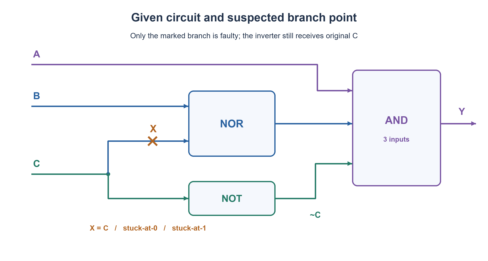
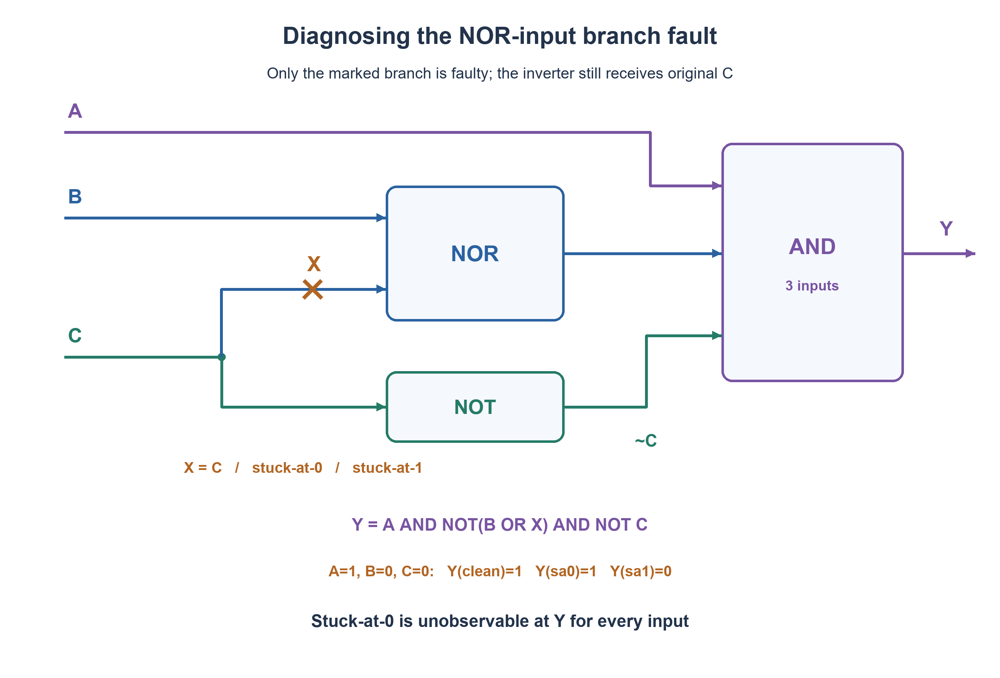
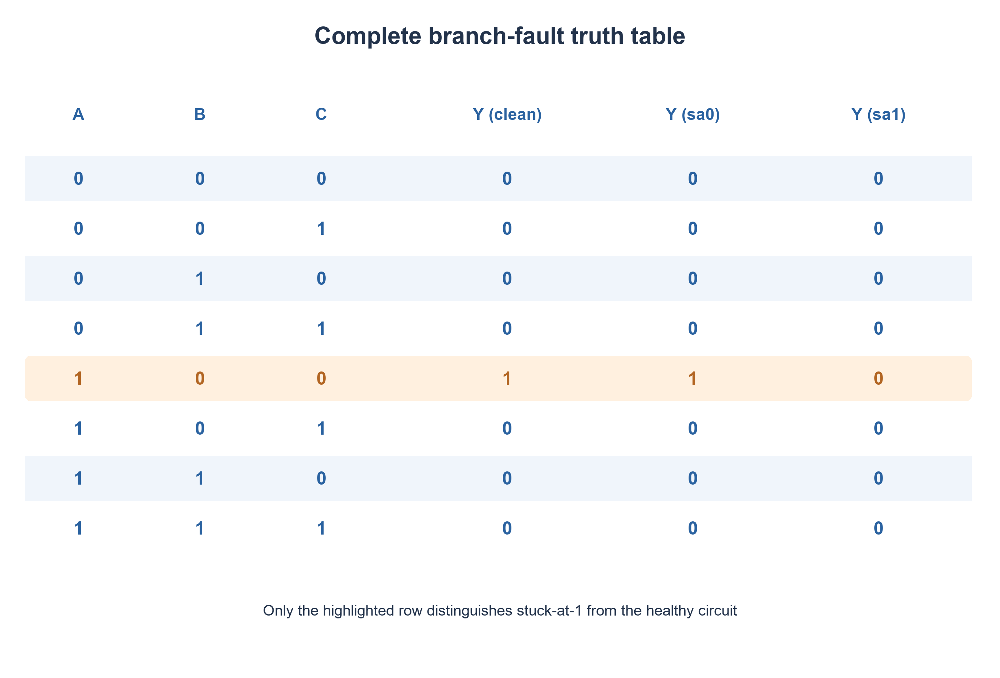

# PREP-069 — תקלה תקועה בענף NOR — מה אפשר לזהות?

## מקור שנמסר

נתון המעגל שבתמונה אשר בנקודה המסומנת X בכחול תיתכן תקלה. התקלות האפשריות הן שהנקודה תהיה מקוצרת ל־0 לוגי (stuck@0) או שהנקודה תהיה מקוצרת ל־1 לוגי (stuck@1). אילו קלטים נכניס למעגל בכדי לבדוק מה התקלה שקיימת בנקודה?

[צילום המקור הפנימי](../sources/prep-069.png)

סטטוס: פתרון מוצע בסיוע AI; בדיקה מקצועית אנושית ממתינה. השיוך לחברות הוא דיווח מהצילום בלבד.

## תקלה תקועה בענף NOR — מה אפשר לזהות?

במעגל הנתון A מגיע ישירות לשער AND בעל שלוש כניסות. B וענף של C נכנסים ל־NOR שמוצאו מגיע לכניסה השנייה של ה־AND. ענף נפרד של C עובר במהפך, ומוצא המהפך מגיע לכניסה השלישית של ה־AND. נקודת X נמצאת רק על ענף C שנכנס ל־NOR, אחרי הפיצול; ענף המהפך נשאר תקין.

ידוע שב־X קיימת אחת משתי תקלות: stuck-at-0 או stuck-at-1. אפשר לשלוט ב־A,B,C ולמדוד רק את Y במוצא. איזה וקטור בדיקה יאפשר להבחין בין שתי התקלות? הרחבה להבהרת מגבלת האבחון: אם גם מעגל תקין הוא אפשרות, האם ניתן להפריד בין כל שלושת המצבים? עבדו במודל בינארי צירופי ללא תזמון או תקלות נוספות.

### רמזים

1. כדי שהבדל בנקודה פנימית יגיע ליציאה, צריך גם ליצור את ההבדל וגם לא לחסום אותו בשער הבא.
2. לצורך הפצת שינוי דרך AND, שאר כניסותיו צריכות להיות 1. מה זה מחייב לגבי A ו־C?
3. אם C=0 ו־B=0, מוצא ה־NOR התקין הוא 1. בדקו מה קורה כאשר X=1. נסו גם ליצור הבדל לתקלה X=0 באמצעות C=1, ובדקו את ענף המהפך.




### הצעה לפתרון

### כותבים קודם את מיקום התקלה במדויק

נסמן x כערך שבאמת נכנס לכניסה התחתונה של ה־NOR. תקין: x=C; תקלה תקועה באפס: x=0; תקלה תקועה באחת: x=1. ענף המהפך עדיין מקבל את C המקורי. לכן:

```text
Y = A AND NOT(B OR x) AND NOT C
Y(clean) = A AND NOT B AND NOT C
Y(sa0)   = A AND NOT B AND NOT C
Y(sa1)   = 0
```

שימו לב לתוצאה: תקלה תקועה באפס אינה משנה את פונקציית המוצא כלל. זו אינה טעות בחישוב; במעגל קיימת יתירות מבחינת התקלה המסוימת הזאת.

### מזהים stuck-at-1

נרצה שבמעגל תקין x יהיה 0 כדי שתהיה הבחנה מ־x התקוע ב־1. לכן בוחרים C=0. כדי שה־NOR יגיב ל־x בוחרים B=0. כדי ש־AND לא יחסום בוחרים A=1; המהפך ממילא נותן 1 כי C=0. נקבל וקטור בדיקה יחיד:

```text
A=1, B=0, C=0
Y(clean)=1, Y(sa0)=1, Y(sa1)=0
```

אם יודעים בוודאות שיש אחת משתי התקלות, Y=0 מזהה sa1 ו־Y=1 מזהה sa0 בתהליך אלימינציה. אם גם מצב תקין אפשרי, Y=1 אינו מוכיח שיש תקלה באפס: הוא תואם גם מעגל תקין. זה ההבדל בין זיהוי תקלה לבין אבחון תחת הנחה שקיימת תקלה.

### מדוע אי אפשר לזהות stuck-at-0 מול תקין?

כדי שהערך התקוע x=0 יהיה שונה מהערך התקין צריך C=1. אבל אז ענף המהפך נותן NOT C=0, ו־AND מוציא 0 ללא תלות ב־NOR. אם C=0, x=0 זהה לערך התקין מלכתחילה. אלה כל האפשרויות ל־C, ולכן אין אף וקטור ב־A,B,C שמבדיל sa0 מתקין. מספר בלתי מוגבל של בדיקות באותה נקודת מדידה לא יעזור.

### כל טבלת האמת

| A | B | C | Y תקין | Y תקוע באפס | Y תקוע באחת |
| --- | --- | --- | --- | --- | --- |
| 0 | 0 | 0 | 0 | 0 | 0 |
| 0 | 0 | 1 | 0 | 0 | 0 |
| 0 | 1 | 0 | 0 | 0 | 0 |
| 0 | 1 | 1 | 0 | 0 | 0 |
| 1 | 0 | 0 | 1 | 1 | 0 |
| 1 | 0 | 1 | 0 | 0 | 0 |
| 1 | 1 | 0 | 0 | 0 | 0 |
| 1 | 1 | 1 | 0 | 0 | 0 |

הטבלה מוכיחה גם ש־100 הוא הווקטור היחיד שמזהה sa1 מול תקין במודל הזה. בדיקה אחת מספיקה להפריד בין שני סוגי התקלה כאשר ידוע שאחת קיימת; אפס בדיקות לא יכולות להפריד ביניהם. אין כאן פתרון לזיהוי כל שלושת המצבים, משום שתקין ו־sa0 שקולים ביציאה.

השרטוט שבשאלה הוא שרטוט נקי של הנתון בלבד. השרטוט בפתרון מוסיף משוואה ותוצאת בדיקה, וה־X נמצא אחרי נקודת הפיצול בענף NOR. אילו התקלה הייתה על הגזע לפני הפיצול, גם המהפך היה מקבל את הערך התקוע והבעיה הייתה אחרת. האימות עבר על כל 8 קלטי A,B,C ושלוש גרסאות המעגל, 24 חישובים. זו בדיקה בינארית מלאה; לא בוצעה הזרקת תקלות לחומרה או בדיקת תזמון. ביקורת מקצועית ממתינה.





### assumptions

[
  "תקלה יחידה בענף C אל NOR אחרי הפיצול; ענף המהפך תקין.",
  "שליטה רק ב־A,B,C ותצפית רק ב־Y; לוגיקה צירופית בינארית.",
  "מפרידים בין הנחת תקלה ודאית לבין אפשרות שהמעגל תקין."
]

### optimality

{
  "criterion": "מספר בדיקות להפרדה בין שתי תקלות ודאיות.",
  "result": "בדיקת 100 אחת מספיקה; אין בדיקה שמפרידה תקין מ־sa0.",
  "proof": "100 נותן 1 ב־sa0 ו־0 ב־sa1. שתי פונקציות תקין ו־sa0 זהות בכל התחום.",
  "scope": "בלי הנחת תקלה ודאית לא ניתן לאבחן את שלושת המצבים במוצא Y בלבד."
}

### verification

"כל שמונת הקלטים בשלוש גרסאות המעגל עברו, 24 חישובים. זוהה 100 כווקטור היחיד ל־sa1; לא נמצא הבדל יחיד בין sa0 לתקין, בהתאמה להוכחה האלגברית. אין בדיקת חומרה פיזית."

### edge_cases

[
  "A=0 או B=1 חוסמים כל תצפית שימושית.",
  "C=1 מפעיל את תקלה באפס אך גם חוסם את AND.",
  "Y=1 ב־100 אינו מפריד תקין מתקלה באפס.",
  "תקלה על C לפני הפיצול היא בעיה שונה."
]

### common_mistakes

[
  "להחליף את C גם בכניסת המהפך כשמזריקים תקלה לענף בלבד.",
  "להפעיל תקלה פנימית בלי לבדוק שהיא מגיעה למוצא.",
  "להבטיח זיהוי sa0 מתקין למרות יתירות לוגית.",
  "לבלבל אבחון בהנחת תקלה ודאית עם זיהוי עצם התקלה."
]

### interview_answer

"אכתוב Y=A·NOT(B OR x)·NOT C. ב־100 תקין ו־sa0 נותנים 1 ו־sa1 נותן 0. sa0 אינו ניתן לזיהוי מול תקין: כדי ליצור הבדל צריך C=1, ואז המהפך מאפס את AND. אם ידוע מראש שיש אחת משתי התקלות, אותה בדיקה יחידה מבדילה ביניהן."

### solution_extensions

{
  "question": "איך נוכל להפוך גם את sa0 לנצפית?",
  "direction": "אפשר להוסיף נקודת תצפית למוצא ה־NOR. שם C=1,B=0 ייתן 0 בתקין ו־1 ב־sa0, בלי חסימת ענף המהפך. זה משנה את נגישות הבדיקה, לא את תשובת המעגל המקורי.",
  "status": "מוכן בתוכן; לא מחובר לתור המשך חי."
}

## Stuck-at fault on a NOR branch — what is observable?

A feeds a three-input AND directly. B and one branch of C feed a NOR whose output is the second AND input. A separate C branch passes through an inverter into the third AND input. X lies only on the C-to-NOR branch after fanout; the inverter branch remains healthy.

Exactly one fault is known to exist at X: stuck-at-0 or stuck-at-1. You may control A,B,C and observe Y only. Which test vector distinguishes the two faults? Diagnostic-limit extension: if a healthy circuit is also possible, can all three states be distinguished? Use an ideal combinational binary model with no delays or other faults.

### Hints

1. An internal fault must first create a difference and then propagate it through the remaining gates.
2. To propagate through AND, its other inputs must be one. What does that require for A and C?
3. With C=0 and B=0 the healthy NOR outputs one. Check X=1. To activate X stuck at zero, try C=1 and examine the inverter branch.




### Proposed solution

### Model the fault location exactly

Let x be the actual NOR branch input. Healthy x=C; stuck-at-0 x=0; stuck-at-1 x=1. The inverter still receives original C. Therefore:

```text
Y = A AND NOT(B OR x) AND NOT C
Y(clean) = A AND NOT B AND NOT C
Y(sa0)   = A AND NOT B AND NOT C
Y(sa1)   = 0
```

Stuck-at-0 does not alter the output function. This is real redundancy for this fault, not a calculation error.

### Detect stuck-at-1

To differ from x stuck at one, choose healthy x=0, hence C=0. Set B=0 so the NOR responds to x. Set A=1 so AND does not block propagation; the inverter also outputs one because C=0. The test is:

```text
A=1, B=0, C=0
Y(clean)=1, Y(sa0)=1, Y(sa1)=0
```

If exactly one of the two faults is known to exist, Y=0 identifies sa1 and Y=1 identifies sa0 by elimination. If healthy operation is possible, Y=1 cannot prove a stuck-at-zero fault because a healthy circuit gives the same result. This separates detection from diagnosis under a prior fault guarantee.

### Why no test distinguishes sa0 from healthy

Activating a difference between x stuck at zero and healthy x requires C=1. Then the healthy inverter produces NOT C=0, forcing the final AND to zero regardless of the NOR result. At C=0, x=0 already equals the healthy value. These exhaust C, so no A,B,C vector distinguishes sa0 from healthy. Unlimited repetitions at the same output cannot help.

### Complete truth table

| A | B | C | Healthy Y | Stuck-at-0 Y | Stuck-at-1 Y |
| --- | --- | --- | --- | --- | --- |
| 0 | 0 | 0 | 0 | 0 | 0 |
| 0 | 0 | 1 | 0 | 0 | 0 |
| 0 | 1 | 0 | 0 | 0 | 0 |
| 0 | 1 | 1 | 0 | 0 | 0 |
| 1 | 0 | 0 | 1 | 1 | 0 |
| 1 | 0 | 1 | 0 | 0 | 0 |
| 1 | 1 | 0 | 0 | 0 | 0 |
| 1 | 1 | 1 | 0 | 0 | 0 |

The table also proves that 100 is the only vector detecting sa1 versus healthy in this model. One test suffices to distinguish the two fault types if exactly one is guaranteed present; zero observations cannot separate them. Distinguishing all three states is impossible because healthy and sa0 are output-equivalent.

The question uses a clean data-only schematic; the solution schematic adds equations and a test result. X remains after fanout on the NOR branch. A stem fault before fanout would also alter the inverter and create a different problem. All eight input combinations and three circuit versions were checked, totaling twenty-four evaluations. This is exhaustive binary-model verification, not hardware fault injection or timing testing. Independent professional review is pending.





### assumptions

[
  "Single C-to-NOR branch fault after fanout; inverter branch healthy.",
  "Control A,B,C, observe Y only; ideal binary combinational logic.",
  "Guaranteed-fault diagnosis is distinguished from a possible healthy circuit."
]

### optimality

{
  "criterion": "Tests separating the two guaranteed fault hypotheses.",
  "result": "One test, 100, suffices; no test separates healthy from sa0.",
  "proof": "100 gives one for sa0 and zero for sa1. Healthy and sa0 functions are identical over the full domain.",
  "scope": "Without the guaranteed-fault assumption, three-way diagnosis from Y alone is impossible."
}

### verification

"All eight inputs across three circuit versions passed, twenty-four evaluations. 100 is the only sa1-detecting vector; healthy and sa0 agree everywhere, matching the algebraic proof. No physical hardware checks."

### edge_cases

[
  "A=0 or B=1 blocks useful propagation.",
  "C=1 activates sa0 but also blocks the AND.",
  "Y=1 at 100 cannot distinguish healthy from sa0.",
  "A C-stem fault before fanout is a different problem."
]

### common_mistakes

[
  "Changing the inverter input when injecting only a branch fault.",
  "Activating a fault without checking output propagation.",
  "Promising sa0 detection despite functional redundancy.",
  "Confusing guaranteed-fault diagnosis with detecting whether a fault exists."
]

### interview_answer

"Write Y=A·NOT(B OR x)·NOT C. At 100, healthy and sa0 give one, while sa1 gives zero. sa0 cannot be detected versus healthy: activating it requires C=1, whose inverter output blocks AND. If one of the two faults is guaranteed, that one test distinguishes them."

### solution_extensions

{
  "question": "How could sa0 become observable too?",
  "direction": "Add an observation point at the NOR output. With C=1,B=0 it is zero when healthy and one under sa0, without inverter-path masking. This changes test access, not the original circuit answer.",
  "status": "Prepared in content, not connected to the live follow-up queue."
}

## Files

- [Code](../solutions/prep_069_branch_fault.py)
- [Verification](../checks/check_prep_069.py)
- [Evidence](../checks/prep-069-verification.json)
