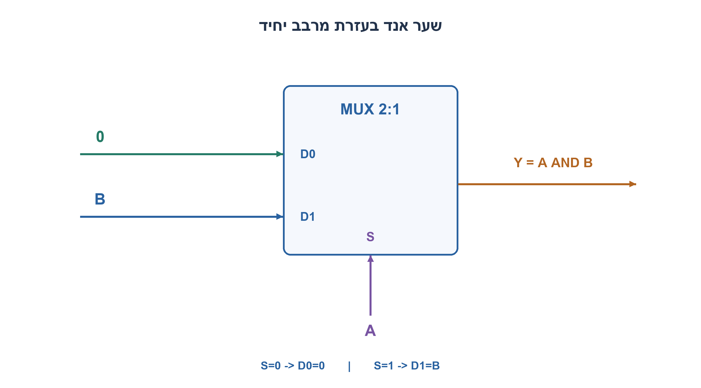
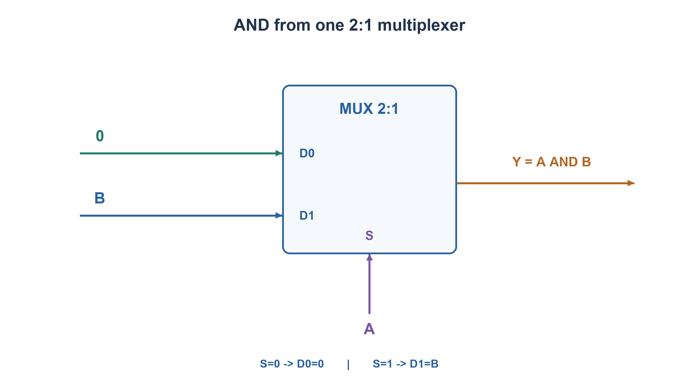

# PREP-070 — מימוש שער AND באמצעות MUX 2:1 יחיד

## מקור שנמסר

ממש שער AND מ MUX2:1

[צילום המקור הפנימי](../sources/prep-070.png)

סטטוס: פתרון מוצע בסיוע AI; בדיקה מקצועית אנושית ממתינה. השיוך לחברות הוא דיווח מהצילום בלבד.

## מימוש שער AND באמצעות MUX 2:1 יחיד

ממשו Y=A AND B בעזרת מרבב MUX 2:1 יחיד. ציינו את חיבורי D0,D1,S ושרטטו את המעגל.

הבהרות: הכניסות בינאריות, המרבב בוחר D0 כאשר S=0 ו־D1 כאשר S=1. מותר לחבר קבוע לוגי 0 וחוטים, אך אין להשתמש בשער לוגי נוסף. זהו מעגל צירופי ללא שעון.

### רמזים

1. בחרו אחת הכניסות כבוררת ובדקו מה הפלט צריך להיות בכל אחד משני ערכיה.
2. כאשר A=0 הפלט תמיד 0; כאשר A=1 הפלט שווה ל־B.
3. חברו A לבחירה S. קבעו איזה אות צריך להופיע ב־D0 ואיזה ב־D1 לפי שתי השורות האלה.

### הצעה לפתרון

### חושבים לפי הבחירה של המרבב

מרבב אינו דורש ששתי כניסות הנתונים יהיו קבועות. אפשר לחבר אחת מהן לאות B. נבחר את A כבורר:

```text
S  = A
D0 = 0
D1 = B
Y  = MUX(S,D0,D1)
```

בשרטוט החץ של A נכנס ל־S בתחתית. הקבוע 0 נכנס ל־D0 העליון, ו־B נכנס ל־D1 התחתון. המספרים 0 ו־1 הם מספרי פורטי הנתונים הנבחרים לפי S; אין הכוונה לחבר קבוע 1 ל־D1.

### למה החיבור הזה עובד?

כאשר A=0 המרבב בוחר D0=0, בדיוק כמו AND עם אחת הכניסות אפס. כאשר A=1 הוא בוחר D1=B, בדיוק כמו AND עם כניסה אחת 1. בנוסחת המרבב:

```text
Y = (NOT S AND D0) OR (S AND D1)
  = (NOT A AND 0) OR (A AND B)
  = A AND B
```

| A | B | פורט נבחר | Y |
| --- | --- | --- | --- |
| 0 | 0 | D0 | 0 |
| 0 | 1 | D0 | 0 |
| 1 | 0 | D1 | 0 |
| 1 | 1 | D1 | 1 |

גם החיבור הסימטרי S=B,D0=0,D1=A תקף. אין צורך במהפך, דלגלג או שעון. מספר הרכיבים הוא MUX אחד וקבוע אפס. תחת מודל שמותר בו רק חוטים וקבועים בלי שום רכיב פונקציונלי, אי אפשר להפיק AND באמצעות אפס מרבבים: חוט יחיד נותן A,B או קבוע, ואף אחד מהם אינו פונקציית AND לכל הקלטים. לכן אחד הוא המינימום במודל הזה; אין בכך הוכחה לשטח מינימלי בספריית תאים אחרת.

נבדקו כל 8 שורות פונקציית המרבב, 4 שורות AND ו־4 שורות החיבור הסימטרי. אלה בדיקות לוגיות מלאות של המודל, ללא סינתזה או מדידת השהיה. הפתרון מוצע וממתין לביקורת מקצועית.



### assumptions

[
  "מרבב אידאלי בוחר D0 ב־S=0 ו־D1 ב־S=1.",
  "קבוע אפס וחוטים מותרים; אין שער נוסף או שעון."
]

### optimality

{
  "criterion": "מספר מרבבים כשמותר רק חיווט וקבועים לצדם.",
  "result": "מרבב אחד נחוץ ומספיק.",
  "proof": "בלי רכיב פונקציונלי אפשר לקבל רק כניסה או קבוע, ולא AND; המימוש משתמש באחד.",
  "scope": "אין טענת שטח או השהיה מינימליים בספריית שערים כללית."
}

### verification

"עברו כל 8 שורות המרבב, כל 4 שורות AND ו־4 שורות המימוש הסימטרי בפייתון. לא בוצעה סינתזה או בדיקת חומרה."

### edge_cases

[
  "A=0 קובע אפס בלי תלות ב־B.",
  "A=1 מעביר B, כולל B=0.",
  "אם ספריית הרכיבים משתמשת במוסכמת בחירה הפוכה יש להתאים את שמות הפורטים.",
  "החלפת D0,D1 בלי להחליף תנאי בחירה נותנת פונקציה אחרת."
]

### common_mistakes

[
  "לחבר D1 לקבוע 1 במקום ל־B, וכך להחזיר רק A.",
  "להחליף בין פורט הבחירה לפורט נתונים.",
  "להוסיף שער AND וכך לעקוף את השאלה.",
  "לצייר חוטים ללא מספרי הפורטים ולכן לא להגדיר מה נבחר."
]

### interview_answer

"אבחר A כ־S, אחבר D0=0 ו־D1=B. כאשר A=0 נקבל 0 וכאשר A=1 נקבל B, ולכן בדיוק A AND B. מספיק מרבב אחד, ללא שעון או שער נוסף."

### solution_extensions

{
  "question": "כיצד תממשו OR בעזרת אותו סוג מרבב יחיד?",
  "direction": "בחרו S=A,D0=B,D1=1: כאשר A=0 צריך B וכאשר A=1 צריך תמיד 1. נדרש קבוע 1 מותר בגרסת ההמשך.",
  "status": "מוכן בתוכן; לא מחובר לתור המשך חי."
}

## Implement AND with one 2:1 MUX

Implement Y=A AND B with one 2:1 multiplexer. Specify D0,D1,S and draw the circuit.

Clarifications: binary signals; the MUX chooses D0 for S=0 and D1 for S=1. Constant logic zero and wires are allowed, but no additional logic gate. This is combinational, with no clock.

### Hints

1. Choose one input as select and ask what the output must be for each select value.
2. When A=0 the output is always zero; when A=1 it equals B.
3. Wire A to S. Choose D0 and D1 from those two cases.

### Proposed solution

### Reason by the select cases

MUX data inputs need not both be constants: one can carry B. Choose A as select:

```text
S  = A
D0 = 0
D1 = B
Y  = MUX(S,D0,D1)
```

In the diagram A enters the bottom S port. Constant zero enters upper D0 and B enters lower D1. The digits in D0/D1 identify selected data ports; D1 is not tied to constant one.

### Why it works

At A=0 the MUX selects constant zero, matching AND with one zero input. At A=1 it selects B, matching AND with one input held high. Algebraically:

```text
Y = (NOT S AND D0) OR (S AND D1)
  = (NOT A AND 0) OR (A AND B)
  = A AND B
```

| A | B | Selected port | Y |
| --- | --- | --- | --- |
| 0 | 0 | D0 | 0 |
| 0 | 1 | D0 | 0 |
| 1 | 0 | D1 | 0 |
| 1 | 1 | D1 | 1 |

The symmetric S=B,D0=0,D1=A also works. No inverter, storage or clock is needed: one MUX and a zero constant suffice. With only wires and constants and no functional component, zero MUXes can output only A,B or a constant, none equal to AND on every input. Therefore one is minimal in this restricted component model, not a minimum physical-area result for other cell libraries.

Checks covered all eight MUX rows, four AND rows and four symmetric-wiring rows. These are exhaustive logical-model checks, not synthesis or propagation-delay measurements. Independent professional review is pending.



### assumptions

[
  "Ideal MUX chooses D0 at S=0 and D1 at S=1.",
  "Zero constant and wires allowed; no additional gate or clock."
]

### optimality

{
  "criterion": "MUX count with only wires and constants otherwise.",
  "result": "One MUX is necessary and sufficient.",
  "proof": "With no functional component only a primary input or constant is possible, not AND; construction uses one.",
  "scope": "No minimum physical area/delay claim for a general cell library."
}

### verification

"Passed all eight MUX rows, four AND rows and four symmetric-implementation rows in Python. No synthesis or hardware tests."

### edge_cases

[
  "A=0 forces zero independently of B.",
  "A=1 forwards B, including B=0.",
  "A library with reversed select convention needs corresponding port mapping.",
  "Swapping D0 and D1 without changing selection gives a different function."
]

### common_mistakes

[
  "Tying D1 high instead of B, which outputs only A.",
  "Confusing select and data ports.",
  "Adding an AND gate and bypassing the constraint.",
  "Omitting port numbers so select behavior remains ambiguous."
]

### interview_answer

"Use S=A,D0=0,D1=B. Select zero returns zero; select one returns B, exactly A AND B. One MUX suffices with no clock or extra gate."

### solution_extensions

{
  "question": "How would you implement OR with one such MUX?",
  "direction": "Use S=A,D0=B,D1=1: when A=0 return B; when A=1 return one. This follow-up explicitly permits a high constant.",
  "status": "Prepared in content, not connected to the live follow-up queue."
}

## Files

- [Code](../solutions/prep_070_and_mux.py)
- [Verification](../checks/check_prep_070.py)
- [Evidence](../checks/prep-070-verification.json)
