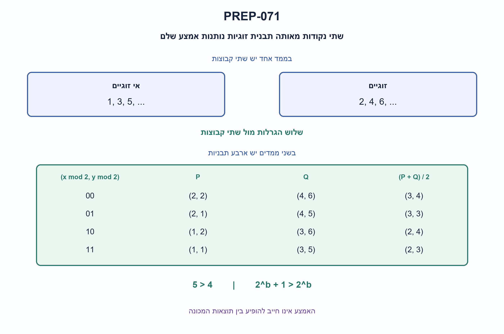
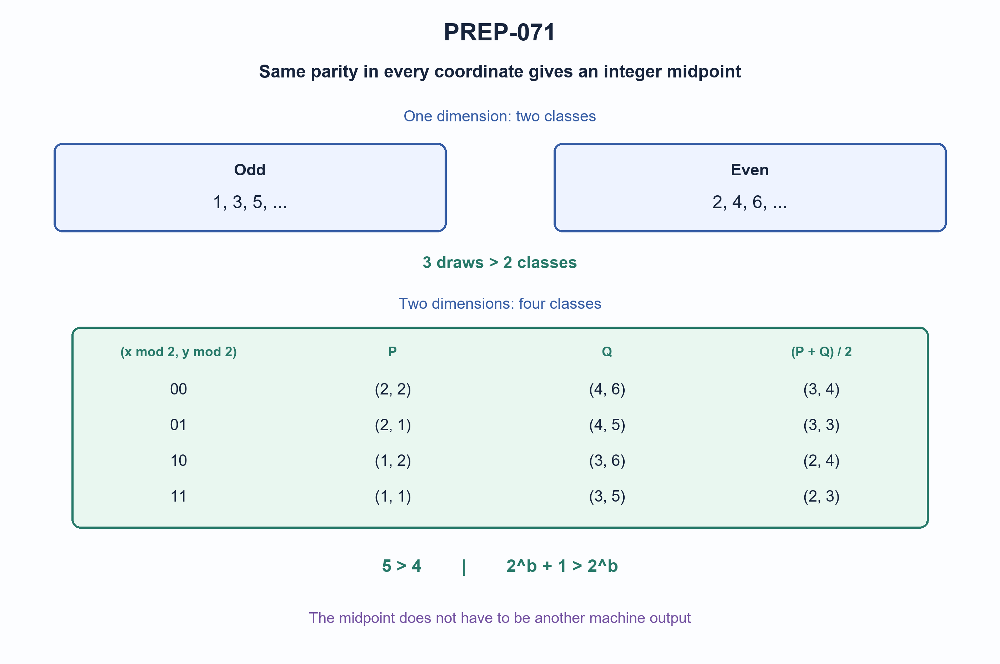

# PREP-071 — זוג בעל אמצע שלם — מספרים ווקטורים

Status: in review; AI-assisted proposed solution; difficulty uncalibrated. Human professional/parity/reuse review pending. No learner activity recorded.

## Preserved source

קבוצת אמצע מוגדרת כך: שני מספרים חיוביים ושלמים אשר קיים עבורם מספר שלם שהוא האמצע שלהם. לדוגמא (1,3) זו קבוצת אמצע, (2,10) זו קבוצת אמצע.
קיימת לך מכונה המוציאה באופן רנדומלי מספרים שלמים חיוביים השונים זה מזה. בכל איטרציה יוצא מספר בודד. מהו מספר האיטרציות המינימאלי הדרוש על מנת לקבל בוודאות שני מספרים המרכיבים קבוצת אמצע.
כעת המכונה מוציאה וקטור בשני מימדים, תוך כמה איטרציות נקבל בוודאות שני וקטורים אשר יגדירו קבוצת אמצע.
כעת המכונה מוציאה וקטור ב־b מימדים תוך כמה איטרציות נקבל בוודאות שני וקטורים אשר יגדירו קבוצת אמצע.

[Source image](../sources/prep-071.png)

Companies reported only by supplied source: Intel.

## he: זוג בעל אמצע שלם — מספרים ווקטורים

מכונה מוציאה בכל איטרציה מספר שלם חיובי חדש השונה מקודמיו. זוג הוא קבוצת אמצע אם הממוצע שלו שלם, למשל (1,3) ו־(2,10). מהו מספר האיטרציות המינימלי שמבטיח זוג לכל סדר תוצאות? הוכיחו גם שמספר קטן יותר אינו מבטיח זאת.

הכלילו לשני ממדים ואחר כך ל־b ממדים: כל פלט הוא וקטור חדש של קואורדינטות שלמות חיוביות, ומחפשים זוג וקטורים שונים שהממוצע שלהם שלם בכל קואורדינטה. b שלם חיובי. הווקטורים שונים, אך קואורדינטות בודדות רשאיות לחזור. האמצע אינו חייב להופיע בפלט. הבהרות הווקטורים והאמצע נוספו בעריכה להסרת עמימות.

### Three progressive hints

1. התעלמו מהגודל המדויק: איזו תכונה קובעת אם סכום שני שלמים מתחלק בשתיים?
2. שני מספרים בעלי אותה זוגיות נותנים ממוצע שלם. בווקטורים התנאי צריך להתקיים בכל קואורדינטה.
3. קבצו וקטורים לפי שאריות הקואורדינטות בחלוקה לשתיים. כמה תבניות קיימות? למינימום, נסו נציג אחד מכל תבנית.

### Proposed solution

**פתרון מוצע — התשובות הן 3 בממד אחד, 5 בשני ממדים ו־2^b+1 בממד b.**

### ממד אחד: שתי קבוצות זוגיות

לשני שלמים x,y יש אמצע שלם בדיוק כאשר x+y זוגי, כלומר שניהם זוגיים או שניהם אי־זוגיים. יש רק שתי קבוצות. אחרי שלושה מספרים שונים, לפחות שניים באותה קבוצה, לפי עקרון שובך היונים. למשל 1,2,5 מכיל את הזוג 1,5 שאמצעו 3; אין צורך שה־3 עצמו יהיה פלט של המכונה.

שלוש הוא המינימום המבטיח, כי 1,2 הם שתי תוצאות ללא אמצע שלם. לפעמים מספיקות שתי תוצאות, כמו 1,3; מבקשים הבטחה לכל סדר, לא מתי הזוג מופיע בריצה מסוימת.

### שני ממדים: ארבע תבניות

אמצע של (x1,y1),(x2,y2) הוא ((x1+x2)/2,(y1+y2)/2). הוא שלם בדיוק כאשר זוגיות ה־x תואמת וגם זוגיות ה־y תואמת. ארבע התבניות הן 00,01,10,11, כאשר 0 פירושו זוגי ו־1 אי־זוגי. חמש נקודות שונות מכריחות שתי נקודות באותה תבנית, למשל (1,1),(3,5) שאמצען (2,3).

ארבע אינן מספיקות: (1,1),(1,2),(2,1),(2,2) משתמשות בכל תבנית פעם אחת. בכל זוג יש קואורדינטה אחת של 1 מול 2, שהממוצע שלה 1.5. לכן חמש הוא מינימום ההבטחה.

### b ממדים: הוכחת הגבול הכללי

לכל קואורדינטה שתי אפשרויות זוגיות, ולכן יש 2^b תבניות. אחרי 2^b+1 תוצאות יש חזרה על תבנית, וכל סכום קואורדינטות בזוג זה זוגי. ממוצע הזוג שלם בכל הממדים יחד.

למינימום, קחו את כל הווקטורים שקואורדינטותיהם הן 1 או 2. יש בדיוק 2^b וקטורים חיוביים שונים, נציג לכל תבנית. כל שניים נבדלים בקואורדינטה אחת לפחות, ובה הממוצע הוא 1.5. זו דוגמה של 2^b תוצאות ללא זוג תקף, ולכן הגבול הדוק.

| ממד | תבניות זוגיות | הגרלות להבטחה |
| --- | --- | --- |
| 1 | 2 | 3 |
| 2 | 4 | 5 |
| b | 2^b | 2^b+1 |

### מוצאים את הזוג, ולא רק סופרים

שומרים במפה את הווקטור הראשון מכל תבנית. לכל תוצאה חדשה מחשבים את שאריות הקואורדינטות בחלוקה לשתיים. אם התבנית קיימת, מחזירים את הנציג, את החדשה ואת אמצען; אחרת שומרים נציג. אין צורך לחשב מרחקים או לבדוק את כל הזוגות. הקוד משתמש ב־tuple גם בממד אחד, למשל (5,).

ל־n תוצאות נדרשות O(nb) פעולות אריתמטיות וזמן צפוי במפת גיבוב, ועד O(b·2^b) ערכי קואורדינטות בזיכרון במודל מילים. זה אינו חסם זמן גרוע־ביותר לגיבוב או ניתוח ביטים למספרים בלתי חסומים. הוכחת מספר ההגרלות אינה תלויה במימוש המפה.

### הנחות שמונעות בלבול

הווקטורים עצמם שונים; קואורדינטות רשאיות לחזור בין נקודות. b שלם חיובי. האמצע אינו חייב להיות פלט. אם דורשים שגם האמצע יופיע, זו שאלה שונה: אפשר להוציא חזקות שונות של שלוש ללא שלוש תוצאות שהאחת ממוצע האחרות. לכן אין אז חסם סופי ללא הגבלת תחום.

אם מתירים חזרות אך דורשים שני ערכים שונים, אין חסם סופי: ערך אחד יכול לחזור לנצח. אם שתי הופעות זהות נחשבות זוג, הן כבר נותנות אמצע שלם. המילה ״רנדומלי״ אינה נדרשת להוכחה: היא מכסה כל סדר אפשרי ואינה מחשבת תוחלת.

האימות השווה למודל זוגות עצמאי בחשבון שברים מדויק: 157 רצפים סקלריים באורכים 0–3 מתוך 1–6, 6,885 תתי־קבוצות בגדלים 0–5 מתוך סריג 4×4, ודוגמאות מינימום בממדים 1–6. בדיקה סופית לצד הוכחה כללית, ללא סקירה מקצועית אנושית. ההצעה בסיוע AI.



### assumptions

```json
[
  "שלמים חיוביים שונים; בגרסה הכללית הווקטורים שונים, לא בהכרח כל ערך קואורדינטה.",
  "b שלם חיובי. האמצע של הזוג שלם בכל קואורדינטה ואינו חייב להופיע בפלט.",
  "נדרשת הבטחה לכל סדר תוצאות, ללא תלות בהתפלגות."
]
```

### optimality

```json
{
  "criterion": "מספר הגרלות להבטחה גרועה־ביותר.",
  "result": "3,5,2^b+1 בממדים 1,2,b.",
  "proof": "יש 2^b תבניות זוגיות; עוד וקטור מכריח חזרה. כל וקטורי {1,2}^b הם דוגמה ללא זוג.",
  "scope": "מינימום להבטחת זוג בלבד, לא תוחלת ולא חסם מימוש זמן או זיכרון."
}
```

### verification

```json
"עברו 157 רצפים סקלריים, 6,885 תתי־קבוצות של סריג 4×4, דוגמאות מינימום בממדים 1–6 וחמש דחיות קלט. אורקל עצמאי בחשבון Fraction. מודל פייתון סופי לצד הוכחה כללית; ביקורת מקצועית ממתינה."
```

### edge_cases

```json
[
  "שתי תוצאות עשויות להספיק בריצה מסוימת.",
  "b=1 נותן 3. נקודות שונות רשאיות לחלוק קואורדינטה.",
  "האמצע אינו חייב להיות פלט. חזרות על אותו וקטור משנות את המודל."
]
```

### common_mistakes

```json
[
  "בדיקת זוגיות רק בקואורדינטה אחת.",
  "ספירת 2b במקום 2^b קבוצות.",
  "חסם עליון ללא דוגמת מינימום.",
  "בלבול בין אמצע שלם לבין אמצע שמופיע בפלט, או בין הבטחה לתוחלת."
]
```

### interview_answer

```json
"הממוצע של שני שלמים שלם בדיוק כשזוגיותם שווה. בווקטורים זה נדרש בכל קואורדינטה. יש 2^b תבניות, ולכן 2^b+1 מכריח זוג. וקטורי {1,2}^b מוכיחים מינימום. התשובות 3,5,2^b+1."
```

### solution_extensions

```json
{
  "question": "מה אם דורשים שגם האמצע יופיע בתוצאות?",
  "direction": "זוהי דרישה אחרת. רצף חזקות שונות של שלוש אינו כולל שלשה שהאחת אמצע האחרות, לכן ללא חסימת תחום אין הבטחה סופית.",
  "status": "מוכן בארכיון; אינו מחובר לתור האינטראקטיבי."
}
```

## en: Integer-midpoint pairs — numbers and vectors

Each iteration outputs a new positive integer, distinct from previous outputs. A pair is a midpoint pair if its average is integral, such as (1,3) or (2,10). What is the minimum number of draws guaranteeing a pair for every output order? Prove minimality too.

Generalize to two dimensions and then b dimensions: outputs are distinct vectors of positive integer coordinates, and seek two whose average is integral in every coordinate. Here b is a positive integer. Whole vectors are distinct, but coordinate values may repeat. The midpoint need not itself be output. Vector/midpoint clarifications were added to resolve source ambiguity.

### Three progressive hints

1. Ignore magnitudes: what property decides whether the sum of two integers is divisible by two?
2. Two integers of the same parity have an integer average. For vectors this must hold in every coordinate.
3. Group vectors by coordinate remainders modulo two. How many signatures exist? For minimality, try one representative per signature.

### Proposed solution

**Proposed solution — the guarantees are three in one dimension, five in two dimensions and 2^b+1 in dimension b.**

### One dimension: two parity classes

Integers x,y have an integer midpoint exactly when x+y is even: both even or both odd. There are two classes. Three distinct outputs force two into one class by the pigeonhole principle. For example, 1,2,5 contains pair 1,5 with midpoint three. The midpoint need not itself be generated.

Three is minimal for a guarantee: outputs 1,2 do not form a valid pair. Some runs succeed after two, such as 1,3; the question asks for all orders, not the first success time of one run.

### Two dimensions: four signatures

The midpoint of (x1,y1),(x2,y2) is ((x1+x2)/2,(y1+y2)/2). It is integral exactly when the x parities match AND the y parities match. Signatures are 00,01,10,11, with zero meaning even and one odd. Five distinct points force a repeated signature. For example, (1,1),(3,5) have midpoint (2,3).

Four do not suffice: (1,1),(1,2),(2,1),(2,2) use one of each signature. Every pair differs in a coordinate with one versus two, whose average is 1.5. Thus five is the minimum guarantee.

### b dimensions: proving the general bound

Every coordinate has two parity choices, so there are 2^b signatures. Among 2^b+1 outputs two have the same signature. Every corresponding coordinate sum is even, giving an integer midpoint vector.

For minimality, use all vectors whose coordinates are one or two. There are exactly 2^b distinct positive vectors, one representative per signature. Every two differ in a coordinate containing one versus two, whose average is 1.5. This is a set of 2^b outputs with no valid pair. The bound is therefore tight.

| Dimension | Parity signatures | Draws for a guarantee |
| --- | --- | --- |
| 1 | 2 | 3 |
| 2 | 4 | 5 |
| b | 2^b | 2^b+1 |

### Finding the pair

Store the first vector for every observed signature in a map. For a new vector compute coordinate remainders modulo two. If its signature exists, return the stored vector, new vector and their midpoint; otherwise save the first representative. No distance calculations or pair enumeration are needed. Code uses tuples even in one dimension, such as (5,).

For n draws this takes O(nb) arithmetic operations and expected hash-map time, and at most O(b·2^b) stored coordinate values in a word model. This is not a worst-case hashing guarantee or bit-complexity bound for unbounded integers. The draw-count proof does not depend on the map implementation.

### Contract clarifications

Whole vectors are distinct, but coordinates may repeat between points. Dimension b is a positive integer. The midpoint need not be an output. Requiring it to be generated changes the problem: distinct powers of three can be generated without any three-term arithmetic progression, so there is no finite guarantee without a bounded domain.

If repetitions are allowed but a pair needs different values, there is no finite bound: one value can repeat forever. If identical occurrences count, such a repetition already gives an integer midpoint. Randomness is not needed by the proof: it handles every order and does not compute an expectation.

Independent exact-Fraction pair checks covered 157 scalar streams of lengths zero through three from 1..6, 6,885 subsets of sizes zero through five of a positive 4x4 lattice, and tight lower-bound witnesses in dimensions one through six. These are finite model checks accompanying the general proof, not human professional review. AI-assisted proposal.



### assumptions

```json
[
  "Distinct positive integers; generalized whole vectors are distinct, not necessarily coordinatewise.",
  "b is a positive integer. A pair must have an integral coordinatewise average; that midpoint need not be generated.",
  "The guarantee covers every output order independently of a random distribution."
]
```

### optimality

```json
{
  "criterion": "Worst-case number of draws guaranteeing a pair.",
  "result": "3,5,2^b+1 in dimensions 1,2,b.",
  "proof": "There are 2^b parity signatures; one more draw repeats one. All vectors in {1,2}^b form a matching no-pair witness.",
  "scope": "Minimum guaranteed draws, not expected waiting time or an implementation time/space lower bound."
}
```

### verification

```json
"Passed 157 scalar streams, 6,885 subsets of a 4x4 lattice, tight witnesses in dimensions 1..6 and five invalid-input rejections. Independent Fraction oracle. Finite Python checks accompany a general proof; professional review pending."
```

### edge_cases

```json
[
  "Two draws can suffice in a favorable run.",
  "b=1 gives three. Distinct points may share coordinates.",
  "The midpoint need not be output. Repeated vectors change the contract."
]
```

### common_mistakes

```json
[
  "Matching parity in only one coordinate.",
  "Counting 2b classes instead of 2^b.",
  "An upper bound without a tightness witness.",
  "Confusing an integral midpoint with a generated midpoint, or a guarantee with an expectation."
]
```

### interview_answer

```json
"An integer average requires matching parity in every coordinate. There are 2^b signatures, so 2^b+1 draws force a pair. Vectors {1,2}^b show minimality. The answers are 3,5,2^b+1."
```

### solution_extensions

```json
{
  "question": "What if the midpoint must also appear among the outputs?",
  "direction": "This is a different contract. Distinct powers of three contain no three-term arithmetic progression, so without a bounded domain there is no finite guarantee.",
  "status": "Prepared in the archive; not connected to the interactive follow-up queue."
}
```

## Permanent code and checks

[Python implementation](../solutions/prep_071_integer_midpoint.py)
[Independent checker](../checks/check_prep_071.py)
[Verification evidence](../checks/prep-071-verification.json)
