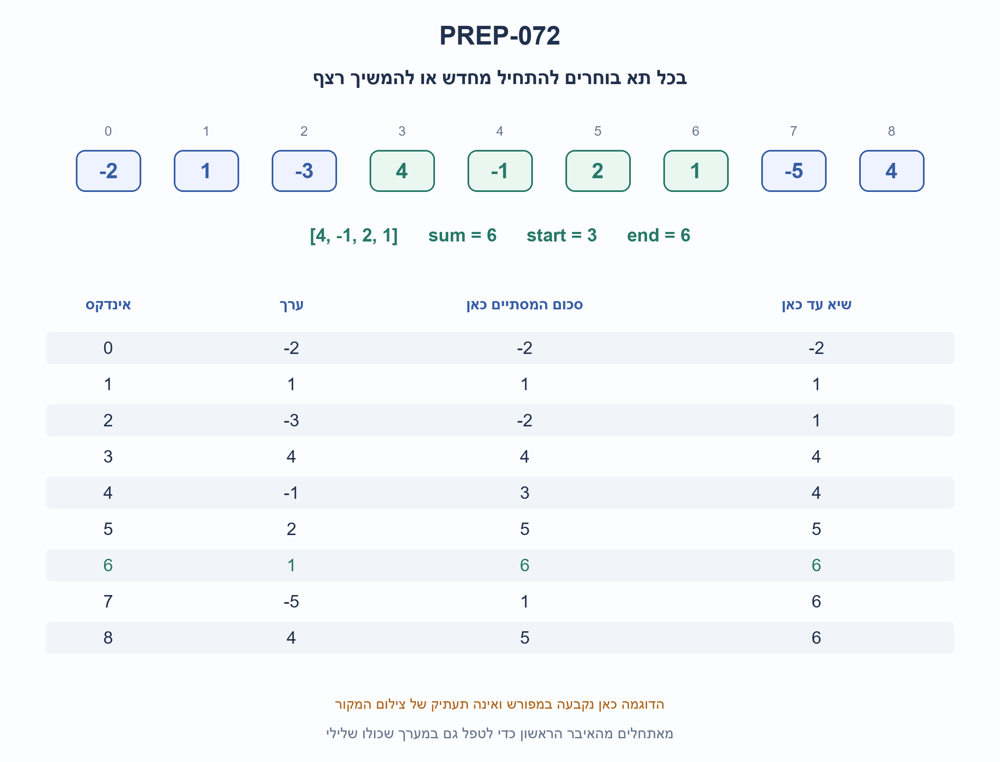
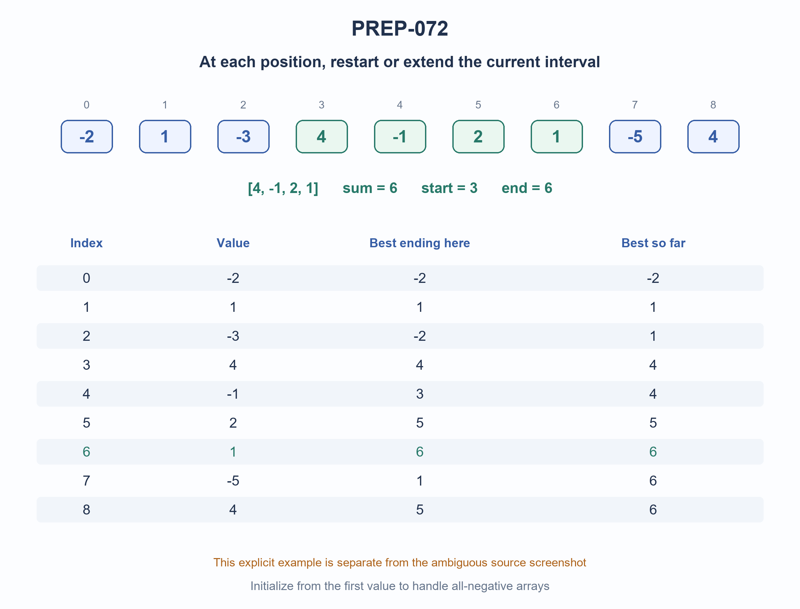

# PREP-072 — תת־המערך הרציף בעל הסכום המרבי / Maximum-sum contiguous subarray

מקור שנמסר ב־21.10.2026. פתרון מוצע בסיוע AI; סקירה מקצועית, תרגום וזכויות שימוש ממתינים.

Source supplied 2026-10-21. AI-assisted proposed solution; professional, translation and reuse reviews pending.

[צילום המקור / Original screenshot](../sources/prep-072.png)

## הנוסח המקורי / Original text

יש מערך של מספרים חיוביים ושליליים, שלמים. כתוב פונ׳ שתחזיר את הרצף מספרים שסכומם הגבוה ביותר. לדוגמא עם המערך [1,4-,2-,5,1,0,5-,4,1,3-,3-] הפונ׳ תחזיר 7 כי 7=(1-)+(2-)+1+0+5 וזה המקסימום. הערת תעתיק: סדר הסימנים והמספרים בצילום דו־כיווני; הנוסח נשמר כפי שנראה, והדוגמה אינה חד־משמעית.

## עברית

### תת־המערך הרציף בעל הסכום המרבי

נתון מערך של מספרים שלמים, חיוביים, שליליים או אפס. מצאו תת־מערך רציף שאינו ריק שסכום איבריו הוא הגבוה ביותר. החזירו (sum,start,end), כאשר start,end הם גבולות כוללים באינדקסים המתחילים ב־0. אפשר להחזיר גם את הפרוסה עצמה, אך יש להבחין בעלות העתקתה. לקלט ריק החזירו None. בשוויון סכומים בחרו התחלה מוקדמת ואז סוף מוקדם.

הבהרת מקור: התמונה מציגה מספרים בסביבת RTL וטוענת לתוצאה 7; סדר הסימנים אינו ברור, ובתעתיק האפשרי [1,-4,-2,5,1,0,-5,4,1,-3,-3] התוצאה הנכונה היא 6, לא 7. אין להסתמך על הדוגמה המצולמת כהוכחה. הדוגמה הערוכה והחד־משמעית שלנו היא [-2,1,-3,4,-1,2,1,-5,4], שעבורה מחזירים (6,3,6) ואת הרצף [4,-1,2,1]. משתמשים בחשבון שלם מדויק; רצף חייב להיות רציף.

### שלושה רמזים

1. אם יודעים שהרצף חייב להסתיים בתא הנוכחי, האם צריך לבדוק מחדש את כל נקודות ההתחלה?

2. כדי להסתיים כאן יש רק שתי אפשרויות מועילות: להתחיל כאן, או להמשיך את הרצף הטוב ביותר שהסתיים בתא הקודם.

3. שמרו סכום נוכחי ושיא גלובלי. סכום קודם שלילי נזרק; אחרת ממשיכים. אתחלו מהאיבר הראשון ולא מאפס, ושמרו גם את נקודות ההתחלה והסוף.

## הצעה לפתרון

### מפרידים שיא שמסתיים כאן משיא בכלל המערך

נסמן current כסכום הגבוה ביותר של רצף לא־ריק שמסתיים בדיוק בתא הנוכחי. כשמגיע איבר חדש x, כל רצף שמסתיים בו הוא או [x], או רצף שמסתיים בתא הקודם שאליו צורף x. מבין הרצפים הקודמים מספיק לשמור את הטוב ביותר: הוספת אותו x משמרת את סדר הסכומים.

אם current הקודם שלילי, הוא רק מפחית את x ולכן מתחילים כאן. אם הוא חיובי, כדאי להמשיך. אם הוא אפס, שתי האפשרויות שוות בסכום, והמשך שומר התחלה מוקדמת יותר לפי כלל השוויון. במקביל שומרים best, שהוא השיא בכל נקודות הסיום שכבר נסרקו.

### מימוש ששומר גם את הרצף

```python
"""Nonempty maximum contiguous subarray; inclusive zero-based boundaries.

Exact integers. Empty input returns None. Ties choose earliest start and then
earliest end. Returns (sum, start, end), without allocating the output slice.
"""


def maximum_subarray(values):
    if not values:
        return None
    current = best = values[0]
    start = best_start = best_end = 0
    for end in range(1, len(values)):
        # Equality extends: an earlier start wins tied sums.
        if current < 0:
            current, start = values[end], end
        else:
            current += values[end]
        if current > best or (current == best and start < best_start):
            best, best_start, best_end = current, start, end
    return best, best_start, best_end

```

הפונקציה מחזירה סכום וגבולות ולא מעתיקה את הרשימה. כדי לקבל את האיברים אפשר לקחת values[start:end+1]. אם אורכה k, העתקת פרוסה דורשת O(k) זמן ומקום לפלט. אם מבקשים רק את הסכום, מחזירים את השדה הראשון בתוצאה; זו משמעות הדוגמה במקור, שטוענת לפלט מספרי.

### דוגמה חד־משמעית עם מעקב

עבור [-2,1,-3,4,-1,2,1,-5,4], סכומי הרצפים הטובים המסתיימים בכל תא הם ‎[-2,1,-2,4,3,5,6,1,5]. השיאים עד כל תא הם ‎[-2,1,1,4,4,5,6,6,6]. לכן מחזירים (6,3,6), כלומר [4,-1,2,1]. התרשים מציג בדיוק את שתי השורות האלה. אין כאן בחירה של איברים מפוזרים: רצף חייב לכלול כל תא בין גבולותיו.

### אי־ההתאמה בדוגמת המקור

צילום המקור נשמר ללא שינוי. סימני המינוס וסדר הביטויים מופיעים בסביבה דו־כיוונית, ולכן תעתיק המספרים אינו ודאי. אם מפרשים את המערך כ־[1,-4,-2,5,1,0,-5,4,1,-3,-3], אורקל המונה את כל הרצפים נותן מקסימום 6, ובכלל השוויון שלנו מחזיר (6,3,4), כלומר [5,1]. גם [5,1,0] מגיע ל־6 אך מסתיים מאוחר יותר. המקור טוען ל־7; לא שינינו בשקט איברים כדי להתאים לטענה. זו עמימות או שגיאת דוגמה שדורשת בירור של הנוסח המקורי, ואינה משפיעה על הבעיה הכללית או המימוש שנבדק.

### למה זה נכון ולמה לא מאתחלים באפס?

באינדוקציה, current הוא המקסימום על כל הרצפים הלא־ריקים שמסתיימים בתא הנוכחי: שתי האפשרויות, להתחיל כאן או להמשיך את הטוב הקודם, מכסות את כולן. best שומר את המקסימום על כל נקודות הסיום שנבדקו, ולכן בסוף הוא המקסימום הכללי. שמירת התחלה מוקדמת בשוויון current, ועדכון best רק בסכום טוב יותר או התחלה מוקדמת יותר, מקיימים את כלל השוויון; הסריקה לפי סוף עולה משמרת את הסוף המוקדם.

מאתחלים current=best=values[0] כדי לייצג רצף לא־ריק. ב־[-5,-2,-9] התשובה היא (-2,1,1), ולא 0 שאינו סכום של רצף מותר. אפס הוא תשובה חוקית רק אם באמת קיים רצף שסכומו אפס.

### עלות ואימות

O(N) פעולות ו־O(1) מילות עזר, ללא הפרוסה האפשרית בפלט. קריאה ליניארית דרושה במקרה הגרוע: איבר שלא נקרא יכול להיות חיובי גדול ולשנות את השיא. במספרים מדויקים גדולים יש גם עלות ביטים של חיבור והשוואה. לא טוענים שזיכרון בביטים בלתי תלוי בגודל המספרים.

עברו כל 97,656 המערכים באורכים 0–7 עם איברים ‎-2..2 ועוד 500 מערכי מספרים גדולים מול אורקל עצמאי המונה כל זוג גבולות ומחשב את סכומו ישירות. הבדיקה משווה גם גבולות ושוויונות. הפתרון מוצע, בסיוע AI, וממתין לסקירה מקצועית עצמאית.



### הנחות

- רצף רציף ולא־ריק; הסכום והגבולות הכוללים מוחזרים באינדקסים המתחילים ב־0.
- קלט ריק מחזיר None. כל האיברים שלמים מדויקים; אין גלישת סכום.
- בשוויון סכומים בוחרים התחלה מוקדמת ואחריה סוף מוקדם.
- עלות העתקת רצף הפלט נספרת בנפרד ממספר משתני העזר.
- דוגמה חדשה וחד־משמעית מחליפה רק את ההדגמה ללומד; צילום המקור וטענת 7 נשמרים ומסומנים כלא תואמים לתעתיק האפשרי.

### עמימות במקור

```json
{
  "requested_output": "המקור מבקש רצף אך הדוגמה מחזירה סכום. הפתרון מחזיר סכום וגבולות, ומהם אפשר להפיק את שתי צורות הפלט.",
  "example": "תעתיק ASCII אפשרי: [1,-4,-2,5,1,0,-5,4,1,-3,-3]. בו המקסימום 6, לא 7. סימנים וסדר בצילום RTL אינם ודאיים; אין התאמה מומצאת ל־7.",
  "edited_example": "דוגמה נפרדת: [-2,1,-3,4,-1,2,1,-5,4] מחזירה (6,3,6)."
}
```

### נכונות ועלות

```json
{
  "criterion": "זמן מעבר ומילות זיכרון עזר, ללא העתקת הפלט.",
  "result": "O(N) זמן ו־O(1) מילות עזר; זמן ליניארי אופטימלי במקרה הגרוע.",
  "proof": "לכל נקודת סיום מספיק השיא שהסתיים בנקודה הקודמת; יש לבדוק ליניארית את הקלט כי איבר שלא נקרא עשוי לשנות את המקסימום.",
  "scope": "העתקת רצף באורך k עולה O(k) זמן ומקום לפלט. אריתמטיקה מדויקת תלויה גם באורך הביטים."
}
```

### אימות

עברו כל 97,656 המערכים באורכים 0–7 מעל ‎-2..2 ועוד 500 מערכי מספרים גדולים. אורקל עצמאי מונה כל רצף לא־ריק ומחשב את סכומו ישירות; משווה סכום, שני גבולות ושוויונות. נבדקה גם אי־התאמה בין טענת 7 לבין התעתיק האפשרי שמחזיר 6. קוד פייתון רץ בפועל; אין עדיין סקירה מקצועית אנושית עצמאית.

### מקרי קצה

- כל האיברים שליליים: מחזירים את הגדול ביותר, לא אפס.
- איבר יחיד: הוא הרצף היחיד.
- מערך ריק: None.
- אפסים ושוויונות: התחלה מוקדמת ואז סוף מוקדם.
- המקסימום עשוי להיות איבר יחיד או כל המערך.
- רצף ריק אינו מותר ולכן אינו מתחרה בשיא שלילי.

### טעויות נפוצות

- אתחול best לאפס מחזיר רצף ריק כשהכול שלילי.
- חיבור רק החיוביים בוחר איברים שאינם בהכרח רציפים.
- שמירת current בלי שיא גלובלי מחזירה רק את הרצף המסתיים בסוף.
- איבוד גבולות הרצף או שוויון לא עקבי.
- העתקת פרוסה בכל צעד עלולה להוסיף עלות ריבועית.
- שינוי שקט של הדוגמה כדי שתיתן את 7 שבצילום.

### תשובה קצרה לראיון

אשמור את הסכום הטוב ביותר של רצף שמסתיים בתא הנוכחי ואת השיא הכללי. אם הסכום הקודם שלילי אתחיל מחדש, אחרת אמשיך. אאתחל מהאיבר הראשון כדי לטפל גם בקלט שכולו שלילי, ואשמור גבולות. זה מעבר O(N) עם O(1) מילות עזר; העתקת הרצף עצמו נספרת בנפרד.

### שאלת המשך

```json
{
  "question": "מה משתנה אם המערך מעגלי והרצף יכול לחצות מהסוף להתחלה?",
  "direction": "מועמד הוא המקסימום הרגיל או סכום כל האיברים פחות סכום תת־המערך המינימלי. צריך למנוע בחירת משלים ריק כשהמינימום הוא כל המערך, ובמיוחד לטפל בכל האיברים השליליים. הגדירו גם ייצוג גבולות לרצף עוטף.",
  "status": "שאלת המשך מוכנה בתוכן; אינה מחוברת לתור ההמשך החי."
}
```

## English

### Maximum-sum contiguous subarray

Given an integer array containing positive, negative or zero values, find a nonempty contiguous subarray with maximum sum. Return (sum,start,end) using inclusive zero-based boundaries. Returning the slice is optional, but account separately for copying it. Empty input returns None. Ties prefer earliest start, then earliest end.

Source clarification: the RTL screenshot claims seven, but sign/order rendering is ambiguous. The possible ASCII transcription [1,-4,-2,5,1,0,-5,4,1,-3,-3] actually has maximum six, not seven. Do not treat that photographed example as proof. Our separate, unambiguous example is [-2,1,-3,4,-1,2,1,-5,4], returning (6,3,6) and interval [4,-1,2,1]. Use exact integer arithmetic; the interval must be contiguous.

### Three hints

1. If the interval must end at the current position, must every possible starting point be reconsidered?

2. Only two useful choices remain: start here, or extend the best interval ending at the previous position.

3. Keep a current ending sum and a global best. Drop a negative previous sum; otherwise extend. Initialize from the first element, not zero, and track boundaries.

## Proposed solution

### Separate the best ending here from the global best

Let current be the largest sum of a nonempty interval ending exactly at this position. After a new value x, an interval ending here either starts with [x] or extends an interval ending at the previous position. Only the best previous ending sum matters because adding the same x preserves the ordering of candidates.

If the previous current is negative, discard it and start here. If positive, extend. If zero, extending and restarting tie in sum; extend to preserve the earlier start. Separately keep best across every ending position already scanned.

### Implementation with boundaries

```python
"""Nonempty maximum contiguous subarray; inclusive zero-based boundaries.

Exact integers. Empty input returns None. Ties choose earliest start and then
earliest end. Returns (sum, start, end), without allocating the output slice.
"""


def maximum_subarray(values):
    if not values:
        return None
    current = best = values[0]
    start = best_start = best_end = 0
    for end in range(1, len(values)):
        # Equality extends: an earlier start wins tied sums.
        if current < 0:
            current, start = values[end], end
        else:
            current += values[end]
        if current > best or (current == best and start < best_start):
            best, best_start, best_end = current, start, end
    return best, best_start, best_end

```

The function returns sum and boundaries without copying the interval. To return its values, use values[start:end+1]; a length-k slice costs O(k) output time/storage. If the caller requests only the sum, use the first result field. This also covers the source's numeric-output interpretation.

### An explicit trace

For [-2,1,-3,4,-1,2,1,-5,4], best-ending-here sums are [-2,1,-2,4,3,5,6,1,5]. Global bests are [-2,1,1,4,4,5,6,6,6]. Return (6,3,6), representing [4,-1,2,1]. The diagram shows these two sequences. This is contiguous selection: every position between the boundaries belongs to the interval.

### Source-example discrepancy

The original screenshot is preserved. Its signs/order are bidirectional, so the numeric transcription is uncertain. If interpreted as [1,-4,-2,5,1,0,-5,4,1,-3,-3], independent all-interval enumeration finds six, with our tie rule returning (6,3,4), namely [5,1]. [5,1,0] also sums to six but ends later. The screenshot claims seven. We have not silently changed elements to match that claim. This remains an ambiguous or incorrect source example needing original-wording clarification; the general task and verified algorithm are unaffected.

### Correctness and initialization

Inductively, current is optimal among all nonempty intervals ending here: starting here and extending the best previous interval cover every possibility. best takes the maximum across all visited ending positions, so it is globally optimal at termination. Retaining earlier starts on equal current sums, and replacing best only for higher sum or earlier start, implements the tie rule; increasing end order preserves earliest end.

Initialize both sums from values[0], representing a real nonempty interval. For [-5,-2,-9], the result is (-2,1,1), not zero, which no legal interval attains. Zero is valid only when an actual interval attains it.

### Cost and verification

O(N) operations and O(1) auxiliary words, excluding an optional output slice. A linear worst-case read bound is necessary because an unread element can be sufficiently positive to change the optimum. Exact large integers add bit-dependent addition/comparison costs; bit storage is not size-independent.

The executed code matched a separate direct-sum all-boundary-pairs oracle on all 97,656 arrays of lengths zero through seven over -2..2, plus 500 large-integer arrays. Assertions include boundaries and ties. AI-assisted proposed solution; independent professional review pending.



### Assumptions

- Intervals are contiguous and nonempty; return sum plus inclusive zero-based boundaries.
- Empty input returns None. Exact integer sums do not overflow.
- Equal sums prefer earliest start and then earliest end.
- Optional output-slice copying is costed separately from auxiliary variables.
- A separate unambiguous teaching example is used; original screenshot and its seven claim remain preserved and flagged against the possible transcription.

### Source ambiguities

```json
{
  "requested_output": "Source asks for an interval but its example returns a sum. Return sum plus boundaries, supporting either output form.",
  "example": "Possible ASCII transcription: [1,-4,-2,5,1,0,-5,4,1,-3,-3]. Its maximum is six, not seven. RTL sign/order is uncertain; no fabricated seven match.",
  "edited_example": "Separate example: [-2,1,-3,4,-1,2,1,-5,4] returns (6,3,6)."
}
```

### Correctness and cost

```json
{
  "criterion": "Scan time and auxiliary words, excluding output copying.",
  "result": "O(N) time and O(1) auxiliary words; worst-case linear time is optimal.",
  "proof": "Each endpoint needs only the previous optimal ending sum; unread input could change the maximum, giving a linear read bound.",
  "scope": "Copying a length-k result requires O(k) output time/storage. Exact arithmetic also depends on bit length."
}
```

### Verification

Passed all 97,656 arrays of lengths 0..7 over -2..2 plus 500 large-integer arrays. Independent oracle enumerates every nonempty interval and sums directly; checks include sum, both boundaries and ties. Also verified the seven-versus-six discrepancy for the possible source transcription. Python executed; independent human professional review pending.

### Edge cases

- All-negative input returns its largest element, not zero.
- One element is the sole interval.
- Empty input returns None.
- Zeros/ties prefer earliest start and then earliest end.
- The optimum may be one element or the entire array.
- An empty interval is forbidden and cannot beat a negative optimum.

### Common mistakes

- Initializing best to zero admits an empty result for all-negative input.
- Summing only positives need not be contiguous.
- Keeping current without a global best returns only the last-ending interval.
- Losing boundaries or inconsistent tie handling.
- Copying a slice at every step can introduce quadratic cost.
- Silently changing source values to fabricate its claimed seven.

### Short interview answer

Keep the best nonempty interval sum ending here and the global best. Restart after a negative previous sum; otherwise extend. Initialize from the first element to handle all-negative inputs and retain boundaries. This takes O(N) time and O(1) auxiliary words, with output copying accounted separately.

### Follow-up

```json
{
  "question": "What changes if the array is circular and an interval may wrap?",
  "direction": "Consider the ordinary maximum or total sum minus a minimum-sum interval. Prevent an empty complement when that minimum covers the whole array, especially for all-negative inputs, and define wraparound boundaries.",
  "status": "Follow-up prepared in content; not connected to the live follow-up queue."
}
```

## קבצים קבועים / Permanent artifacts

- [solutions/prep_072_maximum_subarray.py](../solutions/prep_072_maximum_subarray.py)

- [checks/check_prep_072.py](../checks/check_prep_072.py)

- [checks/prep-072-verification.json](../checks/prep-072-verification.json)


## מקורות נוספים — 24.10.2026, מקבץ 20

- [צילום 4](../sources/2026-10-24-batch20-04.png) — Amazon, NVIDIA, Cisco, Intel; דיווח מקור לא מאומת.

המזהה, היסטוריית התרגול והאישורים האנושיים אינם מוחלפים בעקבות קליטת מקור. הנוסח, שלושת הרמזים והפתרון הטכני נשמרו.


## מקור נוסף — 30.10.2026, מקבץ90

[צילום מקור פרטי 15](../sources/2026-10-30-batch90-15.png)

נותנים מערך המכיל מספרים חיוביים או שליליים. עלינו למצוא את תת הסדרה הרציפה בעלת הסכום המקסימלי. לא ניתן לגשת לאיברי המערך במקום מסוים אלא רק לפי סדר.

שיוכי מקור מדווחים: Apple.

נוספה וריאציה טכנית בשתי השפות; הנוסח, הפתרון והרמזים הקודמים נשמרו כתחילית. הפתרון המורחב ממתין לביקורת מקצועית.

[הווריאציה המלאה / Full variant](prep-072-sequential-stream-batch90-addendum.md)

## קליטה נוספת — 31.10.2026 / Additional intake

- מקור 6: [sources/2026-10-31-batch20-06.png](../sources/2026-10-31-batch20-06.png)

יש לנו מערך בגודל מסוים, וברצוננו למצוא את הסכום המקסימלי שניתן להניב ע״י חיבור איברי תת מערך של המערך שקיבלנו. מה זאת אומרת תת מערך? נניח וקיבלנו את המערך {2,3,4,7,9,1}, אזי תת מערך לדוגמא הוא - {4,7,9}
