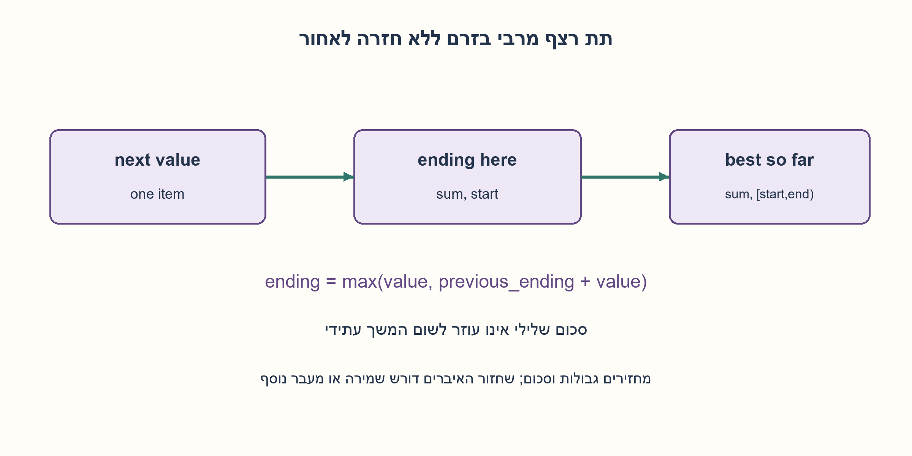
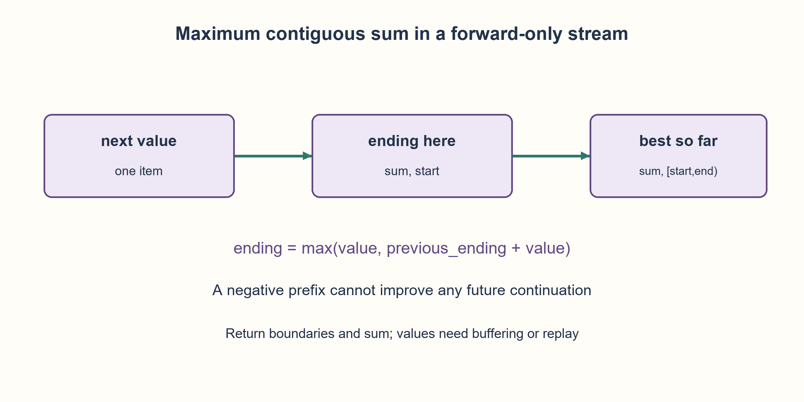

# PREP-072 — קלט טורי בלבד / Sequential input only

מקור נוסף: [צילום פרטי](../sources/2026-10-30-batch90-15.png). פתרון מוצע; ביקורת מקצועית ממתינה.

## עברית

### וריאציה: מותר לקרוא את הקלט רק לפי סדר
הקלט הוא זרם סופי ולא ריק של מספרים שלמים. אפשר לקבל את האיבר הבא בלבד; אין אינדוקס, אורך ידוע מראש, חזרה לאחור או קריאה חוזרת. החזירו סכום מרבי של קטע רציף לא ריק ואת גבולותיו [start,end), שמתחילים מאינדקס 0. בשוויון בחרו תחילה התחלה מוקדמת ואחריה סיום מוקדם. הסבירו מה משתנה אם מבקשים גם להחזיר את האיברים עצמם. מספרים שלמים מדויקים הם הנחת המודל; בטיפוס מוגבל צריך לטפל בגלישה.

### מה צריך לזכור אם אי אפשר לחזור לקלט?
כדי לחשב סכום מרבי לא צריך לשמור את כל המערך. שומרים את סכום הקטע הטוב ביותר שמסתיים באיבר הנוכחי ואת תחילתו, ובנפרד את השיא שנראה עד כה ואת גבולותיו. אם הסכום המסתיים הקודם שלילי, עדיף להתחיל מחדש באיבר הבא; אחרת ממשיכים אותו. באפס ממשיכים כדי לשמור התחלה מוקדמת בשוויון.

מאחרי עיבוד איבר i, current הוא סכום מרבי של קטע לא ריק שמסתיים בדיוק ב־i. שתי האפשרויות היחידות הן קטע באורך אחד או הארכת קטע שמסתיים ב־i−1. האינדוקציה על שתי האפשרויות מוכיחה את האינווריאנט; השוואה לשיא מכסה כל סיום אפשרי. מתחילים מן האיבר הראשון, ולכן במקרה שכל האיברים שליליים מתקבל האיבר הגדול ביותר ולא קטע ריק שסכומו 0.

לדוגמה, בזרם −4,3,−1,2,−8 התוצאה היא סכום 4 וגבולות [1,4). כל איבר נקרא פעם אחת, בזמן O(n) וב־O(1) מילות עזר. זה אינו מבטיח להחזיר את איברי הקטע בלי לשמר אותם: אם הזרם אינו ניתן לשחזור, ייתכן שהקטע הזוכה יהיה כל הקלט ויש לשמור O(n) איברים. פלט גבולות וסכום נמנע מן הדרישה הזו.

97,655 קלטים סופיים באורכים 1–7 נבדקו מול אורקל שמונה את כל הקטעים, עם מקור חד־מעברי שאוסר אינדוקס ויצירת מעבר נוסף. הזרם הריק נדחה במפורש.

```python
"""Single-pass maximum nonempty contiguous sum with index-only output."""


def stream_maximum_subarray(values):
    """Return (sum, start, end_exclusive); ties prefer earlier start then end."""
    iterator = iter(values)
    try:
        current = next(iterator)
    except StopIteration as error:
        raise ValueError("nonempty input required") from error
    current_start = 0
    best_sum, best_start, best_end = current, 0, 1
    for index, value in enumerate(iterator, 1):
        if current < 0:
            current, current_start = value, index
        else:
            current += value
        if current > best_sum or (
            current == best_sum and (current_start, index + 1) < (best_start, best_end)
        ):
            best_sum, best_start, best_end = current, current_start, index + 1
    return best_sum, best_start, best_end
```




## English

### Variant: input may only be read in sequence
The input is a finite nonempty stream of integers. Only the next item is available: no indexing, known length, rewinding or replay. Return a maximal sum of a nonempty contiguous interval and its zero-based half-open boundaries [start,end). Break ties by earlier start, then earlier end. Explain what changes if the actual values must also be returned. Exact integer arithmetic is the model; bounded types need overflow handling.

### What must survive when input cannot be revisited?
Computing the maximal sum does not require keeping the array. Track the best sum ending at the current item and its start; separately track the best complete interval seen so far. If the previous ending sum is negative, start anew at the next item. Otherwise extend it. At zero, extend to retain the earlier start on ties.

After item i, current is a maximal sum of a nonempty interval ending exactly at i. Such an interval is either the singleton or an extension of an interval ending at i−1. Induction over these two cases establishes the invariant; comparing against the global record covers every possible end. Initialization from the first item ensures an all-negative input returns its largest item rather than an empty interval of sum zero.

For −4,3,−1,2,−8 return sum 4 and boundaries [1,4). Each item is read once: O(n) time, O(1) auxiliary words. This does not return the actual interval values without retaining them. With no replay, the winning interval may be the whole input and require O(n) buffered items. Returning boundaries and sum avoids that output requirement.

97,655 finite inputs at lengths 1–7 were checked against exhaustive interval enumeration, using a forward-only source that forbids indexing and another traversal. Empty input is explicitly rejected.

```python
"""Single-pass maximum nonempty contiguous sum with index-only output."""


def stream_maximum_subarray(values):
    """Return (sum, start, end_exclusive); ties prefer earlier start then end."""
    iterator = iter(values)
    try:
        current = next(iterator)
    except StopIteration as error:
        raise ValueError("nonempty input required") from error
    current_start = 0
    best_sum, best_start, best_end = current, 0, 1
    for index, value in enumerate(iterator, 1):
        if current < 0:
            current, current_start = value, index
        else:
            current += value
        if current > best_sum or (
            current == best_sum and (current_start, index + 1) < (best_start, best_end)
        ):
            best_sum, best_start, best_end = current, current_start, index + 1
    return best_sum, best_start, best_end
```



