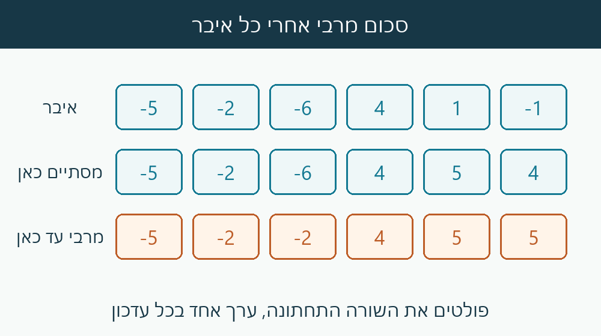
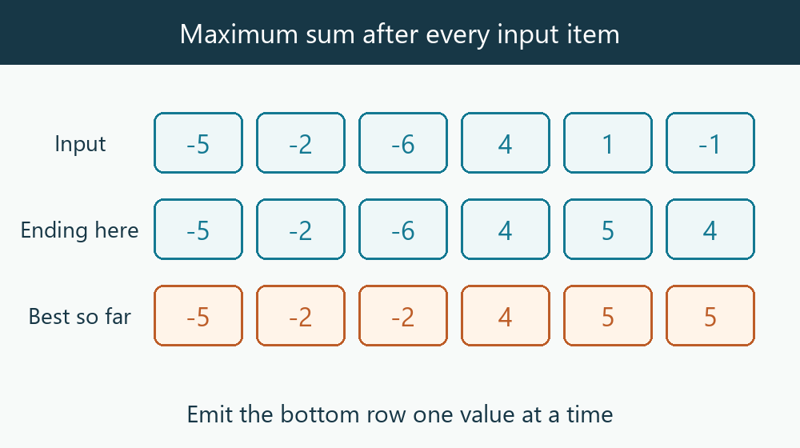

# PREP-072 — תת־מערך מרבי אחרי כל איבר בזרם

[צילום מקור פרטי](../sources/2026-11-18-batch31-27.png)

### הרחבה: תת־מערך מרבי אחרי כל איבר בזרם

זרם של מספרים שלמים מגיע איבר אחר איבר ויכול להימשך ללא סוף. מיד אחרי כל איבר פלטו את סכום תת־המערך הרציף הלא־ריק בעל הסכום המרבי מתחילת הזרם ועד האיבר הזה. אין להמתין לאיבר הבא, לקרוא את הזרם מחדש או לשמור את כולו. כתבו פסאודו־קוד, כולל קלטים שכולם שליליים, והסבירו את עלות העדכון.

### רמזים

1. שמרו בנפרד תוצאה שנגמרת באיבר החדש ותוצאה שיכולה להיגמר מוקדם יותר.
2. המרבי שמסתיים ב־x הוא x לבדו או הרחבה של המקסימום שהסתיים באיבר הקודם.
3. עדכנו ending=max(x,ending+x), ואז best=max(best,ending) ופלטו best מיד. אתחלו מהערך הראשון.

### פתרון להרחבה: תת־מערך מרבי אחרי כל איבר בזרם

כאשר מגיע הערך הראשון, אתחלו ending ו־best לערכו ופלטו אותו. אין פלט לפני קבלת ערך, מפני שאין טווח לא־ריק. בכל עדכון עם x חשבו ending=max(x,ending+x), ולאחר מכן best=max(best,ending). פלטו best בלי לבקש את האיבר הבא.

לאחר כל קלט, ending הוא סכום הטווח הלא־ריק הטוב ביותר שחייב להסתיים באיבר האחרון. טווח כזה מתחיל כאן או מאריך טווח שמסתיים באיבר הקודם. די להאריך את הטוב שבהם כי הוספת x שומרת על סדר הסכומים. הערך best הוא המקסימום על פני כל קצוות הימין שנראו. האינווריאנט מוכיח שכל פלט נכון עבור הקידומת שכבר נקראה. למשל עבור [−5,−2,−6,4,1,−1] הפלטים הם [−5,−2,−2,4,5,5].

פסאודו־קוד: עבור הערך הראשון הציבו ending←x, best←x, פלטו best. עבור כל ערך אחר חשבו ending←max(x,ending+x), best←max(best,ending), פלטו best. במימוש generator אין קריאה מעבר לאיבר הנדרש לפני yield. העלות היא O(1) פעולות על שלמים לכל עדכון ושני סכומים בזיכרון העבודה. אורך הייצוג עשוי לגדול לאורך הזרם ולכן אין טענה לזיכרון קבוע בביטים עבור ערכים או סכומים לא חסומים. מימוש במספר קבוע של ביטים דורש חוזה גלישה או חסמי ערכים.

```python
def prefix_max_subarray_sums(values):
    """Immediately yield the best nonempty interval sum for each prefix."""
    stream = iter(values)
    first = next(stream, None)
    if first is None:
        return
    ending = best = first
    yield best
    for value in stream:
        ending = max(value, ending + value)
        best = max(best, ending)
        yield best
```



פלט אחד מיד אחרי כל ערך, עם טווח לא־ריק ומספרים שלמים מדויקים.

זרם ריק אינו מפיק פלט. ערך יחיד שלילי חייב להיות פלט שלילי, ולא אפס.

שמירת best בלבד לא מספיקה. ייתכן שסכום חלש שמסתיים באיבר החדש עוד יתחבר לערכים עתידיים.

נבדקו פלטים של כל קידומת מול סריקה ממצה של הטווחים. בדיקת זרם שומר מוודאת קריאה אחת בלבד לכל בקשת פלט.

מעבירים את המקסימום שמסתיים כאן קדימה, שומרים בנפרד את הטוב ביותר עד כאן ופולטים אותו מיד.

### Follow-up: Running maximum contiguous sum after every stream item

A stream of integers arrives one item at a time and may continue indefinitely. Immediately after each item, output the maximum sum of a nonempty contiguous subarray within the prefix received so far. Do not wait for the next item, rewind the stream, or store it in full. Give pseudocode, including the all-negative case, and explain the update cost.

### Hints

1. Track a result that ends at the current item separately from one that can end anywhere in the prefix.
2. The best interval ending at x either starts at x or extends the best interval ending one item earlier.
3. Update ending=max(x,ending+x), then best=max(best,ending) and emit best immediately. Initialize with the first item.

### Follow-up solution: Running maximum contiguous sum after every stream item

On the first item set ending and best to its value and emit it. There is no output before receiving an item because no nonempty interval exists. For every subsequent x compute ending=max(x,ending+x), then best=max(best,ending). Emit best without asking for another input.

After each item ending is the largest sum of a nonempty interval forced to end at that item. Such an interval starts here or extends a previous interval ending exactly one item earlier. Extending the best previous candidate suffices because adding x preserves order. The separate best takes the maximum across all right endpoints seen so far. The invariant proves the result on each received prefix. For [−5,−2,−6,4,1,−1], the six outputs are [−5,−2,−2,4,5,5].

Pseudocode: on the first item, ending←x, best←x, emit best. On each subsequent item, ending←max(x,ending+x), best←max(best,ending), emit best. The generator has no lookahead before yield. Each update performs O(1) integer operations and keeps two running sums. Exact integer widths can grow over an unbounded stream, so a constant number of arithmetic values is not a fixed bit-storage bound. A fixed-width implementation needs an overflow policy or numeric bounds.

```python
def prefix_max_subarray_sums(values):
    """Immediately yield the best nonempty interval sum for each prefix."""
    stream = iter(values)
    first = next(stream, None)
    if first is None:
        return
    ending = best = first
    yield best
    for value in stream:
        ending = max(value, ending + value)
        best = max(best, ending)
        yield best
```



One immediate output per item, a nonempty interval, and exact integers.

An empty stream emits nothing. A single negative item emits that negative value, not zero.

Keeping only the best-so-far loses the best ending at the current item, which might extend into a future winner.

Checked every prefix against exhaustive interval sums. A guarded stream also verifies one input read for each requested output.

Carry the best sum ending here and the best sum anywhere so far, and emit the latter immediately.

[solutions/prep_072_contiguous_prefix_maxima.py](../solutions/prep_072_contiguous_prefix_maxima.py)

[checks/prep-072-1118-verification.json](../checks/prep-072-1118-verification.json)
