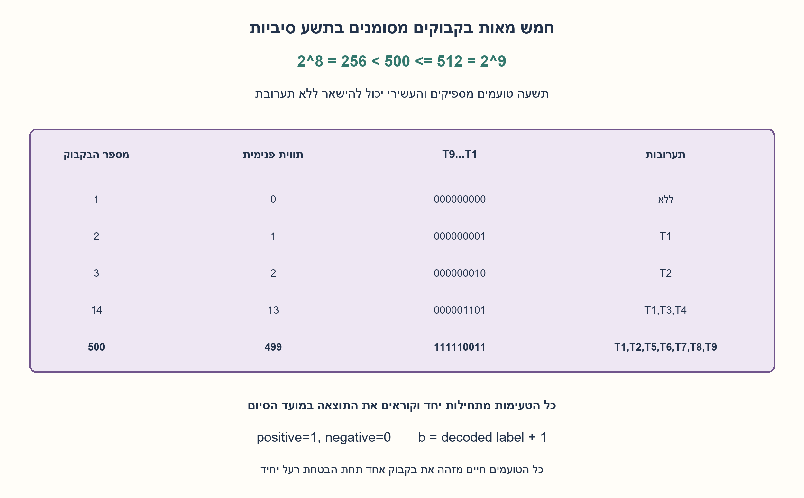
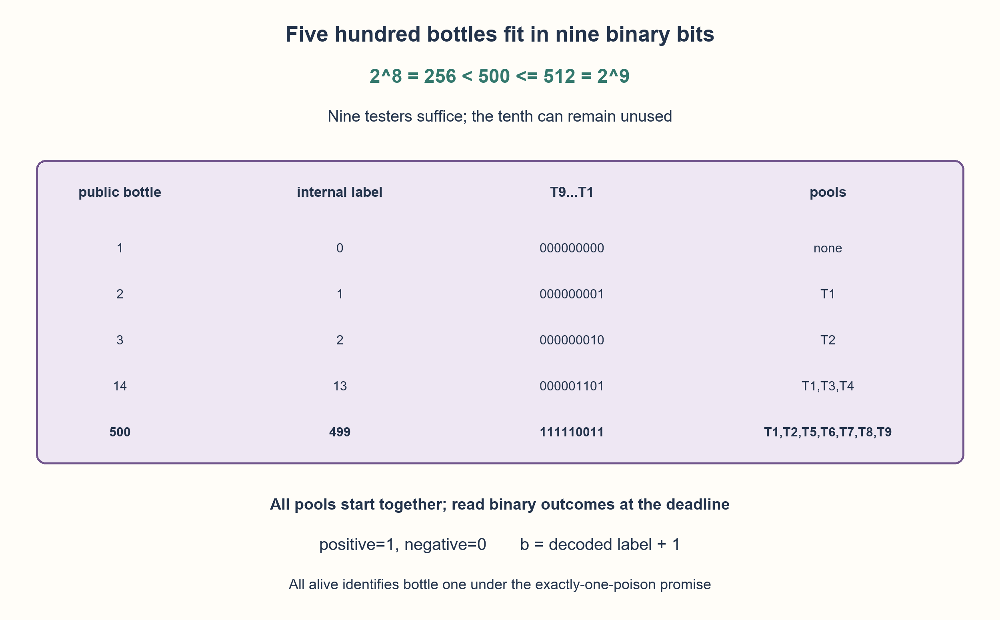

# PREP-073 — 500 בקבוקים: תשעה טועמים מספיקים מתוך עשרה זמינים

פתרון מוצע בסיוע AI; ביקורת אנושית ממתינה. הקושי לא כויל.

[צילום מקור פרטי](../sources/2026-10-30-batch70-30.png)

למלך יש 500 בקבוקי יין. אחד מורעל. עליו לזהות את הבקבוק המורעל בעזרת 10 אסירים שיכולים לטעום. טיפה אחת מספיקה כדי להרוג והרעל משפיע אחרי 24 שעות. צריך לגלות את הבקבוק בתוך 24 שעות.

## עברית

500 בקבוקים: תשעה טועמים מספיקים מתוך עשרה זמינים

### וריאציה: 500 בקבוקים ועשרה טועמים זמינים
יש 500 בקבוקים, בדיוק אחד מהם מורעל. עומדים לרשותכם עשרה טועמים. די במנה קטנה מהבקבוק המורעל כדי לגרום לתוצאה בינארית מובחנת לאחר 24 שעות בדיוק. מותר להכין לכל טועם תערובת ממספר בקבוקים ולהתחיל את כל הבדיקות במקביל. כיצד מזהים את הבקבוק המורעל עד תום 24 השעות, ומה מספר הטועמים המזערי הנדרש?

הבהרות עריכה: מודל החידה מניח שהתוצאה ניתנת לצפייה בנקודת 24 השעות, תוצאה חיובית נשמרת, וכל תערובת המכילה מנה מספקת מהרעל מזוהה ללא נטרול או דילול שמבטל זיהוי. אין מגבלת נפח או מספר מנות. זו חידת קידוד מופשטת. המועד כולל את נקודת 24 השעות;דרישה לסיים לפניה היא שאלה אחרת.

1. לכל טועם יש שתי תוצאות. כמה תבניות שונות יכולים k טועמים להחזיר בסבב מקביל אחד?
2. השוו 256 ו־512 למספר 500. אין חובה להשתמש בכל עשרת הטועמים הזמינים.
3. תנו לבקבוקים תוויות פנימיות 0 עד 499 ב־9 ביטים. טועם i מקבל מכל בקבוק שהביט i בתוויתו הוא 1. גם תבנית שכל הביטים בה 0 היא מידע חוקי כשידוע שיש בדיוק בקבוק מורעל אחד.

### לא סופרים בקבוקים אחד־אחד — נותנים לכל אחד קוד
עשרה טועמים זמינים, אבל נדרשים רק תשעה. שמונה מספקים לכל היותר 2^8=256 תוצאות, ופחות מ־500 בקבוקים יוכלו לקבל קודים שונים. תשעה מספקים 2^9=512 תוצאות, מספיק ל־500. זה גם חסם תחתון וגם בסיס לבנייה.

נמספר בקבוקים כלפי המשתמש מ־1 עד 500, ולבקבוק b נצמיד את המספר הפנימי b−1. נכתוב אותו כתשע סיביות, עם אפסים מובילים. טועם 1 מתאים לסיבית הפחות משמעותית, טועם 2 לסיבית הבאה, וכך הלאה. כל טועם שותה מתערובת שמכילה מנה מכל בקבוק שקודו כולל 1 במיקומו.

```text
public bottle 1   -> internal 0   -> 000000000
public bottle 2   -> internal 1   -> 000000001
public bottle 3   -> internal 2   -> 000000010
public bottle 500 -> internal 499 -> 111110011
T1 = least significant bit; T9 = most significant bit
```

### מפענחים את תבנית התוצאות
מתחילים את כל תשע הבדיקות בזמן 0. בנקודת 24 השעות, לכל טועם נכתוב 1 אם תוצאתו חיובית ו־0 אחרת. התבנית היא בדיוק הקוד הפנימי של הבקבוק המורעל:הוא הבקבוק היחיד שיכול היה לגרום לתוצאות החיוביות, וכל טועם קיבל אותו אם ורק אם הסיבית המתאימה בו היא 1. הופכים את הקוד למספר ומוסיפים 1 כדי לחזור למספר הבקבוק החיצוני.

אם כולם שליליים, זו אינה תקלה לפי ההנחות:הבקבוק המורעל הוא 1, בעל הקוד 000000000, שממנו לא קיבל איש. ההבטחה שבדיוק אחד מורעל שוללת אפשרות שאין רעל כלל. קודים פנימיים 500 עד 511 לא שויכו לבקבוקים, ולכן תוצאה כזו אינה אפשרית במודל ויש לדחות אותה. הטועם העשירי יכול להישאר ללא דגימה;אם מייצגים גם אותו כסיבית, עליה להיות 0.

### המינימום ולוח הזמנים
ל־k תוצאות בינאריות יש לכל היותר 2^k תבניות. כדי להבחין בוודאות בין 500 אפשרויות צריך 2^k≥500, כלומר k≥9. הבנייה משתמשת בתשעה ולכן היא מזערית. אין הזדמנות לבצע סבב תלוי־תוצאה נוסף באותו חלון:התוצאה הראשונה מגיעה רק בסופו.

אם דורשים זיהוי ממש לפני 24 שעות, ולא כולל נקודת הסיום, כל הטועמים נראים זהים עד אז במודל ההשהיה המדויק. לכן הדרישה הזו אינה אפשרית, ללא קשר לעשרה הטועמים. תיאור זמן של "עד 24 שעות" עם השהיה משתנה או דרישה לתוצאה מוקדמת דורש חוזה זמן חדש.

בניית כל התערובות ברשימות עולה O(500·9), ופענוח דורש 9 סיביות. בכלליות, עבור N בקבוקים דרושים ceil(log 2 N) טועמים והכנת שיוך מפורש עולה O(N log N). בדיקות הקוד מדמות כל בקבוק מורעל, פעם עם 9 ופעם עם 10 טועמים;אין כאן ניסוי חומרי או טענה על כימיה אמיתית.

```python
"""One parallel round at the24-hour endpoint; nine needed,ten available."""


def tasting_groups(testers=9):
    if type(testers) is not int or testers not in (9, 10):
        raise ValueError("use nine or ten available binary endpoint testers")
    return tuple(
        tuple(bottle for bottle in range(1, 501) if ((bottle - 1) >> bit) & 1)
        for bit in range(testers)
    )


def decode(dead):
    dead = tuple(dead)
    if len(dead) not in (9, 10) or any(type(x) is not bool for x in dead):
        raise ValueError("nine or ten Boolean endpoint outcomes required")
    label = sum(1 << bit for bit, value in enumerate(dead) if value)
    if label >= 500:
        raise ValueError("unused pattern violates the declared single-poison model")
    return label + 1
```




## English

500 bottles: nine testers suffice out of ten available

### Variant: 500 bottles and ten available testers
Exactly one of 500 bottles is poisoned. Ten testers are available. An adequate small portion from the poisoned bottle produces a distinguishable binary outcome exactly 24 hours later. A tester may receive a mixture from multiple bottles, and all tests may start simultaneously. How can the poisoned bottle be identified by the end of 24 hours, and what is the minimum number of testers needed?

Editorial contract: the outcome is observable at the 24-hour endpoint and persists. Any mixture containing an adequate poisoned portion tests positive without neutralization or detection-defeating dilution. There is no volume or aliquot limit. This is an abstract coding puzzle. The deadline includes the endpoint;strictly before it is a different requirement.

1. Each tester has two outcomes. How many patterns can k testers produce in one parallel round?
2. Compare 256 and 512 with 500. All ten available testers need not be used.
3. Give bottles internal labels 0 through 499 in nine bits. Tester i samples every bottle whose label has bit i set. The all-zero outcome is valid when exactly one poisoned bottle is guaranteed.

### Assign each bottle a code
Ten testers are available, but only nine are needed. Eight yield at most 2^8=256 patterns, too few for 500 distinguishable possibilities. Nine yield 2^9=512 patterns, enough for 500. This supplies a lower bound and a construction.

Public bottle numbers are 1 through 500. Assign bottle b the internal label b−1, written in nine bits with leading zeros. Tester 1 corresponds to the least significant bit, tester 2 to the next, and so on. Each tester receives an adequate portion from every bottle with a1 in that tester's bit position.

```text
public bottle 1   -> internal 0   -> 000000000
public bottle 2   -> internal 1   -> 000000001
public bottle 3   -> internal 2   -> 000000010
public bottle 500 -> internal 499 -> 111110011
T1 = least significant bit; T9 = most significant bit
```

### Decode the outcome pattern
Start all nine tests at time 0. At the 24-hour endpoint write 1 for a positive tester and 0 for a negative tester. This is exactly the poisoned bottle's internal code:the unique poisoned bottle causes a positive outcome precisely in the pools that contain it. Convert that binary pattern to a number and add 1 to recover the public bottle number.

An all-negative outcome is valid under the contract:public bottle 1 has code 000000000 and was not sampled. Exactly one poisoned bottle is guaranteed, so "none poisoned" is not another possibility. Internal labels 500 through 511 were not assigned and must be rejected if observed. Tester 10 may remain unsampled;in a ten-bit representation its outcome must be 0.

### Minimum testers and timing
With k binary outcomes there are at most 2^k patterns. Guaranteed identification among 500 possibilities requires 2^k≥500, so k≥9. The construction attains nine. A second outcome-dependent round does not fit into the same window because the first result arrives only at the endpoint.

If the deadline is strictly before 24 hours, all testers have indistinguishable observations up to that deadline in the exact-delay model. The task is then impossible regardless of ten available testers. A variable latency stated as "within 24 hours" or an earlier-result requirement needs a different timing contract.

Explicitly building all pool lists takes O(500·9), and decoding inspects nine bits. Generally, N bottles need ceil(log 2 N) testers and explicit membership preparation costs O(N log N). Checks simulate every poisoned position with nine and with ten testers. They are not physical tests or claims about real chemistry.

```python
"""One parallel round at the24-hour endpoint; nine needed,ten available."""


def tasting_groups(testers=9):
    if type(testers) is not int or testers not in (9, 10):
        raise ValueError("use nine or ten available binary endpoint testers")
    return tuple(
        tuple(bottle for bottle in range(1, 501) if ((bottle - 1) >> bit) & 1)
        for bit in range(testers)
    )


def decode(dead):
    dead = tuple(dead)
    if len(dead) not in (9, 10) or any(type(x) is not bool for x in dead):
        raise ValueError("nine or ten Boolean endpoint outcomes required")
    label = sum(1 << bit for bit, value in enumerate(dead) if value)
    if label >= 500:
        raise ValueError("unused pattern violates the declared single-poison model")
    return label + 1
```




## חומר משלים / Supporting material

```json
{
  "assumptions": {
    "he": [
      "בדיוק בקבוק מורעל אחד מתוך 500 וכל שאר הבקבוקים תקינים.",
      "תוצאות בינאריות אמינות זמינות בנקודת 24 השעות;בדיקות מתחילות במקביל.",
      "מותר לערבב מנות מספיקות מכל קבוצה;אין מגבלות נפח או השפעות כימיות נוספות.",
      "היעד הוא זיהוי הבקבוק, ולא שכל בקבוק ייטעם בפועל."
    ],
    "en": [
      "Exactly one of 500 bottles is poisoned.",
      "Reliable binary outcomes are observable at the 24-hour endpoint after simultaneous starts.",
      "Adequate portions may be mixed without volume limits or additional chemical effects.",
      "Identification is required;sampling every bottle is not."
    ]
  },
  "optimality": {
    "he": "תשעה טועמים הכרחיים ומספיקים:256<500≤512. סבב מקביל יחיד, פענוח ב־9 ביטים;הכנת רשימות O(500·9). הטועם העשירי אינו נדרש.",
    "en": "Nine testers are necessary and sufficient:256<500≤512. One parallel round, nine-bit decoding, and O(500·9) explicit pool preparation. The tenth tester is unnecessary."
  },
  "verification": {
    "he": "1,000 הדמיות חד־רעל:כל 500 הבקבוקים עם 9 וגם 10 טועמים. כל 536 תבניות התוצאה הבלתי משויכות בשני הרוחבים נדחו. אומת שהטועם העשירי אינו מקבל דגימות. בדיקות קידוד בלבד.",
    "en": "1,000 single-poison simulations cover all 500 bottles with nine and with ten testers. All 536 unassigned patterns across both widths are rejected. Tester 10 has an empty pool. These are coding checks only."
  },
  "edge_cases": {
    "he": [
      "כל התוצאות שליליות מייצגות את בקבוק 1 לפי המספור שנבחר.",
      "תוצאה בקוד פנימי≥500 מפרה את המודל.",
      "ללא הבטחת בדיוק רעל אחד, תבנית אפס אינה מבדילה בין בקבוק 1 לבין היעדר רעל.",
      "מועד שדורש זיהוי לפני נקודת 24 השעות אינו בר־ביצוע בהשהיה מדויקת."
    ],
    "en": [
      "All-negative means public bottle 1 under this numbering.",
      "An internal code≥500 violates the model.",
      "Without exactly-one-poison, the zero pattern cannot distinguish bottle 1 from no poison.",
      "A deadline strictly before 24 hours is impossible under exact latency."
    ]
  },
  "common_mistakes": {
    "he": [
      "להשתמש בעשרה כי זה מספר הטועמים שסופק, ואז לטעון שזה המינימום.",
      "לערבב סדר סיביות בפענוח.",
      "לבלבל בין מספר חיצוני 1..500 לבין תווית פנימית 0..499.",
      "להניח שאפשר לחכות לתוצאה ואז לבצע סבב נוסף לפני 24 שעות."
    ],
    "en": [
      "Calling ten minimal merely because ten were supplied.",
      "Changing bit order during decoding.",
      "Confusing public 1..500 numbers with internal 0..499 labels.",
      "Waiting for a result and assuming another full round fits before 24 hours."
    ]
  },
  "interview_answer": {
    "he": "אשתמש בתשעה מתוך העשרה. לכל בקבוק קוד 9 ביטים שונה;טועם i מקבל את כל הבקבוקים שהביט i שלהם 1. תבנית התוצאות בנקודת 24 השעות מזהה את הקוד. שמונה אינם מספיקים כי 256<500, ותשעה מספיקים כי 512≥500.",
    "en": "Use nine of the ten. Assign distinct nine-bit codes and give tester i all bottles with bit i set. The 24-hour outcome pattern identifies the code. Eight cannot distinguish 500 cases; nine can."
  },
  "source_ambiguities": {
    "he": [
      "הצילום אינו מפרט מודל ערבוב או נפח;אלו הנחות מופשטות מפורשות.",
      "מועד 24 שעות מפורש ככולל את נקודת הופעת התוצאה.",
      "שיוך Apple מדווח בלבד;הווריאציה מצורפת למשפחת הקידוד הקיימת."
    ],
    "en": [
      "Mixing and volume rules are explicit abstract assumptions absent from the screenshot.",
      "The deadline includes the observable 24-hour endpoint.",
      "Apple attribution is source-reported;this is appended to the existing coding family."
    ]
  },
  "solution_extensions": {
    "he": [
      {
        "question": "ומה אם צריך להבדיל גם ממצב שאין בקבוק מורעל?",
        "answer_direction": "מקצים לתרחיש ללא רעל את תבנית האפס ונותנים לבקבוקים קודים 1..500.501 אפשרויות עדיין נכנסות בתשעה ביטים. אז כל בקבוק מקבל לפחות דגימה אחת.",
        "principle": "תכנון הקודים תלוי בקבוצת כל המצבים שיש להבחין ביניהם."
      }
    ],
    "en": [
      {
        "question": "What if no poisoned bottle is also possible?",
        "answer_direction": "Reserve zero for no poison and label bottles 1..500. The 501 possibilities still fit in nine bits;every bottle is now sampled by at least one tester.",
        "principle": "Codes depend on the complete set of distinguishable states."
      }
    ]
  }
}
```
