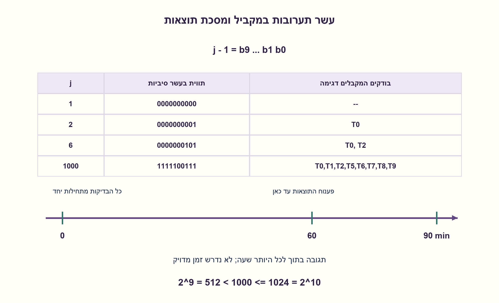
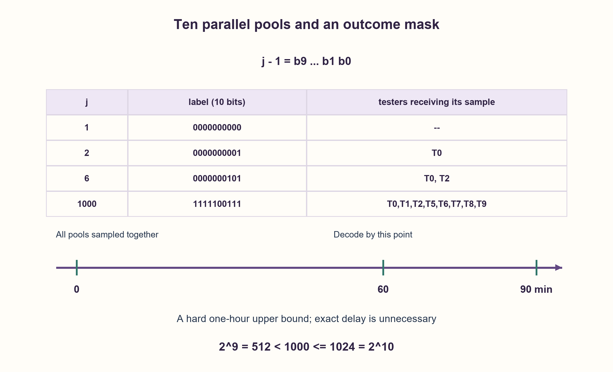

# PREP-073 — בקבוק מורעל אחד מתוך אלף — עשרה טועמים

פתרון מוצע בסיוע AI; ביקורת מקצועית אנושית ממתינה. הקושי אינו מכויל.

[צילום מקור פרטי](../sources/2026-10-30-batch110-20.png)

המלך החליט לערוך משתה שבו יוגשו 1000 בקבוקי יין. מרגל הרעיל בקבוק אחד; אין דרך לגלות מראש את הרעל או השפעתו, אך הקורבן מת תוך כשעה וכל כמות של רעל תהרוג את השותה. נותרה שעה וחצי למשתה. יש למצוא בזמן זה את הבקבוק המורעל בעזרת 10 אסירים שגורלם אינו משנה למלך.

חברות לפי הדיווח בצילום בלבד: Amazon.

## עברית

### וריאציה: אלף בקבוקים, עשרה בודקים ושעה וחצי
בדיוק אחד מ־1000 בקבוקים מורעל. יש עשרה בודקים ו־90 דקות לזהותו. כל כמות מספקת מן הרעל גורמת לתוצאה מזוהה בתוך לכל היותר 60 דקות מהחשיפה הראשונה; אין ידיעה על זמן מדויק. מותר להכין ולדגום תערובות במקביל בתחילת הזמן, ללא מגבלת כמות שמכשילה את המודל. תכננו זיהוי מובטח והסבירו מה אפשר להסיק מזמני תגובה.

הבהרת עריכה: המקור אומר „תוך כשעה”. לצורך הבטחה מתמטית נדרש חסם עליון קשיח של 60 דקות; זמן מקורב ללא חסם אינו מבטיח תוצאה לפני המשתה. ההצעה משתמשת רק בתוצאת קצה בינארית בדקה 60. היא אינה דורשת זמן תגובה זהה בין הבודקים. זהו מודל חידת קידוד מופשט.

1. כבר אחרי שעה אפשר לצפות בתוצאה של כל בדיקה שהחלה מיד. כמה תבניות בינאריות יש לעשרה בודקים?
2. כל בודק יכול להשתתף בתערובת אחרת, כך שיחד התוצאות יקודדו את מספר הבקבוק.
3. מספרו את הבקבוקים בקודים 0..999. בודק i מקבל בדיוק את הבקבוקים שבקוד שלהם סיבית i היא אחת. בדקה 60 קראו את דפוס התוצאות והוסיפו אחת.

### לא צריך לחכות לתור נוסף
ההפרש בין 90 דקות לבין חסם התגובה של 60 אינו מחייב סבב שני. מתחילים עשר בדיקות במקביל בדקה 0, ומקבלים עד דקה 60 עשר סיביות מידע. יש 2^10=1024 דפוסים, מספיק לאלף בקבוקים.

נותנים לבקבוק הציבורי j את התווית הבינארית j−1. בודק i מקבל תערובת מכל הבקבוקים שסיבית i בתווית שלהם היא אחת; כל התערובות נשתות בתחילת הזמן. עד דקה 60, בודק i ייתן תוצאה חיובית אם ורק אם הבקבוק המורעל שייך לתערובת שלו. לכן דפוס התוצאות הוא בדיוק התווית. מוסיפים אחת ומקבלים את מספר הבקבוק. אם כולם נותנים תוצאה שלילית, זהו בקבוק 1, שהתווית שלו אפס ולא נכלל בשום תערובת. הדבר תקף מפני שמובטח שיש בדיוק בקבוק מורעל אחד. דפוסים 1000..1023 אינם משויכים ומצביעים על חריגה מההנחות.

עשרה הם מינימום בסבב יחיד של תוצאות בינאריות: תשעה מציעים רק 512 דפוסים. עלות הכנת טבלת השיוך היא O(1000·10), והפענוח O(10). אין כאן ניסוי כימי או רפואי; הבדיקה היא של מודל זיהוי בלבד.

### מדוע לא להשתמש אוטומטית בשלוש תוצאות לבודק
אם ההשהיה הייתה בדיוק 60 דקות וניתן היה להתחיל חשיפה בדקה 0 או 30, אפשר היה להבחין בין תגובה בדקה 60, תגובה בדקה 90 ואי־תגובה. אז שבעה בודקים מספיקים כי 3^6<1000≤3^7. אבל זמן תגובה לא ידוע שחסום מלמעלה אינו אותו חוזה: תגובה בדקה 60 יכולה לנבוע מחשיפה מוקדמת עם השהיה ארוכה או מחשיפה מאוחרת עם השהיה קצרה. אין קוד שלישוני מובטח על סמך ההנחות שניתנו.

אפשר אף להצדיק חסם של עשרה מול תזמונים אדפטיביים במודל המחמיר שבו ההשהיות רשאיות להשתנות בין הבודקים. יריב מותר יכול לגרום לכל בודק שנחשף לראשונה לפני דקה 60 לתת תוצאה בדיוק בדקה 60, ולכל מי שנחשף לראשונה בדקה 60 או אחריה לתת תוצאה רק 60 דקות לאחר החשיפה, אחרי המועד האחרון. לפני דקה 60 אין מידע; במועד זה יש לכל היותר מסכה של עשר תוצאות בינאריות, ואחריו לא מתקבל מידע חדש עד דקה 90. עם n בודקים יש לכל היותר 2^n מסכות. זהו נימוק נפרד, התלוי במפורש במודל השהיות עצמאי ובחסם הקשיח; אין להסיק ממנו חסם תחת כל חוק פיזי אחר.

### מודל לוגי בפייתון שהורץ

```python
"""Abstract identification code; no experiment on people or chemicals."""


def pools(bottles: int = 1000, tasters: int = 10):
    if bottles < 1 or tasters < 0 or bottles > 1 << tasters:
        raise ValueError("insufficient binary outcome patterns")
    return [{public for public in range(1, bottles + 1)
             if ((public - 1) >> bit) & 1} for bit in range(tasters)]


def identify(dead, bottles: int = 1000):
    outcomes = tuple(dead)
    if any(value not in (0, 1, False, True) for value in outcomes):
        raise ValueError("outcomes must be binary")
    label = sum(int(value) << bit for bit, value in enumerate(outcomes))
    if not 0 <= label < bottles:
        raise ValueError("unassigned outcome pattern")
    return label + 1


def permitted_adversarial_death(first_exposure: float) -> float:
    """Allowed independent latency in (0,60]; observation deadline is minute 90."""
    if first_exposure < 0:
        raise ValueError("exposure time must be nonnegative")
    return 60 if first_exposure < 60 else first_exposure + 60
```




### assumptions

```json
[
  "בדיוק בקבוק אחד מורעל, התוצאות אמינות ומצטברות, והתגובה הראשונה נגרמת בתוך (0,60] דקות.",
  "התערובות מתחילות יחד בדקה 0, וכוללות מינון מספק ללא נטרול או דילול שמונע זיהוי.",
  "החסם מול כל תזמון אדפטיבי מניח השהיות לא ידועות שעשויות להיות שונות באופן עצמאי; בניית הסבב היחיד אינה זקוקה לעצמאות זו."
]
```

### optimality

עשרה נחוצים ומספיקים לסבב בינארי יחיד. הוכחת היריב מרחיבה זאת לתזמונים אדפטיביים רק במודל ההשהיות העצמאי המפורש. שבעה תחת השהיה מדויקת הם פתרון לחוזה אחר.

### verification

כל 1000 זהויות הבקבוק נבדקו מול אורקל חלוקה ושארית, כולל דפוס שלילי מלא ו־24 דפוסים לא משויכים. נבדקו 1000 דפוסי השהיות תקפים וכן תשעה זמני גבול בחשבון רציונלי. החסם האדפטיבי הוא הוכחה נפרדת, לא בדיקה ממצה של כל מדיניות זמנים.

### edge_cases

```json
[
  "דפוס שלילי מלא מזהה את בקבוק 1 במיספור שנבחר.",
  "תגובה בדיוק בדקה 60 כלולה בחסם; מתחילים מספיק מוקדם.",
  "„כשעה” ללא חסם עליון קשיח אינו מספק הבטחה בזמן."
]
```

### common_mistakes

```json
[
  "לחלק לעשר קבוצות זרות ולזהות רק קבוצה.",
  "לחכות לתשובה ואז להתחיל סבב של שעה נוספת.",
  "לבלבל „לכל היותר שעה” עם „בדיוק שעה” ולהשתמש בשלוש תוצאות ללא הצדקה."
]
```

### interview_answer

אתן לבקבוקים תוויות של עשר סיביות, וכל בודק יקבל את התערובת של הסיבית שלו. כולם מתחילים מיד; אחרי שעה דפוס התוצאות הוא התווית, לפני תום השעה וחצי. לא אקודד זמן מוות בלי הבטחה להשהיה מדויקת.

### source_ambiguities

הניסוח המקורי מקורב בזמן ואינו מפרט ערבוב, דילול או חוק השהיה משותף. כל ההנחות הדרושות להבטחה מתועדות; הגרסאות הישנות ורמזיהן נשמרים.

### solution_extensions

```json
[
  {
    "question": "מה משתנה אם ההשהיה בדיוק שעה ותוצאת דקה 90 נחשבת בזמן?",
    "answer_direction": "אפשר לתת לכל בודק אחת משלוש משמעויות: חשיפה בדקה 0, חשיפה בדקה 30 או ללא חשיפה. קוד בן שבע ספרות בבסיס שלוש מכסה 1000 בקבוקים.",
    "principle": "כמות המידע תלויה בחוק התזמון, לא רק במספר הבודקים."
  }
]
```

## English

### Variant: one thousand bottles, ten testers and ninety minutes
Exactly one of one thousand bottles is poisoned. Ten testers and ninety minutes are available to identify it. Any adequate poisoned portion produces an identifiable outcome no later than sixty minutes after first exposure; the exact delay is unknown. Mixtures may be prepared and sampled simultaneously at time zero, without a volume limitation that defeats the model. Give a guaranteed identification strategy and explain what reaction timing does and does not reveal.

Editorial clarification: the source says “within about an hour.” A mathematical guarantee needs a hard sixty-minute upper bound; an approximate duration without a bound cannot guarantee an answer before the feast. The construction uses only binary endpoint outcomes at minute sixty. It does not require equal reaction delays across testers. This is an abstract coding puzzle.

1. Every test started immediately has an observable result by sixty minutes. How many binary patterns can ten testers produce?
2. Each tester can receive a different mixture so the joint outcomes encode a bottle label.
3. Label bottles zero through 999. Tester i samples exactly those whose labels have bit i set. At minute sixty decode the outcome mask and add one.

### A second result-dependent round is unnecessary
The difference between the ninety-minute deadline and the sixty-minute response bound does not require another round. Start ten tests in parallel at minute zero and obtain ten information bits by minute sixty. Their 2^10=1024 possible patterns can distinguish one thousand bottles.

Give public bottle j the binary label j−1. Tester i samples a mixture of exactly the bottles whose labels have bit i set. All mixtures are sampled at time zero. By minute sixty, tester i has a positive outcome exactly when the poisoned bottle belongs to that mixture. The outcome mask is therefore its label; add one for the public bottle number. All-negative identifies bottle one, whose zero label puts it in no mixture. This works because exactly one poisoned bottle is guaranteed. Codes 1000..1023 are unassigned and indicate a model violation.

Ten is minimal in one round of binary outcomes: nine provide only 512 patterns. Explicit pool preparation costs O(1000·10), and decoding O(10). This is verification of an abstract identification code, not a chemical or medical experiment.

### Why three outcomes per tester cannot be assumed
If delay were exactly sixty minutes, tests starting at minutes zero and thirty could distinguish a reaction at sixty, a reaction at ninety, and no reaction. Seven testers would then suffice because 3^6<1000≤3^7. An unknown delay with an upper bound is a different contract: a reaction at sixty could follow early exposure with a long delay or late exposure with a short delay. The stated assumptions do not guarantee that ternary code.

A lower bound of ten also applies to adaptive timings in the stronger adversarial model where delays may vary independently between testers. An allowed adversary can make every tester first exposed before minute sixty react exactly at minute sixty, and make anyone first exposed at minute sixty or later react sixty minutes after exposure, beyond the deadline. No information arrives before sixty. At sixty there is only a binary mask, and no new information arrives afterward by ninety. With n testers there are at most 2^n masks. This is a separate proof explicitly dependent on the independent-delay model and hard bound, not a claim covering every other physical timing law.

### Executed Python logical model

```python
"""Abstract identification code; no experiment on people or chemicals."""


def pools(bottles: int = 1000, tasters: int = 10):
    if bottles < 1 or tasters < 0 or bottles > 1 << tasters:
        raise ValueError("insufficient binary outcome patterns")
    return [{public for public in range(1, bottles + 1)
             if ((public - 1) >> bit) & 1} for bit in range(tasters)]


def identify(dead, bottles: int = 1000):
    outcomes = tuple(dead)
    if any(value not in (0, 1, False, True) for value in outcomes):
        raise ValueError("outcomes must be binary")
    label = sum(int(value) << bit for bit, value in enumerate(outcomes))
    if not 0 <= label < bottles:
        raise ValueError("unassigned outcome pattern")
    return label + 1


def permitted_adversarial_death(first_exposure: float) -> float:
    """Allowed independent latency in (0,60]; observation deadline is minute 90."""
    if first_exposure < 0:
        raise ValueError("exposure time must be nonnegative")
    return 60 if first_exposure < 60 else first_exposure + 60
```




### assumptions

```json
[
  "Exactly one bottle is poisoned, outcomes are reliable and persistent, and first exposure produces a reaction after a delay in (0,60] minutes.",
  "All mixtures start at minute zero and contain adequate portions without neutralization or detection-defeating dilution.",
  "The bound against arbitrary adaptive timing assumes independently variable unknown delays; the one-round construction does not need that independence."
]
```

### optimality

Ten are necessary and sufficient for one binary round. The adversarial proof extends the bound to adaptive timing only under the explicit independently variable-delay model. Seven under exact delay solves a different contract.

### verification

All one thousand bottle identities were checked against an independent division/remainder oracle, including all-negative and twenty-four unassigned masks. One thousand allowed delay patterns and nine rational-arithmetic timing boundaries were checked. The adaptive lower bound is a separate proof, not exhaustive testing of all timing policies.

### edge_cases

```json
[
  "All-negative identifies bottle one under this numbering.",
  "A reaction exactly at sixty is included in the bound; start promptly.",
  "“About an hour” without a hard upper bound does not guarantee a timely result."
]
```

### common_mistakes

```json
[
  "Splitting bottles into ten disjoint groups identifies only a group.",
  "Waiting for a result before starting another full-hour round.",
  "Treating “at most an hour” as “exactly an hour” and assuming three outcomes per tester."
]
```

### interview_answer

Assign ten-bit labels and let each tester sample the pool for one bit. Start everyone immediately; after an hour the outcome mask is the bottle label, before the ninety-minute deadline. Do not encode reaction time without an exact-delay guarantee.

### source_ambiguities

The source gives an approximate duration and omits mixing, dilution and a common delay law. All assumptions needed for a guarantee are explicit. Earlier variants and their hints are retained.

### solution_extensions

```json
[
  {
    "question": "What changes with an exact sixty-minute delay and an inclusive minute-ninety deadline?",
    "answer_direction": "Each tester can encode first exposure at zero, at thirty, or never. Seven ternary digits cover one thousand bottles.",
    "principle": "Available information depends on the timing law, not just the tester count."
  }
]
```
