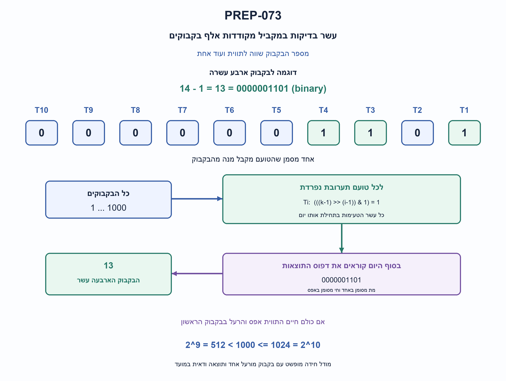
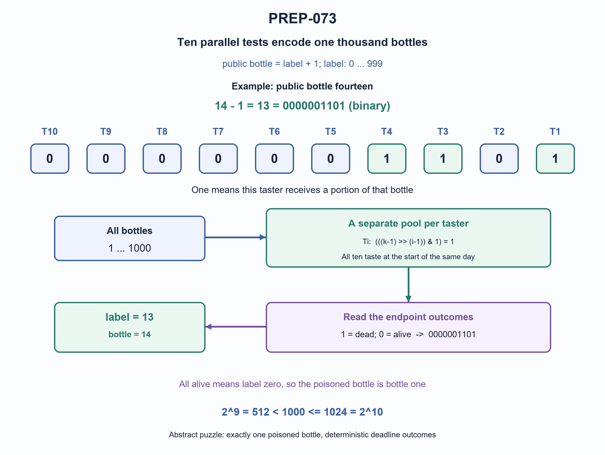

# PREP-073 — בקבוק מורעל אחד מתוך אלף — עשרה טועמים

Status: in review; AI-assisted proposed solution; difficulty uncalibrated. Human professional/parity/reuse review pending. No learner activity recorded.

## Preserved source

מלך קיבל 1000 בקבוקי יין. אחד מהבקבוקים מורעל, ועליו לגלות איזה מהם מורעל. בבקבוק ישנו רעל שמי ששותה מהבקבוק, בסוף היום מת. לרשות המלך עשרה משרתים. עליו לגלות תוך יום אחד איזה מן הבקבוקים מורעל.

[Source image](../sources/prep-073.png)

Companies reported only by supplied source: Mellanox, Amazon, CEVA.

## he: בקבוק מורעל אחד מתוך אלף — עשרה טועמים

מלך קיבל 1000 בקבוקי יין ובדיוק אחד מהם מורעל. מי ששותה מנה מספקת ממנו ימות עד סוף היום. לרשותו עשרה טועמים, ועליו לזהות בוודאות את הבקבוק בתוך יום אחד. כיצד יחלק טעימות וכיצד יפענח? הוכיחו גם מינימום טועמים במודל הזה.

הבהרות שנוספו: מותר לקחת מנות ולערבב; רעל במנה מספקת הורג בוודאות עד סוף היום, ותערובת ללא רעל אינה הורגת. הערבוב אינו מבטל רעל ואין מגבלת נפח שמונעת הכנה. כל הטעימות במקביל בתחילת היום, והמידע הוא רק חי/מת בסופו; לא מסתמכים על זמן מוות מדויק ולא מאפשרים סבב שני.

### Three progressive hints

1. כל טועם נותן בסוף היום אחת משתי תוצאות. כמה דפוסים יכולים עשרה טועמים לייצג יחד?
2. אותו בקבוק יכול להשתתף בתערובות של כמה טועמים; הדפוס המשותף יזהה אותו.
3. מספרו תוויות מ־0 עד 999 בעשרה ביטים. כל טועם מקבל בדיוק את הבקבוקים שהביט שלו הוא 1.

### Proposed solution

**פתרון מוצע — עשרה טועמים, עשרה ביטים, עשר תערובות שנבדקות במקביל.**

### סופרים את המידע

בסוף היום כל טועם חי או מת, כלומר מספק ביט אחד. עשרה טועמים יכולים לייצר 2^10=1024 דפוסים, די להבחנה בין 1000 אפשרויות. תשעה נותנים רק 512, ולכן אינם מספיקים במודל הזה. זהו חסם מידע; כעת נבנה תערובות שמממשות אותו.

### בניית הקוד והתערובות

מספרי הבקבוקים הגלויים הם 1–1000. לבקבוק k ניתן תווית פנימית k−1, כלומר 0–999. נכתוב אותה בעשרה ביטים. הטועם T1 מתאים לביט הנמוך במשקל 1, T2 למשקל 2, ועד T10 במשקל 512. במחרוזת בינארית משמאל לימין הסדר הוא T10 עד T1.

| בקבוק גלוי | תווית פנימית | קוד T10...T1 | טועמים שמקבלים ממנו |
| --- | --- | --- | --- |
| 1 | 0 | 0000000000 | אף אחד |
| 2 | 1 | 0000000001 | T1 |
| 3 | 2 | 0000000010 | T2 |
| 4 | 3 | 0000000011 | T1,T2 |
| 14 | 13 | 0000001101 | T1,T3,T4 |
| 1000 | 999 | 1111100111 | T1,T2,T3,T6,T7,T8,T9,T10 |

לכל טועם מכינים תערובת נפרדת המכילה מנה מכל בקבוק שהביט שלו 1. כל עשרת הטועמים טועמים בתחילת היום. אין המתנה לתוצאת טועם אחד לפני הכנת הבדיקה הבאה — זהו סבב מקביל יחיד.

### הפענוח

בסוף היום נכתוב 1 לכל טועם שמת ו־0 לכל טועם שחי. הדפוס הוא התווית של הבקבוק המורעל; מוסיפים 1 לקבלת מספרו הגלוי. למשל, אם רק T1,T3,T4 מתו, הדפוס T10...T1 הוא 0000001101, שערכו 13, ולכן הבקבוק הוא 14.

אם כולם חיים, התווית 0 והבקבוק הוא 1, שממנו אף אחד לא טעם. זה תקין בזכות הנתון שיש בדיוק בקבוק אחד מורעל: כל אחת מ־999 האפשרויות האחרות הייתה הורגת לפחות טועם אחד. אפשר לחלופין להשתמש בקודים 1–1000 כדי שכל בקבוק ייבדק, אך אז משנים גם את הפענוח ודפוסי השגיאה. אין לערבב את שיטות המספור.

### נכונות ומינימום

אם הבקבוק k מורעל, טועם i מת בדיוק כאשר התערובת שלו מכילה את k, וזה קורה בדיוק כאשר ביט i−1 של k−1 הוא 1. לכן דפוס המוות שווה לקוד שהוקצה לבקבוק. כל הקודים שונים, ולכן מזהים יחיד. הבנייה משיגה את ההבחנה שהחסם ספר.

עבור N בקבוקים באותו מודל נדרשים ומספיקים ceil(log2(N)) טועמים. עבור 1000 התוצאה 10. זו אופטימליות במספר טועמים לסבב אחד של תוצאות בינאריות, לא במספר מנות או נפח. בניית התערובות הישירה צורכת O(N·log N) בדיקות ביט, ופענוח O(log N). טועם מקבל מנות מהרבה בקבוקים, ולא קבוצה נפרדת שאין לה חפיפה עם האחרות.

### הנחות חשובות

זוהי חידה מופשטת: בדיוק בקבוק אחד מורעל; מותר לקחת מנות ולערבב; מנה מספקת של רעל בתערובת הורגת בוודאות עד סוף היום, ותערובת ללא רעל אינה הורגת. הערבוב אינו מבטל את הרעל ואין מגבלת נפח שמונעת הכנה בתחילת היום. אין משתמשים בשעת מוות מדויקת: המקור נותן תוצאת סוף יום, לא חלונות זמן מובחנים. השפעה לא ודאית, דילול שאינו עומד בהנחה או עיכוב מעבר למועד מבטלים את ההבטחה.

הקוד בונה עשר קבוצות בקבוקים. הפענוח מקבל עשרה ערכי אמת בסדר T1 עד T10. דפוסים שתוויתם 1000–1023 אינם משויכים לשום בקבוק ולכן מדווחים כשגיאה.

הבדיקה בנתה את קבוצות התערובות ודימתה כל אחד מ־1000 הבקבוקים כאפשרות היחידה המורעלת. כולם פוענחו נכון והדפוסים ייחודיים. נבדקו גם כולם חיים, כל 24 הדפוסים הבלתי מנוצלים וחמישה קלטים פגומים. זו בדיקת מודל וקוד, לא ניסוי בטועמים או אימות כימי. הצעה בסיוע AI, ממתינה לביקורת מקצועית.



### assumptions

```json
[
  "בדיוק בקבוק אחד מתוך 1000 מורעל.",
  "מותר לערבב ולחלק מנות; כל תערובת עם מנה מספקת של הרעל הורגת בוודאות עד המועד. ללא רעל שורדים.",
  "טעימה מקבילה בתחילת היום ותוצאה בינארית בסופו, ללא סבב שני או קידוד בשעת המוות.",
  "מספרים גלויים 1–1000, תוויות פנימיות 0–999; T1 הוא הביט הנמוך. כולם חיים מזהה את בקבוק 1."
]
```

### optimality

```json
{
  "criterion": "מספר טועמים בסבב אחד של תוצאות בינאריות ודאיות.",
  "result": "עשרה נחוצים ומספיקים.",
  "proof": "2^9=512 קטן מאלף, ו־2^10=1024 מספיק עם בניית הקידוד הבינארי.",
  "scope": "לא מינימום מנות או נפח, לא כמה בקבוקים מורעלים או תוצאות לא ודאיות, ולא מידע על שעת המוות."
}
```

### verification

```json
"נבדקו כל 1000 אפשרויות הבקבוק המורעל לפי חברות בתערובות, ייחודיות ופענוח; הושוו לאורקל חלוקות ושאריות עצמאי. נבדקו כולם חיים, 24 דפוסים בלתי מנוצלים וחמישה קלטים פגומים. מודל פייתון בלבד; ללא ניסוי אנושי או כימי; ביקורת מקצועית ממתינה."
```

### edge_cases

```json
[
  "כולם חיים מזהה את בקבוק 1 שלא נבדק.",
  "בקבוק 1000 נותן תווית 999; דפוסים 1000–1023 אינם תקפים.",
  "כמה בקבוקים מורעלים יוצרים איחוד ביטים ועלולים להטעות.",
  "אין זמן להמתין לסבב שני."
]
```

### common_mistakes

```json
[
  "עשר קבוצות נפרדות שמזהות רק קבוצה.",
  "חיפוש בינארי סדרתי שאין זמן להמתין לתוצאותיו.",
  "בלבול בין מספר בקבוק לתווית או בין סדר הביטים לסדר הטועמים.",
  "דחיית כולם חיים למרות שיש בדיוק בקבוק מורעל אחד.",
  "הסתמכות על שעת מוות מדויקת שלא ניתנה."
]
```

### interview_answer

```json
"אסמן בקבוקים בתוויות 0–999 בעשרה ביטים. כל טועם מקבל תערובת מכל בקבוק שהביט שלו 1, וכולם טועמים יחד. דפוס המתים בסוף היום הוא התווית; מוסיפים אחת למספר הגלוי. כולם חיים מזהה בקבוק 1. עשרה מינימליים כי תשעה נותנים רק 512 דפוסים."
```

### solution_extensions

```json
{
  "question": "כמה טועמים נחוצים ל־1025 בקבוקים באותם כללים?",
  "direction": "עשרה נותנים 1024 דפוסים בלבד. נדרשים 11, וקידוד של 11 ביטים מספיק.",
  "status": "מוכן בארכיון; אינו מחובר לתור האינטראקטיבי."
}
```

## en: One poisoned bottle among one thousand — ten tasters

A king has 1000 wine bottles, exactly one poisoned. An adequate dose causes death by the end of the day. He has ten tasters and must identify the bottle with certainty within one day. Specify the tasting assignment and decoding, and prove the minimum taster count under this model.

Added clarifications: taking portions and mixing are allowed. An adequate poison dose deterministically kills by the deadline; poison-free pools do not. Mixing does not neutralize poison, and volume limits do not prevent preparation. All taste in parallel at the start; only alive/dead is read at the endpoint. Do not rely on exact death times or a second testing round.

### Three progressive hints

1. Each taster has two endpoint outcomes. How many joint patterns can ten tasters represent?
2. A bottle can appear in several tasters' pools; the combined pattern can identify it.
3. Use labels 0..999 in ten bits. Each taster samples exactly bottles whose code has one in its assigned bit.

### Proposed solution

**Proposed solution — ten tasters, ten bits and ten pools tested in parallel.**

### Count the information

At the deadline each taster is alive or dead, providing one bit. Ten tasters can produce 2^10=1024 joint patterns, enough for 1000 possibilities. Nine provide only 512 and cannot suffice in this model. This is an information lower bound; a pooling construction must attain it.

### Codes and pools

Public bottles are numbered 1..1000. Assign bottle k internal label k−1, ranging 0..999, written in ten binary bits. T1 represents the least-significant bit of weight one, T2 weight two, through T10 weight 512. A written binary string from left to right is T10 through T1.

| Public bottle | Internal label | Code T10...T1 | Tasters receiving a portion |
| --- | --- | --- | --- |
| 1 | 0 | 0000000000 | None |
| 2 | 1 | 0000000001 | T1 |
| 3 | 2 | 0000000010 | T2 |
| 4 | 3 | 0000000011 | T1,T2 |
| 14 | 13 | 0000001101 | T1,T3,T4 |
| 1000 | 999 | 1111100111 | T1,T2,T3,T6,T7,T8,T9,T10 |

Prepare a separate pool for each taster containing a portion from each bottle whose code has one in that taster's bit. All ten taste at the start. Nothing waits for an earlier outcome; this is one parallel batch.

### Decode

At the deadline write one for a dead taster and zero for a survivor. This pattern is the poisoned bottle's internal label; add one for its public number. If only T1,T3,T4 die, the T10...T1 pattern is 0000001101, value thirteen, identifying public bottle fourteen.

All alive means label zero, hence bottle one, which was deliberately not sampled. This is valid because exactly one poisoned bottle is guaranteed: every other one of the 999 possibilities kills at least one taster. Alternatively use codes 1..1000 so every bottle is sampled, but then decoding and invalid patterns must change consistently. Do not mix numbering schemes.

### Correctness and minimum

If k is poisoned, taster i dies exactly when its pool contains k, which happens exactly when bit i−1 of k−1 is one. Thus the death pattern equals k's assigned code. Distinct codes uniquely identify every bottle. The construction achieves the distinguishability counted by the lower bound.

For N bottles under the same model, ceil(log2(N)) tasters are necessary and sufficient; for 1000 the answer is ten. This minimizes tasters for one batch of binary endpoint results, not portions or volume. Direct construction takes O(N·log N) bit inspections; decoding takes O(log N). Tasters receive overlapping pools of many bottles, not disjoint groups that identify only one group.

### Assumptions

This is an abstract puzzle: exactly one bottle is poisoned; portions and mixing are permitted; an adequate poison portion in a pool deterministically kills by the deadline, and poison-free pools do not kill. Mixing does not neutralize poison, volume limits do not prevent preparation at the start, and precise death time is not used. The source provides end-of-day outcomes, not distinguishable timing windows. Uncertain effects, inadequate dilution or delay beyond the deadline remove the guarantee.

Code constructs ten groups and decodes ten Booleans ordered T1 through T10. Labels 1000..1023 are unused and rejected rather than assigned to nonexistent bottles.

Checks constructed the actual pools and simulated every one of the 1000 possible single poisoned bottles. All decoded correctly with unique patterns. All-alive, all 24 unused patterns and five malformed inputs were checked too. This is a code/model check, not real tasting or chemical validation. AI-assisted proposal; professional review pending.



### assumptions

```json
[
  "Exactly one of 1000 bottles is poisoned.",
  "Mixing and portions are allowed; any pool with an adequate poison dose deterministically kills by the deadline; poison-free pools do not.",
  "All taste in parallel at the start and give one binary endpoint outcome, with no second round or death-time encoding.",
  "Public numbers 1..1000 use internal labels 0..999; T1 is the low bit. All-alive identifies public bottle one."
]
```

### optimality

```json
{
  "criterion": "Taster count in one batch of deterministic binary endpoint results.",
  "result": "Ten are necessary and sufficient.",
  "proof": "2^9=512 is less than 1000, while 2^10=1024 suffice with the binary-pooling construction.",
  "scope": "No dose or volume minimum; excludes multiple poisons, uncertainty and death-time information."
}
```

### verification

```json
"All 1000 poisoned-bottle cases passed pool-membership simulation, uniqueness and decoding against an independent division/remainder oracle. All-survive, 24 unused patterns and five malformed inputs passed. Python model only, no real human or chemical experiment; professional review pending."
```

### edge_cases

```json
[
  "All alive identifies unsampled bottle one.",
  "Bottle 1000 has label 999; patterns 1000..1023 are invalid.",
  "Multiple poisoned bottles can produce a misleading union of bits.",
  "No time remains for a second result-dependent round."
]
```

### common_mistakes

```json
[
  "Ten disjoint groups identify only a group.",
  "Sequential binary search despite no time for several outcome rounds.",
  "Confusing public bottle numbers with labels or reversing the bit/taster order.",
  "Rejecting all-alive despite the exactly-one-poison guarantee.",
  "Relying on exact death times not provided by the source."
]
```

### interview_answer

```json
"Assign labels 0..999 in ten bits. Each taster receives all bottles whose code has one in its bit, and all taste in parallel. The endpoint death pattern is the label; add one for the public bottle. All-alive means bottle one. Ten is minimal because nine give only 512 patterns."
```

### solution_extensions

```json
{
  "question": "How many tasters are needed for 1025 bottles under the same rules?",
  "direction": "Ten give only 1024 patterns. Eleven are required and eleven-bit pooling suffices.",
  "status": "Prepared in the archive; not connected to the interactive follow-up queue."
}
```

## Permanent code and checks

[Python implementation](../solutions/prep_073_binary_bottles.py)
[Independent checker](../checks/check_prep_073.py)
[Verification evidence](../checks/prep-073-verification.json)
