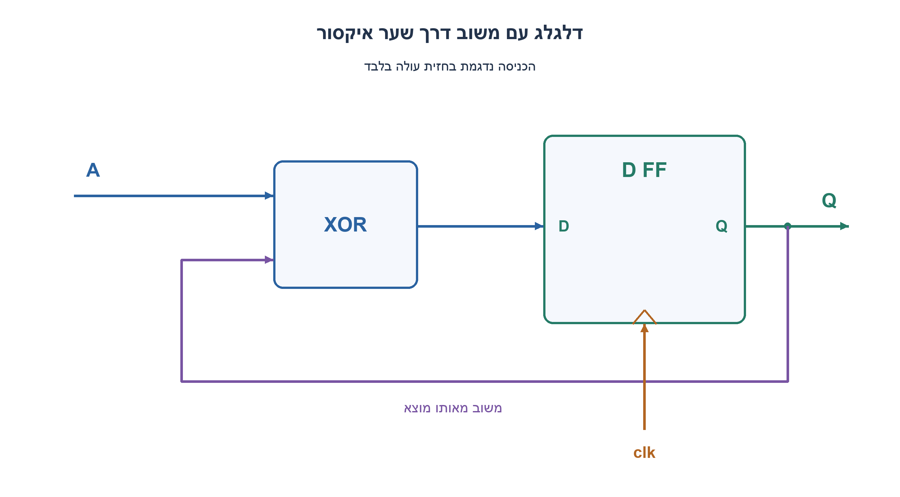
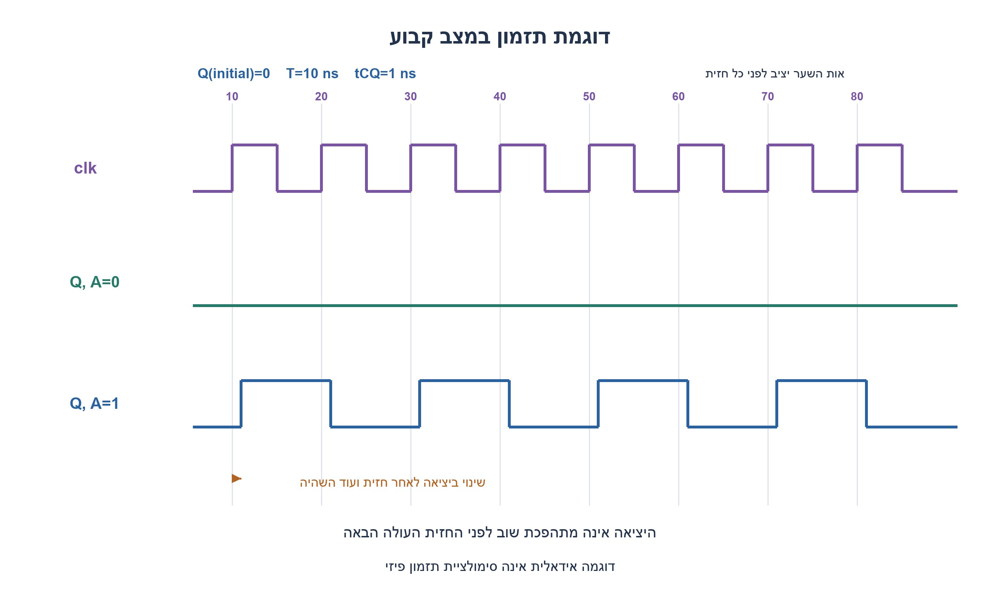
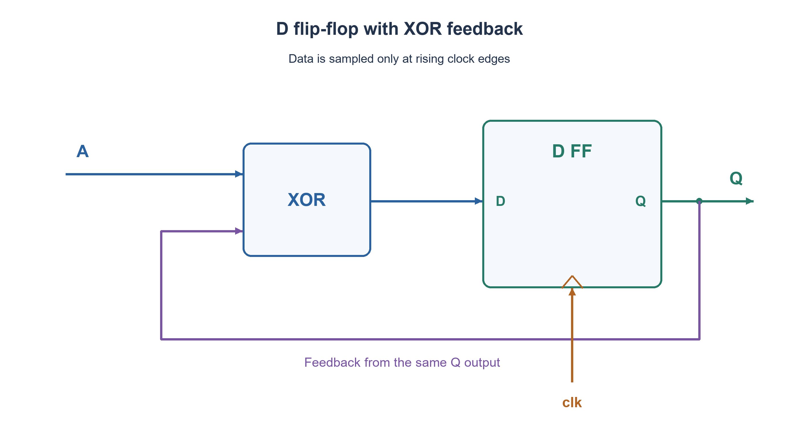
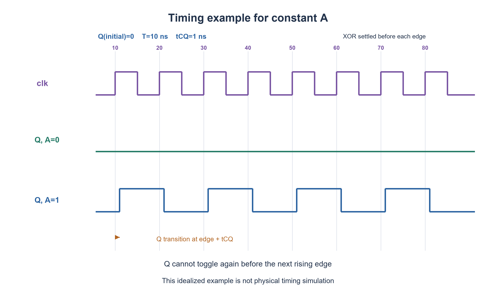

# PREP-074 — משוב XOR לדלגלג D: שמירה, היפוך ותזמון

## מקור שנמסר

שאלות טכניות: 1: מעגל הכולל d-ff עם שער xor בכניסה שלו עם המוצא.. כלומר לוקחים חוט מהמוצא ומכניסים אותו לשער xor עם כניסה שנייה A ואת זה מכניסים לכניסה של ה FF. ואז שואלים כל מיני שאלות על מה עושה המעגל במידה והכניסה A תקועה על "1" ועל "0". מה קורה כאשר יש DELAY במוצא ? לצייר את ה OUTPUT גם.

[צילום המקור הפנימי](../sources/prep-074-source.png)

סטטוס: הצעה לפתרון בסיוע AI; ביקורת מקצועית אנושית ממתינה. פרטי החברות הם דיווח מהמקור בלבד. הבהרות העריכה להלן אינן חלק מהצילום.

## משוב XOR לדלגלג D: שמירה, היפוך ותזמון

נתון דלגלג D שמוצאו Q חוזר לאחת מכניסות שער XOR; הכניסה השנייה היא A, ומוצא השער מחובר ל־D. נתחו את ההתנהגות עבור A=0, עבור A=1, ועבור רצף ערכי A. ציירו את clk ואת Q והסבירו את השפעת ההשהיות.

הבהרות שנוספו למקור: הדלגלג דוגם רק בחזית עולה, בעל זמן מחזור T, ואינו נועל שקוף. נניח Q=0 בתחילת דוגמת התזמון; ללא אתחול ידוע הפאזה אינה ידועה. A וכל המסלול אל D עומדים בזמני setup/hold. הפרידו בין השהיית clock-to-Q, השהיית XOR/חיווט במסלול המשוב, והשהיה נוספת ביציאה חיצונית אחרי נקודת פיצול המשוב. הניחו אפס skew/uncertainty לצורך נוסחאות התזמון הפשוטות. אין ערכי השהיה מספריים בצילום; כל מספר בדוגמה הוא הנחה מסומנת. האם המשוב גורם לתנודה בין חזיתות?

### רמזים

1. כתבו מה הדלגלג דוגם בחזית אחת, לפני שמנסים להסיק צורת גל שלמה.
2. הציבו A=0 ואז A=1 בשער XOR. האם אתם מקבלים את המצב הישן או את היפוכו?
3. השתמשו ב־Q(next)=Q XOR A. כל שינוי ביציאה מגיע אחרי החזית והשהיית clock-to-Q; השינוי החוזר אל D אינו חזית שעון נוספת.

### הצעה לפתרון

### מתחילים ממשוואת המצב

דלגלג זוכר; שער XOR רק מחשב מה יישמר בחזית הבאה. אם Q[k] הוא המצב אחרי החזית הקודמת ו־A[k] יציב לקראת החזית הבאה, אז:

```text
D = Q XOR A
Q[k+1] = Q[k] XOR A[k]
```

| Q לפני החזית | A שנדגם | Q אחרי החזית |
| --- | --- | --- |
| 0 | 0 | 0 |
| 1 | 0 | 1 |
| 0 | 1 | 1 |
| 1 | 1 | 0 |

A=0 נותן D=Q, ולכן שומרים את המצב; הוא אינו מתאפס אוטומטית. A=1 נותן D=NOT Q, ולכן מתהפכים פעם בכל חזית עולה. חזרה לאותו מצב דורשת שתי חזיתות, ומתקבל fQ=fclk/2. במודל אידאלי עם אותה השהיה לשתי קצוות זמן הגבוה והנמוך הם T, ולכן duty cycle הוא 50%. זמני clock-to-Q שונים לעלייה ולירידה יכולים ליצור סטייה קטנה ב־duty cycle הפיזי.

לרצף A כללי: Q אחרי k חזיתות שווה Q(initial) XOR הזוגיות של k הביטים שנדגמו. למשל מ־Q=0, עבור A=1,0,1,1 מתקבלים Q=1,1,0,1. זה דלגלג T עם T=A, או צובר זוגיות; אין כאן SRFF ואין מצב S=R אסור. אם Q ההתחלתי אינו ידוע, A=0 אינו פותר זאת וגם רצף של היפוכים אינו מבטיח ערך מוחלט ידוע.

### מה משנה ההשהיה?

בדוגמת השרטוט בלבד T=10ns ו־tCQ=1ns. בחזיתות t=10,20,30,...ns דוגמים את D הישן. כאשר A=1, Q משתנה ב־11,21,31,...ns. השינוי עובר שוב ב־XOR ומכין D הפוך לקראת החזית הבאה; הוא אינו משנה שוב את Q מיד. זה אינו מתנד קומבינטורי, כל עוד הרכיב אכן דלגלג בחזית ולא נועל שקוף.

כדי שהמשוב יספיק לחזית הבאה, תחת ההנחות הפשוטות שנקבעו:

```text
T >= tCQ(max) + tXOR/wire(max) + tsetup
tCQ(min) + tXOR/wire(min) >= thold
```

השהיה נוספת בתוך המשוב נכללת ב־tXOR/wire: היא עלולה להפר setup במחזור הבא; מסלול קצר מדי עלול להפר hold באותה חזית. הגדלת T לבדה אינה מתקנת הפרת hold. ל־A יש מסלול setup/hold משלו אל D, וגם הוא חייב להיבדק. במערכת אמיתית מוסיפים skew, jitter, uncertainty, שינויי עומס ופינות תהליך לפי כלי STA וספריית התאים. הפרת תזמון אינה מאפשרת לנבא צורת גל דטרמיניסטית במודל הבוליאני.

אם מוסיפים delay רק לעותק של Q שנשלח החוצה, אחרי נקודת המשוב, המצב הפנימי ומשוואתו נשארים ללא שינוי: היציאה החיצונית היא עותק מאוחר. לעומת זאת delay בענף שחוזר ל־XOR משפיע על אילוצי המשוב. זו הבחנה שצריך לברר לפני ציור צורת הגל.

### אימות והיקף הטענה

במודל Python נבדקו כל ארבע שורות האמת וכל רצפי A באורכים 0–10 משני המצבים ההתחלתיים: 4,094 רצפים ו־36,868 חזיתות מול חישוב זוגיות נפרד. נבדקו גם אירועי השהיה קבועה, שמירה ב־A=0, וחלוקה בשתיים ב־A=1. צורף תיאור SystemVerilog התנהגותי, אך לא בוצעו קומפילציית HDL, סינתזה, STA או בדיקת חומרה. ההצעה ממתינה לביקורת מקצועית.





### assumptions

[
  "דלגלג D בחזית עולה; A והמשוב עומדים ב־setup/hold. הנועל השקוף אינו המודל.",
  "Q=0 רק לדוגמה; ללא אתחול אין פאזה מובטחת. T=10ns,tCQ=1ns הם ערכים לדוגמה בלבד.",
  "אפס skew/uncertainty בנוסחאות הפשוטות; מיקום delay חיצוני ביחס לפיצול המשוב מוגדר במפורש."
]

### truth_table

[
  {
    "Q_before": 0,
    "A": 0,
    "Q_after": 0
  },
  {
    "Q_before": 0,
    "A": 1,
    "Q_after": 1
  },
  {
    "Q_before": 1,
    "A": 0,
    "Q_after": 1
  },
  {
    "Q_before": 1,
    "A": 1,
    "Q_after": 0
  }
]

### waveform_observations

[
  "A=0: שמירת Q, לא איפוס.",
  "A=1: מעבר אחד אחרי כל חזית עולה; תדר חצי במצב יציב.",
  "עיכוב חיצוני אחרי פיצול המשוב מזיז את העותק בלבד; עיכוב בתוך המשוב משנה אילוצי תזמון."
]

### verification

עברו 4 שורות אמת, 4,094 רצפים, 36,868 חזיתות ובדיקות אירועי השהיה ואילוצי min/max במודל Python. אין HDL/STA/בדיקה פיזית.

### edge_cases

[
  "Q התחלתי לא ידוע אינו הופך לידוע דרך XOR בלבד.",
  "A המשתנה ליד חזית עלול להפר תזמון.",
  "delay במשוב גדול מדי או קצר מדי פוגע ב־setup או ב־hold בהתאמה.",
  "בהיעדר חזית Q אינו דוגם מחדש, גם כאשר D משתנה."
]

### common_mistakes

[
  "לקרוא למשוב הזה מתנד שרץ בלי שעון.",
  "לומר ש־A=0 מאפס את המצב.",
  "להוסיף tCQ לכל מחזור כצבירת השהיה במקום להצמיד כל שינוי לחזית הרלוונטית.",
  "לבדוק setup בלבד או להניח שהאטת השעון מתקנת hold."
]

### interview_answer

אכתוב Q(next)=Q XOR A: אפס שומר, אחת מהפכת, ורצף כללי צובר זוגיות. ב־A=1 התדר חצי. Q משתנה רק אחרי חזית ועוד tCQ; המשוב מכין את D הבא. צריך לעמוד גם ב־setup למחזור הבא וגם ב־hold לאותה חזית, ולהבהיר היכן נוספה ההשהיה.

### solution_extensions

{
  "question": "כיצד תוסיפו איפוס סינכרוני לאפס ומה הוא פותר?",
  "direction": "בחרו Q(next)=0 כאשר reset=1, אחרת Q XOR A. הוא קובע מצב התחלתי ופאזה; אינו מחליף עמידה בתזמון.",
  "status": "מוכן בתוכן; לא מחובר לתור המשך חי."
}

### technical_references

[
  {
    "title": "AMD UG1388 — דרישות setup ו־hold",
    "url": "https://docs.amd.com/r/2021.1-English/ug1388-acap-system-integration-validation-methodology/Understanding-Timing-Reports",
    "note": "מסמך יצרן תומך בדרישות יציבות לפני ואחרי חזית. משוואת המשוב היא גזירה עצמאית של המעגל."
  }
]

## XOR feedback around a D flip-flop: hold, toggle and timing

A D flip-flop feeds its Q output into one input of an XOR gate. A is the other input, and the XOR output drives D. Analyze A=0, A=1 and an arbitrary sampled A sequence. Draw clk and Q and explain the effect of propagation delays.

Explicit editorial clarifications: the DFF samples only on rising edges with period T; it is not a transparent latch. Use Q=0 initially for the waveform example; without known initialization its phase is unknown. A and the complete D input path meet setup/hold. Distinguish clock-to-Q, XOR/wiring delay in the feedback path, and extra external-output delay after the feedback branch point. Assume zero clock skew/uncertainty for the simplified timing equations. The source gives no numerical delays; any example numbers are labelled additions. Can feedback cause toggling between clock edges?

### Hints

1. Write the value sampled at one edge before deriving the complete waveform.
2. Substitute A=0 and A=1 into XOR. Does D equal old Q or its complement?
3. Use Q(next)=Q XOR A. An output transition follows the edge plus clock-to-Q; feedback changing D is not another clock edge.

### Proposed solution

### Start with the state equation

The flip-flop stores state; XOR only computes the value to store at the next rising edge. If Q[k] is the old stored state and A[k] is stable for the next edge:

```text
D = Q XOR A
Q[k+1] = Q[k] XOR A[k]
```

| Q before edge | Sampled A | Q after edge |
| --- | --- | --- |
| 0 | 0 | 0 |
| 1 | 0 | 1 |
| 0 | 1 | 1 |
| 1 | 1 | 0 |

A=0 makes D=Q, so the state holds; it does not automatically reset. A=1 makes D=NOT Q, so Q toggles at each rising edge. Returning to the same value takes two edges, giving fQ=fclk/2. With ideal equal rise/fall propagation delays, high and low each last T and duty cycle is 50%. Unequal rising/falling clock-to-Q delays can slightly alter the physical duty cycle.

For arbitrary A, Q after k edges is initial Q XOR the parity of the k sampled bits. From Q=0 with A=1,0,1,1 the successive Q values are 1,1,0,1. This is a T flip-flop with T=A, or a parity accumulator; it is not an SRFF and has no forbidden S=R input pair. Unknown initial Q remains unknown under holding or toggling unless initialized by some specified mechanism.

### What does propagation delay change?

Only the illustrative diagram assumes T=10ns and tCQ=1ns. At sampling edges t=10,20,30,...ns the DFF samples old D. For A=1, Q changes at 11,21,31,...ns. That change passes through XOR and prepares the opposite D for the next edge; it cannot cause another immediate Q transition. This is not a combinational oscillator, provided the component really is edge triggered rather than transparent.

For the simplified zero-skew model, feedback must satisfy:

```text
T >= tCQ(max) + tXOR/wire(max) + tsetup
tCQ(min) + tXOR/wire(min) >= thold
```

Added delay inside feedback belongs in tXOR/wire: too much can violate next-edge setup; too little minimum delay can violate same-edge hold. Increasing T alone does not repair a hold violation. A has its own input-to-D timing path and must also meet setup/hold. Real static timing analysis includes skew, jitter, uncertainty, loading and process corners. A Boolean model cannot predict a deterministic waveform after a timing violation.

If added delay affects only an external copy of Q after the feedback branch, internal state evolution is unchanged; the external output is simply later. A delay in the branch returning to XOR instead changes feedback timing constraints. Clarify the location before drawing waveforms.

### Verification and scope

Python checked four truth rows and all A sequences of lengths zero through ten from both initial states: 4,094 streams and 36,868 sampling edges against a separate parity calculation. Constant-delay events, holding for A=0 and divide-by-two for A=1 were also checked. Behavioral SystemVerilog is supplied but was not compiled, synthesized, HDL-simulated, statically timed or tested in hardware. Professional review is pending.





### assumptions

[
  "Rising-edge DFF; A and feedback meet setup/hold. A transparent latch is a different model.",
  "Q=0 only for the example; unknown initialization means unknown phase. T=10ns,tCQ=1ns are illustrative only.",
  "Simplified inequalities assume zero skew/uncertainty; delay location relative to the feedback branch is explicit."
]

### truth_table

[
  {
    "Q_before": 0,
    "A": 0,
    "Q_after": 0
  },
  {
    "Q_before": 0,
    "A": 1,
    "Q_after": 1
  },
  {
    "Q_before": 1,
    "A": 0,
    "Q_after": 1
  },
  {
    "Q_before": 1,
    "A": 1,
    "Q_after": 0
  }
]

### waveform_observations

[
  "A=0 holds Q rather than resetting it.",
  "A=1 gives one transition after each rising edge and half frequency in steady state.",
  "An external delay after the feedback branch delays only that copy; feedback-path delay changes timing constraints."
]

### verification

Passed four truth rows, 4,094 streams, 36,868 edges, delay-event and min/max-constraint examples in Python. No HDL, STA or physical verification.

### edge_cases

[
  "XOR alone does not resolve an unknown initial Q.",
  "A changing near the edge can violate timing.",
  "Excessive or insufficient feedback delay can violate setup or hold respectively.",
  "Without a new edge Q does not resample even when D changes."
]

### common_mistakes

[
  "Calling the feedback a free-running oscillator.",
  "Claiming A=0 clears the state.",
  "Accumulating tCQ across cycles rather than associating each transition with its sampling edge.",
  "Checking setup alone or expecting a slower clock to fix hold."
]

### interview_answer

Q(next)=Q XOR A: zero holds, one toggles, and an arbitrary sequence accumulates parity. A=1 divides frequency by two. Q changes only after an edge plus tCQ; feedback prepares the next D. Check next-edge setup and same-edge hold, and clarify exactly where added delay is located.

### solution_extensions

{
  "question": "How would synchronous reset-to-zero change the circuit?",
  "direction": "Select Q(next)=0 when reset is one, otherwise Q XOR A. Reset establishes state and phase but does not replace timing checks.",
  "status": "Prepared in content, not connected to the live follow-up queue."
}

### technical_references

[
  {
    "title": "AMD UG1388 — setup and hold requirements",
    "url": "https://docs.amd.com/r/2021.1-English/ug1388-acap-system-integration-validation-methodology/Understanding-Timing-Reports",
    "note": "Manufacturer documentation supports the before/after-edge stability requirements. Feedback equations are independently derived for this circuit."
  }
]

## Files

- [Code](../solutions/prep_074_xor_feedback_dff.py)
- [Code](../solutions/prep_074_xor_feedback_dff.sv)
- [Verification](../checks/check_prep_074.py)
- [Evidence](../checks/prep-074-verification.json)
