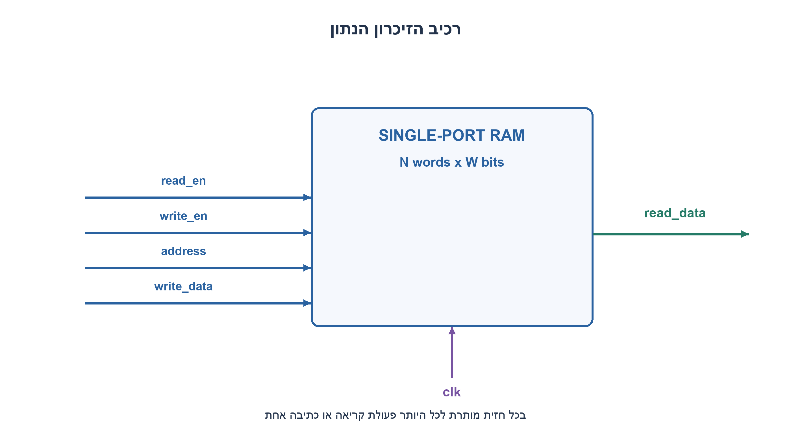
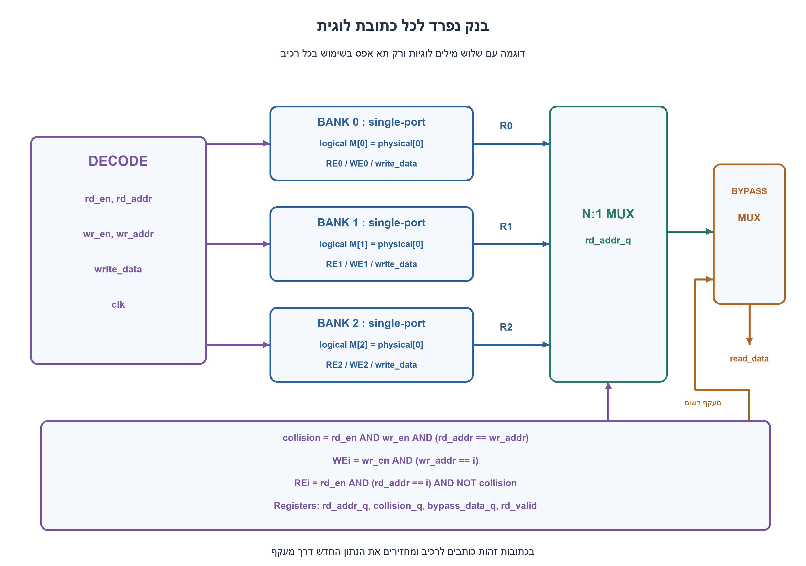
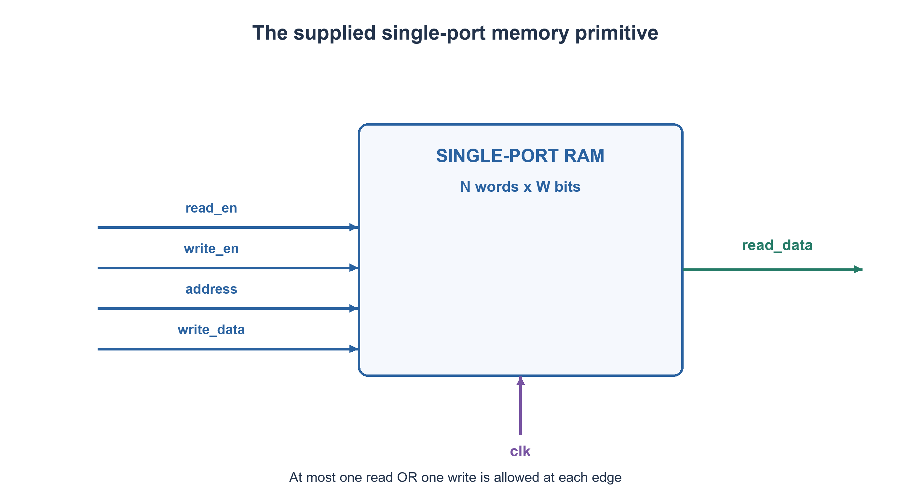
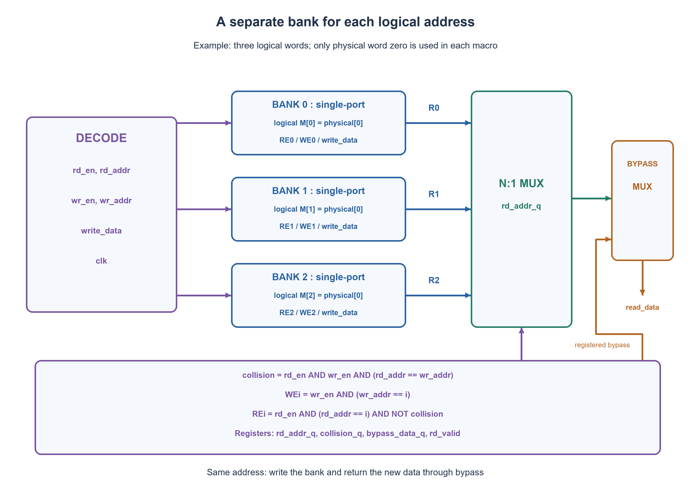

# PREP-075 — קריאה וכתיבה במקביל מזיכרונות בעלי פורט יחיד

## מקור שנמסר

שאלה 2 : רכיב שמקבל 4 כניסות
1) READ-ENABLE
2) WRITE-ENABLE
3) ADDRESS
4) ADDRES_DATA
ומוצא אחד שהוא READ-DATA
הרכיב הזה לא יכול לכתוב ולקרוא באותו זמן..
יש לך כמה שאתה רוצה מן הרכיב הזה ושערים לוגים..
תעשה רכיב חדש שיודע לקרוא ולכתוב באותו זמן.

[צילום המקור הפנימי](../sources/prep-075-source.png)

סטטוס: הצעה לפתרון בסיוע AI; ביקורת מקצועית אנושית ממתינה. פרטי החברות הם דיווח מהמקור בלבד. הבהרות העריכה להלן אינן חלק מהצילום.

## קריאה וכתיבה במקביל מזיכרונות בעלי פורט יחיד

נתון רכיב זיכרון עם read_en, write_en, address ו־write_data, ומוצא read_data. הוא יכול לקרוא או לכתוב בכל חזית, אך אינו יכול לבצע את שתיהן באותה חזית. מותר להשתמש בכל מספר של רכיבים כאלה ובלוגיקת בקרה. בנו זיכרון לוגי שמקבל קריאה אחת וכתיבה אחת במקביל, גם לאורך רצף בלתי מוגבל של מחזורים. הציגו חיבורים, משמעות הכתובות, התנגשות באותה כתובת ועלות.

הבהרות שנוספו למקור: הזיכרון הלוגי מכיל N מילים של W ביטים, N,W חיוביים. לכל primitive לפחות N מילים, קריאה סינכרונית עם פלט רשום וכתיבה באותו שעון עולה; בכל חזית לכל רכיב לכל היותר פעולה אחת. לממשק הלוגי יש כתובות נפרדות rd_addr,wr_addr; פורט הכתובת היחיד של primitive אינו שתי כתובות עצמאיות. אחרי חזית עם rd_en=1 מופיעים הנתון ו־rd_valid=1 למחזור התגובה, ללא מחזור המתנה נוסף. כתיבה וקריאה לאותה כתובת מחזירות את הנתון החדש, write-first. ללא קריאה rd_valid=0 והנתון אינו מחייב. אין הבטחת תוכן בתחילת העבודה: קריאה מוגדרת רק לאחר כתיבה לאותה מילה, או במעקף כתיבה באותה חזית. איפוס הבקרה מדכא בקשות ומאפס rd_valid אך אינו מאפס את הזיכרון. מותרות לוגיקה צירופית ורשומות בקרה, לרבות רשומת מעקף של W ביטים; אין צורך לממש את כל מערך הנתונים מחדש בדלגלגים. אין רשות אוטומטית לשעון כפול, ואין דרישה למספר מינימלי של רכיבים.

### רמזים

1. הגדירו קודם שתי כתובות לוגיות ותוצאת קריאה כאשר שתיהן זהות. מה בדיוק גורם להתנגשות בפורט יחיד?
2. אין מגבלת מספר רכיבים. האם אפשר לשלם בשטח כך ששתי כתובות לוגיות שונות לעולם לא יפנו לאותו רכיב פיזי?
3. הקדישו לכל מילה לוגית רכיב נפרד והשתמשו רק בתא אפס שלו. בקריאה וכתיבה לאותה מילה, כתבו לרכיב והחזירו את הנתון החדש במעקף. התאימו את בחירת הפלט לתזמון הקריאה.

### הצעה לפתרון

### מחליפים צפיפות זיכרון בהפרדת פורטים

המפתח הוא שמותרות הרבה קופסאות ואין דרישת מינימום. נקדיש למילה לוגית i את bank[i], ונשמור אותה רק בכתובת הפיזית 0 של אותו רכיב. נקבל N בנקים. יתר התאים בכל רכיב אינם בשימוש; זו בחירה מכוונת כדי לתת בנייה פשוטה ותקפה בלי להמציא שעון נוסף. כל address פיזי מחובר לקבוע 0. write_data מגיע לכל הבנקים, אבל רק בנק הכתיבה מקבל write_en.

אם rd_addr שונה מ־wr_addr, פונים לשני בנקים שונים: אחד קורא ואחד כותב באותה חזית. אם הכתובות שוות, אי אפשר לבצע את שתי הפעולות באותו בנק; לפי חוזה write-first, אין צורך לקרוא אותו: כותבים ושומרים את write_data למעקף הפלט.

```text
collision = rd_en AND wr_en AND (rd_addr == wr_addr)
WE[i] = wr_en AND (wr_addr == i)
RE[i] = rd_en AND (rd_addr == i) AND NOT collision
physical_address[i] = 0
```

לכל i, האותות RE[i],WE[i] אינם פעילים יחד. במקרה של שתי כתובות שונות האחד יכול לקרוא בזמן שהאחר כותב; במקרה של התנגשות קריאת הבנק מדוכאת. זה נכון לכל מחזור בנפרד, ולכן אין תור כתיבות שעלול להתמלא אחרי רצף ארוך.

### התאמת הפלט לזמן הקריאה

primitive שקיבל RE קורא את תא אפס ומעדכן את פלטו הרשום אחרי החזית. באותה חזית הבקרה שומרת rd_addr_q ואת collision_q; בעת התנגשות היא שומרת גם bypass_data_q=write_data. אחרי החזית:

```text
read_data = collision_q ? bypass_data_q : bank[rd_addr_q].read_data
rd_valid  = rd_en שנדגם בחזית האחרונה
```

בחירת הבנק חייבת להיות רשומה: שימוש ב־rd_addr החי עלול להעביר פלט של בקשת קריאה אחרת כאשר הכתובת כבר השתנתה. כאשר אין קריאה rd_valid=0 ואין הבטחת נתון בממשק. איפוס חוסם את RE/WE ומאפס את rd_valid; אינו טוען לאיפוס של תוכן כל הזיכרונות. גם כש־N אינו חזקה של שתיים יש להבטיח כתובות 0..N−1 ולדחות כתובות לא חוקיות בממשק. הבקרה, המפענחים, ה־MUX והנתונים חייבים לעמוד בתזמון השעון; צירופיות אינה הבטחה לאפס השהיה.

### דוגמה ונכונות

בזיכרון של ארבע מילים: תחילה נכתוב 7 לכתובת 1. בחזית הבאה נבקש לקרוא מ־1 ולכתוב 9 ל־3. bank[1] קורא 7 ו־bank[3] כותב 9; נקבל 7 עם rd_valid=1. בחזית שלאחר מכן קריאה וכתיבה של 5 לאותה כתובת 1 כותבות ל־bank[1], מדכאות בו RE ומחזירות 5 דרך המעקף. קריאה עתידית מ־1 תחזיר גם היא 5.

האינווריאנט: תא אפס בבנק i מכיל את הכתיבה האחרונה למילה לוגית i, אם הייתה כזו. בתחילה אין טענה על מילה שלא נכתבה. כל כתיבה משנה רק את הבנק הנכון. קריאה ללא התנגשות מחזירה את אותה מילה; קריאה עם התנגשות מחזירה את הכתיבה החדשה. מכאן החוזה מתקיים לכל רצף בקשות תקין.

### עלות ומה לא מספיק

משתמשים ב־N רכיבי RAM. אם כל אחד בעל N מילים של W ביטים, הקיבולת הפיזית היא N²W ביטים ורק NW מנוצלים. יש גם מפענחים, MUX של N כניסות ברוחב W, כתובת רשומה, דגלים ורשומת מעקף של W ביטים. אין כאן טענת מינימום שטח או מספר רכיבים; זה מחיר גבוה שמותר על פי נוסח הבעיה.

שני עותקים זהים עם כתיבה לשניהם אינם פותרים זרם מלא של קריאות וכתיבות: בכל חזית כתיבה שני הפורטים עסוקים, ולכן אין עותק פנוי לקריאה מכתובת אחרת. תור עדכונים סופי אינו פותר רצף בלתי מוגבל של כתיבות בלי להוכיח קצב ניקוז מתאים. גם פיצול רגיל לזוג בנקים לפי ביט כתובת אינו מספיק: שתי כתובות שונות יכולות להתנגש באותו בנק. חלופה תקפה היא multipumping: אם מותר שעון פנימי של 2f ושני חלונות פעולה שעומדים בתזמון, primitive אחד יכול לבצע שתי גישות במחזור לוגי; זו הנחה נוספת, לא תוצאה של חיבור שערים בלבד.

### אימות

מודל Python מייצג כל primitive בנפרד ואוסר RE ו־WE יחד. עברו כל בקשות הקריאה/כתיבה/כתובות/נתון לכל תוכן התחלתי של ביט אחד בעומקים 1–4, ועוד 50,000 חזיתות אקראיות בעומקים 1,2,3,8,17 מול מפרט מערך נפרד עם write-first. נכללו איפוס, מילים שטרם נכתבו והתנגשויות. לא בוצעו סימולציית HDL, סינתזה או בדיקת תזמון פיזי. ההצעה ממתינה לביקורת מקצועית.





### assumptions

[
  "זיכרון לוגי N×W עם כתובות נפרדות לקריאה ולכתיבה, שעון עולה משותף ותגובה אחרי אותה חזית.",
  "כל primitive הוא single-port עם קריאה רשומה, ולכל היותר פעולה אחת בחזית; מספיקים לפחות N תאים ברכיב.",
  "write-first בהתנגשות; מילים שלא נכתבו אינן בעלות ערך מובטח. איפוס בקרה אינו מאפס נתונים.",
  "מותר מספר לא מוגבל של רכיבים, לוגיקה ורשומות בקרה כולל מעקף W ביטים; אין שעון כפול נתון ואין יעד מינימום שטח."
]

### optimality

{
  "criterion": "קצב גישה לוגי תחת מגבלת primitive בעל פורט יחיד.",
  "result": "קריאה אחת וכתיבה אחת לכל מחזור ללא דחייה, באמצעות N בנקים ומעקף.",
  "proof": "כתובות שונות נמצאות בבנקים שונים; כתובות זהות דורשות כתיבה פיזית אחת ומעקף בלבד.",
  "scope": "בנייה תקפה ולא טענת מינימום. N רכיבים וקיבולת פיזית N²W אם כל רכיב הוא N×W."
}

### verification

בדיקה ממצה של כל בקשות המחזור לכל זיכרון ביטי בעומקים 1–4 ועוד 50,000 חזיתות אקראיות מול מפרט נפרד. כל primitive נאסר מקריאה וכתיבה יחד; אין סימולציית HDL או בדיקת תזמון פיזי.

### edge_cases

[
  "N=1: כל בקשת קריאה+כתיבה היא התנגשות ומטופלת במעקף.",
  "כתובות שונות באותו מחזור, כתובות זהות וזרם בקשות ללא הפסקה.",
  "אין קריאה: rd_valid=0. אין כתיבה קודמת: תוכן לא מובטח.",
  "איפוס גובר על הבקשות ושומר נתוני זיכרון קיימים; כתובות לא חוקיות אינן מתקבלות."
]

### common_mistakes

[
  "להציג שני עותקים שכל כתיבה מעדכנת את שניהם כאילו אחד עדיין פנוי לקריאה.",
  "להוסיף שעון 2f בלי להצהיר שזו הנחה חדשה.",
  "לבחור פלט RAM סינכרוני באמצעות כתובת חיה של המחזור הבא.",
  "להשאיר תוצאת התנגשות באותה כתובת ללא הגדרה או לטעון למינימום רכיבים בלי הוכחה."
]

### interview_answer

מאחר שמספר הרכיבים אינו מוגבל, אקדיש לכל כתובת לוגית רכיב משלה ואשתמש רק בתא אפס. קריאה וכתיבה לכתובות שונות מגיעות לרכיבים שונים. באותה כתובת אכתוב ואחזיר את הנתון החדש במעקף רשום. ארשום גם את בחירת בנק הקריאה כדי להתאים לקריאה סינכרונית. זו בנייה בזבזנית בשטח אבל תומכת בזרם מלא בלי שעון כפול.

### solution_extensions

{
  "question": "מה משתנה אם נדרש read-first באותה כתובת במקום write-first?",
  "direction": "המעקף אינו מספיק כדי להחזיר את הערך הישן. בנייה פשוטה שאינה מינימלית: שני רכיבים לכל מילה; שניהם שומרים עותקים, בכל כתיבה מעדכנים רק אחד ומסובבים ביט מצביע לעותק החדש. בהתנגשות קוראים את העותק העדכני הישן וכותבים לעותק השני; בבקשה הבאה המצביע בוחר בעותק שנכתב. דורש מצביע לכל מילה ואתחול/תקפות. יש לבדוק תזמון ורצפים, ואין כאן טענה שנבדקה חלופה זו בקוד המצורף.",
  "status": "מוכן בתוכן; לא מחובר לתור המשך חי; הרחבה לא אומתה בקוד."
}

### source_ambiguities

[
  "המקור אינו מציין עומק, רוחב, קריאה סינכרונית או צירופית, latency, כתובות לוגיות נפרדות, אתחול או תוצאת read-during-write. אלה הוגדרו במפורש בנוסח הערוך.",
  "השם ADDRES_DATA בצילום פורש כ־write_data ולא ככניסת כתובת שנייה. אין די במקור כדי להכריע אם כוונה לחלוקת זמן או למספר מינימלי של רכיבים."
]

### technical_references

[
  {
    "title": "AMD — Single Port RAM",
    "url": "https://docs.amd.com/r/en-US/ug958-vivado-sysgen-ref/Single-Port-RAM",
    "note": "התנהגות קריאה בזמן כתיבה תלויה בחוזה הרכיב; הבנייה כאן מניחה במפורש primitive שאינו מבצע שתי פעולות. הבנקאות היא גזירה עצמאית, לא ייחוס ליצרן."
  }
]

## Concurrent read and write using single-port memories

A memory primitive has read_en, write_en, address and write_data inputs and a read_data output. It can read OR write at a clock edge, never both. Any number of these primitives and control logic are available. Build a logical memory accepting one read and one write concurrently for an unbounded sequence of cycles. Give connections, address semantics, same-address behavior and cost.

Explicit editorial clarifications: logical capacity is N words of W bits, with positive N,W. Each primitive has at least N words, synchronous registered reads and writes on the same rising-edge clock; each primitive performs at most one operation per edge. The logical interface has separate rd_addr and wr_addr; one primitive address port is not two independent addresses. After an edge with rd_en=1, data and rd_valid=1 are available for its response cycle, without an extra wait cycle. Same-address simultaneous requests return new write data (write-first). Without a read rd_valid=0 and data is unspecified. Initial memory contents are not guaranteed; a defined read follows a write to that word or a same-edge write bypass. Control reset suppresses requests and clears rd_valid, without clearing memory. Combinational logic and control registers, including a W-bit bypass register, are allowed; implementing the entire data array in flip-flops is unnecessary. A double-frequency clock is not automatically available. Minimum primitive count is not required.

### Hints

1. First define independent logical addresses and the required same-address read value. What exactly creates a single-port conflict?
2. There is no primitive-count limit. Can extra hardware ensure that different logical addresses never access the same physical component?
3. Dedicate one primitive to each logical word, using only its physical address zero. On a same-word collision write the bank and bypass new data. Align output selection with synchronous read timing.

### Proposed solution

### Trade memory density for conflict separation

Unlimited primitives and no minimum-count requirement permit a simple valid construction. Dedicate bank[i] to logical word i, storing that word only at physical address zero. There are N banks. All remaining words in each primitive are deliberately unused. This buys a correct design without inventing a faster clock. Tie every physical address to zero; broadcast write_data but enable only the selected write bank.

Different logical read and write addresses select different primitives, so one reads while the other writes at the same edge. If the addresses match, that bank cannot do both. The write-first contract lets us suppress its read, perform the write and return registered write data through bypass.

```text
collision = rd_en AND wr_en AND (rd_addr == wr_addr)
WE[i] = wr_en AND (wr_addr == i)
RE[i] = rd_en AND (rd_addr == i) AND NOT collision
physical_address[i] = 0
```

RE[i] and WE[i] are never simultaneously active. Distinct addresses use different banks; a same-address collision disables the bank read. This property holds on every edge, so no deferred-write queue can overflow after a long sequence.

### Align output selection with the read response

A bank with RE samples physical word zero and updates its registered read output after the edge. At that same edge control stores rd_addr_q and collision_q; a collision also captures bypass_data_q=write_data. After the edge:

```text
read_data = collision_q ? bypass_data_q : bank[rd_addr_q].read_data
rd_valid  = rd_en sampled at the most recent edge
```

The bank selector must be registered: a live rd_addr could select another bank as soon as the next request changes address. Without a read, rd_valid=0 and output data is not specified by the interface. Reset suppresses RE/WE and clears rd_valid; it does not imply clearing every memory word. Even for a non-power-of-two N, addresses must lie in 0..N−1 and invalid encodings must be rejected. Control, decoding, muxing and data paths must all meet the clock period; combinational logic does not mean zero delay.

### Example and correctness

For four logical words, first write 7 at address1. Next request a read from1 and a write of9 at3. Bank1 reads7 while bank3 writes9, yielding7 with rd_valid=1. Then simultaneously reading and writing5 at address1 writes bank1, disables its RE and returns5 through bypass. A later ordinary read from1 also returns5.

Invariant: physical word zero of bank i contains the most recent write to logical word i, if one exists. Nothing is claimed for an unwritten word. Each write updates only its proper bank. A noncolliding read returns that bank's word; a colliding read returns new write data. Therefore the contract holds for every valid request sequence.

### Cost and tempting invalid shortcuts

The construction uses N RAM primitives. If each contains N words of W bits, physical capacity is N²W bits while only NW are used. Additional hardware includes decoders, an N-input W-bit mux, a registered address, flags and a W-bit bypass register. No minimum-area or minimum-component-count claim is made; this intentionally expensive construction is allowed.

Two identical replicas with writes broadcast to both do not support an unrestricted read/write stream: both ports are occupied on a write edge, leaving neither free to read another address. A finite update queue does not solve unbounded writes without a proven drain rate. Ordinary two-way banking by one address bit also fails when two different addresses map to the same bank. Multipumping is a valid alternative only if a 2f internal clock and two correctly timed operation slots are explicitly permitted; gates alone do not establish that timing resource.

### Verification

The Python model represents each physical primitive separately and asserts mutual exclusion of RE/WE. Every read/write/address/data request from every one-bit initialized memory of depths1..4 passed, plus50,000 random edges at depths1,2,3,8,17 against an independent write-first array specification. Checks included reset, unwritten values and same-address collisions. No HDL simulation, synthesis or physical timing verification was performed. Professional review is pending.





### assumptions

[
  "Logical N×W memory, independent read/write addresses, common rising-edge clock and response after the sampling edge.",
  "Each single-port primitive has registered reads and at most one operation per edge, with at least N physical words.",
  "Write-first collisions; unwritten words are unspecified. Control reset does not clear memory contents.",
  "Unlimited primitives, logic and control registers including a W-bit bypass are allowed; no double-frequency clock is supplied and minimum area is not required."
]

### optimality

{
  "criterion": "Logical access throughput with single-port physical primitives.",
  "result": "One read and one write per cycle without stalls, using N banks and bypass.",
  "proof": "Different addresses occupy different banks; a same-address request needs only one physical write plus bypass.",
  "scope": "Valid construction, not a minimum claim. N macros and N²W physical capacity when each macro is N×W."
}

### verification

Exhaustive one-edge requests from every one-bit memory of depths1..4 plus50,000 random edges against a separate specification. Primitive read/write mutual exclusion asserted; no HDL or physical timing verification.

### edge_cases

[
  "N=1 makes every simultaneous request a collision handled by bypass.",
  "Different addresses, same address and uninterrupted request streams.",
  "No read means rd_valid=0. A never-written word has no guaranteed content.",
  "Reset overrides requests while preserving memory contents; invalid addresses are rejected."
]

### common_mistakes

[
  "Broadcasting writes to two replicas while assuming one remains free to read.",
  "Adding a 2f clock without identifying the additional assumption.",
  "Selecting a synchronous RAM response with the next cycle's live address.",
  "Leaving same-address behavior undefined or claiming minimum primitive count without proof."
]

### interview_answer

With unlimited primitives I dedicate one macro to each logical address and use only its word zero. Different-address read/write requests hit different macros. A same-address request writes the macro and returns registered new data through bypass. I also register the bank selector to align the synchronous response. It wastes area but handles full-rate streams without a faster clock.

### solution_extensions

{
  "question": "What changes if same-address reads must return old data (read-first)?",
  "direction": "New-data bypass is insufficient. One nonminimal construction uses two macros per logical word and a per-word current-copy bit. A write updates the other copy and flips the bit; a colliding read reads the previously current copy while the other is written. The next request selects the newly written copy. Initialization/validity and timing need explicit treatment. This extension was not executed by the supplied checks.",
  "status": "Prepared in content, not connected to the live follow-up queue; extension not code-verified."
}

### source_ambiguities

[
  "The source omits depth, width, read timing, latency, independent logical addresses, initialization and collision behavior. The edited prompt declares them explicitly.",
  "The source's ADDRES_DATA was interpreted as write_data, not as another address. It does not establish whether time multiplexing or a minimum component count was intended."
]

### technical_references

[
  {
    "title": "AMD — Single Port RAM",
    "url": "https://docs.amd.com/r/en-US/ug958-vivado-sysgen-ref/Single-Port-RAM",
    "note": "Read-during-write behavior depends on the primitive contract. This construction explicitly assumes no dual operation per primitive; banking is independently derived, not attributed to the manufacturer."
  }
]

## Files

- [Code](../solutions/prep_075_banked_single_port.py)
- [Verification](../checks/check_prep_075.py)
- [Evidence](../checks/prep-075-verification.json)
