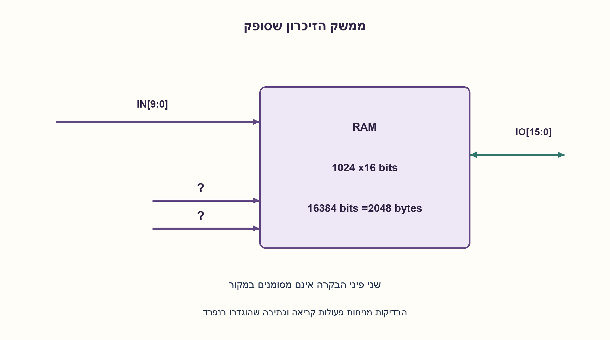
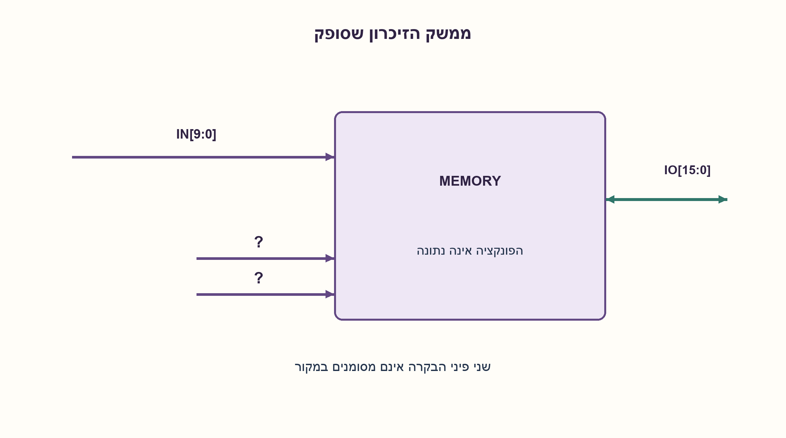
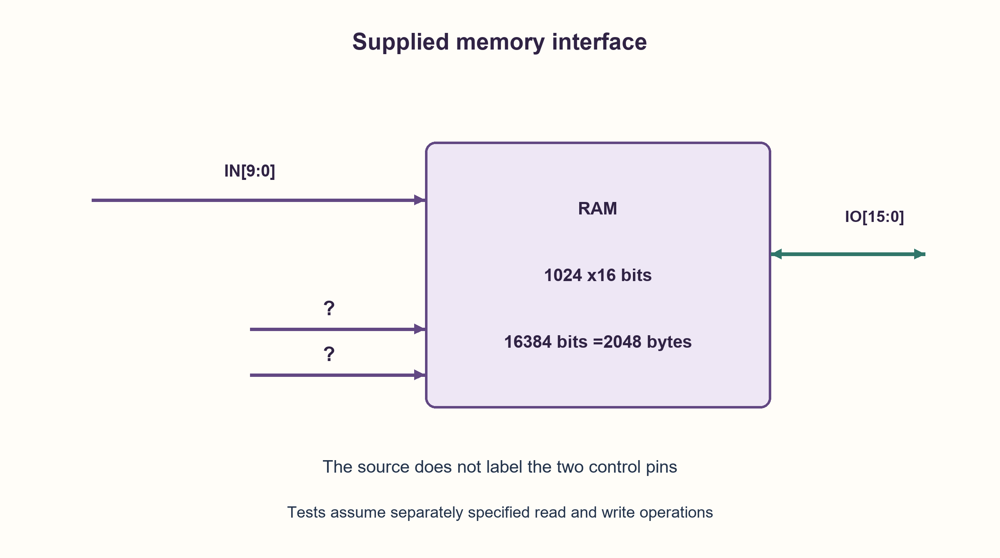
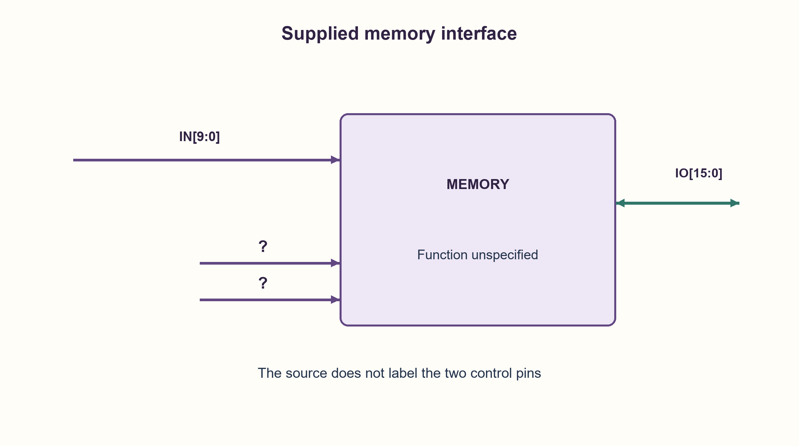

# PREP-076 — בדיקת זיכרון: האם שתי כתובות פונות לאותו תא?

פתרון מוצע בסיוע AI; ביקורת מקצועית אנושית ממתינה. הקושי אינו מכויל.

[צילום מקור פרטי](../sources/2026-10-30-batch90-12.png)

יש קופסת זיכרון. 1. למה משמשת הכניסה לדעתך? 2. מה מרחב הזיכרון? 3. איך היית בודק את תקינות הזיכרון? 4. כתוב פסאודו־קוד. בשרטוט נראים אוטובוס נכנס ברוחב 10, אוטובוס דו־כיווני ברוחב 16 ושני חיבורי בקרה ללא כיתוב.

חברות לפי הדיווח בצילום בלבד: Apple.

## עברית

### וריאציה: קופסת זיכרון עם אפיקי 10 ו־16 סיביות
בצילום נראים אפיק נכנס המסומן 10, אפיק דו־כיווני המסומן 16 ושני קווי בקרה ללא שמות. הסבירו שימוש אפשרי, הסיקו מה ניתן לדעת על הקיבולת ותכננו בדיקות עם פסאודו־קוד.

הבהרה: רוחבי הפינים לבדם אינם מוכיחים שהרכיב הוא RAM. לצורך חישוב ובדיקות נבחר מודל מפורש של RAM רגיל, עם 10 קווי כתובת ו־16 קווי נתונים, ללא ריבוב כתובות או בנקים מוסתרים. פעולות read/write חוקיות, זמני התייצבות וכיוון DQ חייבים להיקבע מחוזה הממשק; שני קווי המקור אינם משויכים בשקט ל־WE/OE. הבדיקה הרסנית, ולכן נדרשת הרשאה או גיבוי אם יש נתונים חשובים.

1. הפרידו בין מספר הכתובות לבין מספר הביטים בכל כתובת.
2. עשר סיביות כתובת בוחרות 2^10 מילים, וכל מילה מכילה 16 סיביות תחת הנחת הממשק.
3. בדקו נתונים קבועים, סיבית יחידה מטיילת, ואז כתבו ערך ייחודי לכל כתובת לפני הקריאה; כך אי אפשר להסתפק בקריאה מיד אחרי כתיבה לכל תא.

### הקיבולת היא מסקנה מותנית בחוזה
אם עשר הכניסות הן כתובת מקבילית רגילה, יש 2^10=1024 מילים. אם אפיק 16 הוא מילה שלמה, מתקבלים 16,384 ביטים, כלומר 2,048 בתים. רוחב כתובת אינו מספר תאי הנתונים כפול 16 פעם נוספת. אבל השרטוט אינו מגדיר סוג רכיב, כתובות מרובבות, בנקים, זמני גישה או משמעות פיני הבקרה; אי אפשר להסיק את הפרטים האלה מהקווים לבדם.

במודל RAM הנבחר יש read/write מסונכרנות או מושלמות לפני הפעולה הבאה. יש לקבוע מי מניע DQ בכל שלב כדי שלא שתי יציאות יניעו את האפיק יחד. הרשאת כתיבה ונתונים יציבים נבדקים לפי חוזה או datasheet של רכיב מזוהה; אין להמציא רמות בקרה לפי השרטוט.

בדיקה הרסנית בסיסית: עבור כל דפוס מתוך 0000, FFFF,5555, AAAA ו־16 דפוסי walking-one, כותבים אותו לכל הכתובות ואז קוראים את כולן ומשווים. לאחר מכן כותבים את i לכתובת i לכל i=0..1023, ורק אז קוראים כל כתובת ומשווים ל־i. הערכים הייחודיים מתאימים ל־16 ביטים. אם שני i שונים חולקים תא פיזי, לא ייתכן ששתי קריאותיו יחזירו שני ערכים שונים, ולכן לפחות אחת נכשלת.

קריאה מיידית אחרי כל כתיבה לבדה יכולה לפספס aliasing: שתי כתובות שונות יכתבו ויקראו שוב ושוב את אותו תא בהצלחה. גם הבדיקה הרחבה אינה מוכיחה את כל תקלות הזיכרון האמיתיות. למשל פרמוטציה קבועה ובי־חד־ערכית של הכתובות נראית תקינה דרך אותו ממשק קריאה/כתיבה; תקלות תלויות זמן, צימוד, שימור מטען ו־read disturb דורשות מודלי כשל ובדיקות נוספים. יש לבדוק גם כתובות גבול, שינויים בבקרות ומניעת כתיבה כשהיא אסורה לפי מפרט.

הדגם ביצע 20 מעברי דפוס ועוד מעבר כתובות ייחודיות; בעלות O(1024·16) עבור מספר סיביות הנתונים הפרמטרי, ואחסון עבודה קבוע מעבר לזיכרון הנבדק. נבדק דגם תקין ועוד 26 דגמי תקלות:10 קווי כתובת מאולצים לאפס ו־16 קווי נתונים תקועים באפס. זהו אימות מודל לוגי, לא בדיקת שבב פיזי או הכשרה לתקן בדיקות זיכרון.

### מודל לוגי בפייתון שהורץ

```python
"""Logical RAM fault-injection model; not a physical memory test qualification."""


class Memory:
    def __init__(self, alias_bit=None, stuck_zero_bit=None):
        self.words = [0] * 1024
        self.alias_bit = alias_bit
        self.stuck_zero_bit = stuck_zero_bit

    def address(self, address):
        return address if self.alias_bit is None else address & ~(1 << self.alias_bit)

    def write(self, address, value):
        if not 0 <= address < 1024 or not 0 <= value < 65536:
            raise ValueError("10 address and 16 data bits required")
        if self.stuck_zero_bit is not None:
            value &= ~(1 << self.stuck_zero_bit)
        self.words[self.address(address)] = value

    def read(self, address):
        if not 0 <= address < 1024:
            raise ValueError("10 address bits required")
        return self.words[self.address(address)]


def interface_tests(memory):
    """Destructive: assumes conventional, deterministic read/write operations."""
    for pattern in (0, 65535, 21845, 43690, *(1 << i for i in range(16))):
        for address in range(1024):
            memory.write(address, pattern)
        for address in range(1024):
            if memory.read(address) != pattern:
                return False
    # Each logical address receives a unique value before any is checked.
    for address in range(1024):
        memory.write(address, address)
    return all(memory.read(address) == address for address in range(1024))
```






### assumptions

```json
[
  "המספר 16 הוא רוחב מילה, והמספר 10 רוחב כתובת, רק תחת הנחת RAM רגיל שהוספנו.",
  "קווי הבקרה במקור אינם מסומנים. פעולות גישה וסיום פעולה מוגדרות מראש במודל.",
  "מותר להרוס את התוכן לצורך הבדיקה."
]
```

### optimality

N=1024, W=16 במודל; בדיקות walking-data וכתובות בעלות O(NW), ללא טענת כיסוי לכל תקלה פיזית.

### verification

דגם RAM תקין ועוד 26 דגמי תקלה הוזרקו ונבדקו. קיבולת 16,384 ביטים אומתה בחישוב עצמאי.

### edge_cases

```json
[
  "כתובות 0 ו־1023.",
  "מילה שכולה 0, שכולה 1 וכל סיבית נתונים לבדה.",
  "קווים מקוצרים ו־aliasing בין כתובות; קריאה/כתיבה דרך פרמוטציה נסתרת."
]
```

### common_mistakes

```json
[
  "הכרזה על RAM או שמות בקרות ללא מפרט.",
  "בלבול בין ביטים לבתים.",
  "השוואה רק מיד אחרי כתיבה שמפספסת aliasing."
]
```

### interview_answer

תחת חוזה 10 סיביות כתובת ו־16 סיביות נתונים:1024 מילים,16,384 ביטים,2 KiB. אגדיר בקרות ותזמון ואז אבצע דפוסי נתונים ובדיקה עם ערכים שונים בכל הכתובות לפני הקריאה.

### source_ambiguities

```json
[
  "אין סימון לפיני הבקרה ואי אפשר להסיק שימוש יחיד מהשרטוט.",
  "נפח גדול יותר עם ריבוב כתובות או בנקים אפשרי בממשק אחר; הוא לא נתון כאן."
]
```

### solution_extensions

```json
[
  {
    "question": "האם בדיקת ממשק יכולה לזהות החלפה של שני קווי כתובת אם אותו מיפוי משמש לקריאה ולכתיבה?",
    "answer_direction": "לא תמיד. פרמוטציה קבועה ובי־חד־ערכית נשארת שקופה לממשק ללא עוגן עצמאי.",
    "principle": "תצפיות דרך אותו מיפוי אינן מגלות בהכרח את המיפוי הפיזי."
  }
]
```

## English

### Variant: memory box with 10-bit and 16-bit buses
The supplied sketch has an incoming bus marked10, a bidirectional bus marked16 and two unnamed control pins. Explain a possible use, what capacity can be inferred and how to test it, with pseudocode.

Clarification: bus widths alone do not prove RAM functionality. For capacity and testing choose conventional RAM with ten address lines and sixteen data lines, no multiplexed addresses or hidden banks. Legal read/write commands, settling times and DQ direction require an interface contract; the two source pins are not silently named WE/OE. Tests destroy data, so important contents need prior authorization or backup.

1. Separate address count from bits per address.
2. Ten address bits choose2^10 words, each with 16 bits under the interface assumption.
3. Use fixed patterns, walking data bits and distinct address values written before verification; immediate write-then-read alone misses aliasing.

### Capacity follows only under an interface contract
If the ten inputs are a conventional parallel address, there are 2^10=1024 words. If the sixteen-bit bus is a full word, capacity is 16,384 bits, or 2,048 bytes. Address width is not multiplied by word width a second time. The sketch does not identify device type, address multiplexing, banks, access timing or the control-pin meanings; those do not follow from unlabeled lines.

The selected RAM model completes each read/write before the next. Specify which endpoint drives DQ in each phase so two outputs do not contend. Write authorization and stable-data timing come from an actual interface contract or identified-device datasheet, not guessed pin names.

A basic destructive test writes each pattern in 0000, FFFF,5555, AAAA and sixteen walking-one patterns to every address, then reads all addresses and compares. Next write i to address i for all i=0..1023 before reading any back. Distinct address values fit in 16 bits. If two different logical addresses share a cell, that cell cannot return both distinct expected values, so at least one comparison fails.

Immediate write-then-read per address alone can miss aliasing: two addresses may repeatedly access the same cell successfully. Nor does the broader test prove every real fault absent. A fixed bijective address permutation is observationally indistinguishable through a shared read/write mapping; time-dependent, coupling, retention and read-disturb faults need additional fault models and tests. Also exercise boundary addresses, legal controls and forbidden-write conditions from the real specification.

The model runs twenty pattern passes and one unique-address pass. Generalized cost is O(N·W) for N words and W walking-bit patterns, with constant auxiliary working storage beyond the device. Checks cover one healthy model and 26 faulty models: ten address lines tied low and sixteen data lines stuck at zero. This is logical fault-model verification, not a physical chip test or memory-test qualification.

### Executed Python logical model

```python
"""Logical RAM fault-injection model; not a physical memory test qualification."""


class Memory:
    def __init__(self, alias_bit=None, stuck_zero_bit=None):
        self.words = [0] * 1024
        self.alias_bit = alias_bit
        self.stuck_zero_bit = stuck_zero_bit

    def address(self, address):
        return address if self.alias_bit is None else address & ~(1 << self.alias_bit)

    def write(self, address, value):
        if not 0 <= address < 1024 or not 0 <= value < 65536:
            raise ValueError("10 address and 16 data bits required")
        if self.stuck_zero_bit is not None:
            value &= ~(1 << self.stuck_zero_bit)
        self.words[self.address(address)] = value

    def read(self, address):
        if not 0 <= address < 1024:
            raise ValueError("10 address bits required")
        return self.words[self.address(address)]


def interface_tests(memory):
    """Destructive: assumes conventional, deterministic read/write operations."""
    for pattern in (0, 65535, 21845, 43690, *(1 << i for i in range(16))):
        for address in range(1024):
            memory.write(address, pattern)
        for address in range(1024):
            if memory.read(address) != pattern:
                return False
    # Each logical address receives a unique value before any is checked.
    for address in range(1024):
        memory.write(address, address)
    return all(memory.read(address) == address for address in range(1024))
```






### assumptions

```json
[
  "The16-bit word and 10-bit address interpretation is an added conventional-RAM assumption.",
  "Source control pins are unnamed; valid accesses and completion are defined by the model.",
  "Destructive testing is allowed under the declared contract."
]
```

### optimality

N=1024, W=16 in the model; walking-data and address tests cost O(NW), without claiming coverage of every physical fault.

### verification

One healthy RAM and 26 injected fault models checked. Capacity16,384 bits independently calculated.

### edge_cases

```json
[
  "Addresses0 and 1023.",
  "All-zero, all-one and each one-hot data word.",
  "Address aliasing and a shared hidden bijective permutation."
]
```

### common_mistakes

```json
[
  "Declaring RAM or control names without a specification.",
  "Confusing bits and bytes.",
  "Only verifying immediately after each write, missing aliasing."
]
```

### interview_answer

Under ten address and sixteen data bits:1024 words,16,384 bits,2 KiB. Specify controls/timing, then use data patterns and distinct-address writes before readback.

### source_ambiguities

```json
[
  "Control pins are unnamed; the sketch does not identify a unique function.",
  "Address multiplexing or banks could permit another capacity under another interface, but are not supplied facts."
]
```

### solution_extensions

```json
[
  {
    "question": "Can the interface detect swapped address lines when the same map serves reads and writes?",
    "answer_direction": "Not in general. A stable bijective permutation is invisible without an independent anchor.",
    "principle": "Observations through one mapping need not identify its physical realization."
  }
]
```
