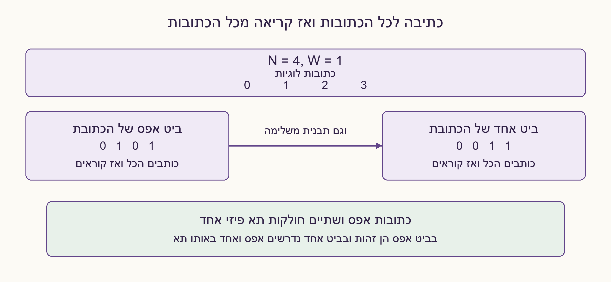
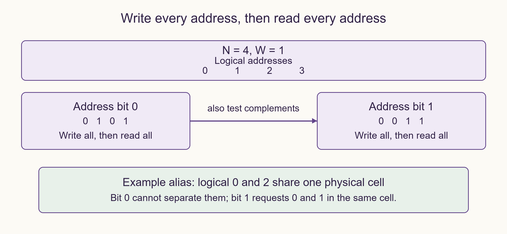

# PREP-076 — בדיקת זיכרון: האם שתי כתובות פונות לאותו תא?

## מקור שנמסר

צריך לבדוק רכיב זכרון שלא ידוע אם הגישה לכתובות נכונה. כיצד תוכל לוודא שמה שקראת הוא נכון?

[צילום מקור פנימי](../sources/prep-076-source.png)

פתרון מוצע בסיוע AI; ביקורת מקצועית אנושית ממתינה. השיוך לחברות מדווח בצילום בלבד.

## עברית: בדיקת זיכרון: האם שתי כתובות פונות לאותו תא?

נתון זיכרון בעל N כתובות לוגיות 0 עד N−1 ומילים ברוחב W ביטים, N,W≥1. אפשר לקרוא ולכתוב בכל כתובת, אך לא ידוע אם פענוח הכתובות תקין. כיצד תבדקו שהקריאה מחזירה את הנתון של הכתובת המבוקשת ולא של כתובת אחרת? הציעו בדיקה שמזהה alias — שתי כתובות המופנות לאותו תא — גם כאשר W קטן ממספר ביטי הכתובת. הסבירו מה אי אפשר להוכיח רק בעזרת ממשק הזיכרון.

הבהרות שנוספו: זו בדיקה הרסנית; אין צורך לשמר נתונים. גישה בודדת מושלמת לפני הגישה הבאה, והנתונים נשמרים בהיעדר תקלה. במודל התקלה הראשי אותה מפת כתובות קבועה משמשת לקריאה ולכתיבה, ואין מנגנון cache שמסתיר גישה להתקן. אין גישה לכתובות הפיזיות, oracle חיצוני או תקלות משתנות בזמן. אין צורך לזהות כל סוג אפשרי של תקלה בזיכרון.

### רמזים

1. כתיבה לכתובת ומיד קריאה ממנה יכולה להצליח גם כשהכתובת שגויה. איזה מידע עלול להימחק כשכותבים גם לכתובות אחרות?
2. כתבו לכל הכתובות לפני שקוראים בחזרה. אם שתי כתובות חולקות תא, הן אינן יכולות לשמור במקביל שני ערכים שונים.
3. לכל זוג כתובות שונות יש ביט כתובת שבו הן נבדלות. בכל סבב כתבו את אותו ביט לכל מילת הנתונים, קראו את כל הכתובות, ואז בדקו גם את התבנית המשלימה.

### הצעה לפתרון

### קודם מגדירים מה ניתן לבדוק

לא ניתן להוכיח מאיזה תא פיזי הגיע מידע אם אין נקודת ייחוס חיצונית. אם כל הכתובות עוברות אותה תמורה חד־חד־ערכית בקריאה ובכתיבה, הזיכרון מתנהג בדיוק כזיכרון תקין: כל כתובת לוגית עדיין שומרת מילה עצמאית. שום רצף פעולות דרך הממשק הזה לא יחשוף רק שינוי שמות פיזיים כזה. לעומת זאת, alias בין שתי כתובות מפר את העצמאות, וניתן לזהותו במודל הקבוע שנבחר.

### מדוע כתיבה וקריאה מיידית אינן מספיקות?

אם 0 ו־2 פונות לאותו תא, הפעולה write(0,0),read(0) יכולה להצליח, וגם write(2,1),read(2) יכולה להצליח. לא בדקנו אם הכתיבה השנייה דרסה את המידע של כתובת 0. לכן מפרידים את כל שלב הכתיבה מכל שלב הקריאה. אם W גדול דיו אפשר לכתוב לכל כתובת את מספרה ואז לקרוא את כולן; אבל W=1 לא מסוגל להחזיק חתימה ייחודית לכל כתובת בבת אחת.

### בדיקה לפי ביטי כתובת

נסמן K=max(1,ceil(log2 N)) ו־MASK=2^W−1. לכל ביט כתובת b מ־0 עד K−1, מבצעים שני סבבים: תבנית רגילה והמשלימה. בסבב רגיל כותבים MASK לכתובת שהביט b שלה הוא 1, ואפס לאחרת. כותבים קודם לכל N הכתובות, ורק אז קוראים את כולן ומשווים לערך הצפוי. בסבב המשלים מחליפים אפס ו־MASK. אי התאמה מסמנת כשל; אם כל הסבבים עברו, לא נמצאה תקלה במודל שנבדק.

```text
for each address bit b:
    for invert in {0, 1}:
        write EVERY address using bit_b(address) XOR invert
        read EVERY address and compare with its expected word
```

N=4,W=1: בסבב b=0 כותבים לכתובות 0,1,2,3 את 0,1,0,1; בסבב b=1 כותבים 0,0,1,1. alias בין 0 ל־2 אינו מתגלה מהתבנית הראשונה לבדה, אך בתבנית השנייה התא המשותף נדרש להכיל גם 0 וגם 1. לפחות אחת מהקריאות תיכשל. ההשלמות בודקות גם ששני ערכי הנתון ניתנים להופעה בכל תא; הן מועילות למשל לתקיעת ביט נתון, אך אינן הוכחה לכיסוי כל תקלות הזיכרון. עבור N=1 עדיין כותבים וקוראים אפס וכל האחדות.

### נימוק נכונות ומגבלות

יהיו a≠c שתי כתובות המופנות לאותו תא. יש ביט b שבו הן נבדלות. אחרי כתיבת כל התבנית, התא הפיזי מכיל ערך יחיד, בעוד שהציפיות לשתי הכתובות שונות. לכן לא תיתכן הצלחה של שתי ההשוואות, גם אם לתא יש יותר משתי כתובות לוגיות. לזיכרון תקין כל כתובת מקבלת את הערך המצופה ונשמרת עד הקריאה, ולכן הוא עובר. מספר הגישות בהצלחה הוא 4NK, כלומר O(N log N) עבור N≥2 ו־O(N) למקרה N=1, עם מספר קבוע של משתני עזר מעבר לזיכרון הנבדק. מוני כתובת משתמשים ב־O(log N) ביטים, ולכן אין כאן טענת זיכרון עזר קבוע בביטים.

הבדיקה הרסנית ואינה מחליפה בדיקות March, צימוד, retention, תזמון, cache או bus. היא גם אינה מאתרת בהכרח איזה תא פיזי פגום. אם הכתיבה עצמה אינה אמינה, mismatch אינו מספיק לבדו כדי להאשים רק את מסלול הקריאה. אימות Python בדק 6,826 מקרי מפות כתובת ורוחבי מילה באופן ממצה עד N=5, עוד 640 מקרי מפה מדגמיים, 153 תמורות עקביות שעברו כמצופה, 153 מקרי מסלול קריאה ו־300 תקלות ביט נתון. לא בוצעה בדיקת התקן פיזי. הפתרון מוצע וממתין לביקורת מקצועית.



### assumptions

```json
[
  "N כתובות לוגיות ומילים ברוחב W, שניהם חיוביים; בדיקה הרסנית מותרת.",
  "הגישות מושלמות לפי סדר והאחסון שומר נתונים; cache אינו מסתיר את ההתקן.",
  "מודל ראשי: מפה קבועה זהה לקריאה ולכתיבה; אין oracle של כתובות פיזיות.",
  "אין הבטחת זיהוי לכל תקלה או זיהוי של תמורה עקבית וחד־חד־ערכית."
]
```

### optimality

```json
{
  "criterion": "מספר גישות עבור בדיקת ביטי כתובת עם כל רוחב W.",
  "result": "4N·max(1,ceil(log2 N)) גישות בהצלחה; מספר קבוע של משתנים, O(log N+W) ביטי עזר במימוש טיפוסי.",
  "proof": "K ביטים, שתי קוטביות ולכל קוטביות N כתיבות ו־N קריאות.",
  "scope": "אין טענה למספר גישות מינימלי או לכיסוי כל תקלות הזיכרון."
}
```

### verification

עברו 6,826 מקרי מפה/רוחב ממצים עד N=5, 640 מקרי מפה מדגמיים, 153 תמורות עקביות, 153 תמורות מסלול קריאה, 300 תקלות ביט נתון ו־6 פרמטרים לא תקינים. נבדקה גם דוגמה שבה write/read מיידיים מחמיצים alias. מודל Python בלבד.

### edge_cases

```json
[
  "N=1: אין alias בין כתובות, אך נבדקים אפס וכל האחדות.",
  "W=1 מספיק למספר סבבים; אין לקטוע חתימת כתובת ולהניח ייחוד.",
  "N שאינו חזקה של 2: בודקים רק כתובות 0..N−1.",
  "שתי כתובות בעלות אותו ביט בסבב אחד עשויות להיפרד בסבב אחר.",
  "תמורה עקבית בקריאה ובכתיבה אינה כשל נראה דרך הממשק."
]
```

### common_mistakes

```json
[
  "לכתוב ולקרוא כל כתובת מיד, כך שדריסה בין כתובות אינה נבדקת.",
  "לכתוב אותה תבנית לכל הכתובות בלבד.",
  "לאחסן address mod 2^W בלי לבדוק התנגשויות.",
  "להבטיח לזהות מאיזה תא פיזי קראו בלי מקור השוואה.",
  "להריץ בדיקה הרסנית על נתונים שחייבים לשמור."
]
```

### interview_answer

אכתוב קודם לכל הכתובות ואז אקרא את כולן. כשאין מספיק ביטים לחתימה ייחודית, אבדוק בכל סבב ביט כתובת אחר ואת המשלים שלו. כל זוג aliases נבדל בביט כלשהו, ולכן אינו יכול לעבור את אותו סבב. תמורה חד־חד־ערכית זהה בקריאה ובכתיבה אינה ניתנת לזיהוי דרך הממשק בלבד.

### solution_extensions

```json
{
  "question": "איך משתנה הבדיקה אם אסור לאבד את תוכן הזיכרון?",
  "direction": "צריך גיבוי עצמאי או תכנון בדיקה לא הרסני תחת מודל תקלות מוגדר. שמירת מילה אחת ושחזור מיידי אינה שומרת בהכרח תא נוסף שחולק אותה כתובת פיזית.",
  "status": "מוכן בתוכן; לא מחובר לתור המשך חי."
}
```

## English: Memory verification: do two addresses alias?

A memory has N logical addresses 0 through N−1 and W-bit words, N,W≥1. You can read and write each address, but do not know whether address decoding is correct. How would you test that a read returns the requested address's data rather than another address's data? Detect address aliasing — two addresses sharing a cell — even when W is smaller than the address bit count. Explain what the memory interface alone cannot prove.

Editorial clarifications: testing may destroy all data. Each access completes before the next; data otherwise persists. In the primary fault model one stable map serves both reads and writes, and no cache hides device accesses. Physical addresses and an independent oracle are unavailable; time-varying faults are outside this model. This is not a request to detect every possible memory fault.

### Hints

1. Writing and immediately reading one address can succeed through a faulty decoder. What may be overwritten when other addresses are written too?
2. Write all addresses before reading back. Two aliases cannot simultaneously retain different expected values.
3. Every distinct address pair differs in some address bit. In each pass replicate that bit across the data word, read all addresses, and repeat with the complementary pattern.

### Proposed solution

### First establish what is observable

Without an external reference, the interface cannot prove which physical cell supplied a value. If reads and writes use the same bijective permutation of physical cells, behavior is exactly that of healthy memory: each logical address still owns independent storage. No sequence through this interface distinguishes that renaming. Address aliasing does destroy independence and is detectable under the chosen stable-map model.

### Why immediate write/read is insufficient

If addresses 0 and 2 share a cell, write(0,0),read(0) may succeed, and write(2,1),read(2) may also succeed. The test never checks whether the second write destroyed address 0's value. Separate the full writing phase from the full reading phase. With enough data width we could store a unique address signature in each word, but W=1 cannot encode every address simultaneously.

### Address-bit-plane test

Let K=max(1,ceil(log2 N)) and MASK=2^W−1. For each address bit b from zero through K−1, perform a normal pass and its complement. In a normal pass write MASK where address bit b is one and zero elsewhere. Write all N addresses first, then read every address and compare with its expected value. In the complementary pass swap zero and MASK. Return failure on a mismatch; completing all passes means no fault was found within the tested model.

```text
for each address bit b:
    for invert in {0, 1}:
        write EVERY address using bit_b(address) XOR invert
        read EVERY address and compare with its expected word
```

For N=4,W=1, bit-zero pass writes 0,1,0,1 to addresses 0,1,2,3; bit-one pass writes 0,0,1,1. An alias between 0 and 2 escapes the first pattern alone but cannot satisfy both expected values in the second. At least one read mismatches. Complements also exercise both data values per cell, helping detect stuck-data bits, but do not establish complete memory fault coverage. For N=1 still test zero and all ones.

### Correctness and limits

Let distinct addresses a,c share one cell. Some address bit b differs. After the whole pattern is written, that physical cell has a single value, yet the two logical addresses expect different words. Both comparisons cannot pass, even if more addresses share that cell. Healthy memory passes because each independent location retains its expected value until checked. A successful run performs 4NK accesses: O(N log N) for N≥2, with the N=1 special case still tested. There are a constant number of auxiliary variables; address counters require O(log N) bits, so auxiliary storage is not constant in bits.

This destructive test is not a replacement for March, coupling, retention, timing, cache or bus testing, nor does it necessarily locate a faulty physical cell. If writes may also fail, a mismatch alone does not isolate the read path. Python checks exhausted 6,826 map/width cases through N=5, plus 640 sampled maps, 153 consistent permutations that correctly passed, 153 read-path permutation cases and 300 stuck-data cases. No physical device was tested. The proposed solution awaits professional review.



### assumptions

```json
[
  "N logical addresses and W-bit words, both positive; destructive testing allowed.",
  "Accesses complete in order and storage retains data; no cache hides the device.",
  "Primary model: one stable mapping for reads and writes; no physical-address oracle.",
  "No complete fault coverage or detection of consistent bijective physical renaming is claimed."
]
```

### optimality

```json
{
  "criterion": "Access count of this bit-plane test for arbitrary positive W.",
  "result": "4N·max(1,ceil(log2 N)) accesses on success; constant variable count, typically O(log N+W) auxiliary bits.",
  "proof": "K bits, two polarities, each with N writes and N reads.",
  "scope": "Not a minimum-access or complete-memory-fault-coverage claim."
}
```

### verification

Passed 6,826 exhaustive map/width cases through N=5, 640 sampled maps, 153 consistent permutations, 153 read-path permutations, 300 stuck-data cases and six invalid-parameter cases. Also checked an alias counterexample missed by immediate write/read. Python model only.

### edge_cases

```json
[
  "N=1 has no inter-address alias but still tests zero and all ones.",
  "W=1 suffices with multiple passes; truncating an address signature loses uniqueness.",
  "For non-power-of-two N test only addresses 0..N−1.",
  "Addresses equal in one tested bit may differ in another pass.",
  "A consistent read/write permutation is interface-equivalent to healthy memory."
]
```

### common_mistakes

```json
[
  "Writing and immediately reading each address misses later alias overwrites.",
  "Using only one identical pattern for all addresses.",
  "Storing address mod 2^W without considering signature collisions.",
  "Claiming physical-cell identity without an independent observation point.",
  "Destructively testing data that must be retained."
]
```

### interview_answer

Write all addresses before reading any back. If words cannot hold unique address signatures, test one address-bit plane and its complement per pass. Every aliased pair differs in some bit and cannot both pass that pattern. A consistent bijective physical renaming is unobservable through this interface alone.

### solution_extensions

```json
{
  "question": "What changes if memory contents must survive testing?",
  "direction": "Use independent backup or a genuinely non-destructive strategy for a specified fault model. Saving and immediately restoring one word may not protect another logical alias of that cell.",
  "status": "Prepared in content, not connected to the live follow-up queue."
}
```

## Files

- [solutions/prep_076_address_alias.py](../solutions/prep_076_address_alias.py)
- [checks/check_prep_076.py](../checks/check_prep_076.py)
- [checks/prep-076-verification.json](../checks/prep-076-verification.json)
