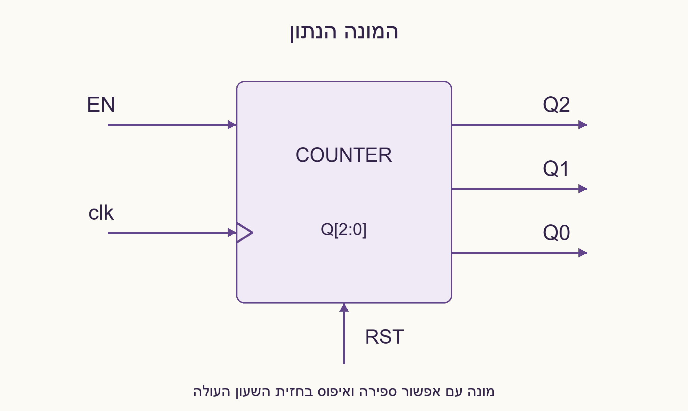
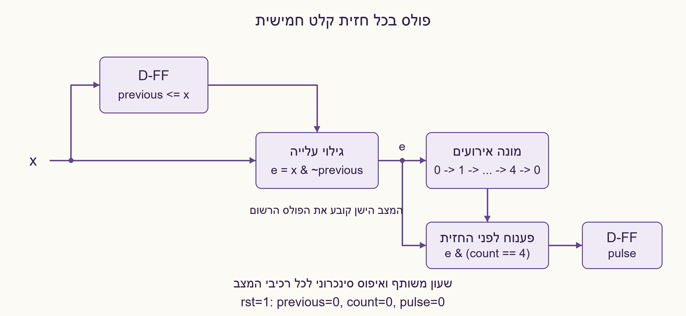
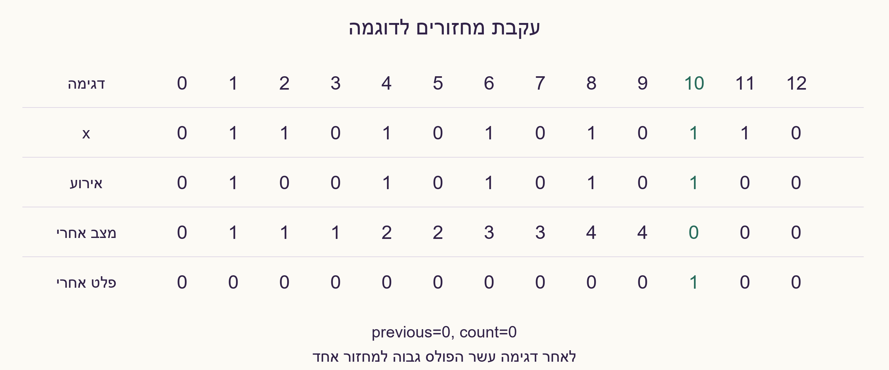
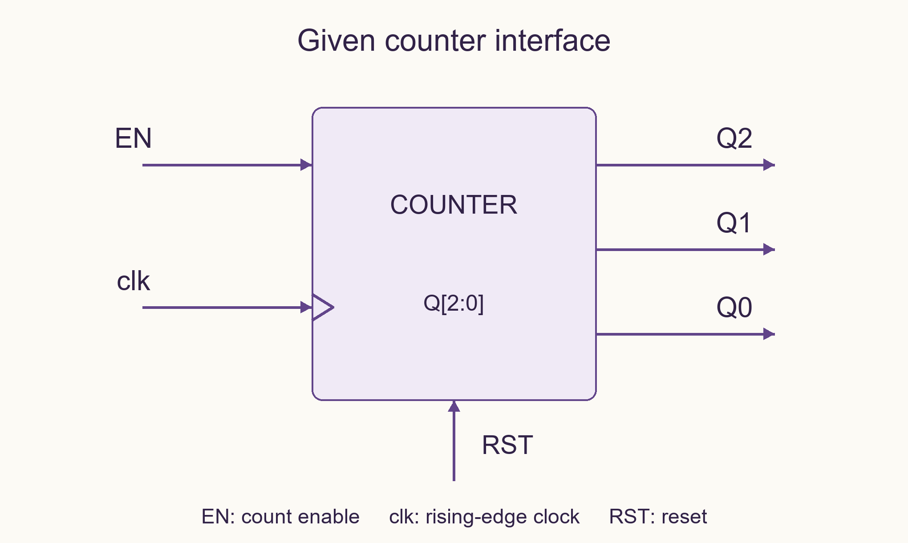
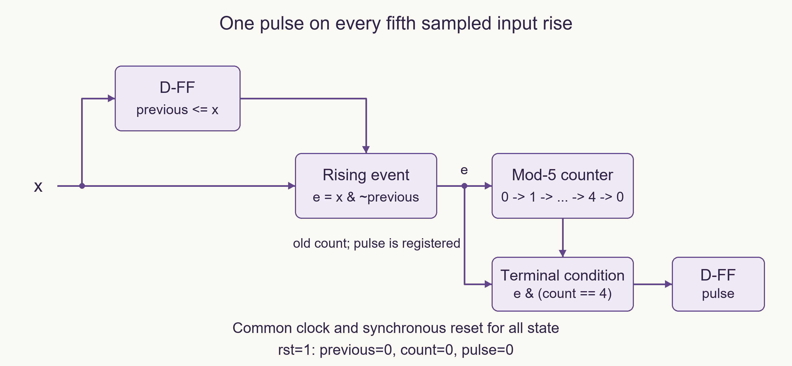
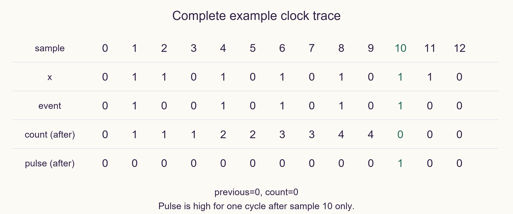

# PREP-078 — פולס בכל עלייה חמישית של אות קלט

## מקור שנמסר

בעזרת מונה ממש מערכת המזהה 5 עליות של אות הכניסה. כלומר, כל עלייה חמישית של אות הכניסה מוצא המערכת עולה ל־1 למחזור שעון אחד. המונה נראה כך: EN, clk, RST, Q2, Q1, Q0.

[צילום מקור פנימי](../sources/prep-078-source.png)

פתרון מוצע בסיוע AI; ביקורת מקצועית אנושית ממתינה. השיוך לחברות מדווח בצילום בלבד.

## עברית: פולס בכל עלייה חמישית של אות קלט

בעזרת מונה בן שלושה ביטים בעל EN,clk,RST ויציאות Q2,Q1,Q0, ומעט לוגיקה נוספת, תכננו מערכת שמוציאה pulse=1 למשך מחזור שעון יחיד על כל עלייה חמישית של אות קלט x. עלייה פירושה מעבר מדגימה 0 לדגימה 1, ולא חמישה מחזורים שבהם x נשאר גבוה. הציגו מעגל, טבלת עדכון ועקבת מחזורים.

הבהרות שנוספו: x סינכרוני ל־clk ומקיים setup/hold. כל המצב מתעדכן בחזית העולה של clk; אין להשתמש ב־x כשעון. RST חיצוני פעיל בגבוה, סינכרוני ובעל עדיפות, ומאפס את זיכרון הדגימה הקודמת, המונה והפולס. המונה הנתון מגדיל את Q כשה־EN=1 וניתן לאפסו סינכרונית; אפשר להוסיף FF ושערים. pulse רשום וגבוה במחזור שמתחיל מיד אחרי החזית שבה נדגמה העלייה החמישית. נדרשת חזית איפוס לפני שימוש; x=1 בדגימה הראשונה לאחר האיפוס ייחשב לעלייה משום שהדגימה הקודמת אופסה ל־0.

### רמזים

1. איך תבדילו בין עלייה חדשה לבין קלט שכבר היה גבוה גם במחזור הקודם?
2. שמרו דגימה קודמת ב־FF, ועדכנו את המונה רק כשיש 0→1 בין הדגימות.
3. ספרו אירועים במצבים 0–4. אם מגיע אירוע כשהמצב הישן הוא 4, אפסו רק את המונה והוציאו פולס רשום; זיכרון הדגימה הקודמת ממשיך לקבל x בכל מחזור.

### הצעה לפתרון

### מפרידים גילוי אירוע מספירתו

נשמור previous, דגימת x מהחזית הקודמת. לפני החזית מחשבים e=x AND NOT previous. כל עוד x נשאר 1, אחרי החזית הראשונה previous=1 ולכן אין אירועים נוספים. נשמור count בטווח 0–4 כמספר העליות מאז הפולס האחרון, מודולו 5.

```text
e = x AND NOT previous
pulse_next = e AND (count == 4)
count_next = 0 if pulse_next else count + e
previous_next = x
```

כל צד ימין מחושב מהמצב הישן. ב־RST חיצוני מציבים previous=count=pulse=0. בכל חזית אחרת FF הפולס מקבל pulse_next, FF הדגימה מקבל x והמונה מתעדכן. למונה הנתון מחברים EN=e ו־RST_counter=RST_external OR (e AND count==4), בהנחה המפורשת של איפוס סינכרוני שגובר על EN. איפוס סיום הספירה אינו מאפס את previous ואינו מאפס את FF הפולס: ה־FF הזה צריך דווקא לקלוט 1 בחזית החמישית. למימוש עם איפוס אסינכרוני נדרש תכנון אחר; אין להעתיק אליו את החיבור הזה באופן עיוור.

### טבלת עדכון מלאה למצב חוקי

| count לפני | e=0: count אחרי / pulse | e=1: count אחרי / pulse |
| --- | --- | --- |
| 0 | 0 / 0 | 1 / 0 |
| 1 | 1 / 0 | 2 / 0 |
| 2 | 2 / 0 | 3 / 0 |
| 3 | 3 / 0 | 4 / 0 |
| 4 | 4 / 0 | 0 / 1 |

בכל שורה previous מקבל x. RST=1 גובר על כל שורה ומאפס את שלושת משתני המצב. המצבים 5–7 אינם מגיעים אחרי איפוס במודל התקין; לא הוגדרה התאוששות מהזרקת תקלה למונה.

### עקבה ודוגמה

| דגימה | 0 | 1 | 2 | 3 | 4 | 5 | 6 | 7 | 8 | 9 | 10 | 11 | 12 |
| --- | --- | --- | --- | --- | --- | --- | --- | --- | --- | --- | --- | --- | --- |
| x | 0 | 1 | 1 | 0 | 1 | 0 | 1 | 0 | 1 | 0 | 1 | 1 | 0 |
| e | 0 | 1 | 0 | 0 | 1 | 0 | 1 | 0 | 1 | 0 | 1 | 0 | 0 |
| count אחרי | 0 | 1 | 1 | 1 | 2 | 2 | 3 | 3 | 4 | 4 | 0 | 0 | 0 |
| pulse אחרי | 0 | 0 | 0 | 0 | 0 | 0 | 0 | 0 | 0 | 0 | 1 | 0 | 0 |

בדגימה 10 מתקבלת העלייה החמישית. pulse=1 עד החזית הבאה, גם אם x נשאר גבוה בדגימה 11; אז previous כבר 1 והפולס חוזר ל־0. השארת x=1 למאה מחזורים יוצרת אירוע אחד בלבד.

### נכונות ועלות

באינדוקציה, previous הוא הדגימה הקודמת, ו־count הוא מספר אירועי 0→1 שנדגמו מאז איפוס, מודולו 5. לכן count=4 ואירוע חדש הם בדיוק כל אירוע חמישי. FF הפולס מקבל 0 בכל חזית שאינה כזאת, ולכן משכו מחזור אחד. העלות במימוש היא 3 ביטי מונה, FF לדגימה קודמת ו־FF לפולס, יחד 5 ביטי מצב ולוגיקה לגילוי חזית ופענוח 4. זו עלות המימוש, לא הוכחת מינימום שטח.

אימות Python מול אורקל של רשימת אירועים עבר על כל 8,191 רצפי הקלט באורכים 0–12, על 16,384 רצפי קלט/איפוס באורך 7 ועל 200 רצפים מדגמיים בני 1,000 מחזורים. SystemVerilog צורף אך לא קומפל ולא סומלץ. אין כאן הוכחה ללכידת פולס אסינכרוני קצר או בדיקת מטסטביליות. הפתרון מוצע וממתין לביקורת מקצועית.







### assumptions

```json
[
  "x סינכרוני ל־clk ומקיים setup/hold; סופרים 0→1 בין דגימות, לא זמן ברמה גבוהה.",
  "RST חיצוני סינכרוני פעיל בגבוה ובעל עדיפות; נדרשת חזית איפוס לפני שימוש.",
  "previous מאותחל ל־0, לכן דגימה ראשונה גבוהה אחרי איפוס נספרת.",
  "מונה EN בן שלושה ביטים עם איפוס סינכרוני; FF ושערים נוספים מותרים.",
  "pulse רשום למשך מחזור אחרי דגימת כל עלייה חמישית."
]
```

### optimality

```json
{
  "criterion": "מספר ביטי המצב במימוש המסוים.",
  "result": "3 ביטי מונה ועוד previous ו־pulse: 5 ביטים; O(1) עדכון בחזית.",
  "proof": "חמישה ערכי count מיוצגים בשלושה ביטים; נשמרים בנוסף דגימה קודמת ופלט רשום.",
  "scope": "אין הוכחה למינימום שערים, שטח או השהיה."
}
```

### verification

עברו כל 8,191 רצפי הקלט באורכים 0–12, כל 16,384 רצפי קלט/איפוס באורך 7 ו־200 רצפים בני 1,000 מחזורים מול אורקל רשימת אירועים. נבדק קלט שנשאר גבוה. מודל Python בלבד; SystemVerilog לא קומפל ולא סומלץ.

### edge_cases

```json
[
  "חמישה מחזורים רצופים גבוהים הם אירוע אחד בלבד.",
  "הפולס החמישי מתאפס בחזית הבאה גם אם x נשאר גבוה.",
  "איפוס גובר על אירוע חמישי ועל pulse שהיה גבוה.",
  "סיום ספירת חמש אינו מאפס previous.",
  "קלט שעולה ויורד בין שתי חזיתות דגימה אינו מובטח להיקלט."
]
```

### common_mistakes

```json
[
  "לחבר EN ישירות ל־x ולספור זמן גבוה במקום עליות.",
  "לאפס previous יחד עם המונה בכל עלייה חמישית ולספור שוב קלט שנשאר גבוה.",
  "לחשב פענוח count==4 על המצב החדש במקום להגדיר במפורש מצב ישן.",
  "להשתמש ב־x כשעון נגזר בלי חוזה תזמון.",
  "להניח ששני מסנכרנים מבטיחים קליטת כל פולס צר."
]
```

### interview_answer

אשמור את הדגימה הקודמת ואחשב e=x AND NOT previous. המונה יתקדם רק כש־e=1. כשהמצב הישן 4 ויש אירוע, אאפס את המונה ואטען 1 ל־FF הפולס; בכל מחזור אחר הפולס ייטען 0. previous מתעדכן תמיד, ולכן רמה גבוהה ממושכת אינה נספרת שוב.

### solution_extensions

```json
{
  "question": "ומה אם x מגיע משעון אחר או הוא פולס קצר?",
  "direction": "סנכרון רמה בשני FF מפחית סיכון מטסטביליות אך עלול להחמיץ פולס קצר. לפי דרישות הקצב והאובדן נדרש pulse stretching, קידוד toggle או handshake עם ניתוח CDC; אין הבטחת לכידת כל אירוע מהחיבור הנוכחי.",
  "status": "מוכן בתוכן; לא מחובר לתור המשך חי."
}
```

## English: One pulse for every fifth input rising edge

Using a three-bit counter with EN,clk,RST and outputs Q2,Q1,Q0 plus additional logic, design a system that asserts pulse for exactly one clock cycle on every fifth rising edge of input x. An input rise is a sampled zero-to-one transition, not five cycles spent high. Show a circuit, update table and clock trace.

Editorial clarifications: x is synchronous to clk and meets setup/hold. All state updates on rising clk; do not use x as a clock. External RST is synchronous, active high and has priority, clearing the previous sample, counter and pulse. The given counter increments when EN=1 and supports synchronous reset; extra flip-flops and gates are allowed. pulse is registered and high during the cycle immediately following the edge that samples the fifth rise. A reset edge is required before use; a high first post-reset sample counts as a rise because the previous sample was cleared to zero.

### Hints

1. How can you distinguish a new rise from an input that was already high last cycle?
2. Store the previous sample in a flip-flop; enable counting only on a sampled zero-to-one transition.
3. Count events in states zero through four. An event from old count four resets the counter and registers a pulse; the previous-sample flip-flop still updates with x every clock.

### Proposed solution

### Separate event detection from counting

Store previous, the input sampled on the prior clock edge. Before the edge compute e=x AND NOT previous. If x stays high, previous becomes one after the first sample and no additional events occur. Keep count in zero through four as the sampled-rise count modulo five.

```text
e = x AND NOT previous
pulse_next = e AND (count == 4)
count_next = 0 if pulse_next else count + e
previous_next = x
```

All right-hand sides use old state. External reset sets previous=count=pulse=0. Otherwise the pulse flip-flop captures pulse_next, the history flip-flop captures x, and the counter updates. For the supplied macro connect EN=e and RST_counter=RST_external OR (e AND count==4), under the explicit synchronous-reset-over-enable assumption. The terminal-count reset must not clear previous or reset the pulse flip-flop: that flip-flop must capture one on the fifth event. An asynchronous-reset macro requires a different design; do not copy this connection blindly.

### Complete legal-state update table

| Old count | e=0: new count / pulse | e=1: new count / pulse |
| --- | --- | --- |
| 0 | 0 / 0 | 1 / 0 |
| 1 | 1 / 0 | 2 / 0 |
| 2 | 2 / 0 | 3 / 0 |
| 3 | 3 / 0 | 4 / 0 |
| 4 | 4 / 0 | 0 / 1 |

Every row updates previous to x. RST=1 overrides the table and clears all three state variables. Counter encodings five through seven are unreachable after reset in the healthy model; injected-invalid-state recovery is not specified.

### Complete example trace

| Sample | 0 | 1 | 2 | 3 | 4 | 5 | 6 | 7 | 8 | 9 | 10 | 11 | 12 |
| --- | --- | --- | --- | --- | --- | --- | --- | --- | --- | --- | --- | --- | --- |
| x | 0 | 1 | 1 | 0 | 1 | 0 | 1 | 0 | 1 | 0 | 1 | 1 | 0 |
| e | 0 | 1 | 0 | 0 | 1 | 0 | 1 | 0 | 1 | 0 | 1 | 0 | 0 |
| New count | 0 | 1 | 1 | 1 | 2 | 2 | 3 | 3 | 4 | 4 | 0 | 0 | 0 |
| New pulse | 0 | 0 | 0 | 0 | 0 | 0 | 0 | 0 | 0 | 0 | 1 | 0 | 0 |

The fifth rise is sampled at index ten. pulse stays high until the next edge even though x remains high at sample eleven; previous is already one and the pulse returns to zero. Holding x high for one hundred cycles produces just one event.

### Correctness and cost

Inductively, previous equals the prior sample and count is the number of sampled zero-to-one events since reset modulo five. Thus old count four plus a new event identifies exactly every fifth event. The pulse register captures zero on every other edge, giving one-clock duration. This construction uses three counter bits, one history bit and one pulse bit: five state bits plus edge-detection and count-four decode logic. This is a construction cost, not a minimum-area proof.

Python comparison against an independent event-list oracle passed all 8,191 input sequences of lengths zero through twelve, all 16,384 input/reset sequences of length seven, and 200 sampled one-thousand-cycle traces. Supplied SystemVerilog was not compiled or HDL-simulated. This does not verify capture of narrow asynchronous pulses or metastability. Professional review remains pending.







### assumptions

```json
[
  "x is synchronous to clk and meets setup/hold; count sampled zero-to-one transitions, not high duration.",
  "External reset is synchronous active high with priority; reset edge required before use.",
  "previous resets to zero, so a first high post-reset sample counts as a rise.",
  "Three-bit enable counter supports synchronous reset; extra gates and flip-flops allowed.",
  "Registered pulse lasts the cycle following each sampled fifth rise."
]
```

### optimality

```json
{
  "criterion": "State bits in this particular construction.",
  "result": "Three counter bits plus previous and pulse: five bits, with O(1) edge update.",
  "proof": "Five count values use three bits; history and registered output are stored separately.",
  "scope": "No minimum gate-count, area or delay claim."
}
```

### verification

Passed all 8,191 binary input sequences of lengths zero through twelve, 16,384 input/reset sequences of length seven and 200 one-thousand-cycle traces against an event-list oracle. Held-high input checked. Python model only; SystemVerilog uncompiled and not HDL-simulated.

### edge_cases

```json
[
  "Five consecutive high cycles are one event.",
  "The fifth-event pulse clears on the next edge even if x stays high.",
  "External reset overrides a fifth event and an existing high pulse.",
  "Modulo-five rollover does not reset previous.",
  "A rise and fall between sampling edges is not guaranteed to be captured."
]
```

### common_mistakes

```json
[
  "Driving EN directly with x counts high cycles instead of rises.",
  "Resetting previous on every fifth event recounts a held-high signal.",
  "Decoding count four from updated state without defining edge semantics.",
  "Using x as a derived clock without a timing contract.",
  "Assuming two synchronizer flip-flops capture every narrow pulse."
]
```

### interview_answer

Store the previous sample and compute e=x AND NOT previous. Enable the counter only on e. An event from old count four resets the counter and loads one into the pulse register; other cycles load zero. Always update previous, so a held-high input is never counted again.

### solution_extensions

```json
{
  "question": "What if x is asynchronous or a narrow pulse?",
  "direction": "A two-flop level synchronizer reduces metastability risk but may miss narrow pulses. Use stretching, toggle encoding or a handshake according to rate/loss requirements, with CDC analysis. This circuit alone does not guarantee event capture.",
  "status": "Prepared in content, not connected to the live follow-up queue."
}
```

## Files

- [solutions/prep_078_fifth_rise.py](../solutions/prep_078_fifth_rise.py)
- [solutions/prep_078_fifth_rise.sv](../solutions/prep_078_fifth_rise.sv)
- [checks/check_prep_078.py](../checks/check_prep_078.py)
- [checks/prep-078-verification.json](../checks/prep-078-verification.json)


## מקור נוסף — 30.10.2026, מקבץ90

[צילום מקור פרטי 17](../sources/2026-10-30-batch90-17.png)

ממש גוזר בעליית שעון ביחס של 1:50.

שיוכי מקור מדווחים: Apple.

נוספה וריאציה טכנית בשתי השפות; הנוסח, הפתרון והרמזים הקודמים נשמרו כתחילית. הפתרון המורחב ממתין לביקורת מקצועית.

[הווריאציה המלאה / Full variant](prep-078-fiftieth_edge-batch90-addendum.md)
