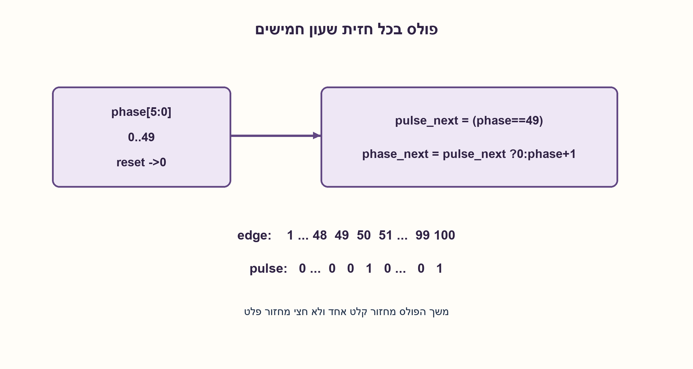
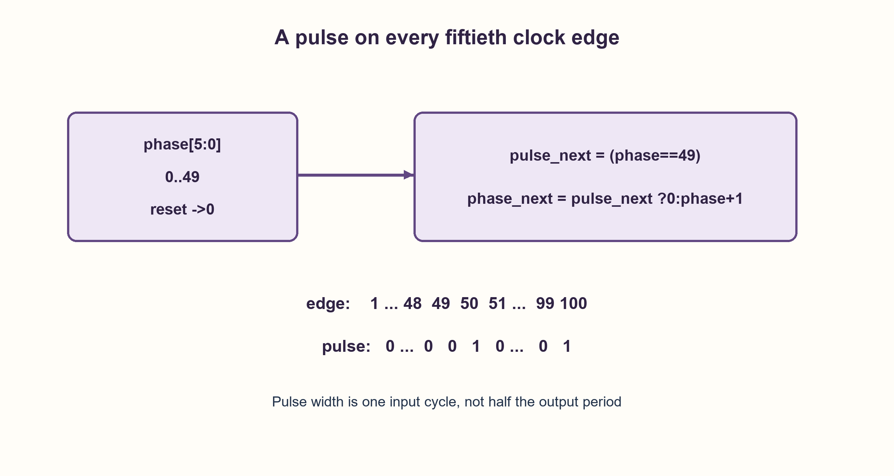

# PREP-078 — פולס בכל עלייה חמישית של אות קלט

פתרון מוצע בסיוע AI; ביקורת מקצועית אנושית ממתינה. הקושי אינו מכויל.

[צילום מקור פרטי](../sources/2026-10-30-batch90-17.png)

ממש גוזר בעליית שעון ביחס של 1:50.

חברות לפי הדיווח בצילום בלבד: Apple.

## עברית

### וריאציה: פולס ביחס 1:50 לשעון עצמו
ממשו פולס בעליית שעון ביחס 1:50. המקור אינו מציין כניסת נתונים נפרדת או duty cycle. בחוזה זה הקלט היחיד לספירה הוא clk: אחרי reset מפיקים פולס בן מחזור קלט מלא בכל חזית חמישים, בפאזות 50,100,150,… אין צורך לזהות עלייה באות נתונים נוסף. השאלה המקורית על כל עלייה חמישית של x נשמרת לעיל.

אם הכוונה לגל שעון מחולק בעל 50% duty cycle, או לפולס על כל חמישים מעברי 0→1 ב־x נפרד, יש להגדיר ממשק אחר; החלופות מוסברות בנפרד.

1. כדי להוציא פולס כל חמישים חזיתות, איזה טווח של פאזות צריך לזכור?
2. מונה מודולו 50 מחזיק 0–49. באיזה ערך ישן צריך להפיק את הפולס ולאפס את הפאזה?
3. אחרי reset phase=0. בכל חזית pulse_next=(phase==49), והפאזה הבאה היא 0 במקרה זה ואחרת phase+1.

נשתמש בשש סיביות למונה phase בטווח 0–49 ובאוגר פולס. reset סינכרוני פעיל־גבוה מאפס את שניהם; חזית האיפוס אינה נספרת. בחזית הבאה phase עובר 0→1 והפולס נשאר 0. כאשר הערך הישן 49, מפיקים pulse=1 ומחזירים phase=0. בחזית הבאה הפולס יורד. לכן הפולסים נמצאים בדיוק בחזיתות 50,100,… ונמשכים מחזור קלט אחד.

הוכחת אינווריאנט פשוטה היא phase=k mod50 אחרי k חזיתות רגילות. הפולס המופק בחזית k הוא 1 אם ורק אם k חיובי ומתחלק ב־50. לא משווים את המונה ל־50 אחרי שנחתך לחמישים מצבים, ולא משתמשים ב־clk כאילו היה אות נתונים הנדגם בתוך עצמו. לוגיקה סינכרונית אחת ואות enable בדרך כלל ברורים יותר מיצירת שעון חדש באמצעות AND של שעון ונתון.

לפולס יש מחזור 50 T אבל הוא גבוה רק T, כלומר duty cycle=1/50. אם נדרש גל מרובע בתדר fclk/50 ו־duty cycle של 50%, מונים 25 חזיתות ואז הופכים אוגר פלט; שני היפוכים נמשכים 50 חזיתות. שתי הדרישות אינן זהות. השימוש ביציאה כשעון ממשי מחייב גם משאבי שעון וניתוח generated clock; הדגמה לוגית אינה אישור תכנון שעון.

אם יש x נפרד, מגלים rise=x AND NOT previous ואז מקדמים את המודולו 50 רק ב־rise. צריך להבטיח דגימה תקינה; סנכרון CDC רגיל אינו מבטיח שכל פולס אסינכרוני מהיר ייתפס. זו חלופה נפרדת, לא כניסה שהצילום דרש. בדקנו 10,000 חזיתות שעון,200,000 דגימות של חלופת x ו־10,000 מחזורים של חלופת הגל המרובע. ה־SV לא הודר.

### מודל לוגי בפייתון שהורץ

```python
"""Modulo50 event pulse. API call denotes one rising source-clock edge."""


def clock_pulses(cycles):
    if type(cycles) is not int or cycles < 0:
        raise ValueError("nonnegative cycle count required")
    phase = 0
    trace = []
    for _ in range(cycles):
        pulse = int(phase == 49)
        phase = 0 if pulse else phase + 1
        trace.append((pulse, phase))
    return trace


def input_event_pulses(samples):
    """Single clock domain; sampled event input must obey the sampling contract."""
    previous = phase = 0
    result = []
    for value in samples:
        if type(value) is not int or value not in (0, 1):
            raise ValueError("binary samples required")
        rising = value & (1 ^ previous)
        pulse = int(rising and phase == 49)
        if rising:
            phase = 0 if pulse else phase + 1
        previous = value
        result.append(pulse)
    return result


def divided_square(cycles):
    """Optional50% duty-cycle output: toggle every25 input rising edges."""
    phase = level = 0
    result = []
    for _ in range(cycles):
        if phase == 24:
            phase, level = 0, 1 ^ level
        else:
            phase += 1
        result.append(level)
    return result
```


### קוד SystemVerilog מוצע; לא הודר בבדיקה זו

```systemverilog
// One full input-clock cycle high after each50th rising edge; not a50% clock.
module fiftieth_clock_pulse (
  input logic clk, rst,
  output logic pulse
);
  logic [5:0] phase;
  always_ff @(posedge clk) begin
    if (rst) begin phase <= 6'd0; pulse <= 1'b0; end
    else begin
      pulse <= phase == 6'd49;
      phase <= phase == 6'd49 ? 6'd0 : phase + 6'd1;
    end
  end
endmodule
```




### assumptions

```json
[
  "גרסת המקור סופרת את חזיתות clk עצמו; אין x נוסף בחוזה הראשי של הנספח.",
  "פולס רשום מחזור אחד; reset קובע שהראשון בחזית 50 אחרי האיפוס."
]
```

### optimality

שש סיביות פאזה ופלט רשום הם בנייה פשוטה; לפחות 50 פאזות נדרשות למחזור המובחן במודל מונה מודולו. לא נטען מינימום FF כולל.

### verification

10,000 חזיתות,200,000 דגימות אות נפרד ו־10,000 מחזורי חלופת 50% נבדקו מול אורקלי אינדקסים ומניית מעברים.

### edge_cases

```json
[
  "החזית 49 אינה מפיקה פולס; החזית 50 כן.",
  "איפוס גובר על הספירה וקובע מחדש פאזה.",
  "פולס enable אינו זהה לשעון חדש מאושר לתזמון."
]
```

### common_mistakes

```json
[
  "ספירת רמות 1 במקום חזיתות.",
  "בלבול בין duty cycle של 2% ל־50%.",
  "הוספת כניסת x שלא מופיעה במקור."
]
```

### interview_answer

לכל חזית clk אקדם phase מודולו 50. ערך ישן 49 מפיק פולס ומאפס. הפולס נמשךT והמחזור 50 T; אם נדרש 50% אהפוך פלט פעם ב־25 חזיתות.

### source_ambiguities

```json
[
  "„גוזר” אינו מגדיר משך פולס או duty cycle; נבחר פולס בן מחזור אחד.",
  "חלופת x נפרד מוצגת כהרחבה ולא כנתון המקור."
]
```

### solution_extensions

```json
[
  {
    "question": "האם אפשר לייצר גל 50% באמצעות היפוך בכל חמישים חזיתות?",
    "answer_direction": "היפוך כל 50 נותן מחזור 100 וחלוקה במאה. ליחס 1:50 צריך היפוך כל 25.",
    "principle": "שני חצאי מחזור יוצרים מחזור שלם."
  }
]
```

## English

### Variant: a 1:50 pulse from the clock itself
Implement a pulse on a clock rise at ratio1:50. The source specifies neither an additional data input nor duty cycle. This contract counts clk edges directly: after reset emit one full input-cycle pulse on edges 50,100,150,… No separate data-edge detector is required. The original every-fifth-rise-of-x question above is retained.

A 50%-duty divided clock, or one pulse per fifty transitions of a separate x, is a different interface; those alternatives are discussed separately.

1. What phase range remembers one event every fifty clock edges?
2. A modulo 50 counter holds0..49. Which old value causes the pulse and wrap?
3. Reset phase=0. On each edge pulse_next=(phase==49); next phase is 0 then, otherwise phase+1.

Use a six-bit phase register restricted to 0..49 and a pulse register. Synchronous active-high reset clears both; its edge is not counted. At the next edge phase moves0→1 and pulse stays0. Old phase 49 produces pulse=1 and wraps phase to 0. The following edge lowers pulse. Thus pulses occur exactly at edges 50,100,… and each lasts one input cycle.

Invariant: after k ordinary clock edges, phase=k mod50. The pulse produced on edge k is 1 exactly when positive k is divisible by 50. Do not compare a fifty-state counter against an unreachable50, or pretend clk is a separate data signal sampled by itself. A synchronous clock-enable is generally clearer than creating a clock using an uncontrolled AND gate.

Pulse period is 50 T but high time is only T, so its duty cycle is 1/50. For an fclk/50 square wave with 50% duty, count 25 edges and toggle an output register; two toggles consume50 edges. These are different requirements. Using any generated output as an actual clock also requires clocking resources and generated-clock timing analysis; a logical model is not clock signoff.

With a separate x, detect rise=x AND NOT previous and advance modulo 50 only on rise. A valid sampling contract is essential; a basic CDC synchronizer does not guarantee capture of every fast asynchronous pulse. This is a separate variant, not an input invented for the supplied clock-only task. Checks cover 10,000 clock edges,200,000 samples of the optional x variant and 10,000 square-wave cycles. Proposed SV was not compiled.

### Executed Python logical model

```python
"""Modulo50 event pulse. API call denotes one rising source-clock edge."""


def clock_pulses(cycles):
    if type(cycles) is not int or cycles < 0:
        raise ValueError("nonnegative cycle count required")
    phase = 0
    trace = []
    for _ in range(cycles):
        pulse = int(phase == 49)
        phase = 0 if pulse else phase + 1
        trace.append((pulse, phase))
    return trace


def input_event_pulses(samples):
    """Single clock domain; sampled event input must obey the sampling contract."""
    previous = phase = 0
    result = []
    for value in samples:
        if type(value) is not int or value not in (0, 1):
            raise ValueError("binary samples required")
        rising = value & (1 ^ previous)
        pulse = int(rising and phase == 49)
        if rising:
            phase = 0 if pulse else phase + 1
        previous = value
        result.append(pulse)
    return result


def divided_square(cycles):
    """Optional50% duty-cycle output: toggle every25 input rising edges."""
    phase = level = 0
    result = []
    for _ in range(cycles):
        if phase == 24:
            phase, level = 0, 1 ^ level
        else:
            phase += 1
        result.append(level)
    return result
```


### Proposed SystemVerilog; not compiled in this check

```systemverilog
// One full input-clock cycle high after each50th rising edge; not a50% clock.
module fiftieth_clock_pulse (
  input logic clk, rst,
  output logic pulse
);
  logic [5:0] phase;
  always_ff @(posedge clk) begin
    if (rst) begin phase <= 6'd0; pulse <= 1'b0; end
    else begin
      pulse <= phase == 6'd49;
      phase <= phase == 6'd49 ? 6'd0 : phase + 6'd1;
    end
  end
endmodule
```




### assumptions

```json
[
  "The source variant counts clk edges directly; no x input is added to its primary contract.",
  "A registered one-cycle pulse; reset establishes the first pulse on post-reset edge 50."
]
```

### optimality

Six phase bits and a registered pulse give a simple construction. A modulo phase controller distinguishes fifty phases; no minimum total-FF claim is made.

### verification

10,000 edges,200,000 separate-event samples and 10,000 optional50%-wave cycles checked against index and transition-count oracles.

### edge_cases

```json
[
  "Edge 49 is low; edge 50 asserts.",
  "Reset overrides counting and establishes phase anew.",
  "An enable pulse is not automatically a timing-qualified generated clock."
]
```

### common_mistakes

```json
[
  "Counting high levels rather than specified edges.",
  "Confusing2% and 50% duty cycles.",
  "Inventing a separate x input for the source."
]
```

### interview_answer

Advance phase modulo 50 on each clk edge. Old49 emits a pulse and wraps. High time is T and period 50 T; for 50% duty toggle once per 25 edges.

### source_ambiguities

```json
[
  "The source does not specify pulse width or duty; one input cycle is explicitly chosen.",
  "A separate-x version is an extension, not a source fact."
]
```

### solution_extensions

```json
[
  {
    "question": "Does toggling every fifty edges create a 50%-duty divide-by 50 clock?",
    "answer_direction": "No. Two toggles take100 edges. Divide-by 50 needs a toggle every 25.",
    "principle": "Two half-periods make a full period."
  }
]
```
