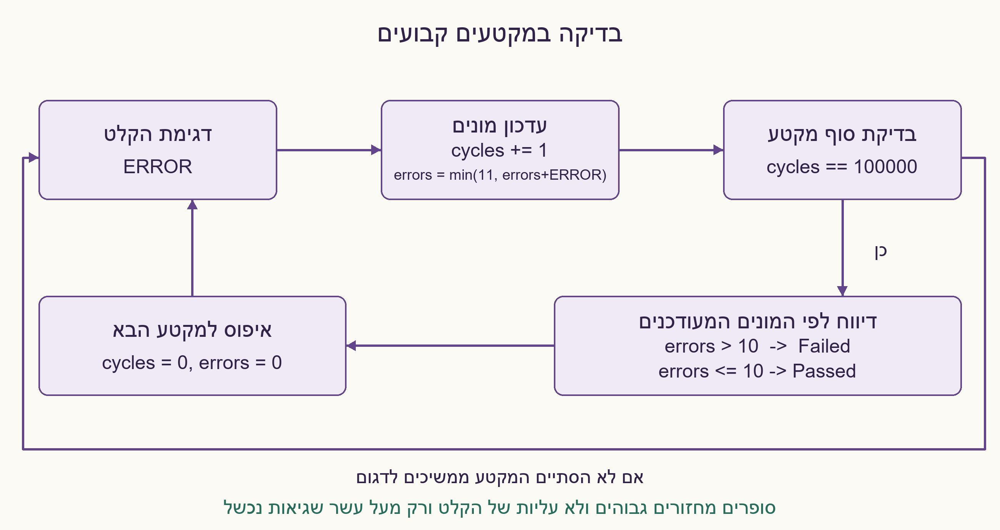
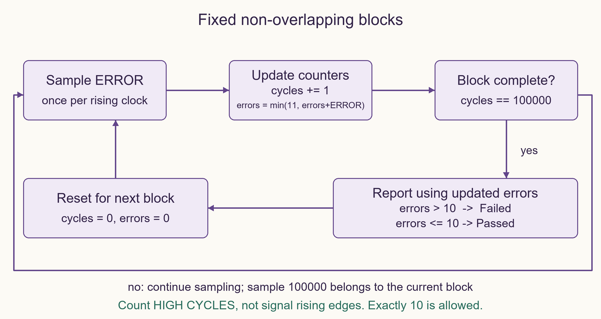

# PREP-081 — ניטור ERROR: יותר מעשר שגיאות ב־100,000 מחזורים

## מקור שנמסר

יש לך רכיב שיוצא ממנו ביט בדיקה שמוציא ERROR כאשר הוא מזהה בעיה. אתה צריך לכתוב פסאודו קוד כך שיבדוק האם במהלך 100K מחזורי שעון יש יותר מ־10 errors, אם כן להוציא הודעת Failed.

[צילום מקור פנימי](../sources/prep-081-source.png)

פתרון מוצע בסיוע AI; ביקורת מקצועית אנושית ממתינה. השיוך לחברות מדווח בצילום בלבד.

## עברית: ניטור ERROR: יותר מעשר שגיאות ב־100,000 מחזורים

מרכיב יוצא ביט ERROR, שערכו 1 בכל מחזור שבו מזוהה תקלה. כתבו פסאודו־קוד שדוגם אותו פעם אחת בכל מחזור שעון ובודק מקטעים עוקבים שאינם חופפים, כל אחד באורך בדיוק 100,000 מחזורים. בסיום כל מקטע, אם יותר מעשרה מהמחזורים שנדגמו בו היו ERROR=1, הפיקו הודעה Failed; אחרת Passed. הציגו טיפול נכון במחזור האחרון ובמקטע הבא.

הבהרות שנוספו: סופרים מחזורים שבהם הביט גבוה, לא רק עליות של הביט; בדיוק עשר שגיאות מותרות. הספירה מתאפסת בתחילת כל מקטע. כל הדגימות בינאריות ומסונכרנות לשעון; קטע קלט אחרון שאורכו קטן מ־100,000 אינו תוצאה מלאה. כהרחבה, הסבירו כיצד תזהו חריגה בכל חלון זז של 100,000 מחזורים, והאם שתי הדרישות שקולות.

### רמזים

1. אילו שני דברים צריך לספור בנפרד: כמה זמן עבר וכמה דגימות היו 1?
2. המחזור ה־100,000 עדיין שייך למקטע הנוכחי. עדכנו את ספירת השגיאות לפני ההשוואה ל־10.
3. למקטעים קבועים מספיקים שני מונים. בחלון זז, שגיאה ישנה צריכה לצאת מהחלון; אפשר לשמור רק את זמני 11 השגיאות האחרונות עד שהחריגה מתגלה.

### הצעה לפתרון

### קודם קובעים את משמעות החלון

המקור לא הבחין בין מקטעים קבועים לחלון זז. בנוסח הראשי בחרנו במפורש מקטעים של 100,000 דגימות: 0..99,999, ואז 100,000..199,999 וכן הלאה. אלה תנאים שונים מחלון שמסתיים בכל מחזור, ולכן ההרחבה מטופלת בנפרד. כמו כן, ERROR שנשאר 1 שלושה מחזורים מוסיף שלוש לספירה, לא אחת.

### פתרון למקטעים קבועים

```text
cycles = 0; errors = 0
forever:
    wait for next rising clock edge
    e = sample(ERROR)
    cycles = cycles + 1
    errors = min(11, errors + e)
    if cycles == 100000:
        report('Failed' if errors > 10 else 'Passed')
        cycles = 0; errors = 0
```

זו סמנטיקה רציפה של פסאודו־קוד: ההשוואה רואה את הספירות המעודכנות, כולל הדגימה האחרונה. ב־HDL עם השמות לא חוסמות יש לחשב ערכי next מפורשים או להשוות תוך הוספת e; שימוש במונה הישן עלול לפספס שגיאה אחת במחזור האחרון. מאחר שאכפת לנו רק מהסף, ניתן לרוות את errors ב־11; מידע על הכמות המדויקת מעבר ל־11 אינו נחוץ.

אחרי 99,999 דגימות עם עשרה מחזורי שגיאה, אם הדגימה ה־100,000 היא 1, נקבל 11 ו־Failed. אם יש עשר בלבד — Passed. איפוס המונים נעשה לאחר הדיווח, ולכן אותה דגימה אינה נספרת שוב במקטע הבא. בקוד Python המצורף מוחזרות תוצאות רק עבור מקטעים שלמים. אפשר לדווח כשל מוקדם בשגיאה ה־11 כי שגיאות במקטע אינן יורדות, אבל אין לדווח Passed לפני הסוף. המימוש שנבחר מדווח רק בסוף המקטע, כבחוזה השאלה.

### מדוע זה נכון וכמה זיכרון צריך?

אחרי k דגימות במקטע, cycles=k ו־errors=min(11,מספר האחדות באותן k דגימות). זה נכון בתחילת המקטע, ונשמר בהוספת כל דגימה. ב־k=100,000 ההשוואה errors>10 שקולה ליותר מעשר שגיאות אמיתיות, גם עם רוויה. לאחר הדיווח האיפוס משחזר את האינווריאנט למקטע הבא. יש O(1) עבודה בכל דגימה ושני מונים בעלי רוחב קבוע לנתונים בשאלה: למשל 17 ביטים למספר מחזורים עד 100,000 ו־4 ביטים למספר שגיאות עד 11. זה אינו דירוג שטח אופטימלי.

### הרחבה: כל חלון זז

שש שגיאות בסוף מקטע וחמש בתחילת המקטע הבא עוברות בשני המקטעים, אך חלון שחוצה את הגבול מכיל 11 ונכשל. לכן מונה שמתאפס כל 100,000 מחזורים אינו פתרון לדרישת חלון זז.

נסמן זמן דגימה t החל מ־0. נשמור תור של זמני מחזורים שבהם ERROR=1. לפני הכנסת הדגימה t מסירים מהראש כל זמן s שעבורו t−s≥100,000: חלון נוכחי מכיל בדיוק את הזמנים t−99,999 עד t. אם ERROR=1 מוסיפים t, ואם אורך התור הפך ל־11 מדווחים כשל ועוצרים. עד אותו רגע נשמרים לכל היותר 11 זמנים. לפני שהושלם חלון ראשון נבדק רק הקידומת שנצפתה; 11 שגיאות בה כבר מבטיחות כשל בחלון הראשון אם הדגימה תימשך. אם החוזה מתיר דיווח רק לאחר חלון מלא, יש לדחות את ההודעה בהתאם.

כל זמן מוכנס ומוסר לכל היותר פעם אחת, ולכן העלות O(1) בממוצע אמורטי לדגימה. בקוד זה קיים גם חסם קטן של עד 11 הסרות לפעולה. יש לכל היותר 11 רשומות זמן, אך זמן t אינו חסום במודל Python, ולכן אין טענה למספר קבוע של ביטים בריצה שאינה מוגבלת. בחומרה יש לתכנן רוחב זמן וטיפול בגלישה, או להשתמש בהיסטוריית 100,000 ביטים ומונה בחלון.

האימות השווה למודל עצמאי של סכומי פרוסות: 49,128 שילובי רצף/חלון/סף ממצים, 2,000 מקרים מדגמיים וחמישה מקרי גבול באורך 200,000 מחזורים. נבדקה במפורש פקיעת שגיאה בגיל 100,000 בדיוק. לא נבדקו דגימה פיזית או חיבור לסימולטור. הפתרון מוצע וממתין לביקורת מקצועית.



### assumptions

```json
[
  "ERROR הוא ביט מסונכרן שנדגם פעם אחת בכל חזית שעון; סופרים דגימות גבוהות.",
  "הנוסח הראשי משתמש במקטעים לא חופפים של בדיוק 100,000 דגימות, עם דיווח בסוף.",
  "יותר מ־10 פירושו 11 ומעלה; בדיוק 10 אינו כשל.",
  "קידומת אחרונה קצרה אינה מקטע שלם; חלון זז הוא הרחבה שונה.",
  "בדיקת החלון הזז משתמשת בזמני Python לא חסומים ומפסיקה בכשל הראשון."
]
```

### optimality

```json
{
  "criterion": "עלות עיבוד ואחסון למימושים הנתונים.",
  "result": "מקטעים: O(1) לדגימה ושני מונים. חלון זז: O(1) אמורטי לדגימה ועד 11 רשומות זמן לפני עצירה.",
  "proof": "המונים מתעדכנים פעם לדגימה; כל זמן בתור מוכנס ומוסר פעם אחת בלבד.",
  "scope": "לא נטען למינימום ביטים; זמני ריצה לא חסומים אינם מספר קבוע של ביטים."
}
```

### verification

השוואה לאורקל סכומי פרוסות עברה ב־49,128 שילובים ממצים, 2,000 מקרים מדגמיים וחמישה מקרי גבול מלאים של 200,000 מחזורים. נבדקו סף 10/11, חלון שחוצה גבול ופקיעת חותמת זמן בגיל 100,000 בדיוק. Python בלבד.

### edge_cases

```json
[
  "השגיאה ה־11 במחזור האחרון חייבת לגרום לכשל באותו מקטע.",
  "בדיוק עשרה מחזורי ERROR=1 עוברים.",
  "ERROR=1 לאורך 11 מחזורים נספר כ־11, גם ללא עליות נוספות.",
  "מקטע חדש מתחיל עם שני מונים מאופסים.",
  "לחלון זז, גיל 100,000 כבר מחוץ לחלון; גיל 99,999 עדיין בפנים.",
  "מקטעים תקינים בנפרד עשויים ליצור כשל בחלון שחוצה ביניהם."
]
```

### common_mistakes

```json
[
  "להשתמש ב־>=10 במקום >10.",
  "לספור עליות ERROR במקום כל מחזור גבוה.",
  "לבדוק את המונה הישן ולפספס את הדגימה האחרונה.",
  "לאפס אחרי השגיאה ה־11 באמצע מקטע ולשנות את גבולותיו.",
  "לבלבל מקטעים קבועים עם כל חלון זז.",
  "לטעון ש־11 חותמות זמן לא חסומות הן תמיד מספר קבוע של ביטים."
]
```

### interview_answer

אדגום ERROR בכל מחזור ואעדכן מונה מחזורים ומונה שגיאות רווי ב־11. אחרי הכללת הדגימה ה־100,000 אדווח Failed רק אם השגיאות גדולות מ־10, ואז אאפס למקטע הבא. אם הכוונה לכל חלון זז, אשמור זמני שגיאות בתור ואוציא כל זמן שגילו לפחות 100,000; 11 זמנים פעילים מראים כשל.

### solution_extensions

```json
{
  "question": "כיצד תמשיכו לנטר גם אחרי שנמצא חלון כושל, עם מספר ביטים מוגדר?",
  "direction": "אפשר לשמור טבעת של 100,000 דגימות ומונה סכום: בכל מחזור מחסירים את הביט היוצא ומוסיפים את החדש. יש להגדיר תוצאות לפני שהחלון מלא, רוחב מונים, איפוס וגלישה; זו חלופה עם אחסון חסום וברור.",
  "status": "מוכן בתוכן; לא מחובר לתור המשך חי."
}
```

## English: ERROR monitor: more than ten errors in 100,000 cycles

A component exposes ERROR, high in every cycle where a fault is detected. Write pseudocode that samples it once each clock cycle and checks consecutive non-overlapping blocks of exactly 100,000 cycles. At each block end report Failed if more than ten sampled cycles in that block had ERROR=1; otherwise report Passed. Handle the final sample and the next block correctly.

Editorial clarifications: count high cycles, not just rising edges; exactly ten errors are allowed. Reset counts for each block. Samples are binary and synchronous; a final input tail shorter than 100,000 cycles is not a complete result. Extension: detect a violation in every sliding 100,000-cycle window, and explain whether that is equivalent.

### Hints

1. Which two quantities must be counted separately: elapsed samples and high samples?
2. The 100,000th sample belongs to the current block. Include it before comparing the error count with ten.
3. Two counters suffice for fixed blocks. A sliding window must expire old errors; retaining up to eleven error timestamps is enough until a failure is found.

### Proposed solution

### Define the window first

The source does not distinguish fixed blocks from sliding windows. The main question explicitly chooses samples 0..99,999, then 100,000..199,999, and so on. This differs from checking a window ending every cycle, so the extension is separate. Also, ERROR high for three cycles contributes three errors, not one.

### Fixed-block solution

```text
cycles = 0; errors = 0
forever:
    wait for next rising clock edge
    e = sample(ERROR)
    cycles = cycles + 1
    errors = min(11, errors + e)
    if cycles == 100000:
        report('Failed' if errors > 10 else 'Passed')
        cycles = 0; errors = 0
```

This is sequential pseudocode: the comparison sees updated counts, including the last sample. HDL nonblocking assignments require explicit next values or adding e to the old count; testing the old error count alone can miss an eleventh error on the final cycle. Since only the threshold matters, errors may saturate at eleven; its exact larger value is unnecessary.

After 99,999 samples containing ten highs, a high 100,000th sample makes eleven and reports Failed. Exactly ten reports Passed. Reset after reporting so the same sample is not counted again in the next block. The supplied Python implementation returns results only for complete blocks. Early failure on the eleventh high is logically valid because errors in a block never decrease, but early Passed is not. The chosen implementation reports at block end as required.

### Correctness and memory

After k block samples, cycles=k and errors=min(11,the number of highs among those samples). The invariant holds initially and is preserved by including each new sample. At k=100,000 the test errors>10 exactly matches more than ten actual errors, despite saturation. Reset restores the invariant for the next block. Each sample costs O(1) work. The specified constants permit fixed-width counters, for example seventeen bits through 100,000 cycles and four bits through eleven errors. This is not a minimum-area result.

### Extension: every sliding window

Six errors at one block's end and five at the next block's beginning pass both fixed blocks, yet a crossing window contains eleven and fails. A counter resetting every 100,000 clocks therefore does not solve sliding-window monitoring.

Let sample time t start at zero. Maintain a queue of times when ERROR was high. Before inserting sample t, expire every oldest timestamp s with t−s≥100,000: the current window contains exactly t−99,999 through t. Append t when ERROR=1. If queue length becomes eleven, report failure and stop. At most eleven timestamps exist before termination. Before a first full window exists, only the observed prefix is checked; eleven highs already guarantee that the first complete window will fail if sampling continues. If reporting must wait for a full window, defer the message accordingly.

Each timestamp is inserted and removed at most once, giving amortized O(1) work per sample. This implementation also bounds any one expiration loop by eleven entries. There are at most eleven records, but Python time is unbounded, so a constant bit count is not claimed for an indefinitely running monitor. Hardware needs a timestamp width and wraparound policy, or a 100,000-bit history ring and a running count.

Independent slice-sum oracles verified 49,128 exhaustive sequence/window/threshold combinations, 2,000 sampled cases and five 200,000-cycle boundary cases. Expiration at age exactly 100,000 was checked explicitly. Physical sampling and simulator integration were not tested. The proposed solution awaits professional review.



### assumptions

```json
[
  "ERROR is a synchronous binary sample taken once per clock edge; count high samples.",
  "The primary contract uses non-overlapping blocks of exactly 100,000 samples, reporting at block end.",
  "More than ten means eleven or more; exactly ten is not failure.",
  "A final short tail is incomplete; sliding windows are a different extension.",
  "The sliding implementation uses unbounded Python timestamps and stops at first failure."
]
```

### optimality

```json
{
  "criterion": "Processing and storage cost of these constructions.",
  "result": "Fixed blocks: O(1) per sample and two counters. Sliding: amortized O(1) per sample and up to eleven timestamp records before termination.",
  "proof": "Counters update once per sample; each timestamp is inserted and removed at most once.",
  "scope": "No minimum-bit claim; unbounded run times do not fit a constant number of bits."
}
```

### verification

Slice-sum oracle comparison passed 49,128 exhaustive combinations, 2,000 sampled cases and five full 200,000-cycle boundary cases. Checked ten versus eleven, crossing-block windows and expiration at exactly 100,000 cycles. Python only.

### edge_cases

```json
[
  "The eleventh error on the final sample must fail that same block.",
  "Exactly ten high samples pass.",
  "Eleven consecutive high cycles count as eleven without additional rising edges.",
  "A new block starts with both counters cleared.",
  "In a sliding window, age 100,000 is expired; age 99,999 remains.",
  "Individually passing blocks can contain a failing crossing window."
]
```

### common_mistakes

```json
[
  "Using >=10 instead of >10.",
  "Counting ERROR transitions instead of high cycles.",
  "Testing the old count and missing the last sample.",
  "Resetting the block on its eleventh error changes block boundaries.",
  "Confusing fixed blocks with every sliding window.",
  "Claiming eleven unbounded timestamps always use a constant number of bits."
]
```

### interview_answer

Sample ERROR each cycle and update a cycle count plus an error count saturated at eleven. After including sample 100,000 report Failed only if errors exceed ten, then reset for the next block. For sliding windows, retain error timestamps, expire ages at least 100,000 and fail when eleven active timestamps coexist.

### solution_extensions

```json
{
  "question": "How would monitoring continue after failures with a fixed storage bit budget?",
  "direction": "Keep a ring of 100,000 sampled bits and a running sum: subtract the departing bit and add the new one each cycle. Specify startup before a full window, counter widths, reset and wraparound. This offers an explicit bounded-storage alternative.",
  "status": "Prepared in content, not connected to the live follow-up queue."
}
```

## Files

- [solutions/prep_081_error_monitor.py](../solutions/prep_081_error_monitor.py)
- [checks/check_prep_081.py](../checks/check_prep_081.py)
- [checks/prep-081-verification.json](../checks/prep-081-verification.json)


## מקור נוסף — 31.10.2026, מקבץ110

[צילום מקור פרטי 12](../sources/2026-10-31-batch21-12.png)

קיים קטע הקוד while(!exit) rc = check_error() ... כאשר check_error מחזירה 0 או 1 לפי האם התרחשה שגיאה או לא. יש לצאת מהלולאה רק אם התרחשו 5 שגיאות ב־10 השניות האחרונות.

שיוכי מקור מדווחים: NVIDIA, Amazon.

[צילום מקור פרטי 20](../sources/2026-10-31-batch21-20.png)

קיים קטע הקוד while(!exit) rc = check_error() ... כאשר check_error מחזירה 0 או 1 לפי האם התרחשה שגיאה או לא. יש לצאת מהלולאה רק אם התרחשו 5 שגיאות ב־10 השניות האחרונות.

שיוכי מקור מדווחים: NVIDIA, Amazon.

נוספה וריאציה בשתי השפות; הנוסח, הפתרון והרמזים הקודמים נשמרו. הפתרון המורחב ממתין לביקורת מקצועית.

[הווריאציה המלאה / Full variant](prep-081-time_window_batch21-addendum.md)
