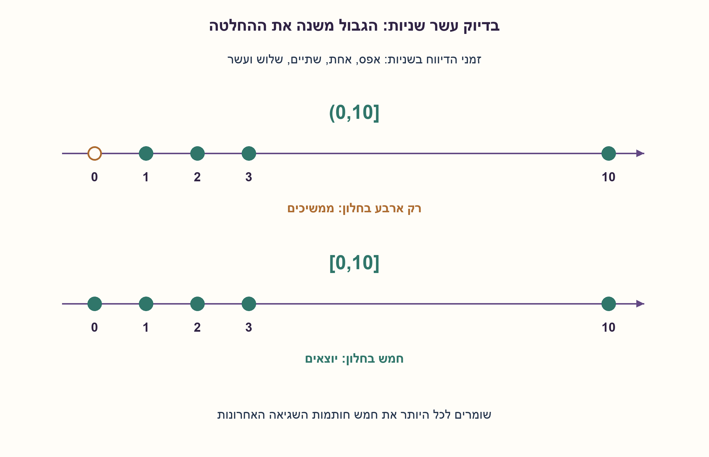
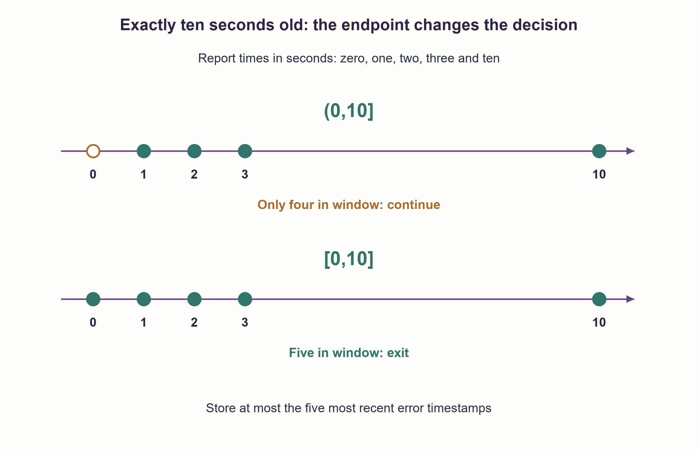

# PREP-081 — חמש שגיאות בחלון של עשר שניות

פתרון מוצע בסיוע AI; ביקורת מקצועית ממתינה. הנוסח והרמזים המקוריים נשמרים.

[צילום מקור פרטי](../sources/2026-10-31-batch21-12.png)

קיים קטע הקוד while(!exit) rc = check_error() ... כאשר check_error מחזירה 0 או 1 לפי האם התרחשה שגיאה או לא. יש לצאת מהלולאה רק אם התרחשו 5 שגיאות ב־10 השניות האחרונות.

## עברית

### וריאציה: חלון זמן זז, לא מקטע מחזורי שעון
בלולאה קוראים ל־check_error(), שמחזירה 0 או 1. יש לצאת בפעם הראשונה שבה זוהו לפחות חמש שגיאות בעשר השניות האחרונות. הציגו אלגוריתם שאינו תלוי בקצב הקריאות, ונמקו כמה זיכרון צריך לשמור.

חוזה מפורש: כל תוצאה 1 היא דיווח על אירוע חדש אחד, ולא רמת תקלה מתמשכת שנקראת שוב. תוצאה 0 אינה מוסיפה אירוע. חותמים כל דיווח בזמן החזרה מן הקריאה באמצעות שעון מונוטוני בננו־שניות; לא מדובר בהסקת זמן התרחשות פיזי שאינו נמסר. סופרים דיווחים שנצפו מתחילת הניטור; היסטוריה קודמת אינה ידועה.

החלון הראשי הוא (t−10,t]: דיווח שגילו בדיוק עשר שניות כבר מחוץ לחלון. הסבירו גם כיצד לשנות לחלון [t−10,t] הכולל את הגבול. פירוש 'חמש' הוא לפחות חמש, ולא בדיוק חמש. אם המקור מתכוון לרמה מתמשכת, לאירועים שהוחמצו בין קריאות או לזמן פיזי מוקדם מן הדיווח, נדרש ממשק נוסף; אין להמציא את המידע.

1. אל תסיקו מספר שניות ממספר קריאות. אילו זמני אירועים צריך לזכור כדי לדעת אם יש חמישה בחלון?
2. התור צריך להיות מסודר בזמן. בכל בדיקה מסירים את מה שהתיישן ומוסיפים חותמת זמן רק לדיווח 1.
3. די לשמור את חמש חותמות השגיאה האחרונות: אם אפילו החמישית לא התיישנה, יש לפחות חמש בחלון. הגדירו במפורש מה קורה בגיל עשר שניות בדיוק.

### שומרים זמן של אירועים, לא ספירת לולאות
תדירות הקריאות יכולה להשתנות. עשרה סיבובים אינם עשר שניות, וחלונות קבועים שאינם חופפים מפספסים פרץ שחוצה את גבולם. לכן משתמשים בחותמות זמן אמיתיות משעון מונוטוני.

מחזיקים deque לפי זמן עם קיבולת חמש. בכל קריאה בזמן t מסירים מן הראש חותמות `≤t−10s`, כי החלון הראשי פתוח משמאל. אם התקבל 1, מוסיפים את t; כאשר התור מלא, החותמת העתיקה ביותר נזרקת. יוצאים אם אחרי העדכון יש חמש חותמות בתור. בהמשך מוצג המימוש בננו־שניות שלמות, כדי שההשוואה לעשר שניות לא תהיה תלויה בעיגול float.

### מדוע מספיקות רק חמש חותמות?
אחרי כל קידומת, התור מכיל את לכל היותר חמש השגיאות האחרונות שעדיין בחלון. הסרת חותמת שהתיישנה בטוחה, כי שעון מונוטוני אינו מחזיר אותה לחלון בעתיד. כאשר שומרים רק את חמש האחרונות, כל חותמת שנזרקת בגלל הקיבולת ישנה מכולן. אם אחת מן הנזרקות הייתה בחלון, גם כל חמש המאוחרות ממנה היו בו, ולכן ממילא תנאי היציאה מתקיים. אם אין חמש חותמות שמורות בתוקף, גם היסטוריה מלאה אינה יכולה להוסיף חותמת ישנה בלי שכבר יהיו חמש חדשות ממנה.

לכן תנאי התור שקול ל'לפחות חמש שגיאות בחלון', גם אם בפועל יש שש או יותר. התור אינו סופר רק מצב שבו ההיסטוריה מכילה בדיוק חמש. בודקים גם קריאות 0: הן אינן מאפסות היסטוריה אלא רק מאפשרות להסיר אירועים ישנים. תנאי שלא היה נכון אינו יכול להפוך לנכון בגלל חלוף זמן בלבד; בדרך כלל הפעם הראשונה שהוא מתקיים מגיעה עם דיווח 1 חדש.

### הגבול הוא חלק מהדרישה
דיווחים בזמנים 0,1,2,3,10 שניות אינם מספיקים בחלון (0,10], כי הראשון בחוץ. בחלון [0,10] הם כן מספיקים. כדי לכלול את הגבול מסירים רק חותמות `<t−10s`, במקום `≤t−10s`. שני המימושים קיימים בפרמטר closed_left; אין תשובה אחת בלי בחירת מוסכמת גבול.

הפעלת הלולאה היא `wait_for_error_threshold(check_error, time.monotonic_ns)`. `check_error` נבדקת לפני חותמת הזמן, ולכן השעון מתאר את מועד הדיווח. אם היא מחזירה שוב ושוב 1 לאותה תקלה, הקוד הזה יספור כמה דיווחים ולא ידע שמדובר באותו אירוע. כדי לספור אירועים פיזיים נדרשים מזהה/חותמת אירוע או חוזה 'אירוע חדש אחד' כמו שנבחר כאן.

לכל אירוע יש לכל היותר הכנסה אחת והסרה אחת; הטיפול בתור הוא O(1) באופן אמורטי לכל תצפית, בלי לספור את העלות של check_error עצמה. הקיבולת היא בדיוק חמש חותמות, כלומר O(1) מילים עבור הסף הקבוע. אין חסם לזמן עד היציאה אם חמש שגיאות אינן מגיעות בחלון. נבדקו 156,158 זרמי דיווח ו־888,860 תצפיות מול ספירת היסטוריה מלאה בשתי מוסכמות הגבול, כולל חותמות שוות ושש שגיאות בו־זמנית.

```python
"""Five distinct observed error reports within a monotonic ten-second window.

Each 1 denotes one new incident; a sustained hardware level is a different input.
Default interval is (now-10s, now]; closed_left=True instead includes the cutoff.
"""

from collections import deque

TEN_SECONDS_NS = 10_000_000_000


class ErrorTimeWindow:
    def __init__(self, *, window_ns=TEN_SECONDS_NS, threshold=5, closed_left=False):
        if type(window_ns) is not int or window_ns <= 0 or type(threshold) is not int or threshold < 1:
            raise ValueError("Positive integer window and threshold required")
        self.window_ns = window_ns
        self.threshold = threshold
        self.closed_left = closed_left
        self.errors = deque(maxlen=threshold)
        self.last_now = None

    def observe(self, error, now_ns):
        if error not in (0, 1) or type(now_ns) is not int or now_ns < 0:
            raise ValueError("Binary report and nonnegative integer timestamp required")
        if self.last_now is not None and now_ns < self.last_now:
            raise ValueError("Timestamps must be monotonic, allowing ties")
        self.last_now = now_ns
        cutoff = now_ns - self.window_ns
        while self.errors and (self.errors[0] < cutoff if self.closed_left else self.errors[0] <= cutoff):
            self.errors.popleft()
        if error:
            self.errors.append(now_ns)
        return len(self.errors) == self.threshold


def wait_for_error_threshold(check_error, monotonic_ns):
    monitor = ErrorTimeWindow()
    while True:
        report = check_error()
        observed_at = monotonic_ns()
        if monitor.observe(report, observed_at):
            return observed_at
```




## English

### Variant: a sliding time window, not a clock-cycle block
A loop calls check_error(), which returns zero or one. Exit at the first observation where at least five errors have been reported within the last ten seconds. Give an algorithm independent of polling frequency and justify its storage bound.

Explicit contract: each one reports one new incident, not a sustained fault level repeatedly read. Zero adds no event. Timestamp the report when the call returns using a monotonic nanosecond clock; this does not infer an earlier physical occurrence time that the interface never supplies. Count reports observed since monitoring began; earlier history is unknown.

The main window is (t−10,t]: a report exactly ten seconds old is excluded. Also show the change for inclusive [t−10,t]. Five means at least five, not exactly five. A persistent level, missed incidents between polls or earlier physical event timestamps require an additional input contract rather than invented information.

1. Polling count is not elapsed time. Which incident timestamps are needed to establish five in the window?
2. Keep timestamps ordered. On each observation expire old entries, and append only for report one.
3. The five most recent error timestamps suffice: if even the fifth most recent is still in the window, at least five qualify. Specify the exactly-ten-seconds boundary.

### Retain incident times rather than loop counts
Polling frequency may vary. Ten loop iterations do not mean ten seconds, and nonoverlapping fixed buckets can miss a burst across their boundary. Use actual timestamps from a monotonic clock.

Maintain an ordered deque with capacity five. At observation time t, expire timestamps `≤t−10s`, since the main window is open on the left. If the report is one, append t; a full deque discards its oldest entry. Exit if five entries remain after the update. The implementation uses integer nanoseconds so the ten-second boundary does not depend on floating-point rounding.

### Why do only five timestamps suffice?
After each prefix, the deque contains at most the five most recent errors still in the window. Expired entries can never return because time is monotonic. An entry discarded by the capacity limit is older than all five retained entries. If that discarded entry were still in the window, all five later entries would also qualify, already satisfying the exit condition. Conversely, a full history cannot supply an older qualifying entry while fewer than five later retained ones qualify.

Thus the deque condition is equivalent to at least five in the window, including histories with six or more. It does not require the full history to contain exactly five. Zero-report observations are checked too: they do not reset history, but may expire old entries. Passage of time alone cannot make a previously false threshold become true; the first qualifying observation normally includes a new error report.

### The endpoint convention changes the answer
Reports at times 0,1,2,3,10 seconds fail the condition for (0,10], because the first is outside. They satisfy it for [0,10]. To include the left endpoint, expire only timestamps `<t−10s` instead of `≤t−10s`. Parameter closed_left implements both; neither convention should be assumed silently.

Run the loop as `wait_for_error_threshold(check_error, time.monotonic_ns)`. The callback runs before the clock sample, so timestamps represent report times. If it repeatedly returns one for the same sustained fault, this code counts repeated reports and cannot discover that they represent one incident. Physical incident counting requires event identities/timestamps or the chosen one-new-incident-per-report contract.

Each event is inserted at most once and removed at most once, giving O(1) amortized deque work per observation, excluding check_error's own cost. Exactly five timestamps are retained: O(1) words for the fixed threshold. There is no finite termination bound if five qualifying reports never occur. Checks compared 156,158 report streams and 888,860 observations against full-history counting under both endpoint conventions, including tied timestamps and six simultaneous errors.

```python
"""Five distinct observed error reports within a monotonic ten-second window.

Each 1 denotes one new incident; a sustained hardware level is a different input.
Default interval is (now-10s, now]; closed_left=True instead includes the cutoff.
"""

from collections import deque

TEN_SECONDS_NS = 10_000_000_000


class ErrorTimeWindow:
    def __init__(self, *, window_ns=TEN_SECONDS_NS, threshold=5, closed_left=False):
        if type(window_ns) is not int or window_ns <= 0 or type(threshold) is not int or threshold < 1:
            raise ValueError("Positive integer window and threshold required")
        self.window_ns = window_ns
        self.threshold = threshold
        self.closed_left = closed_left
        self.errors = deque(maxlen=threshold)
        self.last_now = None

    def observe(self, error, now_ns):
        if error not in (0, 1) or type(now_ns) is not int or now_ns < 0:
            raise ValueError("Binary report and nonnegative integer timestamp required")
        if self.last_now is not None and now_ns < self.last_now:
            raise ValueError("Timestamps must be monotonic, allowing ties")
        self.last_now = now_ns
        cutoff = now_ns - self.window_ns
        while self.errors and (self.errors[0] < cutoff if self.closed_left else self.errors[0] <= cutoff):
            self.errors.popleft()
        if error:
            self.errors.append(now_ns)
        return len(self.errors) == self.threshold


def wait_for_error_threshold(check_error, monotonic_ns):
    monitor = ErrorTimeWindow()
    while True:
        report = check_error()
        observed_at = monotonic_ns()
        if monitor.observe(report, observed_at):
            return observed_at
```




## חומר משלים / Supporting material

```json
{
  "assumptions": {
    "he": [
      "כל 1 מדווח על אירוע חדש אחד; 0 אינו אירוע. אין זיהוי אוטומטי של תקלה מתמשכת או אירועים שהוחמצו.",
      "הזמן הוא זמן דיווח מונוטוני בננו־שניות, עם אפשרות לחותמות שוות. היסטוריה לפני תחילת הניטור אינה נתונה.",
      "הסף הוא לפחות 5. החלון הראשי (t−10,t] פתוח משמאל; חלופה סגורה מוצגת בנפרד."
    ],
    "en": [
      "Each one reports one new incident; zero is not an event. Persistent or missed physical incidents are not inferred.",
      "Timestamps are monotonic integer-nanosecond report times, allowing ties. Pre-monitoring history is not supplied.",
      "Threshold is at least five. The main interval is (t−10,t]; an inclusive alternative is separate."
    ]
  },
  "optimality": {
    "he": "תור של עד חמש חותמות מספיק בדיוק להחלטת הסף. כל אירוע נכנס ויוצא פעם אחת: O(1) עבודה אמורטית לתצפית ועזר של חמש חותמות. אין הבטחת סיום כשאין פרץ מתאים.",
    "en": "At most five timestamps exactly suffice for the threshold decision. Each event enters/leaves once: O(1) amortized work per observation and five stored timestamps. No termination guarantee without a qualifying burst."
  },
  "verification": {
    "he": "156,158 זרמים ו־888,860 תצפיות נבדקו מול ספירת היסטוריה מלאה בשני פירושי הגבול. נבדקו גם השוואת ננו־שניות בגבול, שש שגיאות באותו זמן, אי־איפוס בעקבות 0 והתנהגות עצירת הלולאה.",
    "en": "156,158 streams and 888,860 observations matched full-history counting under both boundary conventions. Actual nanosecond cutoff, six same-time errors, zero-report retention and loop stopping were also checked."
  },
  "edge_cases": {
    "he": [
      "שגיאה שגילה בדיוק 10 שניות אינה בחלון הראשי; היא כן בחלופה הסגורה.",
      "שש שגיאות עדיין עומדות בתנאי 'לפחות חמש'.",
      "דיווח 0 אינו מאפס את תור האירועים.",
      "בלי חמישה דיווחים בחלון אין צורך וגם אין הבטחה לצאת."
    ],
    "en": [
      "Exactly ten-second-old errors are excluded in the main interval and included in the closed alternative.",
      "Six errors still satisfy at least five.",
      "A zero report does not clear event history.",
      "Without five qualifying reports the loop need not and may never exit."
    ]
  },
  "common_mistakes": {
    "he": [
      "לספור קריאות במקום זמן, או להשתמש בשני דליים קבועים במקום חלון זז.",
      "לצאת רק כשיש בדיוק חמש ולדחות מצב עם יותר מחמש.",
      "לספור כל דגימה של רמה גבוהה כאירוע פיזי חדש בלי חוזה כזה.",
      "להשתמש בשעון קיר שעלול לחזור לאחור או לשכוח להגדיר את גבול החלון."
    ],
    "en": [
      "Counting calls instead of time, or using fixed buckets instead of a sliding window.",
      "Accepting exactly five while rejecting more than five.",
      "Counting every high-level sample as a new physical incident without that contract.",
      "Using an adjustable wall clock or leaving the endpoint convention undefined."
    ]
  },
  "interview_answer": {
    "he": "אשמור את חמש חותמות השגיאה האחרונות בשעון מונוטוני. בכל בדיקה אסיר את מה שמחוץ לעשר השניות, אוסיף זמן רק אם זה אירוע חדש, ואצא אם נשארו חמש. כך גם שש שגיאות מתקבלות, קצב הקריאות אינו קובע זמן, ומוגדר במפורש מה קורה בדיוק בגבול עשר השניות.",
    "en": "Keep the five most recent error timestamps on a monotonic clock. Expire entries outside ten seconds, append only for a new incident report, and exit when five remain. Six errors still qualify, polling count does not define time, and the exactly-ten-seconds boundary is explicit."
  },
  "source_ambiguities": {
    "he": [
      "הצילום אינו קובע אם 1 הוא אירוע חדש או רמה, אם השעון מודד זמן דיווח או זמן פיזי, מה קורה בגבול, או אם חמש פירושו לפחות. הנחות אלה גלויות; שני הצילומים הזהים 12 ו־20 נשמרים כמקורות של אותה וריאציה."
    ],
    "en": [
      "The source omits event-versus-level semantics, report-versus-physical timestamps, cutoff inclusion and at-least versus exactly five. These choices are explicit. Duplicate screenshots twelve and twenty are retained as sources for this one variant."
    ]
  },
  "solution_extensions": {
    "he": [
      {
        "question": "מה משתנה אם רוצים לדעת כמה שגיאות היו, ולא רק אם היו לפחות חמש?",
        "answer_direction": "צריך לשמור את כל האירועים שעדיין בחלון או מבנה שקול. קיבולת חמש מאבדת את המספר המדויק כאשר יש שש ויותר.",
        "principle": "אפשר לצמצם היסטוריה לפי שאלת ההחלטה, לא לפי שאילתת ספירה מדויקת."
      }
    ],
    "en": [
      {
        "question": "What if the exact number of recent errors is required?",
        "answer_direction": "Retain all unexpired events or an equivalent counting structure. A capacity-five queue loses the exact count once six or more occur.",
        "principle": "History compression depends on the decision query, not an exact-count query."
      }
    ]
  }
}
```
