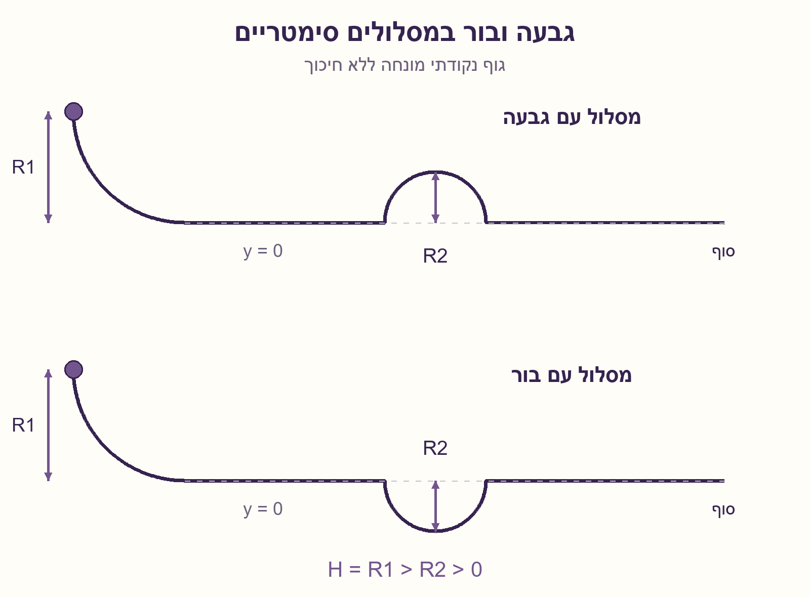
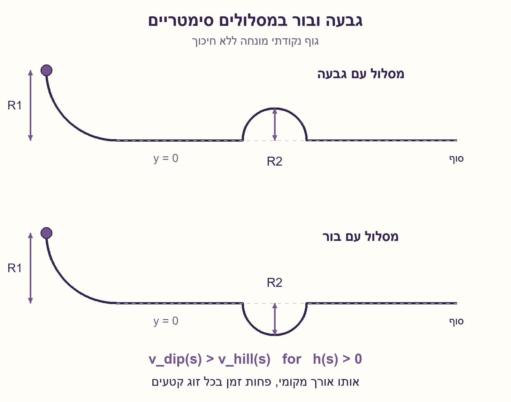

# PREP-082 — גבעה מול בור — מי מגיע ראשון?

מקור: [צילום המקור](../sources/prep-082-source.png). פתרון מוצע בסיוע AI; ביקורת מקצועית ממתינה.

## נוסח המקור

שאלת היגיון. שני כדורים נופלים ... בצורה של רבע מעגל ברדיוס R1, הכדורים זהים (בעלי אותה מסה וגודל), אין חיכוך. לכדור הראשון יש גבעה ברדיוס R2 ולכדור השני יש בור ברדיוס R2. מי יגיע ראשון לסוף? [המילים בתחילת תיאור הנפילה אינן קריאות במלואן; הצילום הוא המקור המחייב.]

## השאלה הערוכה

שני כדורים זהים משתחררים יחד ממנוחה בשני מסלולים. תחילת כל מסלול היא אותה ירידה בצורת רבע מעגל ברדיוס R1. אחריה קטע אופקי; באחד המסלולים גבעה ובשני בור, שניהם קשתות חצי־מעגל ברדיוס R2 ותמונות מראה ביחס למפלס האופקי. סוף שני המסלולים באותו מרחק אופקי. מי מגיע ראשון, והאם מהירותם בסוף זהה? נמקו באמצעות מהירות לאורך המסלול, לא רק באמצעות המהירות הסופית.

הבהרות שנוספו כדי לקבל מודל חד־משמעי: מתייחסים לגופים נקודתיים המונחים במסילה אידאלית המחייבת אותם להישאר עליה, ללא חיכוך, אובדן אנרגיה, גלגול או ניתוק. גובה ההתחלה מעל המישור הוא H=R1, ומניחים R1>R2>0 כדי ששני המסלולים עבירים. הקטעים לפני ואחרי המכשול זהים; שתי הקשתות באותו אורך, והחיבורים הם אידאליזציה ללא אובדן אנרגיה. השרטוט סכמטי. אם כדור רשאי להתנתק ממשטח רגיל, הסבירו מדוע נדרש ניתוח נוסף.



## שלושה רמזים

1. התחילו ממה שקובע את המהירות בגובה נתון כאשר אין אובדן אנרגיה. האם שוויון מהירות בסוף קובע גם זמן הגעה?

2. התאימו כל קטע קטן בקשת הגבעה לקטע באותו אורך בקשת הבור. השוו את הגבהים ואת המהירויות בזוג הזה.

3. שימור אנרגיה נותן v=√(2g(H−y)). בגבעה y=h ובבור y=−h. השוו את הזמן ds/v בכל זוג קטעים.

## הצעה לפתרון

### המודל קודם לתשובה
במודל המפורש של מסילות מונחות וסימטריות, **הכדור במסלול הבור מגיע ראשון**, אבל לשניהם אותה מהירות בסוף. האמירה תלויה במודל: צילום של שני מסלולים, ללא מידע על מגע ויכולת מעבר, אינו מפרט לבדו כל היבט של תנועה פיזית.

### מהירות נקבעת לפי הגובה
בוחרים y=0 במישור האופקי. לשני הגופים אותה אנרגיה התחלתית mgH. שימור אנרגיה נותן:

```text
mgH = (1/2)mv^2 + mgy
v(y) = sqrt(2g(H-y))
```

המסה מצטמצמת. בגובה האופקי המהירות היא v0=√(2gH). הירידה הראשונית זהה, ולכן שני הכדורים מגיעים לתחילת המכשול יחד ובאותה מהירות.

### משווים קטע לקטע, לא רק התחלה וסוף
נסמן ב־s מרחק לאורך כל קשת וב־h(s) את הגובה הלא־שלילי של הגבעה. בקשת המראה של הבור הגובה הוא ‎−h(s). לכל זוג קטעים אותו אורך ds, אבל:

```text
v_hill(s) = sqrt(2g(H-h(s)))
v_dip(s)  = sqrt(2g(H+h(s)))
```

בכל קטע פנימי שבו h(s)>0, הכדור בבור מהיר יותר. הזמן לעבור קטע קצר הוא ds/v. לכן הזמן בכל זוג קטעים קטן יותר בבור, וגם סכום הזמנים — או האינטגרל לאורך הקשת — קטן יותר. אין צורך לחשב אינטגרל כדי להכריע.

### למה היתרון לא נעלם ביציאה?
בסיום המכשול שני הכדורים חוזרים ל־y=0, ולכן שוב נעים במהירות v0. לבור כבר יש יתרון בזמן, והקטע האופקי הנותר זהה ונעשה באותה מהירות. לכן היתרון נשמר עד הסוף. אנרגיה קובעת מהירות לפי גובה; היא אינה קובעת לבדה כמה זמן לקחה הדרך.

### דוגמה מספרית ובדיקת הנחות
עבור H=3m, R2=1m ו־g=9.81m/s², מודל חצי־מעגל נותן בקירוב 0.464192 שניות בגבעה מול 0.372967 שניות בבור, עבור המכשול בלבד. הדוגמה היא המחשה, לא ההוכחה. נבדקו גם חסמי סכומי רימן עצמאיים מול החישוב הנומרי.

אם הגבעה גבוהה מכפי שהאנרגיה ההתחלתית מאפשרת, ייתכן שהכדור לא יחצה אותה כלל. אם אין הנחיה המחייבת מגע, על הגבעה הכדור עלול להתנתק ולנוע בבליסטיקה; צריך את גאומטריית המשטח ותנאי המגע. אם אורכי המסלולים אינם תמונות מראה, מהירות גדולה יותר בחלק מהדרך לבדה אינה מבטיחה הגעה מוקדמת. אין כאן סימולציה של כדור מתגלגל או ניסוי פיזי.



## English

Two identical balls are released together from rest on two tracks. Both begin with the same quarter-circle descent of radius R1 and then a horizontal section. One track has a hill and the other a dip: semicircular arcs of radius R2, mirrored about the horizontal level. Both tracks end at the same horizontal position. Which ball arrives first, and are their final speeds equal? Compare speeds along the paths, rather than only at the finish.

Added modeling assumptions: ideal guided point masses remain on their prescribed tracks, with no friction, energy loss, rolling or detachment. Initial height is H=R1, and R1>R2>0 makes both routes traversable. Sections before and after the features are identical; paired arcs have equal length, with ideal energy-preserving joins. The diagram is schematic. If a ball may detach from an ordinary surface, explain why additional analysis is needed.

1. With no energy loss, what sets speed at a particular height? Does equal final speed imply equal arrival time?

2. Pair each small hill-arc segment with an equal-length dip segment. Compare their heights and speeds.

3. Energy gives v=√(2g(H−y)). The hill has y=h and the dip y=−h. Compare the time ds/v in each paired segment.

### State the model before the answer
Under the stated guided, mirrored-track model, **the dip ball arrives first**, although both have the same final speed. This conclusion is conditional: a rough drawing without contact and traversability information does not specify every aspect of a physical trajectory.

### Height determines speed
Choose y=0 at the horizontal level. Both bodies initially have energy mgH. Conservation gives:

```text
mgH = (1/2)mv^2 + mgy
v(y) = sqrt(2g(H-y))
```

Mass cancels. At the horizontal level both have speed v0=√(2gH). Their initial descents are identical, so they reach the features together with equal speeds.

### Compare paired segments, not just endpoints
Let s measure distance along each arc, and h(s) be the nonnegative hill height. Its mirrored dip point has height −h(s). Each paired segment has the same length ds, but:

```text
v_hill(s) = sqrt(2g(H-h(s)))
v_dip(s)  = sqrt(2g(H+h(s)))
```

Wherever h(s)>0, the dip ball is faster. A small segment takes ds/v time, so every such pair takes less time in the dip. Summing, or integrating over the arcs, gives a strictly smaller dip traversal time. Evaluating the integral is unnecessary for the comparison.

### Why does the advantage survive the exit?
Both return to y=0 after the features and therefore recover speed v0. The dip ball has already gained time; the identical remaining horizontal sections take equal times at the same speed. Thus the lead persists to the finish. Energy determines speed at a height, not the time spent reaching it.

### Numerical illustration and limits
For H=3m, R2=1m and g=9.81m/s², the semicircle model gives approximately 0.464192 seconds over the hill and 0.372967 seconds through the dip, for the features alone. These numbers illustrate the argument rather than prove it. Independent monotone Riemann bounds also checked the numerical calculation.

An energetically inaccessible hill may not be crossed at all. Without a guide that enforces contact, a ball can detach from the hill and follow a projectile trajectory; surface geometry and contact forces then require analysis. If path lengths are not mirrored, a higher speed on part of the route alone does not establish an earlier finish. This is neither a rolling-ball simulation nor a physical experiment.

## קבצים ובדיקות

- [מודל Python](../solutions/prep_082_mirrored_tracks.py)
- [בדיקה עצמאית](../checks/check_prep_082.py)
- [תוצאות](../checks/prep-082-verification.json)
- [מחולל השרטוטים](../solutions/draw_prep_082_tracks.py)

## חומר משלים דו־לשוני

### assumptions

```json
{
  "he": [
    "שחרור משותף ממנוחה, כבידה אחידה וללא אובדן אנרגיה; גופים נקודתיים מונחים, ללא גלגול או ניתוק.",
    "H=R1>R2>0; שתי קשתות חצי־מעגל תמונות מראה, וקטעי הכניסה והיציאה זהים.",
    "המסילות והחיבורים הם אידאליזציה גאומטרית; אין טענה שהציור מגדיר לבדו תנועה על משטח פתוח."
  ],
  "en": [
    "Simultaneous rest release, uniform gravity and no energy loss; guided point masses without rolling or detachment.",
    "H=R1>R2>0; semicircular features are mirrored, with identical entrance and exit sections.",
    "Tracks and joins are ideal geometric constraints; the sketch alone does not establish open-surface contact."
  ]
}
```

### optimality

```json
{
  "he": {
    "criterion": "השוואת זמני הגעה תחת אותו מודל מסילה.",
    "result": "מסלול הבור מהיר ממסלול הגבעה במודל המוגדר.",
    "proof": "לכל זוג קטעים שווי אורך, הגובה בבור נמוך יותר ולכן ds/v קטן יותר; בקטע פנימי אי־השוויון חזק.",
    "scope": "זו אינה טענה שהבור הוא המסלול המהיר ביותר מכל צורה, ולא פתרון לבעיית ברכיסטוכרון."
  },
  "en": {
    "criterion": "Arrival-time comparison under one explicit track model.",
    "result": "The dip route is faster than its mirrored hill route.",
    "proof": "Each equal-length paired segment is lower in the dip, so ds/v is smaller, strictly so in the interior.",
    "scope": "Not a globally fastest-track claim or a solution to the brachistochrone problem."
  }
}
```

### edge_cases

```json
{
  "he": [
    "גבעה שאינה עבירה אנרגטית עשויה למנוע הגעה.",
    "גובה מכשול אפס מבטל את ההבדל; זהו גבול ולא מקרה R2>0.",
    "מהירות סופית שווה אינה זמן הגעה שווה.",
    "בלי מסילה מונחת יש לבדוק ניתוק ומגע; בלי סימטריה יש לחשב את המסלולים בפועל."
  ],
  "en": [
    "An energetically inaccessible hill may prevent arrival.",
    "Zero feature height removes the difference; it is a limiting case outside R2>0.",
    "Equal final speed does not imply equal arrival time.",
    "Without enforced guidance, check detachment; without mirror geometry, analyze actual route lengths."
  ]
}
```

### common_mistakes

```json
{
  "he": [
    "להסיק ששוויון אנרגיה או מהירות בסוף מחייב הגעה יחד.",
    "להתייחס לאורך אופקי במקום לאורך הקשת ds.",
    "להניח שהכדור נשאר על גבעה בלי לבדוק מגע או להצהיר על מסילה מנחה.",
    "לשנות בשקט את הבעיה לגלגול עם חיכוך או לטעון לאופטימליות בין כל המסלולים."
  ],
  "en": [
    "Inferring simultaneous arrival from equal final energy or speed.",
    "Using horizontal distance instead of arc length ds.",
    "Assuming hill contact without a guide or contact analysis.",
    "Silently changing to rolling with friction or claiming global track optimality."
  ]
}
```

### interview_answer

```json
{
  "he": "במסלולים מונחים סימטריים, הבור מקדים. בשני המסלולים כל זוג קטעים שווה באורכו, אך בבור הגובה נמוך יותר ולכן המהירות גדולה יותר. הזמן ds/v קטן יותר בכל זוג. ביציאה המהירויות שוות, ולכן היתרון שכבר נצבר בזמן נשמר.",
  "en": "For guided mirrored routes, the dip wins. Paired segments have equal arc length, but the dip is lower and therefore faster, taking less ds/v time. Exit speeds match, so the time advantage already gained persists."
}
```

### solution_extensions

```json
{
  "he": {
    "question": "האם המסקנה נשמרת כאשר המסלול הנמוך ארוך בהרבה ואינו תמונת מראה?",
    "direction": "לא בהכרח. משווים את אינטגרל ds/v על כל מסלול; תוספת אורך יכולה לגבור על יתרון מהירות.",
    "status": "מוכן בארכיון, אינו מחובר לתור המשך אינטראקטיבי."
  },
  "en": {
    "question": "Does the conclusion persist for a much longer lower route that is not mirrored?",
    "direction": "Not necessarily. Compare each complete ds/v integral; extra length can outweigh higher speed.",
    "status": "Prepared in the archive; not connected to the interactive follow-up queue."
  }
}
```

### source_ambiguities

```json
{
  "he": [
    "תחילת תיאור הנפילה בצילום אינה קריאה במלואה; נשמר הצילום המקורי.",
    "המקור אינו מציין שחרור ממנוחה, יחס R1/R2, הבטחת מגע או מודל גלגול; ההנחות של הנוסח הערוך מפורשות.",
    "שרטוט רדיוס לבדו אינו מגדיר כל חיבור וקינמטיקה פיזית."
  ],
  "en": [
    "The opening description of the descent is not fully legible; the original screenshot is retained.",
    "The source does not specify rest release, R1/R2 ratio, contact guarantees or rolling; edited assumptions are explicit.",
    "A radius label alone does not fully define joins and physical kinematics."
  ]
}
```

### technical_references

```json
{
  "he": [
    {
      "title": "OpenStax — שימור אנרגיה מכנית",
      "url": "https://openstax.org/books/university-physics-volume-1/pages/8-3-conservation-of-energy",
      "scope": "עקרון השימור כשכוחות לא־משמרים אינם עושים עבודה. השוואת המסלולים כאן נגזרת בנפרד."
    }
  ],
  "en": [
    {
      "title": "OpenStax — conservation of mechanical energy",
      "url": "https://openstax.org/books/university-physics-volume-1/pages/8-3-conservation-of-energy",
      "scope": "Energy conservation when nonconservative forces do no work. The track-time comparison is derived separately here."
    }
  ]
}
```

### verification

```json
{
  "he": "עברו 54 שילובי גובה/רדיוס/כבידה, 5,346 השוואות מהירות פנימיות וארבע דחיות גאומטריה. חישוב Simpson נבדק מול חסמי רימן מונוטוניים עצמאיים ועם רזולוציה כפולה. מודל גופים נקודתיים בלבד; לא נבדקו גלגול, ניתוק, פגיעות או מסילה פיזית.",
  "en": "Passed 54 height/radius/gravity combinations, 5,346 interior speed comparisons and four geometry rejections. Simpson quadrature was checked against independent monotone Riemann bounds and doubled resolution. Guided point-mass model only; no rolling, detachment, impacts or physical-track test."
}
```
