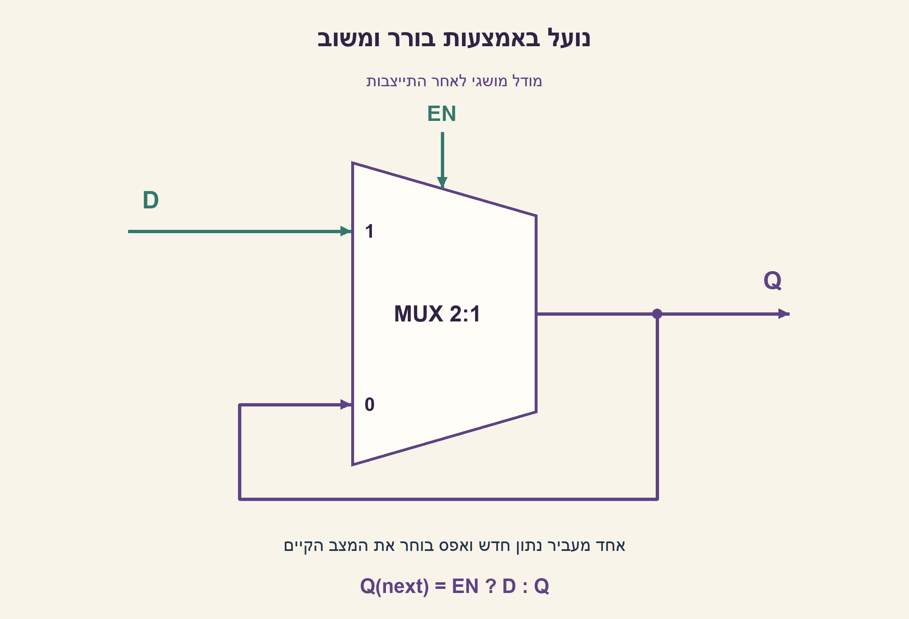
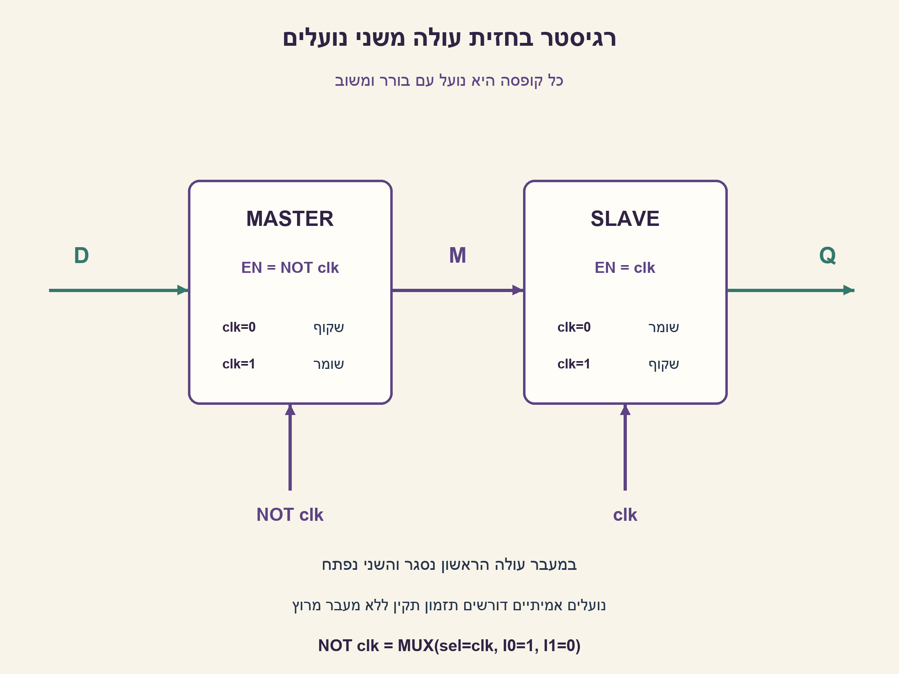
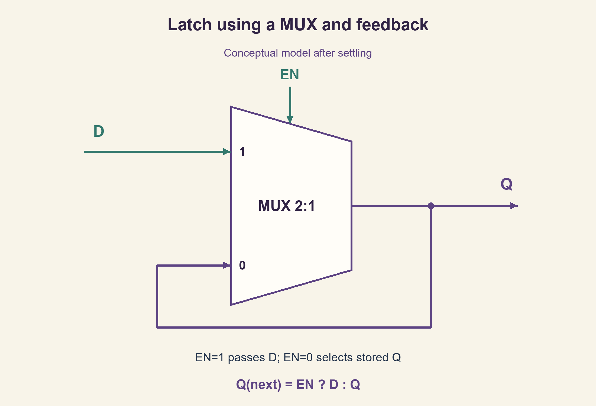
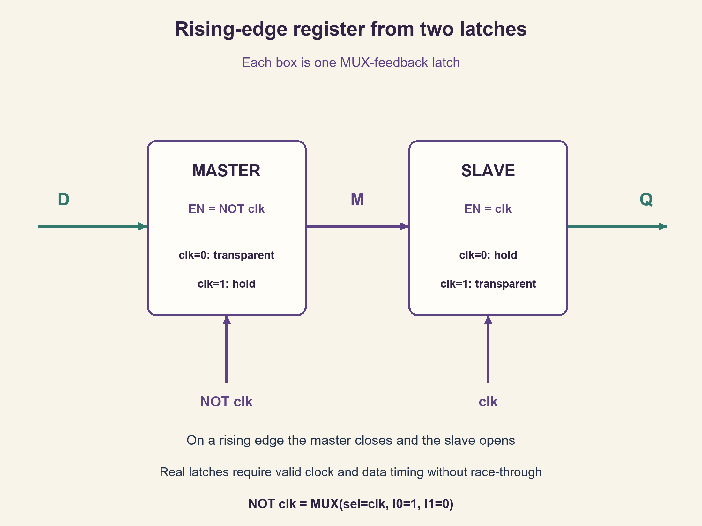

# PREP-083 — מ־MUX לנועל ולרגיסטר בחזית עולה

## מקור שנמסר

מהו LATCH, מהו REGISTER? תכננו לאצ' בעזרת MUX 2-1, לאחר מכן ביקשו לתכנן REGISTER בעזרת MUX2-1 או LATCH

[צילום המקור הפנימי](../sources/prep-083-source.png)

סטטוס: הצעה לפתרון בסיוע AI; ביקורת מקצועית אנושית ממתינה. הבהרות העריכה נפרדות מהצילום. שיוך חברה, אם יש, הוא דיווח המקור בלבד.

## מ־MUX לנועל ולרגיסטר בחזית עולה

הסבירו מה ההבדל בין נועל (Latch) לבין רגיסטר. תכננו נועל D ברגישות לרמה גבוהה באמצעות בורר MUX 2:1 ומשוב. לאחר מכן תכננו רכיב זיכרון של ביט אחד הדוגם בחזית עולה באמצעות נועלים, והסבירו כיצד הוא מתרחב לרגיסטר W ביטים. אם מותר להשתמש רק בבוררים, הראו גם כיצד יוצרים את בקרת השעון ההפוכה. כהמשך, הוסיפו enable סינכרוני לרגיסטר.

הבהרות העריכה: כאן המילה REGISTER פירושה W דלגלגים בעלי שעון משותף, ולא שרשרת נועלים השקופה באותה רמה. במימוש של ביט אחד מדובר בדלגלג D בחזית עולה. מותרים חיווט משוב וקבועים 0 ו־1; לא ניתן לבנות זיכרון מרשת בוררים קומבינטורית ללא משוב או רכיב זוכר. תחילה מנתחים מודל אידאלי אחרי התייצבות, עם נתון יציב סביב חזית הדגימה. אין איפוס בנוסח המקורי, ולכן מצב התחלתי אינו מובטח; במודל הבדיקה מספקים מצב ידוע לצורך השוואה. יש להפריד בין השרטוט המושגי לבין מימוש תאים פיזי ודרישות setup/hold, רוחב פולס ומרוץ בין נועלים.

### רמזים

1. הפרידו בין חלון שבו מותר למוצא לעקוב אחרי הקלט לבין רגע דגימה יחיד.
2. בורר יכול לבחור בין נתון חדש לבין ערך שמוחזר מהמוצא. כיצד שתי רמות שקיפות משלימות מפרידות את הקלט מהמוצא?
3. לנועל השתמשו ב־Q(next)=EN?D:Q. לדלגלג בחזית עולה חברו נועל ראשון ששקוף כש־clk=0 לנועל שני ששקוף כש־clk=1; נתחו כל חצי מחזור.

### הצעה לפתרון

### מתחילים מסוג הזיכרון

נועל D ברמה גבוהה מעביר את D אל Q כל עוד EN=1, אחרי השהיית ההתפשטות, ושומר כאשר EN=0. שינויים רבים יכולים לעבור במשך חלון השקיפות. דלגלג בחזית עולה דוגם רק סביב המעבר 0→1 ושומר בין חזיתות; הנתון עדיין חייב לעמוד ב־setup/hold. רגיסטר W ביטים הוא W רכיבי אחסון כאלה עם שעון משותף. המילה רגיסטר לבדה אינה מגדירה תמיד את סוג הרכיב, ולכן ביררנו אותו בנוסח.

### נועל מבורר אחד

ל־MUX נסמן I0 כניסה שנבחרת כשהבורר אפס, ו־I1 כשהבורר אחת. חברו I1=D, I0=Q במשוב, ו־S=EN:

```text
Q(next) = MUX(S=EN, I0=Q, I1=D)
```

כש־EN=1 נבחר D. כש־EN=0 נבחר שוב Q ונשמר הערך. המשוב הוא מה שמאפשר אחסון; רשת MUX חסרת מעגלי משוב מחשבת פונקציה של הקלט הנוכחי בלבד. זו הדגמה לוגית של נועל, ולא היתר להכניס לולאה קומבינטורית שרירותית לתכנון FPGA או ASIC. משתמשים בתא אחסון מאושר ובתיאור שהכלים תומכים בו.

### משני נועלים לדלגלג

חברו D→Master→M→Slave→Q. הראשון שקוף ב־clk=0 והשני ב־clk=1. כאשר השעון נמוך M עוקב אחרי D אך Q מוחזק. בחזית עולה הראשון נסגר ושומר את הדגימה; השני נפתח ומעביר את M הקבוע ל־Q אחרי השהיה. במשך השלב הגבוה שינויי D אינם עוברים דרך הראשון. בחזית יורדת השני נסגר והראשון שוב נפתח; Q נשאר קבוע. כך מחוץ לחלון הדגימה אין מעבר ישיר מ־D ל־Q. אם הופכים את קוטביות שני הנועלים מתקבלת דגימה בחזית יורדת.

אם מותרים רק בוררים וקבועים, בקרת NOT clk נוצרת מבורר נוסף עם S=clk,I0=1,I1=0. לכן בספירה המושגית לביט אחד: שני בוררי משוב לאחסון, ועוד בורר ליצירת השעון המשלים אם הוא אינו זמין. יצירת השעון המשלים יכולה להיות משותפת ל־W ביטים במודל; עלות פיזית כוללת הפצה ועומס ולא רק ספירה זו. קבועים וחיווט אינם רכיבי זיכרון נוספים.

### enable לרגיסטר ותזמון אמיתי

לפני כל דלגלג בוחרים D_FF=EN?D:Q. בחזית עולה EN=1 טוען ו־EN=0 שומר. זהו MUX לפני דלגלג, לא חיבור EN ישירות לשעון. כדי ליצור enable מהנועלים המושגיים אפשר להוסיף בחירה זו בכניסת המבנה; שכפלו אותה לכל ביט.

תיאור עם clk ו־NOT clk אינו מבטיח לבדו שהנועלים הפיזיים לא יהיו שקופים יחד לזמן קצר. חייבים למנוע race-through באמצעות תכנון שעון ותאים מתאים, ולעמוד ב־setup/hold, זמני השהיה ורוחבי פולס. חפיפה עלולה לאפשר לנתון חדש לעבור את שתי הדרגות; גם זמן מת בין הפאזות מחייב אילוצי תזמון. לא נוסיף מספרי ns ללא ספריית תאים ונתוני שעון. מצב התחלתי לא ידוע נשאר לא ידוע עד טעינה או איפוס מוגדרים.

### בדיקה

מודל Python אידאלי עבר 8 שורות אמת, 10,922 רצפי נועל ובהם 61,896 צעדים; 8,192 עקבות Master/Slave ובהן 131,072 שלבים יציבים; ועוד 512 צירופי enable ל־4 ביטים. האורקלים שומרים בנפרד את הנתון האחרון בזמן פתיחת נועל ואת הדגימה בחזית. הנתון מוחזק סביב חזיתות בבדיקת הדלגלג. צורף SystemVerilog מושגי; לא בוצעו קומפילציית HDL, סינתזה, סימולציית תזמון, STA או בדיקת חומרה. הפתרון מוצע וממתין לביקורת מקצועית.





### assumptions

[
  "REGISTER מוגדר כאן כרגיסטר בחזית עולה; נועל ברמה גבוהה אינו אותו רכיב.",
  "מותר משוב וקבועים 0/1; נתון יציב סביב חזית ומודל שלבים אידאלי אחרי התייצבות.",
  "אין איפוס במקור ואין ערך התחלתי מובטח. clock ו־NOT clock אינם כשלעצמם אישור לתזמון פיזי."
]

### truth_table

[
  {
    "EN": 0,
    "D": 0,
    "Q_before": 0,
    "Q_after_settling": 0
  },
  {
    "EN": 0,
    "D": 0,
    "Q_before": 1,
    "Q_after_settling": 1
  },
  {
    "EN": 0,
    "D": 1,
    "Q_before": 0,
    "Q_after_settling": 0
  },
  {
    "EN": 0,
    "D": 1,
    "Q_before": 1,
    "Q_after_settling": 1
  },
  {
    "EN": 1,
    "D": 0,
    "Q_before": 0,
    "Q_after_settling": 0
  },
  {
    "EN": 1,
    "D": 0,
    "Q_before": 1,
    "Q_after_settling": 0
  },
  {
    "EN": 1,
    "D": 1,
    "Q_before": 0,
    "Q_after_settling": 1
  },
  {
    "EN": 1,
    "D": 1,
    "Q_before": 1,
    "Q_after_settling": 1
  }
]

### waveform_observations

[
  "clk=0: הראשון עוקב אחרי D והשני שומר Q.",
  "0→1: הראשון נסגר והשני מעביר את הדגימה השמורה.",
  "clk=1: שינוי D חסום בראשון; 1→0: השני נסגר לפני חזרת השקיפות לראשון לפי תזמון תקין."
]

### source_ambiguities

[
  "המונח REGISTER לא הוגדר בצילום; הוגדר במפורש כרגיסטר בחזית עולה.",
  "המקור אינו מציין קוטביות, איפוס או רכיבים מעבר ל־MUX; אלו הוגדרו כהנחות עריכה.",
  "הצילום אינו כולל תגיות חברות; לא שויך לחברה."
]

### optimality

"ספירת שני בוררי משוב לביט ועוד יצירת שעון משלים היא תיאור המבנה המסוים, לא הוכחת שטח מזערי בספריית תאים. רגיסטר W ביטים דורש W ביטי מצב; עלות שעון וחיווט אינה מיוצגת במודל."

### verification

"עברו 8 שורות אמת, 10,922 רצפי נועל/61,896 צעדים, 8,192 עקבות דלגלג/131,072 שלבים יציבים ו־512 מקרי enable ל־4 ביטים. Python אידאלי בלבד; HDL לא קומפל ואין STA או אימות פיזי."

### edge_cases

[
  "EN=0 אינו מאפס נועל; הוא שומר גם ערך התחלתי לא ידוע.",
  "נועל שקוף יכול להעביר כמה שינויי D באותו מחזור.",
  "שני נועלים באותה קוטביות עלולים להיות שקופים יחד ואינם דלגלג בחזית.",
  "W=1 הוא דלגלג יחיד; W>1 משתף שעון אך שומר ביטים נפרדים.",
  "שינוי D סביב חזית או חפיפת שקיפות אינו מכוסה במודל הבוליאני."
]

### common_mistakes

[
  "להחליף בין רגישות לרמה לרגישות לחזית.",
  "לצייר MUX ללא משוב ולקרוא לו זיכרון.",
  "להרכיב שני נועלים עם אותה בקרת enable.",
  "להציג clk והיפוכו כהבטחת אי־חפיפה פיזית, או להשתמש ב־EN כשעון לא מבוקר.",
  "לטעון שהקוד המושגי עבר סינתזה או STA בלי בדיקה כזאת."
]

### interview_answer

"נועל שקוף בזמן enable, ודלגלג דוגם בחזית. MUX בוחר בין D לבין Q במשוב. כדי לקבל חזית עולה מחברים נועל ששקוף בנמוך לנועל ששקוף בגבוה; השני מעביר רק דגימה שהראשון סגר. מרחיבים לביטים במקביל, ומוסיפים enable באמצעות MUX נתונים. את המרוץ והתזמון הפיזיים צריך לבדוק בנפרד."

### solution_extensions

{
  "question": "מה משתנה אם מחליפים את קוטביות שני הנועלים?",
  "direction": "ראשון שקוף בגבוה ושני בנמוך נותנים דגימה בחזית יורדת, תחת אותם אילוצי תזמון. אין צורך לשנות את רעיון המשוב.",
  "status": "מוכן בתוכן; אינו מחובר לתור המשך חי."
}

### technical_references

[
  {
    "title": "MIT 6.111 — נועלים ודלגלגים",
    "url": "https://web.mit.edu/6.111/www/f2017/handouts/TheDigitalWorld.pdf",
    "note": "פרקי Latch ו־Flip Flop תומכים בהגדרות ובמבנה משני נועלים. ההסבר, המודל והשרטוטים כאן נכתבו מחדש באופן עצמאי."
  }
]

## From a MUX to a latch and a rising-edge register

Explain the difference between a latch and a register. Build an active-high D latch using a 2:1 MUX and feedback. Then build one rising-edge storage bit from latches and extend it to a W-bit register. If only MUXes are allowed, also generate the complementary clock control. As an extension, add a synchronous register enable.

Editorial clarifications: REGISTER here means W flip-flops sharing a clock, rather than latches transparent at the same level; one bit is a rising-edge DFF. Feedback wiring and constants zero/one are allowed. A purely feed-forward combinational MUX network cannot store state. First use an ideal settled-phase model with data stable around the sampling edge. The source specifies no reset, so initialization is not guaranteed; functional tests supply known initial states. Separate this conceptual schematic from physical storage cells, setup/hold, pulse-width requirements and latch race-through.

### Hints

1. Distinguish a window during which output may follow input from a single sampling edge.
2. A MUX can choose fresh data or its own fed-back output. How can complementary transparency levels isolate input from output?
3. Use Q(next)=EN?D:Q for the latch. For a rising-edge flip-flop, connect a master open at clk=0 to a slave open at clk=1, and analyze both half cycles.

### Proposed solution

### Identify the storage contract

An active-high D latch follows D while EN=1, after propagation delay, and holds while EN=0; several transitions can pass during its transparent window. A rising-edge DFF samples around a 0→1 clock transition and holds between edges, subject to setup/hold. A W-bit register comprises W storage bits with a shared clock. The word register alone is not always enough to identify the underlying storage type, so the prompt defines it.

### One MUX with feedback

Let I0 be selected when S=0 and I1 when S=1. Connect I1=D, I0=Q by feedback, and S=EN:

```text
Q(next) = MUX(S=EN, I0=Q, I1=D)
```

EN=1 selects D; EN=0 reselects and holds Q. Feedback enables storage. An acyclic MUX network only computes a function of current inputs. This logical construction is not permission to introduce an arbitrary combinational loop into FPGA or ASIC implementation; use supported storage descriptions and approved cells.

### Two latches form an edge-triggered bit

Connect D→Master→M→Slave→Q. Open the master at clk=0 and the slave at clk=1. During low clock M follows D while Q holds. At the rising edge the master closes and retains the sample; the slave opens and transfers that stable M to Q after delay. While clock is high, changes at D cannot pass the closed master. At the falling edge the slave closes and the master opens again, so Q holds. Thus input cannot pass directly to output outside the sampling window. Reversing both latch polarities instead gives falling-edge sampling.

If only MUXes and constants are available, NOT clk is another MUX with S=clk,I0=1,I1=0. The conceptual one-bit count is two feedback MUXes for storage plus one MUX for the complementary clock if it is unavailable. Complement generation may be shared across W bits in the logical model; physical distribution and loading add costs beyond that count. Constants and wiring introduce no further storage bits.

### Register enable and real timing

Before each DFF, select D_FF=EN?D:Q. On a rising edge EN=1 loads and EN=0 holds. This is a data MUX before a DFF, not EN wired directly into its clock. The conceptual latch pair can use this selection at its data input; replicate for every bit.

Using clk and NOT clk alone does not guarantee the two physical latches never overlap in transparency. Prevent race-through using appropriate storage cells and clock design, and satisfy setup/hold, propagation delays and pulse widths. Overlap can allow fresh data through both stages; any dead interval between phases also needs timing constraints. Numerical nanosecond limits require a cell library and clock specification. Unknown initialization stays unknown until a specified load or reset.

### Verification

The ideal Python model passed eight truth rows, 10,922 latch streams containing 61,896 steps, 8,192 master/slave traces containing 131,072 settled phases, and 512 four-bit enable combinations. Independent oracles retain the last enabled data and the edge sample. Flip-flop test data is held around clock transitions. Conceptual SystemVerilog is included but was not compiled, synthesized, timing-simulated, statically timed or hardware-tested. This is a proposed solution pending professional review.





### assumptions

[
  "REGISTER is defined here as rising-edge storage; an active-high latch has a different contract.",
  "Feedback and zero/one constants are allowed; data is stable around sampling edges in an ideal settled-phase model.",
  "No reset or guaranteed initial value is specified. Complementary clock logic alone does not certify physical timing."
]

### truth_table

[
  {
    "EN": 0,
    "D": 0,
    "Q_before": 0,
    "Q_after_settling": 0
  },
  {
    "EN": 0,
    "D": 0,
    "Q_before": 1,
    "Q_after_settling": 1
  },
  {
    "EN": 0,
    "D": 1,
    "Q_before": 0,
    "Q_after_settling": 0
  },
  {
    "EN": 0,
    "D": 1,
    "Q_before": 1,
    "Q_after_settling": 1
  },
  {
    "EN": 1,
    "D": 0,
    "Q_before": 0,
    "Q_after_settling": 0
  },
  {
    "EN": 1,
    "D": 0,
    "Q_before": 1,
    "Q_after_settling": 0
  },
  {
    "EN": 1,
    "D": 1,
    "Q_before": 0,
    "Q_after_settling": 1
  },
  {
    "EN": 1,
    "D": 1,
    "Q_before": 1,
    "Q_after_settling": 1
  }
]

### waveform_observations

[
  "clk=0: master follows D and slave holds Q.",
  "0→1: master closes and slave transfers the retained sample.",
  "clk=1: master blocks D changes; 1→0: slave closes as master regains transparency, subject to valid timing."
]

### source_ambiguities

[
  "The screenshot does not define REGISTER; the edited problem explicitly uses rising-edge storage.",
  "Polarity, reset and auxiliary components are unspecified; the editorial contract states them.",
  "No company tags are visible in this screenshot, so none are attributed."
]

### optimality

"Two feedback MUXes per bit plus complement generation describe this topology, not minimum physical area in a cell library. W-bit storage requires W state bits; clock and wire costs are outside this model."

### verification

"Passed eight truth rows, 10,922 latch streams/61,896 steps, 8,192 flip-flop traces/131,072 settled phases and 512 four-bit enable cases. Ideal Python only; HDL not compiled, no STA or physical verification."

### edge_cases

[
  "EN=0 holds a latch, including unknown initialization; it does not reset it.",
  "Several D transitions may pass during a transparent phase.",
  "Two same-polarity latches may be open together and do not form the stated edge-triggered bit.",
  "W=1 is one storage bit; W>1 shares a clock while retaining independent bits.",
  "Data changes near an edge and overlap races are outside the Boolean model."
]

### common_mistakes

[
  "Confusing level sensitivity with edge sensitivity.",
  "Drawing a feed-forward MUX and calling it storage.",
  "Driving both latches with the same enable phase.",
  "Treating complemented clocks as guaranteed physical non-overlap, or using EN as an uncontrolled clock.",
  "Claiming conceptual code was synthesized or statically timed without doing so."
]

### interview_answer

"A latch is transparent during enable; a DFF samples at an edge. A feedback MUX selects D or retained Q. A low-open master followed by a high-open slave transfers only the sample closed by the master at a rising edge. Replicate bits for a register and use a data MUX for enable; separately validate physical race and timing constraints."

### solution_extensions

{
  "question": "What changes if both latch polarities are reversed?",
  "direction": "A high-open master followed by a low-open slave gives falling-edge sampling under the same timing discipline. Feedback storage itself is unchanged.",
  "status": "Prepared in content; not connected to the live follow-up queue."
}

### technical_references

[
  {
    "title": "MIT 6.111 — latches and flip-flops",
    "url": "https://web.mit.edu/6.111/www/f2017/handouts/TheDigitalWorld.pdf",
    "note": "The Latch and Flip Flop sections support the definitions and two-latch structure. Explanations, models and diagrams here were independently authored."
  }
]

## קבצים / Files

- [prep_083_mux_latch_register.py](../solutions/prep_083_mux_latch_register.py)
- [prep_083_mux_latch_register.sv](../solutions/prep_083_mux_latch_register.sv)
- [check_prep_083.py](../checks/check_prep_083.py)
- [prep-083-verification.json](../checks/prep-083-verification.json)


## מקורות נוספים — 24.10.2026, מקבץ 20

- [צילום 18](../sources/2026-10-24-batch20-18.png) — Valens, Apple; דיווח מקור לא מאומת.

המזהה, היסטוריית התרגול והאישורים האנושיים אינם מוחלפים בעקבות קליטת מקור. הנוסח, שלושת הרמזים והפתרון הטכני נשמרו.


## מקור נוסף — 30.10.2026, צילום 14

[צילום פרטי](../sources/2026-10-30-batch20-14.png)

זהו מקור נוסף לשאלה הקיימת; הגרסה והתוכן הטכני נשמרו ללא שינוי.
