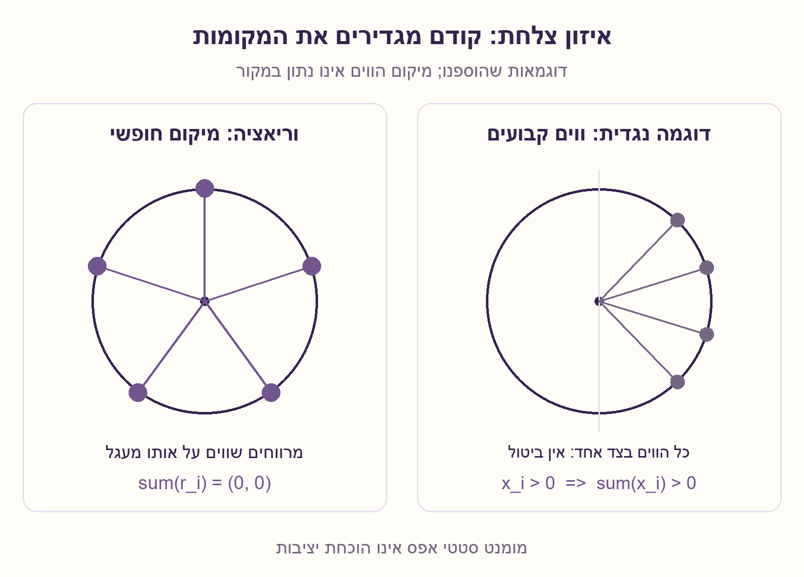
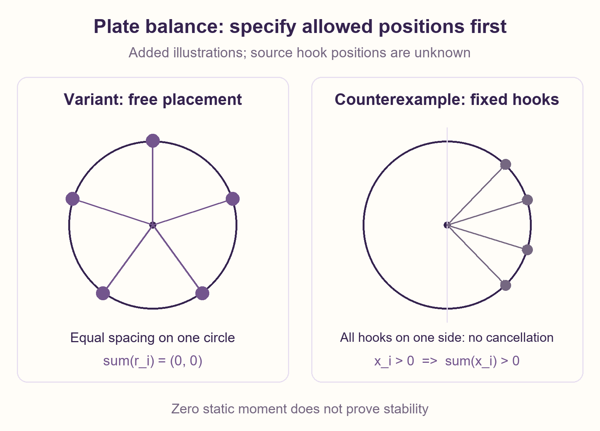

# PREP-084 — איזון צלחת עם משקולות — מה צריך לדעת על הווים?

מצב: בביקורת; הצעה לפתרון בסיוע AI, ממתינה לבדיקה מקצועית אנושית.

## מקור

מעמידים צלחת סינית עם ווי תלייה, האם ניתן לתלות 2 משקולות (שוות משקל), האם ניתן 3,4,5..20

[צילום מקור](../sources/prep-084-source.png)

חברות לפי המקור בלבד, ללא אימות עצמאי: NVIDIA

## נוסח ערוך

צלחת קשיחה מאוזנת אופקית על נקודת תמיכה במרכזה. רוצים לתלות עליה 2 משקולות שוות, ובהמשך 3,4,...,20 משקולות שוות. האם הדבר אפשרי?

המקור מציין ווי תלייה אך אינו נותן את מספרם או את מיקומיהם. הסבירו אילו נתונים חסרים ונסחו תנאי גאומטרי לבדיקת כל מספר משקולות על ווים קבועים. לאחר מכן פתרו וריאציה מפורשת שנוספה כאן: מותר לבחור בחופשיות מקומות שונים על היקף מעגל אחד סביב המרכז. באילו ממספרי המשקולות 2 עד 20 אפשר להשיג מומנט נוסף אפס?

נניח שהצלחת ללא המשקולות כבר מאוזנת, שהמשקולות זהות וחיוביות ושהתמיכה מאזנת את הכוח האנכי בלי לספק מומנט. מדובר באיזון סטטי במצב האופקי, ולא בהבטחת יציבות לאחר הטיה. בגרסת הווים הקבועים אין להניח מיקומים או היתר ערימה שלא נמסרו.

## שלושה רמזים

1. לפני שמחשבים, אילו נתונים גאומטריים על הווים חסרים? מה פירוש איזון סביב נקודת מרכז?
2. ייצגו כל משקולת באמצעות וקטור אופקי מהמרכז אל מקום תלייתה. איזה סכום צריך להתאפס?
3. ווים קבועים מחייבים בדיקת סכום הווקטורים הזמינים. בווריאציה שבה מותר לבחור כל זווית על מעגל, נסו מרווחים זוויתיים שווים.

## הצעה לפתרון

### קודם מבהירים מה מותר
מהצילום לבדו אי אפשר להכריע אם אפשר לתלות 2,3,...,20 משקולות: חסרים מספר הווים ומיקומיהם. צלחת עם שני ווים מנוגדים מאפשרת שתי משקולות; שני ווים באותו צד אינם מאפשרים זאת. אין הצדקה להניח שיש 12 ווים או שמותר להזיז אותם.

### מתרגמים איזון לסכום וקטורים
נסמן את מקום כל משקולת ביחס למרכז ב־r_i=(x_i,y_i,0), ואת כוח הכובד ב־F_i=(0,0,-mg). הצלחת המקורית כבר מאוזנת, והתגובה בנקודת התמיכה אינה מוסיפה מומנט. לכן די לבדוק את המומנט הנוסף:

```text
tau_i = r_i x F_i = (-mg*y_i, mg*x_i, 0)
sum(tau_i) = 0  <=>  sum(x_i) = 0 and sum(y_i) = 0
```

כלומר, ההיטל האופקי של מרכז המסה של המשקולות צריך להישאר במרכז. זו בדיקה של שתי קואורדינטות, ולא של סכום הזוויות. הכוח האנכי הכולל מאוזן על ידי התמיכה.

### אם הווים קבועים
צריך את הקואורדינטות האמיתיות ולחפש k מקומות מותרים שסכומם אפס, בהתאם להיתר הערימה. למשל, אם כל וו נמצא מימין למרכז כך שכל x_i חיובי, שום בחירה לא ריקה לא תתאזן. לכן עצם העובדה ש־k זוגי אינה מספיקה.

### וריאציה מפורשת: מותר לבחור כל מקום על אותו היקף
בווריאציה הזאת אפשר כל k שלם מ־2 עד 20: ממקמים משקולות שוות בקודקודי מצולע משוכלל בעל k קודקודים. עבור 2 אלה נקודות מנוגדות, עבור 3 זהו משולש שווה־צלעות, וכן הלאה. ההפרש הזוויתי הוא סיבוב מלא חלקי k.

הוכחה: ייצגו וקטור במישור כמספר מרוכב. אם z הוא סיבוב בזווית 2π/k, אז z אינו 1 אבל z^k=1, ולכן:

```text
1 + z + z^2 + ... + z^(k-1) = (z^k - 1)/(z - 1) = 0
```

כפל ברדיוס או סיבוב כל הסידור שומרים על האפס. אין צורך בזוגיות של k. בניית k המקומות היא בזמן O(k), וההוכחה תקפה לכל k≥2; בדיקות הקוד מכסות את הטווח המבוקש.

### מה הטענה אינה מוכיחה
התוצאה היא אפס מומנט במצב האופקי של המודל. משקולת אחת שאינה במרכז אינה יכולה להתאזן, אך תמיכה במרכז אינה לבדה הוכחת יציבות: גובה מרכז המסה, גאומטריית התמיכה והתגובה להטיה דורשים מידע נוסף. לא בוצע ניסוי בצלחת פיזית.

## הנחות

[
  "צלחת קשיחה שכבר מאוזנת במצב אופקי סביב נקודת תמיכה מרכזית; התמיכה מאזנת את הכוח הכולל ואינה מספקת זוג מומנטים.",
  "כל המשקולות שוות וחיוביות; כבידה אחידה וכוחות אנכיים. נבדק מומנט סטטי במצב האופקי, לא יציבות להפרעות.",
  "בגרסת הווים הקבועים משתמשים בקואורדינטות הנתונות ובמשקולת אחת לכל וו שנבחר, אלא אם הותר במפורש אחרת.",
  "הבחירה החופשית של מקומות על היקף מעגל היא וריאציה שהוספנו; אינה פרט שניתן להסיק מן המקור."
]

## מדד וגבולות הטענה

{
  "criterion": "קיום סידור בעל מומנט נוסף אפס, תחת קבוצת המקומות המותרת.",
  "result": "בווים לא ידועים אין תשובת כן/לא לפי מספר המשקולות בלבד. בבחירה חופשית על מעגל כל k שלם מ־2 עד 20 אפשרי.",
  "proof": "בגרסה החופשית קודקודי מצולע משוכלל מבטלים את סכום וקטורי המקום. בגרסה הקבועה התנאי הוא סכום קואורדינטות אפס.",
  "scope": "חיפוש כל תתי־הקבוצות במודל הוא אמצעי בדיקה, לא אלגוריתם אופטימלי לבעיית בחירה כללית."
}

## מקרי קצה

[
  "משקולת יחידה ברדיוס חיובי אינה מתאזנת; מקום במרכז היה משנה את הבעיה.",
  "אם כל הווים נמצאים באותו חצי־מישור פתוח, אף קבוצה לא ריקה של משקולות חיוביות עליהם לא תתאזן.",
  "מספר ווים קטן ממספר המשקולות פוסל סידור ללא ערימה; המקור אינו מתיר ערימה במפורש.",
  "מסות או רדיוסים שונים מחייבים סכום משוקלל; איזון סטטי אינו מבטיח שהצלחת תחזור לאחר הטיה."
]

## טעויות נפוצות

[
  "להמציא מספר ווים, למשל 12, או להניח שהם במרווחים שווים בלי שנאמר כך.",
  "לענות שכל מספר זוגי אפשרי ואי־זוגי לא: שלוש נקודות במרווחי שליש סיבוב מתאזנות.",
  "להוכיח שקיים מצולע משוכלל ולהתעלם מכך שאולי אין ווים בקודקודיו.",
  "לבדוק סכום זוויות במקום סכום וקטורים, או לבלבל אפס מומנט עם יציבות פיזית."
]

## תשובה קצרה לראיון

קודם אבקש את מיקומי הווים: מספר המשקולות לבדו אינו מספיק. למשקולות שוות נדרש שסכום וקטורי המקום מהמרכז יהיה אפס. אם מותר לבחור בחופשיות מקומות על מעגל, כל מספר מ־2 עד 20 אפשרי בעזרת מצולע משוכלל. זו וריאציה מפורשת, לא הנחה סמויה על צילום המקור.

## המשך תרגול

{
  "question": "איך משתנה התנאי אם המשקולות אינן שוות?",
  "direction": "מחליפים סכום וקטורים בסכום משוקלל: סכום m_i כפול r_i צריך להיות אפס. אין די בסימטריה גאומטרית לבדה.",
  "status": "מוכן בארכיון; אינו מחובר לתור המשך אינטראקטיבי."
}

## עמימות במקור

[
  "הצילום מזכיר צלחת עם ווי תלייה אך אינו מספק מספר ווים, מיקומים או שרטוט גאומטרי.",
  "ההמשך 3,4,5...20 מפורש כמספרי משקולות שוות; נדרש לאשר את קבוצת מקומות התלייה ואת היתר הערימה.",
  "אופן התמיכה, מרכז המסה ויציבות לאחר הפרעה אינם מוגדרים; נוסח האתר מצהיר על מודל סטטי אידאלי."
]

## מקורות מקצועיים

[
  {
    "title": "OpenStax — תנאי שיווי משקל סטטי",
    "url": "https://openstax.org/books/university-physics-volume-1/pages/12-1-conditions-for-static-equilibrium",
    "scope": "תנאי אפס כוח ואפס מומנט; הבניות הגאומטריות ובדיקת הווים נגזרו כאן בנפרד."
  }
]

## אימות

עברו כל 256 תתי־הקבוצות של שמונה ווים מוגדרים מול חישוב מומנט עצמאי במכפלה וקטורית, ארבע דוגמאות כושלות בחצי־מישור, זהות פולינומית מדויקת לכל k=2..20 ו־57 בדיקות נומריות של מספר/רדיוס. ארבעה קלטים פסולים נדחו. נבדק מודל מומנט אידאלי, ללא ניסוי פיזי או בדיקת יציבות.

## קוד, שרטוטים ובדיקות

[מודל Python](../solutions/prep_084_plate_balance.py)
[בדיקה](../checks/check_prep_084.py)
[תוצאת בדיקה](../checks/prep-084-verification.json)





## English learning material

### Balancing a plate — what hook geometry is required?

A rigid plate is balanced horizontally on a central point support. Can two equal weights be hung on it, and then 3,4,...,20 equal weights?

The source mentions hooks but gives neither their count nor their positions. Identify the missing information and state a geometric condition for testing any count on fixed hooks. Then solve an explicitly added variant: distinct positions may be chosen freely on one circle centered at the support. Which counts from 2 through 20 can have zero added moment?

Assume the unloaded plate is already balanced, the added masses are identical and positive, and the support balances vertical force without supplying torque. The target is static balance in the horizontal configuration, not stability after a tilt. Do not invent fixed-hook positions or permission to stack.

### Three hints

1. Before calculating, which hook-geometry information is missing? What does balance about a central point mean?
2. Represent each equal weight by its horizontal position vector from the center. Which sum must vanish?
3. Fixed hooks require checking sums of their actual vectors. In the added variant with arbitrary positions on a circle, try equal angular spacing.

### Proposed solution

### First clarify the allowed positions
The screenshot alone cannot establish whether 2,3,...,20 equal weights can be hung: the hook count and geometry are missing. Two opposite hooks permit two weights; two hooks on the same side do not. Neither twelve hooks nor movable hooks may be assumed.

### Convert balance into a vector sum
Write each weight's position relative to the center as r_i=(x_i,y_i,0), with gravity F_i=(0,0,-mg). The unloaded plate is already balanced and the point support adds no torque. The added moments therefore obey:

```text
tau_i = r_i x F_i = (-mg*y_i, mg*x_i, 0)
sum(tau_i) = 0  <=>  sum(x_i) = 0 and sum(y_i) = 0
```

The added masses' horizontal center-of-mass projection must remain at the center. Check two coordinate sums, not a sum of angles. The support balances total vertical force.

### If hooks are fixed
Obtain their actual coordinates and seek k permitted positions whose vectors sum to zero, respecting the stacking rule. If all hooks are strictly right of the center, every x_i is positive and no nonempty selection balances. Even k alone is insufficient.

### Explicit added variant: any position on one circle is allowed
Every integer k from 2 through 20 is then feasible: place equal weights at the vertices of a regular k-gon. For two use opposite points; for three use an equilateral triangle. Adjacent angles differ by one full turn divided by k.

For a proof, represent planar vectors as complex numbers. Let z be rotation by 2π/k. Then z is not 1 but z^k=1, giving:

```text
1 + z + z^2 + ... + z^(k-1) = (z^k - 1)/(z - 1) = 0
```

Scaling by the radius or rotating the full arrangement preserves zero. No parity restriction on k is needed. Constructing k positions takes O(k) time; the argument covers every k≥2, while code checks cover the requested range.

### Limits of the conclusion
This establishes zero moment in the model's horizontal configuration. A single off-center mass cannot balance, but a central support alone does not prove stability: center-of-mass height, support geometry and the response to a tilt need additional information. No physical plate experiment was performed.

### assumptions

[
  "A rigid plate is already balanced horizontally about a central point support, which balances total force without providing a torque couple.",
  "All added weights have the same positive mass; uniform gravity acts vertically. The target is zero static moment in the horizontal configuration, not perturbation stability.",
  "For fixed hooks, use their supplied coordinates and one weight per chosen hook unless stacking is explicitly allowed.",
  "Arbitrary choice of positions on a circle is an added variant, not information recoverable from the source."
]

### optimality

{
  "criterion": "Existence of a placement with zero added moment under specified allowed positions.",
  "result": "Unknown fixed hooks cannot be answered from count alone. With free circular placement, every integer k from 2 through 20 is feasible.",
  "proof": "A regular k-gon cancels position vectors in the free variant. Fixed hooks instead require a zero coordinate sum.",
  "scope": "The model's subset enumeration is a verification aid, not an optimal general subset-selection algorithm."
}

### edge_cases

[
  "One mass at positive radius cannot balance; an allowed central position would change the problem.",
  "If all hooks lie in one open half-plane, no nonempty positive-weight selection can balance.",
  "Fewer hooks than weights rules out a placement without stacking; the source does not explicitly permit stacking.",
  "Unequal masses or radii require a weighted sum; static balance does not establish recovery after a tilt."
]

### common_mistakes

[
  "Inventing a hook count, such as twelve, or assuming equal spacing without source support.",
  "Claiming only even counts work: three equal one-third-turn positions already balance.",
  "Showing a regular polygon exists while ignoring whether actual hooks occupy its vertices.",
  "Summing angles rather than position vectors, or confusing zero torque with physical stability."
]

### interview_answer

I would first ask for the hook positions: count alone is insufficient. Equal masses balance when their position vectors from the center sum to zero. If positions on a circle may be chosen freely, every count from 2 through 20 works as a regular polygon. That is an explicit variant, not a hidden assumption about the source.

### solution_extensions

{
  "question": "How does the condition change for unequal masses?",
  "direction": "Use a weighted vector sum: sum(m_i r_i)=0. Geometric symmetry alone is no longer sufficient.",
  "status": "Prepared in the archive; not connected to the interactive follow-up queue."
}

### source_ambiguities

[
  "The screenshot mentions a plate with hooks but provides no hook count, positions or geometric diagram.",
  "The continuation 3,4,5...20 is interpreted as counts of equal weights; allowed locations and stacking permission still need specification.",
  "Support mechanics, original center of mass and perturbation stability are unspecified; the edited question declares an ideal static model."
]

### technical_references

[
  {
    "title": "OpenStax — conditions for static equilibrium",
    "url": "https://openstax.org/books/university-physics-volume-1/pages/12-1-conditions-for-static-equilibrium",
    "scope": "Zero force and torque conditions; the geometric constructions and fixed-hook checks are derived separately here."
  }
]

### verification

Passed all 256 subsets of eight specified hooks against an independent cross-product torque calculation, four infeasible half-plane count cases, an exact polynomial identity for each k=2..20 and 57 numeric count/radius cases. Four invalid inputs were rejected. Ideal static-moment model only; no physical experiment or stability test.
