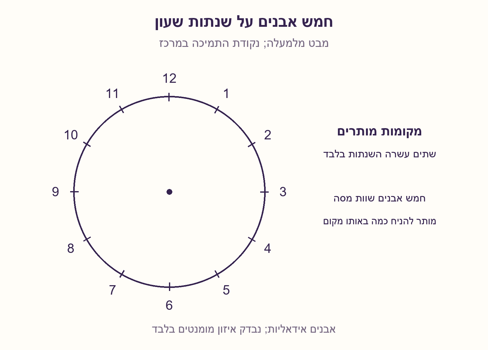
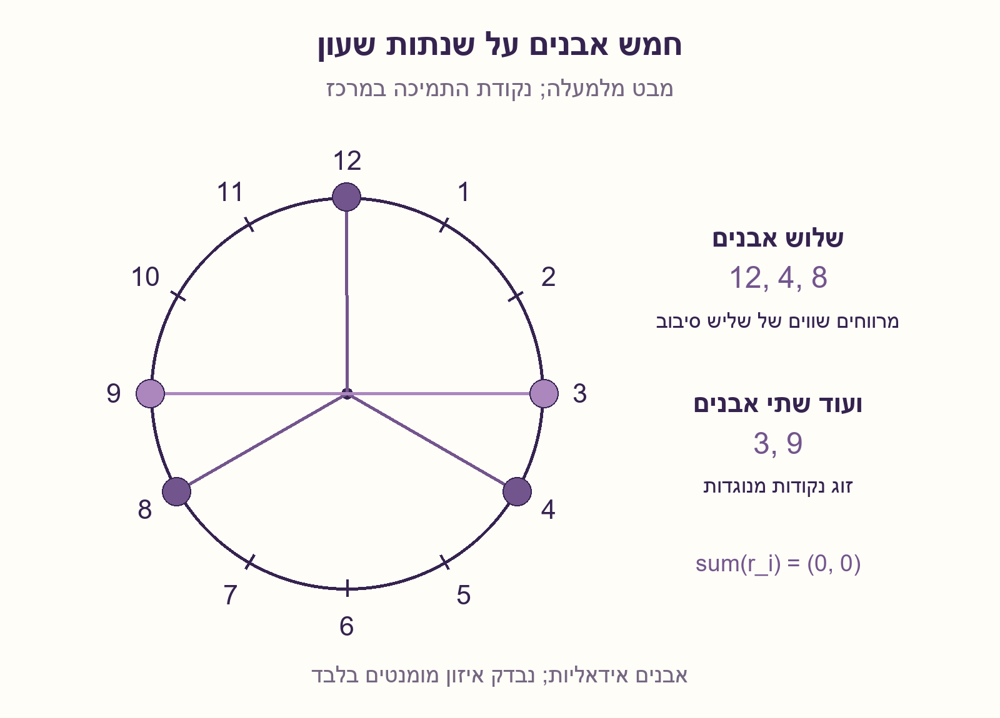
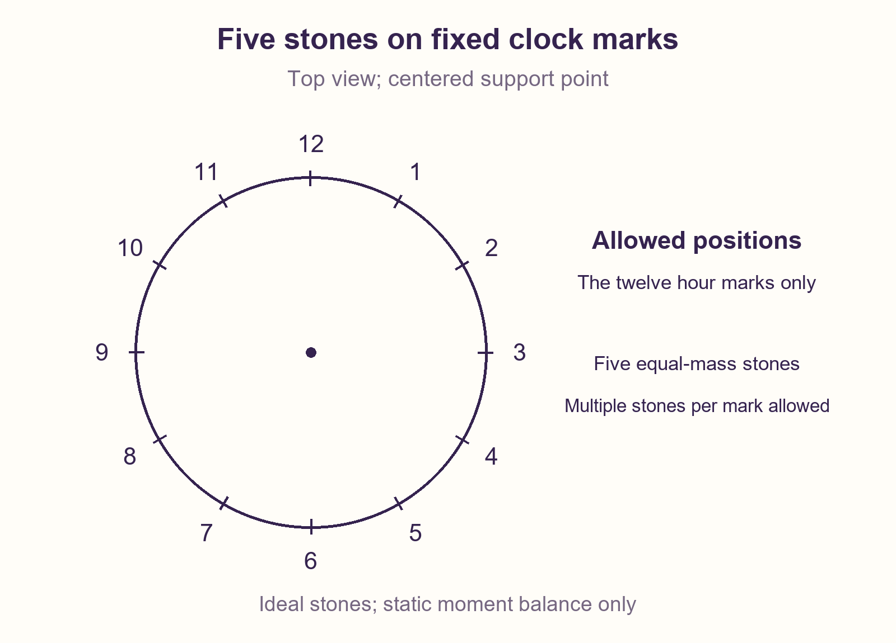
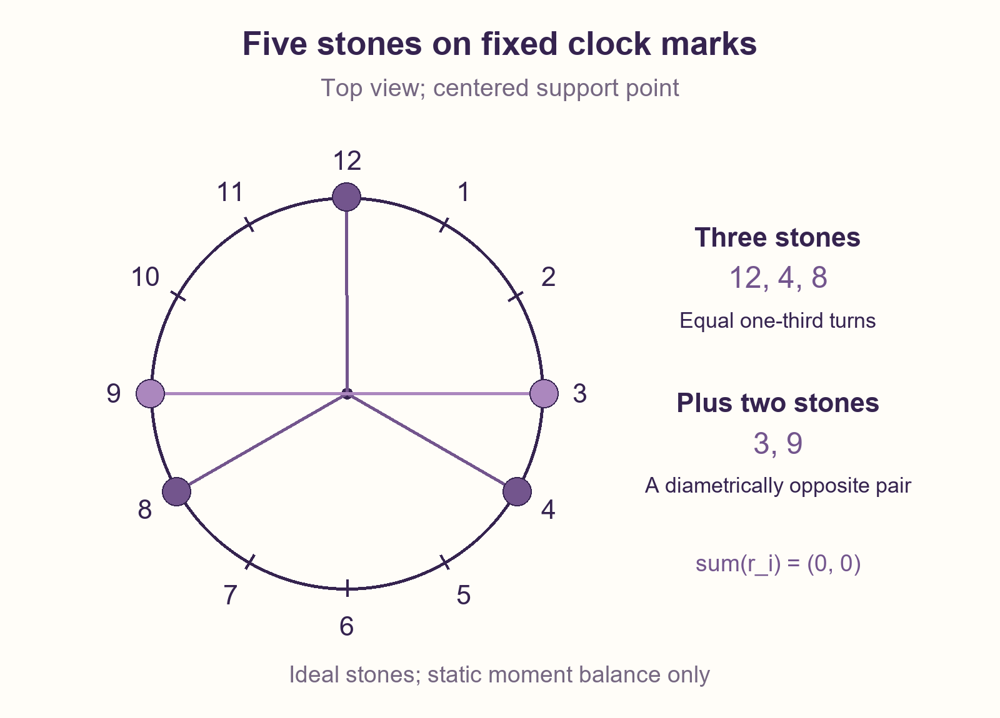

# PREP-085 — חמש אבנים על שעון מאוזן

מצב: בביקורת; הצעה לפתרון בסיוע AI, ממתינה לבדיקה מקצועית אנושית.

## מקור

קיים שעון שמונח על מחט בדיוק באמצע השעון, כך שהוא נמצא בשיווי משקל. עליך להניח 5 אבנים על השנתות!! של המעגל כך שהשעון יישאר בשיווי משקל על המחט. ניתן להניח מספר אבנים על אותה שנת.

[צילום מקור](../sources/prep-085-source.png)

חברות לפי המקור בלבד, ללא אימות עצמאי: Mellanox, Amazon

## נוסח ערוך

שעון עגול קשיח מונח אופקית על מחט בדיוק במרכזו וכבר מאוזן. יש בו 12 שנתות שוות־מרווח במרחק זהה מהמרכז. הניחו בדיוק חמש אבנים שוות מסה על השנתות כך שהמומנט הנוסף ביחס למרכז יהיה אפס. מותר להניח כמה אבנים על אותה שנתה. תנו סידור והסבירו מדוע הוא עובד.

הבהרות שנוספו: האבנים מיוצגות כמסות נקודתיות זהות, הכבידה אחידה והתמיכה אינה מספקת מומנט. שוויון המסות אינו נאמר במפורש במקור. מבוקש איזון סטטי במצב האופקי; אין להניח שהדבר מבטיח יציבות פיזית לאחר הפרעה או כשעורמים אבנים בגובה.

## שלושה רמזים

1. השעון כבר מאוזן לפני הוספת האבנים. מה צריך לקרות למרכז המסה של האבנים בלבד?
2. אפשר לפרק את חמש האבנים לשתי קבוצות שכל אחת מתאזנת בפני עצמה. חפשו חלוקה למספרים קטנים המתאימים לשנתות השעון.
3. זוג נקודות מנוגדות מתבטל. איזו שלישיית שנתות בעלת מרווחים זוויתיים שווים מתבטלת גם היא?

## הצעה לפתרון

### מחפשים קבוצות שמתאזנות בעצמן
כל אבן יוצרת מומנט ביחס למרכז. אבנים זהות במרחק זהה מתאזנות אם סכום וקטורי המקום שלהן אפס. אין צורך שכל אבן תהיה מול אבן אחרת: גם שלוש אבנים במרווחי 120 מעלות מתאזנות.

### סידור לחמש אבנים
נחלק 5 ל־3+2. נניח שלוש אבנים בשעות 12,4,8 — משולש שווה־צלעות — ועוד שתי אבנים בשעות 3,9, שהן נקודות מנוגדות. אלה חמש שנתות שונות, ולכן אפילו אין צורך בהיתר הערימה.

### בדיקה מדויקת
נבחר רדיוס 1, ציר x ימינה וציר y למעלה. מספרי השעות גדלים בכיוון השעון. מיקומי האבנים הם:

```text
12: (0, 1)
 4: (sqrt(3)/2, -1/2)
 8: (-sqrt(3)/2, -1/2)
 3: (1, 0)
 9: (-1, 0)
```

שלוש השורות הראשונות מסתכמות ב־(0,0), וגם השתיים האחרונות. לכן מרכז המסה האופקי של חמש האבנים הוא במרכז. כוח הכובד הכולל של האבנים פועל לאורך הקו האנכי דרך נקודת התמיכה, ואין תוספת מומנט. השעון המקורי כבר מאוזן; התמיכה נושאת את המשקל הכולל.

### מדוע ההרכבה עובדת?
מומנטים מסתכמים לינארית. אם קבוצה אחת מוסיפה מומנט אפס וקבוצה נוספת מוסיפה מומנט אפס, גם איחודן מוסיף אפס. זהו עיקרון שימושי: לפרק מספר מוזר של עצמים לקבוצות סימטריות קטנות, במקום לנסות לסדר את כולם בסימטריה אחת שאינה מתאימה למקומות המותרים. למשל, מחומש משוכלל אינו מתאים ל־12 שנתות, מפני ש־72 מעלות אינן כפולה של 30.

### הוכחה ובדיקה ממוחשבת הן דברים נפרדים
ההוכחה לעיל מספיקה לקיום סידור. לצורך אימות נוסף נסרקו כל 4,368 הסידורים הלא־מסודרים של חמש אבנים על 12 שנתות, כולל ערימות. סכומי הקואורדינטות חושבו בדיוק בבסיס 1 ושורש 3 והושוו לאורקל נפרד באמצעות פולינום ציקלוטומי; לא השתמשנו בסף נקודה צפה להכרעה. קוד החיפוש אינו הדרך הנדרשת לפתרון בראיון: הבנייה עצמה קבועה בגודלה.

### מגבלת המודל
הפתרון קובע אפס מומנט במצב האופקי. הוא מניח אבנים שוות מסה, מיקומים ברדיוס אחד ושעון שכבר מאוזן. אין כאן בדיקת יציבות של גוף אמיתי על חוד: גובה האבנים, מגע והתנהגות לאחר הטיה דורשים נתונים נוספים.

## הנחות

[
  "השעון הוא לוח קשיח אופקי שכבר מאוזן על תמיכה נקודתית במרכזו; תגובת התמיכה מאזנת משקל ואינה מוסיפה מומנט.",
  "חמש האבנים שוות מסה וחיוביות ומיוצגות כמסות נקודתיות; 12 השנתות במרווחי 30 מעלות ועל רדיוס אחד.",
  "מותר להניח כמה אבנים על אותה שנתה, כפי שמצוין במקור; הדוגמה שלנו אינה דורשת ערימה.",
  "נבדק אפס מומנט כבידה במצב האופקי בלבד. גובה וערימת אבנים אמיתיות, חיכוך ויציבות לאחר הטיה אינם ממודלים."
]

## מדד וגבולות הטענה

{
  "criterion": "מציאת סידור חוקי לחמש אבנים על 12 שנתות קבועות עם מומנט נוסף אפס.",
  "result": "סידור אחד הוא 12,4,8 יחד עם 3,9; כל חמש השנתות שונות.",
  "proof": "וקטורי משולש שווה־צלעות מתבטלים ושל זוג מנוגד מתבטלים; סכום שתי קבוצות מאוזנות הוא אפס.",
  "scope": "זו בניית קיום בזמן קבוע, לא טענה שהסידור יחיד או יציב פיזית. חיפוש ממצה משמש אימות בלבד."
}

## מקרי קצה

[
  "מותרת ערימה אך אינה הכרחית; הוכחה צריכה לספור חמש אבנים, לא רק חמש כמויות שרירותיות.",
  "אבנים במסות שונות עשויות להפר את ביטול הווקטורים גם באותם מקומות.",
  "אם השנתות אינן במרחק זהה מהמרכז או התמיכה אינה במרכז, יש לחשב מחדש.",
  "סיבוב כל חמשת המקומות במספר שלם של שנתות שומר על האיזון.",
  "אפס מומנט אופקי אינו מבטיח שהשעון לא ייפול עקב הטיה או הפרעה."
]

## טעויות נפוצות

[
  "לנסות לחלק חמש רק לזוגות ולסיים שמשום שהמספר אי־זוגי אין פתרון.",
  "לסכום את מספרי השעות במקום את וקטורי המקום.",
  "לבחור נקודות במרווחי 72 מעלות: הן אינן כולן שנתות של שעון בן 12 מקומות.",
  "להסתמך על אפס בקירוב נקודה צפה במקום הוכחה או חישוב מדויק.",
  "להשתמש בשרטוט סכמטי כהוכחת יציבות של שעון ואבנים אמיתיים."
]

## תשובה קצרה לראיון

אחלק את חמש האבנים לשלישייה מאוזנת וזוג מאוזן. אשים שלוש אבנים ב־12,4,8, שיוצרות משולש שווה־צלעות, ושתיים ב־3,9, שהן מנוגדות. בכל קבוצה סכום וקטורי המקום אפס, ולכן גם בכל החמש. זהו איזון מומנטים במודל האידאלי, ללא צורך בערימה.

## המשך תרגול

{
  "question": "אם מותר לערום, האם כל מספר של אבנים החל משתי אבנים ניתן לאיזון על 12 השנתות?",
  "direction": "כן: כל מספר זוגי הוא סכום של זוגות מנוגדים; כל מספר אי־זוגי החל מ־3 הוא שלישייה מאוזנת ועוד זוגות. אבן אחת אינה מתאזנת ברדיוס חיובי.",
  "status": "הרחבה עם הוכחת קיום; מוכנה בארכיון ואינה מחוברת לתור המשך אינטראקטיבי."
}

## עמימות במקור

[
  "המקור אינו אומר במפורש שהאבנים שוות מסה; זו הנחה הכרחית להצעה הגאומטרית ונוספה לנוסח האתר.",
  "השעון מתפרש כלוח אופקי עם 12 שנתות רגילות; אופן התמיכה, גודל האבנים וגובהן אינם מוגדרים.",
  "המונח שיווי משקל מתפרש כאפס מומנט סטטי, ללא הבטחת יציבות להפרעות."
]

## מקורות מקצועיים

[
  {
    "title": "OpenStax — תנאי שיווי משקל סטטי",
    "url": "https://openstax.org/books/university-physics-volume-1/pages/12-1-conditions-for-static-equilibrium",
    "scope": "תנאי הכוח והמומנט בלבד; סידור האבנים והאימות המדויק נגזרו כאן בנפרד."
  }
]

## אימות

עברו כל 4,368 הסידורים הלא־מסודרים של חמש אבנים כולל ערימות; נמצאו 24 סידורים מאוזנים בחישוב מדויק. אורקל עצמאי מצמצם פולינומים לפי Phi_12(z)=z^4-z^2+1. נבדקו גם 12 סיבובי הדוגמה, 12 קואורדינטות השעות, אפס סידורים לאבן אחת ושישה זוגות מאוזנים, ונדחו שלושה קלטים פסולים. אין ניסוי פיזי או בדיקת יציבות.

## קוד, שרטוטים ובדיקות

[מודל Python](../solutions/prep_085_clock_stones.py)
[בדיקה](../checks/check_prep_085.py)
[תוצאת בדיקה](../checks/prep-085-verification.json)









## English learning material

### Five stones on a balanced clock

A rigid circular clock lies horizontally on a needle exactly at its center and is already balanced. Its twelve equally spaced hour marks are at the same radius. Place exactly five equal-mass stones on the marks so their added moment about the center is zero. More than one stone may occupy a mark. Give a placement and explain why it works.

Added assumptions: stones are identical point masses, gravity is uniform and the support supplies no torque. Equal masses are not explicit in the source. The target is static balance in the horizontal configuration; do not infer physical stability after a disturbance or with stones stacked at real heights.

### Three hints

1. The clock is already balanced before stones are added. Where must the stones' own horizontal center of mass be?
2. Split the five stones into two groups that each balance independently. Look for small group sizes compatible with clock marks.
3. A diametrically opposite pair cancels. Which three equally spaced hour marks also cancel?

### Proposed solution

### Seek groups that balance independently
Each stone contributes a moment about the center. Equal masses at equal radius balance when their position vectors sum to zero. Pairwise opposition is not the only way: three stones separated by 120 degrees balance too.

### A placement for five stones
Split 5 into 3+2. Put three stones at 12,4,8, forming an equilateral triangle, and two at the opposite marks 3,9. All five marks differ, so stacking permission is not even needed.

### Exact calculation
Choose unit radius, x to the right and y upward. Hours increase clockwise. The stone coordinates are:

```text
12: (0, 1)
 4: (sqrt(3)/2, -1/2)
 8: (-sqrt(3)/2, -1/2)
 3: (1, 0)
 9: (-1, 0)
```

The first three sum to (0,0), as do the last two. Thus the stones' horizontal center of mass is at the center. Their combined gravitational force acts vertically through the support and adds no moment. The original clock is already balanced; the support carries total weight.

### Why composing groups works
Moments add linearly. A zero-moment group combined with another zero-moment group still contributes zero. This suggests a reusable approach: decompose an awkward count into small symmetric groups instead of insisting on a single symmetry incompatible with allowed positions. For example, a regular pentagon does not fit twelve hour marks because 72 degrees is not a multiple of 30.

### Proof and computational checking are distinct
The calculation above already proves existence. As an additional check, all 4,368 unordered five-stone placements on twelve marks, including stacks, were enumerated. Coordinate sums were evaluated exactly in the basis 1 and sqrt(3), then compared with an independent cyclotomic-polynomial oracle. No floating-point threshold decided balance. Search is a verification tool, not the required interview approach: the explicit construction has constant size.

### Model limits
This establishes zero moment in the horizontal configuration, assuming equal masses, a common mark radius and an initially balanced clock. It does not test the stability of a real object on a sharp point: stone height, contact and the response to a tilt require further information.

### assumptions

[
  "The clock is a rigid horizontal plate already balanced on a central point support; its reaction balances weight without adding torque.",
  "Five equal positive-mass stones are ideal point masses; twelve hour marks are separated by 30 degrees at one radius.",
  "Multiple stones on a mark are allowed by the source; the supplied construction does not require stacking.",
  "Only zero gravitational moment in the horizontal configuration is checked. Real stacking height, friction and perturbation stability are outside the model."
]

### optimality

{
  "criterion": "Find one legal zero-added-moment placement of five stones at twelve fixed marks.",
  "result": "One placement is 12,4,8 together with 3,9; all five marks are distinct.",
  "proof": "The equilateral triangle's vectors cancel, as do the opposite pair's; the two zero sums add to zero.",
  "scope": "A constant-time existence construction, not a uniqueness or physical stability claim. Exhaustive search is verification only."
}

### edge_cases

[
  "Stacking is allowed but unnecessary; count exactly five stones rather than arbitrary masses.",
  "Unequal masses can destroy cancellation at the same locations.",
  "Unequal mark radii or an off-center support require recomputation.",
  "Rotating all five locations by an integer number of marks preserves balance.",
  "Zero horizontal moment does not guarantee the clock cannot topple after a tilt or disturbance."
]

### common_mistakes

[
  "Trying only opposite pairs and concluding an odd number is impossible.",
  "Summing hour numbers instead of position vectors.",
  "Using 72-degree spacing: those positions are not all marks on a twelve-position clock.",
  "Treating an approximately zero floating-point sum as an exact proof.",
  "Taking a schematic as proof of real clock-and-stone stability."
]

### interview_answer

Split five into a balanced triple and pair. Put three stones at 12,4,8, forming an equilateral triangle, and two at the opposite marks 3,9. Each group's position vectors sum to zero, so all five do too. This is ideal static moment balance and requires no stacking.

### solution_extensions

{
  "question": "With stacking allowed, can every stone count of at least two balance on twelve marks?",
  "direction": "Yes: every even count consists of opposite pairs; every odd count of at least three is a balanced triple plus pairs. One stone cannot balance at positive radius.",
  "status": "Existence argument prepared in the archive; not connected to the interactive follow-up queue."
}

### source_ambiguities

[
  "Equal stone mass is not explicit in the source; it is required by this geometric construction and was added openly.",
  "The clock is interpreted as a horizontal plate with twelve standard marks; support details and stone dimensions/heights are unspecified.",
  "Balance is interpreted as zero static moment, without a perturbation-stability guarantee."
]

### technical_references

[
  {
    "title": "OpenStax — conditions for static equilibrium",
    "url": "https://openstax.org/books/university-physics-volume-1/pages/12-1-conditions-for-static-equilibrium",
    "scope": "Force and torque conditions only; the stone construction and exact verification are derived separately here."
  }
]

### verification

Passed all 4,368 unordered five-stone placements including stacks; exact arithmetic found 24 balanced placements. An independent oracle reduces polynomials modulo Phi_12(z)=z^4-z^2+1. Also checked twelve rotations of the construction, twelve hour coordinates, no one-stone solution and six balanced pairs; rejected three invalid inputs. No physical experiment or stability test.
