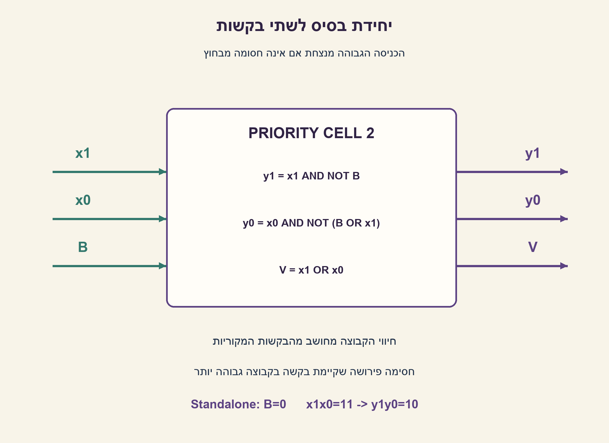
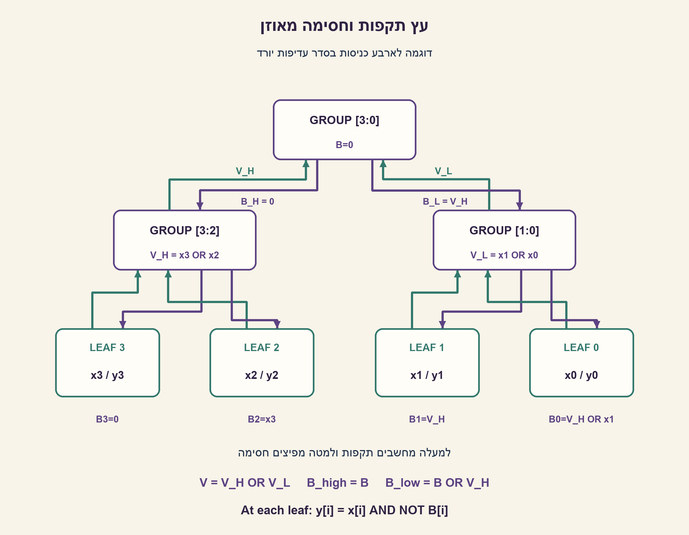
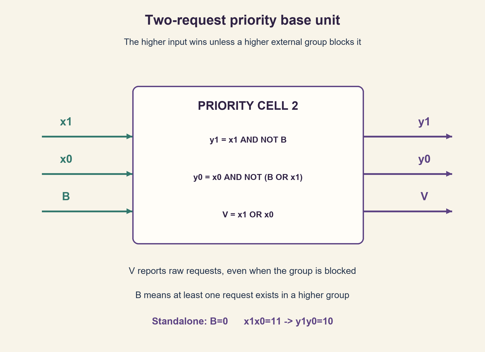
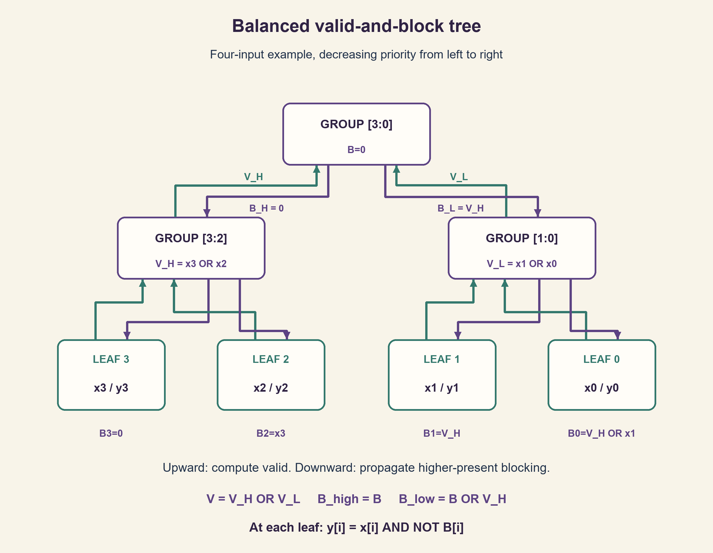

# PREP-086 — בידוד הבקשה הגבוהה: יחידת בסיס, שרשור ועץ

## מקור שנמסר

לממש רכיב המקבל n כניסות בינאריות, ומוציא n יציאות שבהן יש '1' רק עבור הכניסה הגבוהה ביותר שהייתה עם ערך '1', ו־'0' עבור כל שאר היציאות. במידה וכל הכניסות הינן '0' אז כל המוצאים הם '0'. מה יחידת הבסיס של רכיב זה? (נרצה לשרשר n יחידות בסיס בשביל לקבל את הרכיב הנ״ל) מה ה delay time? איך ניתן להקטין את הdelay כאשר n נתון לנו?

[צילום המקור הפנימי](../sources/prep-086-source.png)

סטטוס: הצעה לפתרון בסיוע AI; ביקורת מקצועית אנושית ממתינה. הבהרות העריכה נפרדות מהצילום. שיוך חברה, אם יש, הוא דיווח המקור בלבד.

## בידוד הבקשה הגבוהה: יחידת בסיס, שרשור ועץ

נתונות n כניסות בינאריות x[n−1:0] וצריך להפיק n יציאות y[n−1:0]. רק היציאה המתאימה לכניסה הפעילה בעלת האינדקס הגבוה ביותר תהיה 1; שאר היציאות יהיו 0. אם כל הכניסות אפס, כל היציאות אפס. תכננו יחידת בסיס, הסבירו כיצד משרשרים אותה לכל n, נתחו את השהיית השרשרת, והציעו מבנה בעל השהיה קטנה יותר כאשר n נתון.

הבהרות העריכה: n≥1 ידוע בזמן התכנון, ועדיפות n−1 היא הגבוהה ביותר. היציאה היא וקטור one-hot באורך n, לא אינדקס בינארי. זהו מעגל קומבינטורי ללא שעון; מתעניינים במצב שהתייצב ולא מבטיחים היעדר גליצ'ים. אפשר להשתמש ב־AND/OR בעלי שתי כניסות וב־NOT. לצורך ניתוח עומק, לכל שער השהיה יחידתית ולחוט אפס; אין נתוני ns, עומס או ספריית תאים. הסבירו יחידת ביט שרשורית וגם יחידה לשתי כניסות עם חיווי תקפות המתאים להיררכיה. טפלו גם ב־n שאינו חזקה של שתיים.

### רמזים

1. מה צריך כל ביט לדעת על כל הביטים שמעליו כדי להחליט אם הוא רשאי לעבור?
2. העבירו בין קבוצות חיווי שקיימת בהן לפחות בקשה אחת. האם שרשרת חייבת להמתין לכל קודמותיה?
3. חשבו V=OR של כל קבוצה. מלמעלה למטה העבירו חסימה B: לקבוצה גבוהה B נשאר, ולקבוצה נמוכה העבירו B OR V_high. בעלה קבלו y=x AND NOT B.

### הצעה לפתרון

### תנאי הבחירה

כניסה x[i] זוכה בדיוק אם היא 1 וכל הכניסות שמעליה הן 0:

```text
y[i] = x[i] AND NOT OR(x[n-1], ..., x[i+1])
```

OR של קבוצה ריקה הוא 0, ולכן y[n−1]=x[n−1]. אין קידוד לאינדקס: למשל x=010110 נותן y=010000. במקרה אפס אין זוכה.

### יחידת ביט ושרשרת

נסמן H כנוכחות בקשה באחד הביטים הגבוהים שכבר עברנו. יחידה אחת מקבלת x[i],H ומחזירה y[i]=x[i] AND NOT H ו־H_out=H OR x[i]. מתחילים למעלה ב־H=0 ומשרשרים כלפי מטה n יחידות. באינדוקציה H בכל יחידה הוא בדיוק OR כל הביטים שמעליה, ולכן הנוסחה מתקיימת. בשרשרת יש O(n) שערים ועומק O(n), משום שהחיווי לביטים הנמוכים עובר דרך הרבה יחידות. סיבוכיות פונקציית Python אינה זמן ההתפשטות הפיזי.

### יחידת שתי כניסות שניתנת להרכבה

ליחידה שתי בקשות x1,x0 וחסימה חיצונית B, שפירושה קיימת בקשה בקבוצה גבוהה ממנה. הגדירו:

```text
V  = x1 OR x0
y1 = x1 AND NOT B
y0 = x0 AND NOT (B OR x1)
```

V מחושב מהבקשות המקוריות גם כשהיחידה חסומה; הוא אינו OR של היציאות אחרי חסימה. ביחידה עצמאית B=0: 00→00,01→01,10→10,11→10. בשרשור זוגות מחשבים את B של הזוג הבא כ־B OR V של הזוג הנוכחי. אם נותר ביט בודד, מצמידים לו אפס בצד הנמוך או משתמשים ביחידת הביט לפי מיפוי אינדקסים מפורש.

### מבנה מאוזן: תקפות למעלה וחסימה למטה

כדי לקצר את המסלול, חלקו את הבקשות לקבוצות גבוהות ונמוכות בעץ בינארי. בכל צומת מחשבים V=V_high OR V_low. בשורש B=0. כאשר מעבירים חסימה למטה, הילד הגבוה מקבל B_high=B והילד הנמוך B_low=B OR V_high. בעלה i מפיקים y[i]=x[i] AND NOT B[i]. שתי הפאזות הן כיווני תלות לוגיים באותו מעגל קומבינטורי, לא מחזורי שעון או תוכנה שרצה פעמיים.

מדוע זה נכון? V מציין באינדוקציה אם יש בקשה בתת־העץ. B של כל קבוצה מציין אם יש בקשה מעל כל האינדקסים שלה. בקבוצה הגבוהה אין תוספת מעליה בתוך ההורה; בקבוצה הנמוכה צריך להוסיף את תקפות אחותה הגבוהה. לכן B בכל עלה הוא OR כל הבקשות שמעליו, בדיוק תנאי הבחירה שהתחלנו ממנו.

ל־n שאינו חזקה של שתיים מרפדים את צד האינדקסים הגבוהים באפסים עד N=2^ceil(log2 n), מבצעים את העץ, ומשמיטים את יציאות הריפוד. אפסים אינם מנצחים בקשה אמיתית. למשל n=5 נהפך ל־N=8 עם x7=x6=x5=0. עבור n=1 מקבלים פשוט y0=x0.

### זמן ושטח במודל המוגדר

גובה העץ h=ceil(log2 n). מעבר התקפות דורש לכל היותר h שערי OR; הפצת חסימה עוד לכל היותר h; NOT ו־AND בעלה עוד שניים. לכן חסם שמרני לעומק הוא 2h+2 יחידות לעומת n+1 לשרשרת הלא מפושטת. זה אינו זמן ns מדוד: אפשר לפשט קבועים ולשפר קבועים, ולחיווט ול־fan-out יש עלות אמיתית. בעץ הזה יש לכל היותר N−1 שערי OR כלפי מעלה, N−1 כלפי מטה ו־2N שערי פלט, בסך 4N−2=O(n), לפני פישוט.

עם שערים בעלי fan-in חסום, גם יציאה נמוכה צריכה להיות מושפעת מ־n כניסות, ושער בעומק d יכול לצרף לכל היותר 2^d מקורות. מכאן חסם תחתון Ω(log n) לעומק במקרה הכללי; העץ משיג סדר גודל זה במודל. זו אינה טענת שטח מינימלי או מהירות פיזית מיטבית לכל ספרייה. שערי OR בעלי מספר כניסות בלתי מוגבל משנים את מודל ההשוואה, ופייפליינינג מוסיף השהיית מחזורים ומשנה את החוזה.

### אימות

מודלי Python של השרשרת והעץ הושוו לאורקל עצמאי המשתמש באורך הייצוג הבינארי. עברו 8 שורות אמת ליחידה, כל 16,382 הווקטורים ברוחבים 1–13, ועוד 1,700 וקטורים אקראיים עד רוחב 257 וכל מקרי one-hot ברוחבי המדגם: 37,610 השוואות מימוש בסך הכול. נבדקו אפס, ריבוי בקשות, ריפוד ורוחבים לא תקינים. החסמים הם חישוב מבני; לא בוצעו קומפילציית HDL, סינתזה, STA או מדידת חומרה. הפתרון מוצע וממתין לביקורת מקצועית.





### assumptions

[
  "n≥1, אינדקס גבוה עדיף, פלט n ביטים one-hot, אפס קלט מחזיר אפס.",
  "קומבינטורי אחרי התייצבות; אין שעון ואין דרישת פלט נטול גליצ'ים.",
  "AND/OR בשתי כניסות ו־NOT, השהיה יחידתית, חוטים חופשיים; ניתוח עומק אינו תזמון פיזי.",
  "ריפוד לפאואר־אוף־טו נעשה בבקשות אפס בעלות אינדקס גבוה."
]

### truth_table

[
  {
    "B": 0,
    "x1": 0,
    "x0": 0,
    "V": 0,
    "y1": 0,
    "y0": 0
  },
  {
    "B": 0,
    "x1": 0,
    "x0": 1,
    "V": 1,
    "y1": 0,
    "y0": 1
  },
  {
    "B": 0,
    "x1": 1,
    "x0": 0,
    "V": 1,
    "y1": 1,
    "y0": 0
  },
  {
    "B": 0,
    "x1": 1,
    "x0": 1,
    "V": 1,
    "y1": 1,
    "y0": 0
  },
  {
    "B": 1,
    "x1": 0,
    "x0": 0,
    "V": 0,
    "y1": 0,
    "y0": 0
  },
  {
    "B": 1,
    "x1": 0,
    "x0": 1,
    "V": 1,
    "y1": 0,
    "y0": 0
  },
  {
    "B": 1,
    "x1": 1,
    "x0": 0,
    "V": 1,
    "y1": 0,
    "y0": 0
  },
  {
    "B": 1,
    "x1": 1,
    "x0": 1,
    "V": 1,
    "y1": 0,
    "y0": 0
  }
]

### netlist

{
  "תא_ביט": [
    "y=x AND NOT H",
    "H_out=H OR x"
  ],
  "תא_זוג": [
    "V=x1 OR x0",
    "y1=x1 AND NOT B",
    "y0=x0 AND NOT(B OR x1)"
  ],
  "צומת_עץ": [
    "V=V_high OR V_low",
    "B_high=B",
    "B_low=B OR V_high"
  ]
}

### optimality

"שרשרת: O(n) שטח ועומק. עץ תקפות/חסימה: O(n) שערים ועומק O(log n) במודל fan-in=2, לעומת חסם תחתון Ω(log n) הנובע מתלות יציאה נמוכה בכל n הקלטים. זו אופטימליות בסדר גודל של עומק במודל בלבד, לא הבטחת מינימום שערים או ns פיזי."

### verification

"עברו 8 שורות אמת, 16,382 וקטורים ממצים ברוחבים 1–13, 1,700 וקטורים אקראיים עד 257 ביטים ומקרי one-hot בכל רוחב מדגם; 37,610 השוואות מול אורקל bit_length. נבדקו 6 דחיות קלט לא תקין וחסמי ריפוד/גודל לרוחבים 1–257. Python וחישוב טופולוגי בלבד; אין HDL/סינתזה/STA/מדידת חומרה."

### edge_cases

[
  "n=1: y0=x0; אין טעם לחייב עץ או שערים מיותרים.",
  "x=0: כל היציאות אפס; אין אינדקס זוכה משתמע.",
  "כמה כניסות 1: רק הגבוהה עוברת.",
  "V חייב להישאר חיווי בקשות גולמי גם כש־B=1.",
  "n שאינו חזקה של שתיים: מוסיפים אפסים בלבד ומשמרים אינדקסים.",
  "קלטים משתנים יכולים לגרום לגליצ'ים; אם הפלט נדגם יש לתת לו להתייצב ולעמוד בתזמון המקבל."
]

### common_mistakes

[
  "להחזיר אינדקס בינארי במקום n קווי one-hot.",
  "למסך לפי ביט גבוה שכן יחיד ולא לפי כל הגבוהים.",
  "לחשב V מהיציאות שכבר נחסמו ולשבור את ההיררכיה.",
  "לצייר OR בעל n כניסות ולייחס לו השהיה של שער קטן בלי להצהיר על מודל.",
  "להוסיף דלגלגים ולקרוא לכך אותו פתרון קומבינטורי.",
  "לקרוא למעברי העץ שני מחזורי שעון למרות שאין שעון."
]

### interview_answer

"כל יציאה היא הקלט שלה AND עם השלילה של OR כל הקלטים הגבוהים. בשרשרת מעבירים חיווי seen ולכן ההשהיה ליניארית. לקיצור בונים עץ OR לתקפות קבוצות, מפיצים חסימת higher-present למטה ומסכים כל עלה. מתקבל וקטור one-hot בעומק לוגריתמי ובשטח ליניארי במודל שערים בעלי שתי כניסות, עם ריפוד אפסים אם צריך."

### solution_extensions

{
  "question": "כיצד תוסיפו חיווי valid ואינדקס בינארי בלי לשנות את סדר העדיפות?",
  "direction": "valid הוא V של השורש. אפשר לקודד את וקטור ה־one-hot או לשרשר ביט החלטה בכל רמת עץ. כשהקלט אפס האינדקס אינו תקף ויש למסך או לסמן זאת; אלה יציאות חדשות ולא תחליף לפלט שנדרש.",
  "status": "מוכן בתוכן; אינו מחובר לתור המשך חי."
}

### source_ambiguities

[
  "הצילום אינו נותן fan-in, ספריית תאים או השהיות מספריות; הוצהר מודל שערים יחידתי.",
  "יחידת בסיס יכולה להיות תא ביט או זוג. שתי האפשרויות הוצגו עם ממשקי תקפות וחסימה מפורשים.",
  "שמות החברות הם תגיות בצילום ולא אימות בלתי תלוי של ראיון."
]

### technical_references

[
  {
    "title": "גזירה עצמאית של מסכת עדיפות",
    "note": "הנוסחה, האינדוקציה וחסם עומק העץ נגזרו במפורש בפתרון; אימות ממצה ואקראי מתועד בקוד. השאלה קשורה ל־PREP-014 ול־PREP-016 אך אינה מחזירה רק אינדקס."
  }
]

## Highest active request: base cell, cascade and balanced tree

Given n binary requests x[n−1:0], generate n outputs y[n−1:0]. Only the output corresponding to the highest-index active input is one; every other output is zero. All-zero input gives all-zero output. Design a base unit, explain its cascade for any n, analyze cascade delay, and improve delay when n is known.

Editorial clarifications: n≥1 is a design-time constant; index n−1 has highest priority. Output is an n-bit one-hot vector, not a binary index. This is a combinational settled-state circuit without a clock or glitch-free guarantee. Use two-input AND/OR gates and NOT. For depth analysis each gate has unit delay and wires have zero delay; no nanosecond, loading or cell-library data is given. Explain both a one-bit cascade unit and a two-input base cell with a valid signal suitable for hierarchy. Include non-power-of-two n.

### Hints

1. What must each input know about higher-index inputs before it can pass?
2. Pass whether a group contains any request. Must each lower group wait through every preceding unit?
3. Compute each group valid V by OR. Propagate higher-present blocking downward: B_high=B and B_low=B OR V_high. At a leaf use y=x AND NOT B.

### Proposed solution

### Derive the selection condition

Input x[i] wins exactly when it is one and every higher input is zero:

```text
y[i] = x[i] AND NOT OR(x[n-1], ..., x[i+1])
```

The OR of an empty group is zero, so y[n−1]=x[n−1]. Output is not an index: x=010110 gives y=010000. An all-zero input has no winner.

### One-bit cascade

Let H mean that a higher request has already been seen. One cell accepts x[i],H and produces y[i]=x[i] AND NOT H and H_out=H OR x[i]. Begin at the highest bit with H=0 and cascade downward through n cells. By induction H at each cell is precisely the OR of all higher inputs, establishing correctness. The cascade uses O(n) gates and O(n) depth because lower cells wait for a long higher-present chain. Python running time is not a physical propagation measurement.

### Composable two-request unit

A two-input cell accepts x1,x0 and external blocking B, meaning some higher group has a request. Use:

```text
V  = x1 OR x0
y1 = x1 AND NOT B
y0 = x0 AND NOT (B OR x1)
```

V describes raw requests even while the cell is blocked; it is not the OR of already-masked outputs. Standalone B=0 gives 00→00,01→01,10→10,11→10. Cascading pairs passes B OR V to the next lower pair. For an odd final bit, pair it with a zero at lower priority or use a one-bit cell with explicit index mapping.

### Balanced valid-and-block tree

Split requests into high and low groups in a binary tree. Each internal node computes V=V_high OR V_low. At the root B=0. Propagate B_high=B to the high child and B_low=B OR V_high to the low child. At leaf i generate y[i]=x[i] AND NOT B[i]. These two passes describe logic dependency directions in one combinational circuit, not two clock cycles or a sequential software process.

For correctness, V inductively states whether the subtree contains a request. Each group's B states whether any request exists above every index in that group. The high child needs no additional internal higher group; the low child adds its high sibling's valid. Thus every leaf receives exactly the OR of all higher requests, which is the original selection condition.

For non-power-of-two n, pad higher indices with zeros to N=2^ceil(log2 n), build the tree, and discard padded outputs. Zero requests cannot defeat a real request. For n=5, set x7=x6=x5=0 and use N=8. With n=1 the result is simply y0=x0.

### Depth and size in the stated model

Tree height is h=ceil(log2 n). Upward valid computation takes at most h OR levels, downward blocking at most another h, and a leaf NOT plus AND takes two. A conservative depth bound is therefore 2h+2 units, versus n+1 for an unsimplified serial chain. These are not measured nanoseconds: constants can be simplified, while actual wiring and fan-out cost delay. This tree has at most N−1 upward OR gates, N−1 downward OR gates and 2N output gates, totaling 4N−2=O(n) before simplification.

With bounded gate fan-in, a lowest-priority output depends on n inputs, while depth d can combine at most 2^d source inputs. Hence general depth is Ω(log n); the balanced tree achieves that asymptotic order in this model. This does not establish minimum physical area or fastest timing for every cell library. Unbounded fan-in OR changes the comparison model, and pipelining changes the cycle-latency contract.

### Verification

Python serial and balanced models were compared with an independent bit-length oracle. Checks passed eight base-cell truth rows, all 16,382 vectors at widths 1–13, 1,700 random vectors up to width 257, and all single-active-bit cases at the sampled widths: 37,610 implementation comparisons overall. Zero, multiple requests, padding and invalid widths were included. Depth bounds are structural calculations; no HDL compilation, synthesis, STA or hardware timing measurement was performed. The proposed solution awaits professional review.





### assumptions

[
  "n≥1, higher index wins, n-bit one-hot output, all-zero input returns zero.",
  "Settled combinational behavior; no clock or glitch-free output requirement.",
  "Two-input AND/OR and NOT, unit gate delays, free wires; depth is not physical timing.",
  "Power-of-two padding inserts zero requests at higher indices."
]

### truth_table

[
  {
    "B": 0,
    "x1": 0,
    "x0": 0,
    "V": 0,
    "y1": 0,
    "y0": 0
  },
  {
    "B": 0,
    "x1": 0,
    "x0": 1,
    "V": 1,
    "y1": 0,
    "y0": 1
  },
  {
    "B": 0,
    "x1": 1,
    "x0": 0,
    "V": 1,
    "y1": 1,
    "y0": 0
  },
  {
    "B": 0,
    "x1": 1,
    "x0": 1,
    "V": 1,
    "y1": 1,
    "y0": 0
  },
  {
    "B": 1,
    "x1": 0,
    "x0": 0,
    "V": 0,
    "y1": 0,
    "y0": 0
  },
  {
    "B": 1,
    "x1": 0,
    "x0": 1,
    "V": 1,
    "y1": 0,
    "y0": 0
  },
  {
    "B": 1,
    "x1": 1,
    "x0": 0,
    "V": 1,
    "y1": 0,
    "y0": 0
  },
  {
    "B": 1,
    "x1": 1,
    "x0": 1,
    "V": 1,
    "y1": 0,
    "y0": 0
  }
]

### netlist

{
  "one_bit_cell": [
    "y=x AND NOT H",
    "H_out=H OR x"
  ],
  "two_request_cell": [
    "V=x1 OR x0",
    "y1=x1 AND NOT B",
    "y0=x0 AND NOT(B OR x1)"
  ],
  "tree_node": [
    "V=V_high OR V_low",
    "B_high=B",
    "B_low=B OR V_high"
  ]
}

### optimality

"Cascade: O(n) size and depth. Valid/block tree: O(n) gates and O(log n) depth for fan-in two, matching an Ω(log n) depth lower bound from one low output depending on all n inputs. This is asymptotic depth optimality in that model only, not minimum gate count or physical nanoseconds."

### verification

"Passed eight truth rows, 16,382 exhaustive vectors at widths 1–13, 1,700 random vectors up to 257 bits and all one-hot cases at sampled widths; 37,610 comparisons against a bit_length oracle. Six invalid inputs and padding/size bounds for widths 1–257 were checked. Python and topology calculations only; no HDL, synthesis, STA or hardware measurement."

### edge_cases

[
  "n=1 gives y0=x0; no unnecessary tree is required.",
  "x=0 gives zero outputs, with no implied winning index.",
  "Multiple active inputs select only the highest.",
  "V must remain raw request-valid even when B=1.",
  "Non-power-of-two widths pad only with zero requests and preserve indices.",
  "Changing inputs can glitch; a sampling receiver must allow settling and meet its own timing requirements."
]

### common_mistakes

[
  "Returning a binary index instead of n one-hot lines.",
  "Masking only the immediate higher neighbor instead of every higher request.",
  "Computing V from already-blocked grants, breaking composition.",
  "Assigning an n-input OR the delay of a small gate without stating that model.",
  "Adding pipeline registers while claiming an unchanged combinational contract.",
  "Calling the two tree dependency passes two clock cycles despite having no clock."
]

### interview_answer

"Each output is its request AND the inverse OR of all higher requests. A serial seen chain has linear depth. For lower delay, build a group-valid OR tree, propagate higher-present blocking downward, and qualify each leaf. This gives one-hot output with logarithmic depth and linear size in a two-input-gate model, padding with zeros when necessary."

### solution_extensions

{
  "question": "How can valid and a binary index be added without changing priority?",
  "direction": "Valid is the root V. Encode the one-hot result or append a group-selection bit at each tree level. An all-zero input has no valid index, so qualify or mark it. These are additional outputs, not replacements for the required vector.",
  "status": "Prepared in content; not connected to the live follow-up queue."
}

### source_ambiguities

[
  "No fan-in, cell library or numerical delays are supplied; unit gate assumptions are explicit.",
  "Base unit may mean one bit or a pair; both are shown with explicit valid/block interfaces.",
  "Company names come from screenshot tags and are not independently verified interview reports."
]

### technical_references

[
  {
    "title": "Independent derivation of priority masking",
    "note": "The formula, induction and tree-depth bound are explicitly derived in the solution; exhaustive/random checks are documented in code. Related PREP-014/PREP-016 do not replace this generic one-hot interface and timing exercise."
  }
]

## קבצים / Files

- [prep_086_highest_onehot_tree.py](../solutions/prep_086_highest_onehot_tree.py)
- [check_prep_086.py](../checks/check_prep_086.py)
- [prep-086-verification.json](../checks/prep-086-verification.json)
